# Payment Type

### **Overview** 

The Payment Type setting allows you to manage the different payment methods available for processing transactions. You can create payment types and configure their general settings, payment processors, and mappings based on your operational requirements. Existing payment types can also be modified, deleted, searched, or arranged in a preferred order for easier management and access.

<figure>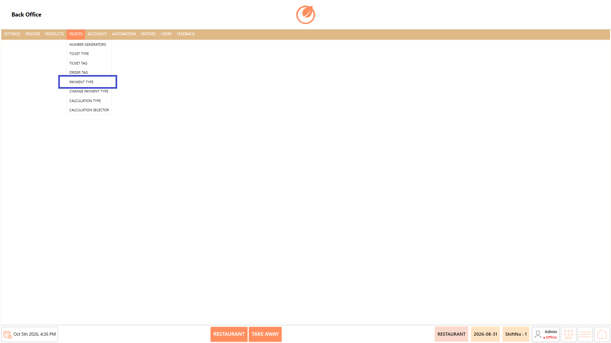<figcaption></figcaption></figure>

### **Screen Elements** 

#### **Payment Type List** 

| **Screen Element**  | **Description**                                                          |
| ------------------- | ------------------------------------------------------------------------ |
| Payment Type List   | Displays the available payment types.                                    |
| Search              | Allows you to search for a specific payment type.                        |
| Add Payment Type    | Opens the screen to create a new payment type.                           |
| Edit Payment Type   | Allows you to modify the selected payment type.                          |
| Delete Payment Type | Deletes the selected payment type after confirmation.                    |
| Sort Payment Types  | Opens the sorting window to arrange payment types in the required order. |
| Close               | Closes the Payment Type screen.                                          |

#### **General Settings** 

| **Screen Element**       | **Description**                                                                                                                                                                                     |
| ------------------------ | --------------------------------------------------------------------------------------------------------------------------------------------------------------------------------------------------- |
| Name                     | Specifies the name of the payment type.                                                                                                                                                             |
| Image Path               | Specifies the image path associated with the payment type.                                                                                                                                          |
| Account Transaction Type | Specifies the account transaction type.                                                                                                                                                             |
| Account                  | Specifies the account associated with the payment type.                                                                                                                                             |
| Button Color             | Specifies the color of the payment type button.                                                                                                                                                     |
| Font Size                | Specifies the font size displayed on the payment type button.                                                                                                                                       |
| Group                    | Specifies the group for the payment type.                                                                                                                                                           |
| Account Code             | Specifies the account code.                                                                                                                                                                         |
| Toggles                  | Allows you to configure options such as No Change Display, Display Value in Shift Close, No Refund, Auto Payment, Non Editable, Enable Tip, Requires Authentication, Allow Over Tender, and Active. |
| Tender Type              | Specifies the tender type.                                                                                                                                                                          |
| Payment Tag              | Specifies the payment tag.                                                                                                                                                                          |
| Alternate Names          | Specifies alternate names for the payment type.                                                                                                                                                     |
| Save                     | Saves the payment type configuration.                                                                                                                                                               |

#### **Payment Processors** 

| **Screen Element** | **Description**                                       |
| ------------------ | ----------------------------------------------------- |
| Add                | Adds a payment processor.                             |
| Remove             | Removes the selected payment processor.               |
| Settings           | Provides settings for the selected payment processor. |
| Name               | Displays the name of the payment processor.           |
| Description        | Displays the description of the payment processor.    |

### **Working** 

#### **Add a Payment Type** 

1. Select "Add Payment Type".

<figure>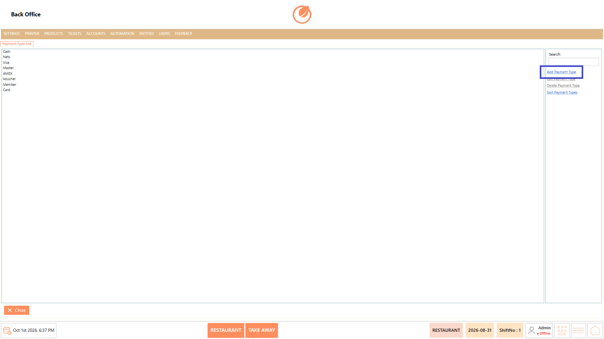<figcaption></figcaption></figure>

2. Enter the required details in "Name" and configure the required settings under "General Settings".

<figure>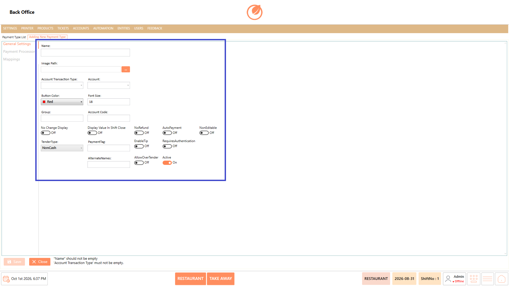<figcaption></figcaption></figure>

3. Open "Payment Processors" and select "ADD" to configure the required payment processor settings.

<figure>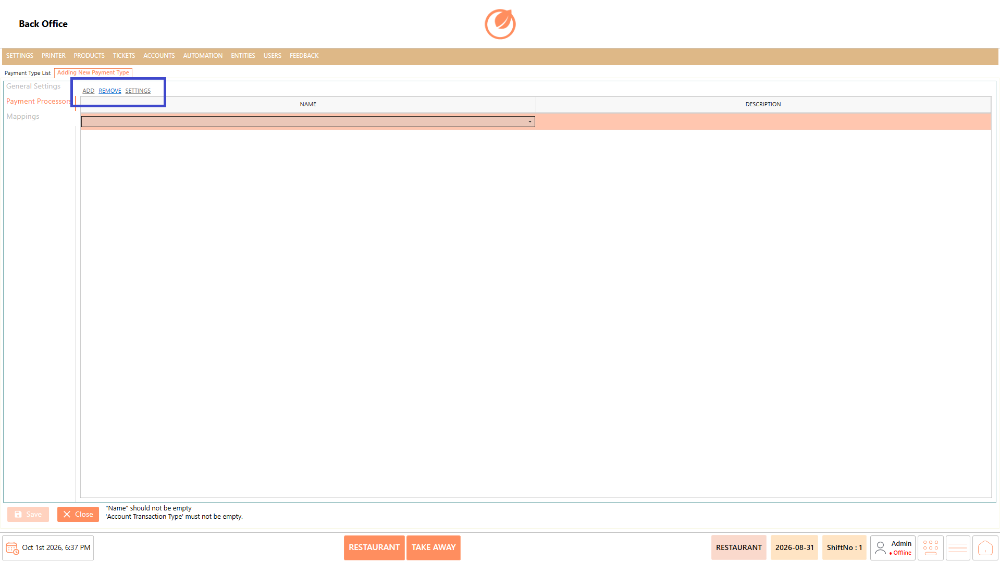<figcaption></figcaption></figure>

4. Open "Mappings" and select "Add" to configure the required terminal, user role, department, and ticket type.

<figure>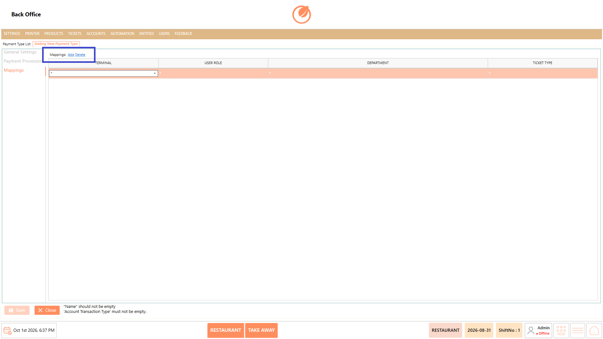<figcaption></figcaption></figure>

5. Select "Save" to create the payment type.

<figure><figcaption></figcaption></figure>

#### **Edit a Payment Type** 

1. Select the payment type that needs to be modified.
2. Select "Edit Payment Type".

<figure>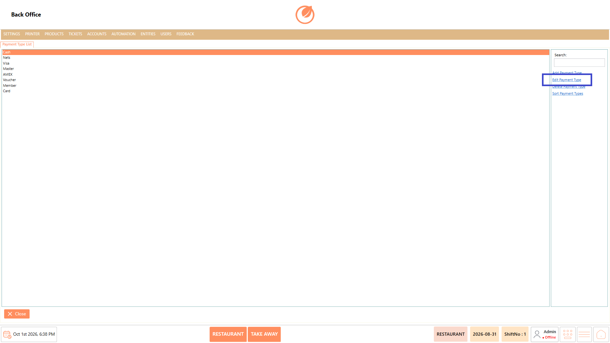<figcaption></figcaption></figure>

3. Update the required general settings, payment processor settings, or mappings.
4. Select "Save" to save the changes.

<figure>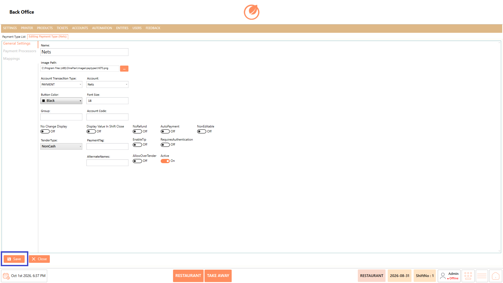<figcaption></figcaption></figure>

#### **Delete a Payment Type** 

1. Select the payment type that needs to be deleted.
2. Select "Delete Payment Type".

<figure>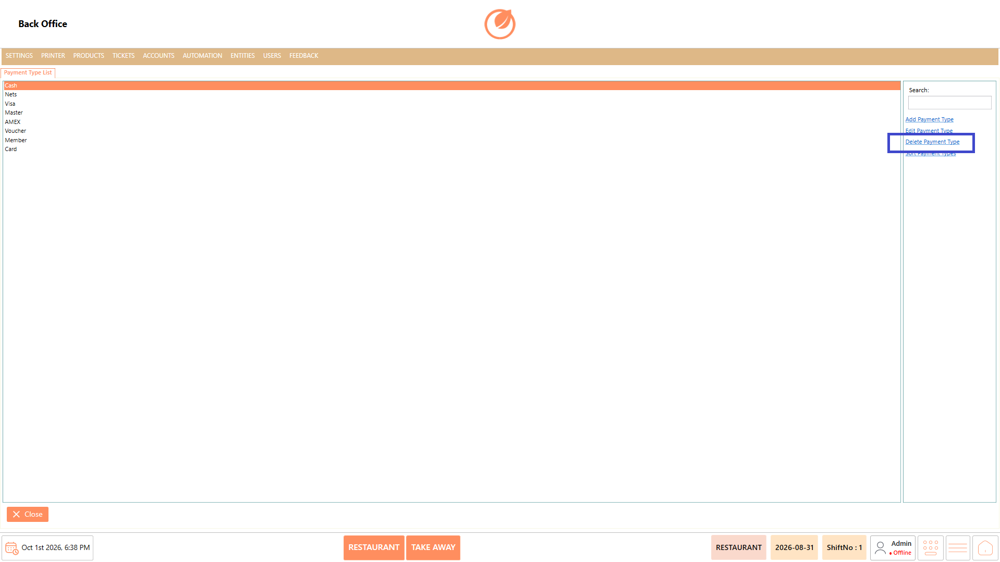<figcaption></figcaption></figure>

3. In the confirmation message, select "Yes" to delete the payment type.

<figure>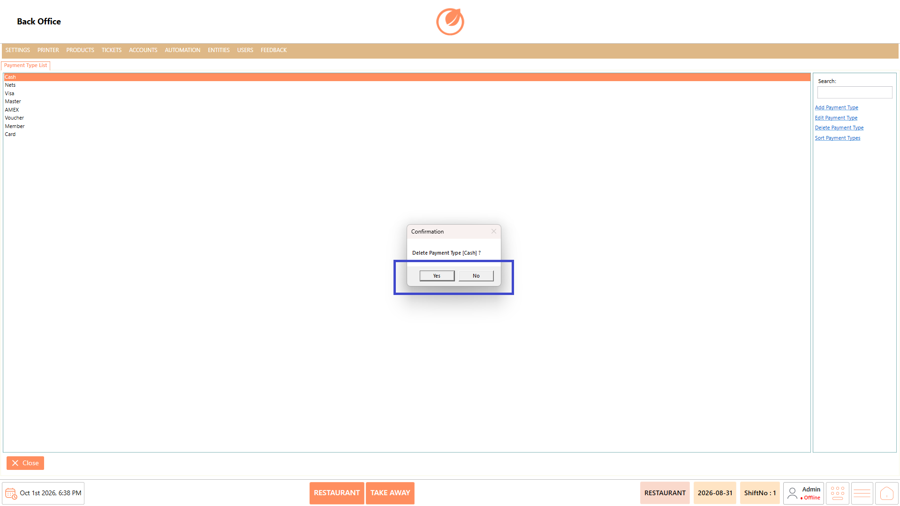<figcaption></figcaption></figure>

#### **Sort Payment Types** 

1. Select "Sort Payment Types".

<figure>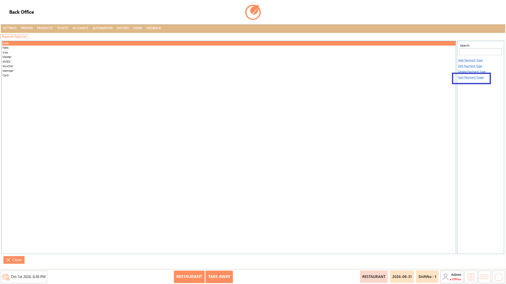<figcaption></figcaption></figure>

2. Drag the payment types to arrange them in the required order.

<figure>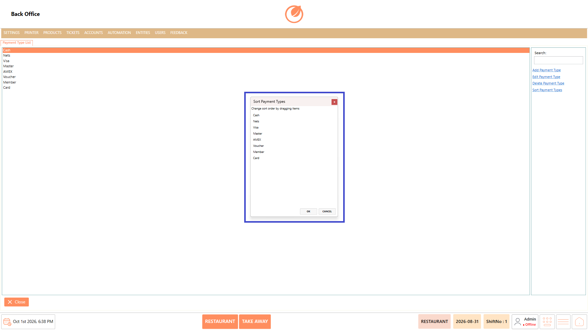<figcaption></figcaption></figure>

3. Select "OK" to apply the changes.

<figure>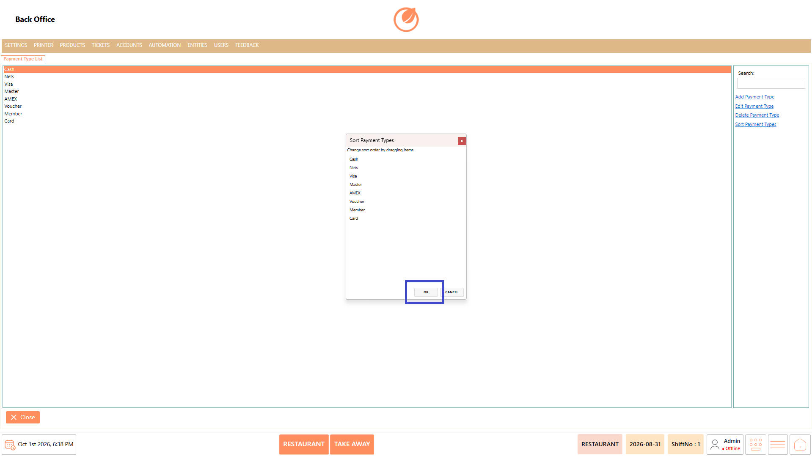<figcaption></figcaption></figure>

### **Use Case** 

* Create a new payment type for an additional payment method.
* Configure the account and transaction settings associated with a payment type.
* Configure payment processors for supported payment methods.
* Map a payment type to specific terminals, user roles, departments, or ticket types.
* Modify existing payment type settings when operational requirements change.
* Delete payment types that are no longer required.
* Arrange payment types in a preferred order for easier access.
* Search for a specific payment type when managing a large list.

### **Notes** 

* Enter the required "Name" before saving a new payment type.
* "Account Transaction Type" is required when creating a payment type.
* Review the configured payment processor and mappings before saving.
* Deleting a payment type requires confirmation.
* Use "Sort Payment Types" to change the display order of payment types.
* Use "Search" to quickly locate a payment type in the list.
