# Ticket Tags

### **Overview** 

The Ticket Tags setting allows you to manage tags used for tickets. You can add new ticket tags, edit existing tags, delete tags, and change their display order. Each ticket tag can also be configured with general settings, sub tags, and mappings.

<figure>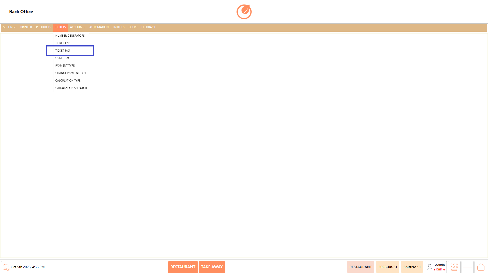<figcaption></figcaption></figure>

### **Screen Elements** 

#### **Ticket Tag List** 

| **Screen Element** | **Description**                                     |
| ------------------ | --------------------------------------------------- |
| Ticket Tag List    | Displays the available ticket tags.                 |
| Search             | Allows you to search for a specific ticket tag.     |
| Add Ticket Tag     | Opens the screen to create a new ticket tag.        |
| Edit Ticket Tag    | Allows you to modify the selected ticket tag.       |
| Delete Ticket Tag  | Deletes the selected ticket tag after confirmation. |
| Sort Ticket Tags   | Allows you to change the order of the ticket tags.  |
| Close              | Closes the Ticket Tag screen.                       |

#### **General Settings** 

| **Screen Element**         | **Description**                                                        |
| -------------------------- | ---------------------------------------------------------------------- |
| Ticket Tag Name            | Specifies the name of the ticket tag.                                  |
| DisplayName                | Specifies the display name for the ticket tag.                         |
| Selection Required         | Controls whether selecting the ticket tag is required.                 |
| Ask Before Creating Ticket | Controls whether the system asks for the tag before creating a ticket. |
| Free Tagging               | Allows free tagging when enabled.                                      |
| Save Free Tags             | Saves tags entered through free tagging when enabled.                  |
| Tagging Type               | Specifies the tagging type.                                            |
| Free Tag Maximum Length    | Specifies the maximum length allowed for a free tag.                   |
| When Tagged                | Specifies the button color displayed when the ticket is tagged.        |
| When Untagged              | Specifies the button color displayed when the ticket is not tagged.    |
| Save                       | Saves the ticket tag configuration.                                    |
| Close                      | Closes the ticket tag configuration screen.                            |

### **Working** 

#### **Add a Ticket Tag** 

1. Select "Add Ticket Tag" from the Ticket Tag List.

<figure>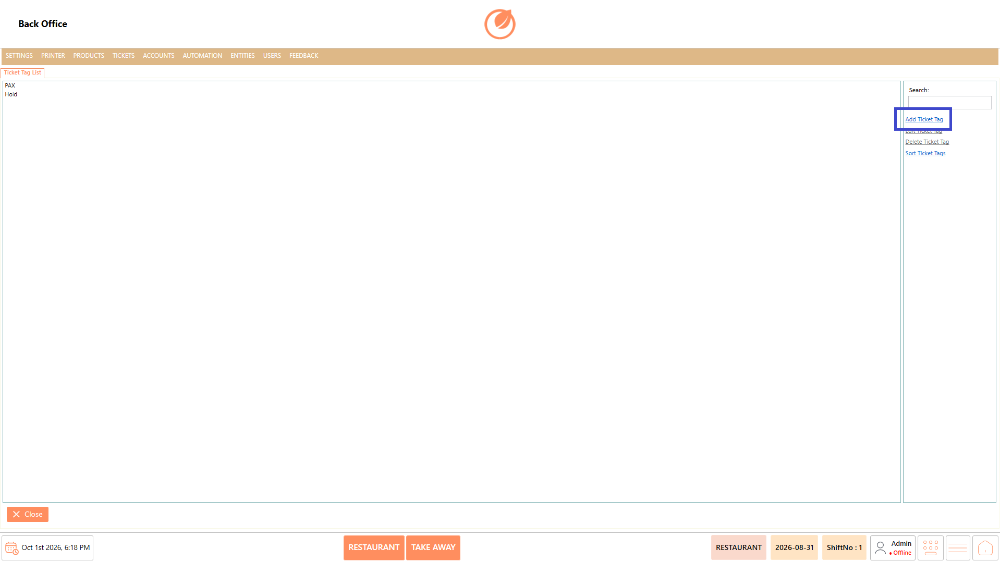<figcaption></figcaption></figure>

2. In General Settings, enter the Ticket Tag Name and DisplayName.
3. Configure the required options, such as "Selection Required", "Ask Before Creating Ticket", and "Free Tagging".
4. Select the required "Tagging Type" and configure "Free Tag Maximum Length", if applicable.
5. Configure the button colors for "When Tagged" and "When Untagged".

<figure>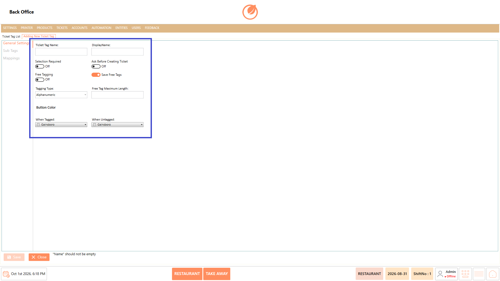<figcaption></figcaption></figure>

6. Select "Sub Tags" to add and manage sub tags, if required.
7. Select "Add Tag".
8. Enter the sub tag name in the "New Tag" field.
9. Enter the "Alias Name", if required.

<figure>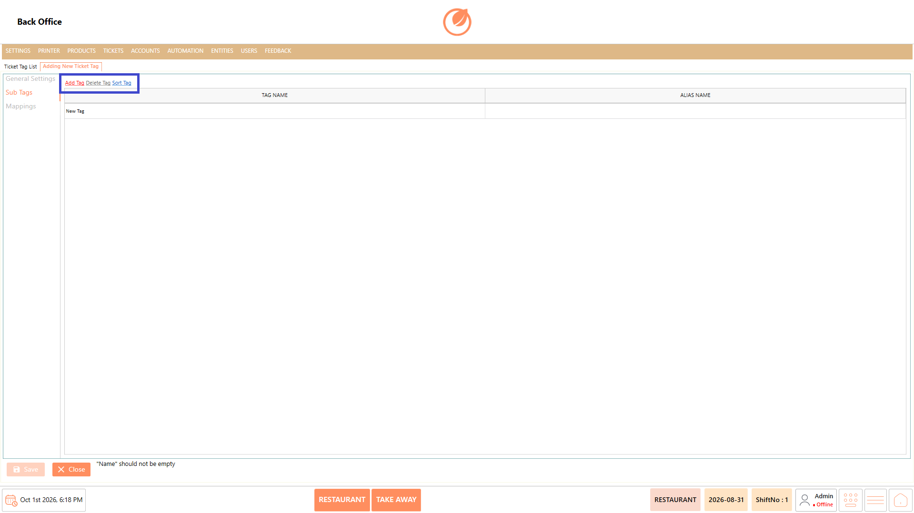<figcaption></figcaption></figure>

10. Select "Mappings" to add mapping details, if required.
11. Select "Add".
12. Select the required values for "Terminal", "User Role", "Department", "Ticket Type", and "DefaultValue".

<figure>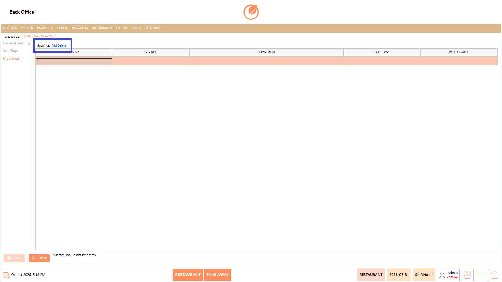<figcaption></figcaption></figure>

13. Select "Save" to save the ticket tag.

<figure><figcaption></figcaption></figure>

#### **Edit a Ticket Tag** 

1. Select the required ticket tag from the Ticket Tag List.
2. Select "Edit Ticket Tag".

<figure>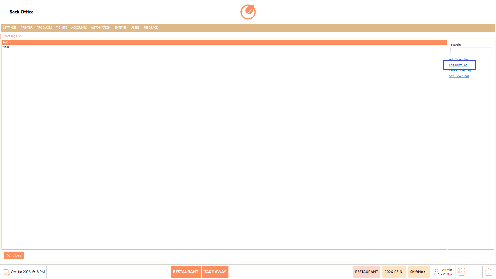<figcaption></figcaption></figure>

3. Modify the required configuration.
4. Select "Save" to apply the changes.

<figure>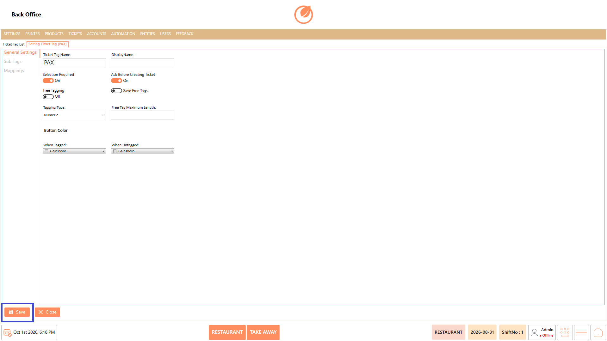<figcaption></figcaption></figure>

#### **Delete a Ticket Tag** 

1. Select the ticket tag you want to remove.
2. Select "Delete Ticket Tag".

<figure><figcaption></figcaption></figure>

3. In the confirmation message, select "Yes" to delete the ticket tag.

<figure>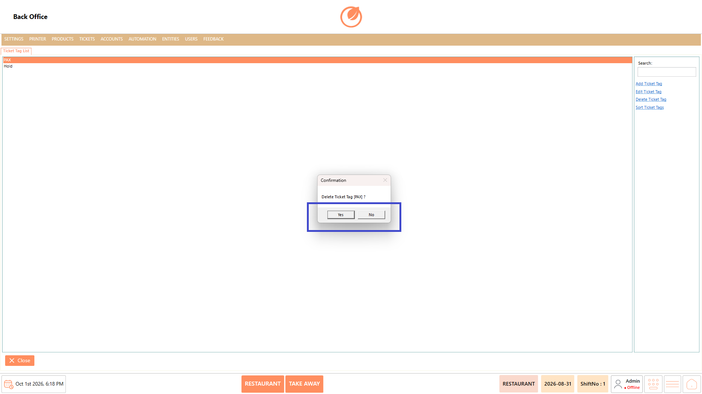<figcaption></figcaption></figure>

#### **Sort Ticket Tags** 

1. Select "Sort Ticket Tags" from the Ticket Tag List.

<figure>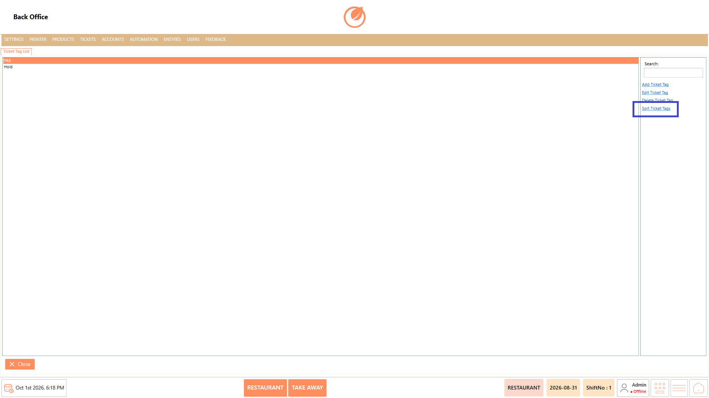<figcaption></figcaption></figure>

2. Drag the accounts to arrange them in the required order.

<figure>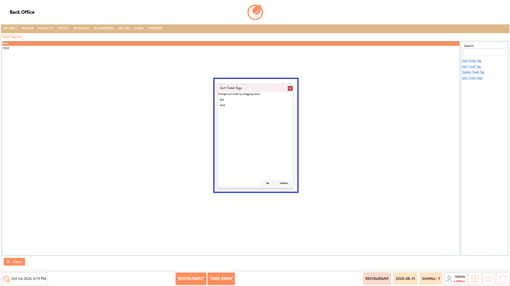<figcaption></figcaption></figure>

3. Select "OK" to apply the changes.

<figure>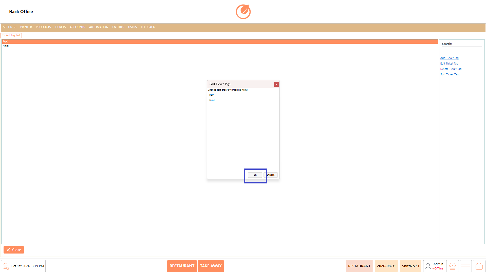<figcaption></figcaption></figure>

### **Use Case** 

* Create ticket tags to categorize and organize tickets.
* Configure whether selecting a ticket tag is required when creating tickets.
* Allow users to enter tags manually using "Free Tagging".
* Create sub tags to provide additional tagging options.
* Configure aliases for sub tags using "Alias Name".
* Define mappings based on terminal, user role, department, and ticket type.
* Edit existing ticket tags when their configuration needs to be updated.
* Sort or delete ticket tags to maintain an organized tag list.

### **Notes** 

* "Ticket Tag Name" must be provided before saving a ticket tag.
* Use "DisplayName" to define how the tag is displayed.
* "Selection Required" can be enabled when a ticket tag must be selected.
* "Free Tagging" allows users to enter tags manually when enabled.
* Configure "Free Tag Maximum Length" when a character limit is required for free tags.
* Sub tags can be added, deleted, and sorted within a ticket tag.
* Mappings can be configured using "Terminal", "User Role", "Department", and "Ticket Type".
* Deleting a ticket tag requires confirmation.
