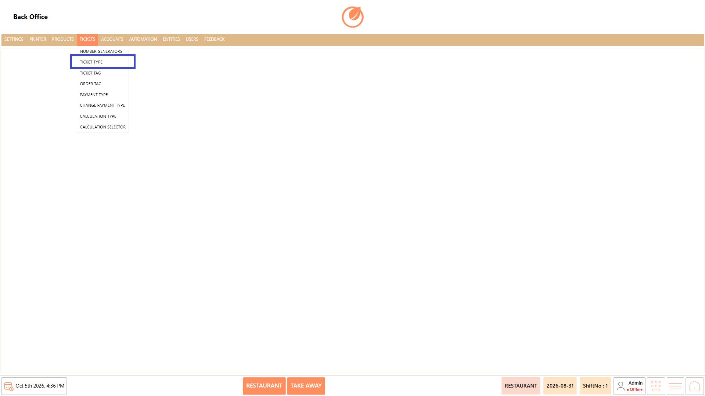
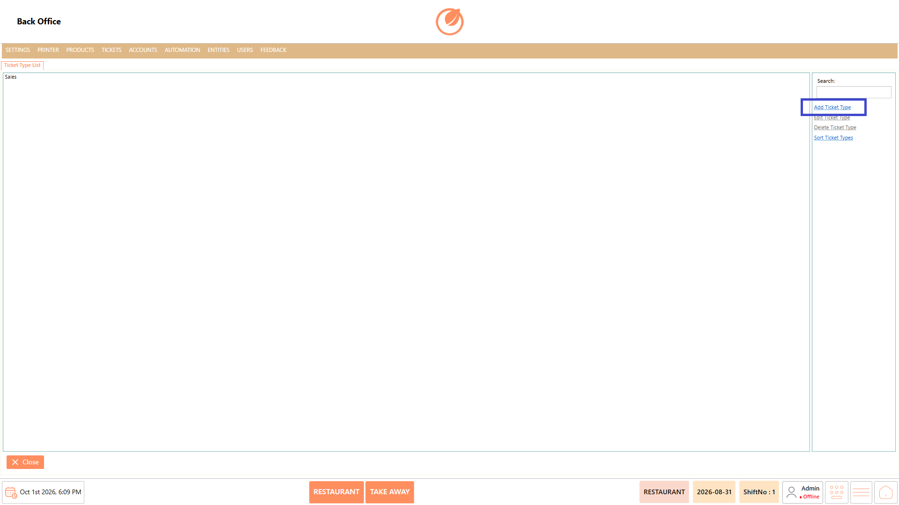
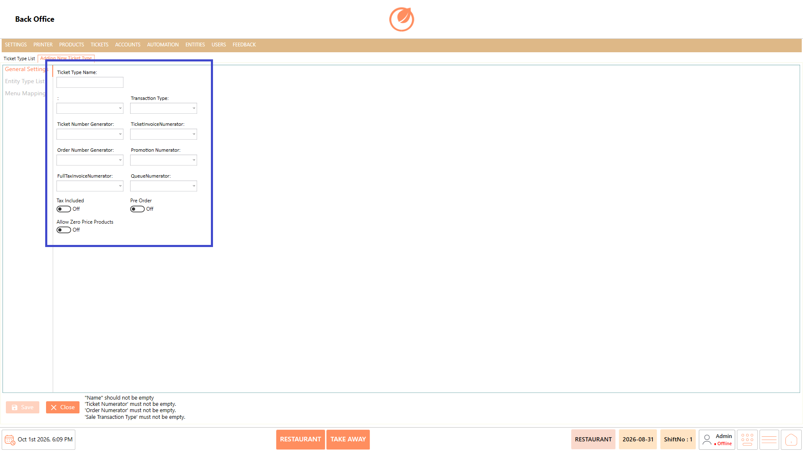
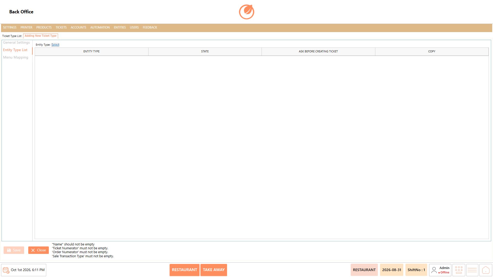
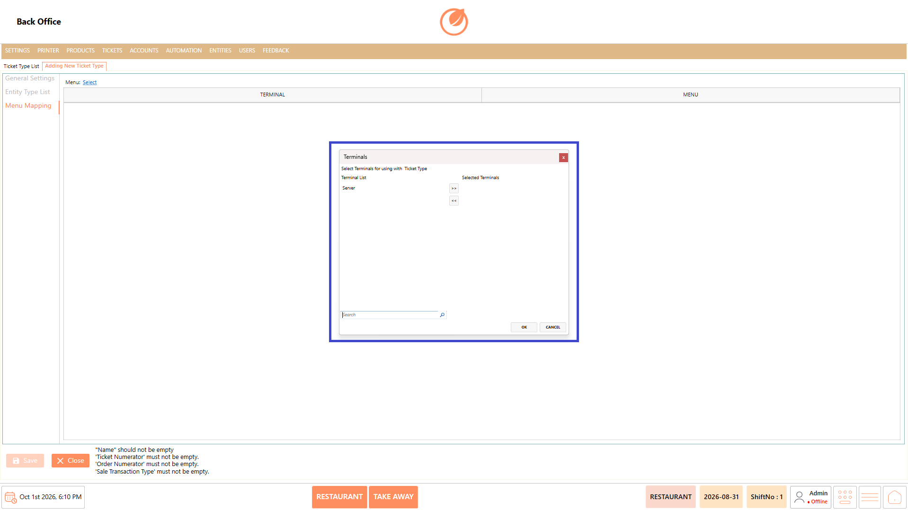
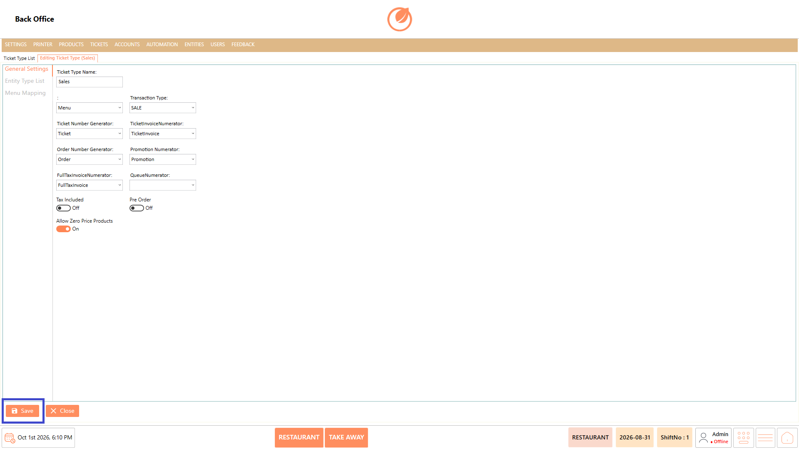
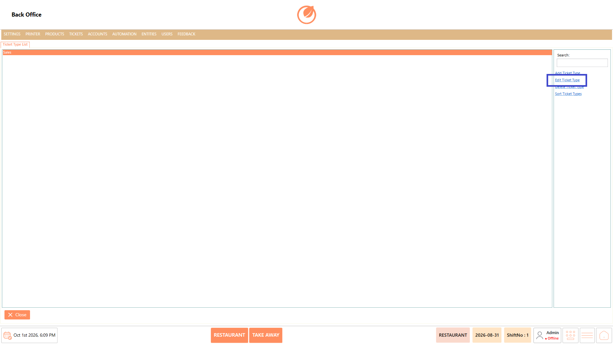
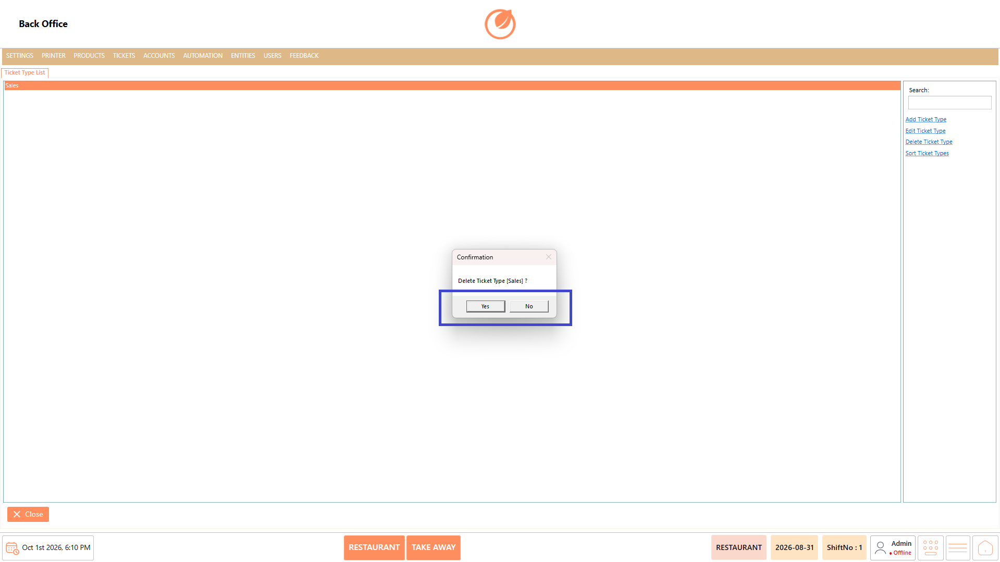
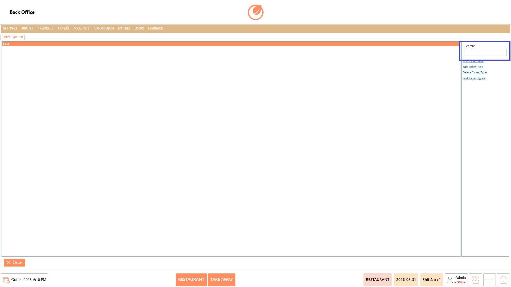

# Ticket Types

### **Overview** 

The Ticket Types setting allows you to manage the different types of tickets used in the system. You can add, edit, delete, and sort ticket types. While creating or editing a ticket type, you can configure its general settings, associate entity types, and map the ticket type to specific terminals and menus.

<figure><figcaption></figcaption></figure>

### **Screen Elements** 

| **Screen Element**        | **Description**                                                                      |
| ------------------------- | ------------------------------------------------------------------------------------ |
| Ticket Type List          | Displays the available ticket types.                                                 |
| Search                    | Allows you to search for a specific ticket type.                                     |
| Add Ticket Type           | Opens the screen to create a new ticket type.                                        |
| Edit Ticket Type          | Opens the selected ticket type for editing.                                          |
| Delete Ticket Type        | Deletes the selected ticket type after confirmation.                                 |
| Sort Ticket Types         | Allows you to change the order of the ticket types.                                  |
| Ticket Type Name          | Specifies the name of the ticket type.                                               |
| Transaction Type          | Specifies the transaction type associated with the ticket type.                      |
| Ticket Number Generator   | Specifies the number generator used for tickets.                                     |
| TicketInvoiceNumerator    | Specifies the numerator used for ticket invoices.                                    |
| Order Number Generator    | Specifies the number generator used for orders.                                      |
| Promotion Numerator       | Specifies the numerator used for promotions.                                         |
| FullTaxInvoiceNumerator   | Specifies the numerator used for full tax invoices.                                  |
| QueueNumerator            | Specifies the numerator used for queue numbers.                                      |
| Tax Included              | Determines whether tax is included for the ticket type.                              |
| Pre Order                 | Determines whether the ticket type is configured for pre-orders.                     |
| Allow Zero Price Products | Determines whether zero-price products can be used with the ticket type.             |
| Entity Type List          | Allows you to select and configure the entity types associated with the ticket type. |
| Menu Mapping              | Allows you to map the ticket type to the required terminals and menus.               |
| Save                      | Saves the ticket type configuration.                                                 |
| Close                     | Closes the current screen.                                                           |

### **Working** 

#### **Add a Ticket Type** 

1. Select "Add Ticket Type".

<figure><figcaption></figcaption></figure>

2. Enter the required details in "Ticket Type Name" and configure the required settings.

<figure><figcaption></figcaption></figure>

3. Open "Entity Type List" and select the required entity types.

<figure><figcaption></figcaption></figure>

4. Select “Select” and configure the entity type settings as required.

<figure><figcaption></figcaption></figure>

5. Open "Menu Mapping" and select the required terminals and menus.

<figure><figcaption></figcaption></figure>

6. Select "Save" to create the ticket type.

<figure><figcaption></figcaption></figure>

#### **Edit a Ticket Type** 

1. Select the ticket type that needs to be modified.
2. Select "Edit Ticket Type".

<figure><figcaption></figcaption></figure>

3. Update the required settings, entity types, or menu mappings.
4. Select "Save" to save the changes.

<figure><figcaption></figcaption></figure>

#### **Delete a Ticket Type** 

1. Select the ticket type that needs to be deleted.
2. Select "Delete Ticket Type".

<figure><figcaption></figcaption></figure>

3. In the confirmation message, select "Yes" to delete the ticket type.

<figure><figcaption></figcaption></figure>

#### **Sort Ticket Types** 

1. Select "Sort Ticket Types".

<figure><figcaption></figcaption></figure>

2. Arrange the ticket types in the required order.

#### **Search for a Ticket Type** 

1. Enter the required text in "Search".

<figure><figcaption></figcaption></figure>

2. Select or review the matching ticket type from the list.

### **Use Case** 

* Create ticket types based on different transaction requirements.
* Configure ticket and order number generation for each ticket type.
* Define tax and pre-order settings for specific ticket types.
* Allow zero-price products where required.
* Associate relevant entity types with a ticket type.
* Configure entity-related settings before creating tickets.
* Map ticket types to the required terminals and menus.

### **Notes** 

* Ensure the required fields are configured before selecting "Save".
* Review the selected entity types before confirming the configuration.
* Verify the terminal and menu mappings for the ticket type.
* Deleting a ticket type requires confirmation.
* Use "Search" to quickly locate a ticket type.
* Use "Sort Ticket Types" to arrange ticket types in the required order.
