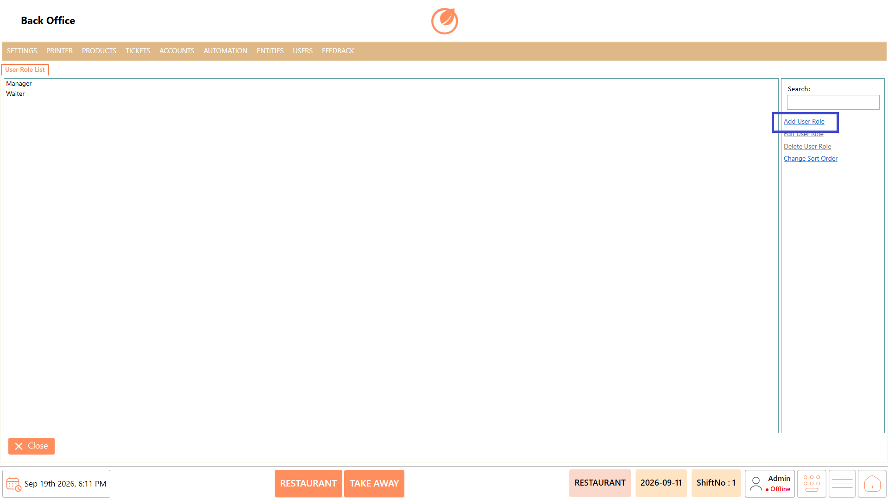
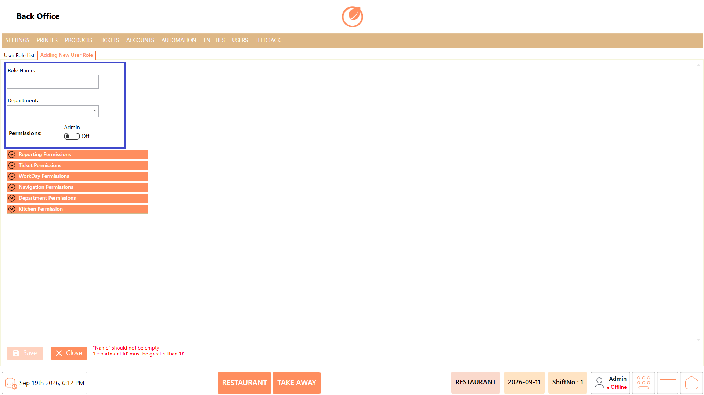
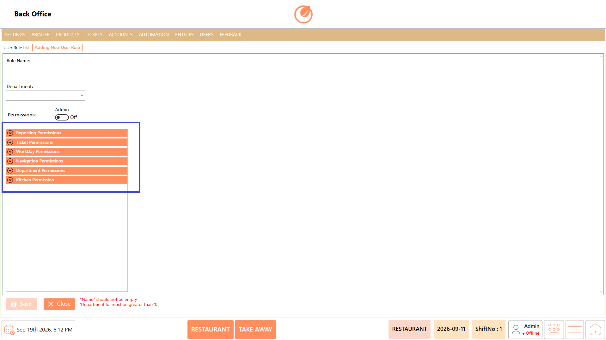
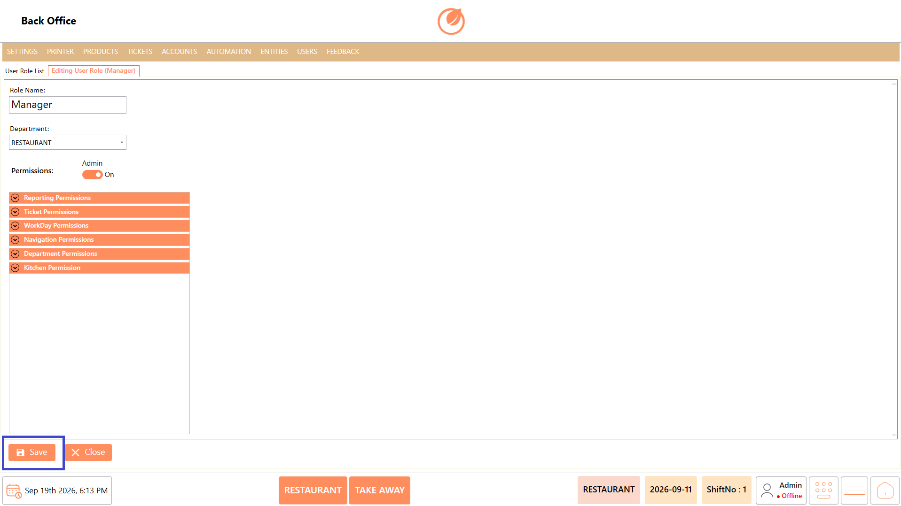
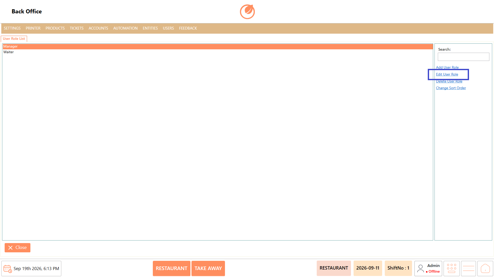
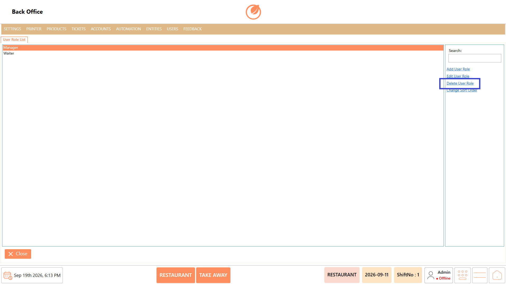
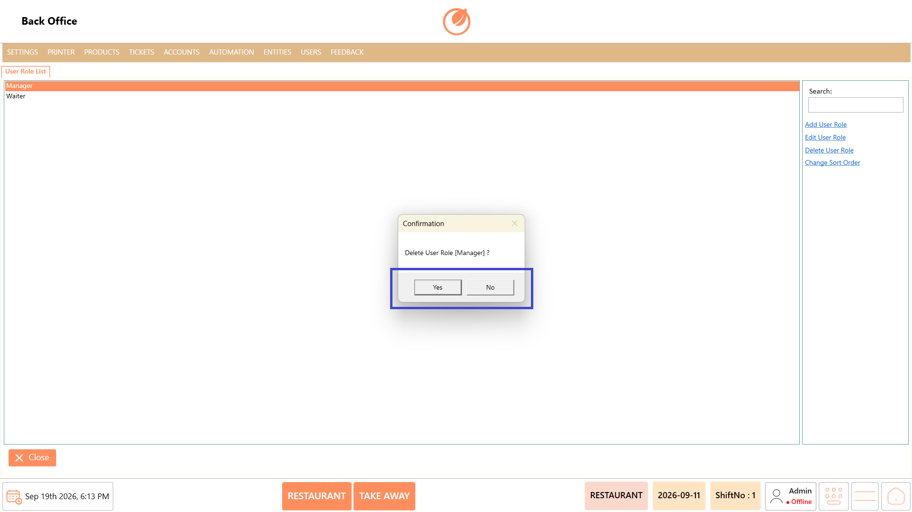
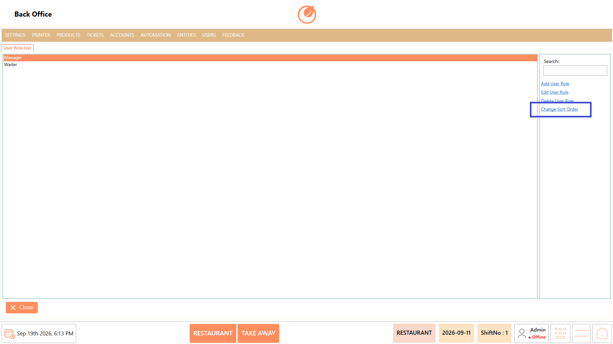

# User Roles

### **Overview** 

The User Roles setting allows administrators to create and manage roles for users in DinePlan. Each role can be associated with a department and configured with specific permissions. Existing roles can also be edited, deleted, or arranged in the required order.

<figure><figcaption></figcaption></figure>

### **Screen Elements** 

| **Screen Element**     | **Description**                                             |
| ---------------------- | ----------------------------------------------------------- |
| User Role List         | Displays the list of existing user roles.                   |
| Search                 | Allows users to search for a specific user role.            |
| Add User Role          | Creates a new user role.                                    |
| Edit User Role         | Opens the selected user role for editing.                   |
| Delete User Role       | Deletes the selected user role after confirmation.          |
| Change Sort Order      | Allows users to change the display order of user roles.     |
| Role Name              | Specifies the name of the user role.                        |
| Department             | Specifies the department associated with the user role.     |
| Admin                  | Enables or disables administrator access for the role.      |
| Reporting Permissions  | Provides permission settings related to reporting.          |
| Ticket Permissions     | Provides permission settings related to tickets.            |
| WorkDay Permissions    | Provides permission settings related to WorkDay.            |
| Navigation Permissions | Provides permission settings related to navigation.         |
| Department Permissions | Provides permission settings related to departments.        |
| Kitchen Permission     | Provides permission settings related to kitchen operations. |
| Save                   | Saves the new role or changes made to an existing role.     |
| Close                  | Closes the User Role screen.                                |

### **Working** 

#### **Add User Role** 

1. Select "Add User Role".

<figure><figcaption></figcaption></figure>

2. Enter the "Role Name".
3. Select the required "Department".
4. Configure the "Admin" option, if required.

<figure><figcaption></figcaption></figure>

5. Expand the required permission sections and configure the permissions.

<figure><figcaption></figcaption></figure>

6. Select "Save" to create the user role.

<figure><figcaption></figcaption></figure>

#### **Edit User Role** 

1. Select the required user role from the list.
2. Select "Edit User Role".

<figure><figcaption></figcaption></figure>

3. Update the required role details or permissions.
4. Select "Save" to save the changes.

<figure><figcaption></figcaption></figure>

#### **Delete User Role** 

1. Select the user role you want to delete.
2. Select "Delete User Role".

<figure><figcaption></figcaption></figure>

3. A confirmation message is displayed.
4. Select "Yes" to delete the role or "No" to cancel.

<figure><figcaption></figcaption></figure>

#### **Change Sort Order** 

1. Select "Change Sort Order".

<figure><figcaption></figcaption></figure>

2. Arrange the user roles in the required order.
3. Save the updated order.

### **Use Case** 

* Create roles for different categories of users.
* Assign a department to a user role.
* Configure administrator access for a role.
* Control access to reporting features.
* Configure ticket-related permissions.
* Manage WorkDay-related permissions.
* Control navigation and department permissions.
* Configure kitchen-related permissions based on the role.

### **Notes** 

* Role Name and Department are required when creating a user role.
* Permission categories can be expanded to configure the required access.
* A confirmation is required before deleting a user role.
* Use "Change Sort Order" to control how user roles are displayed in the list.
