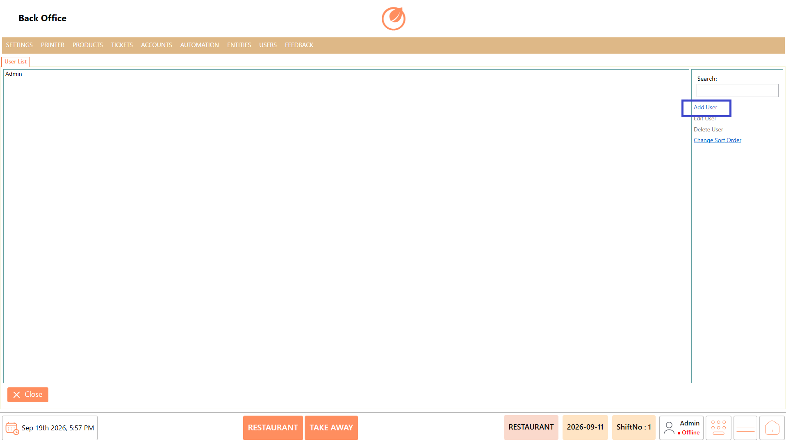
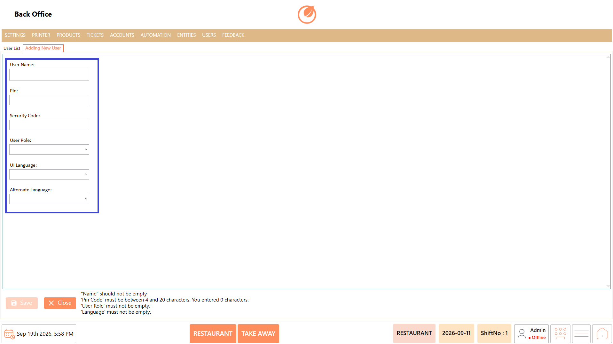
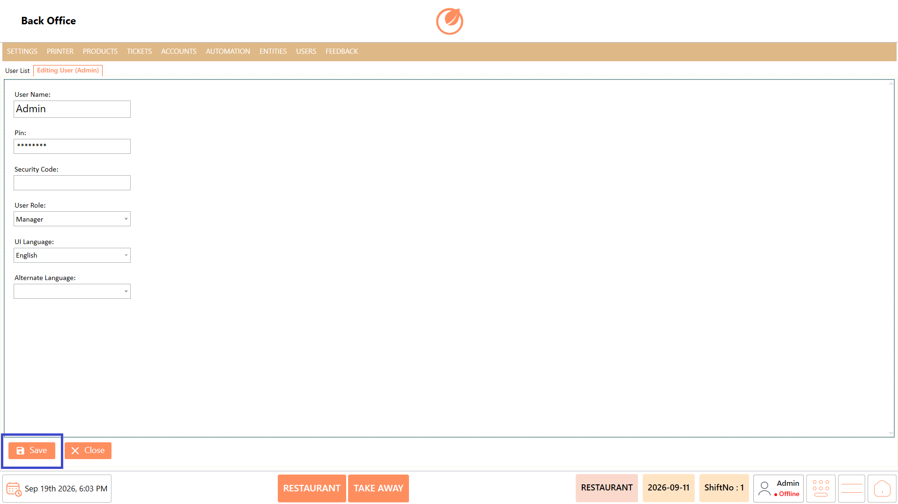
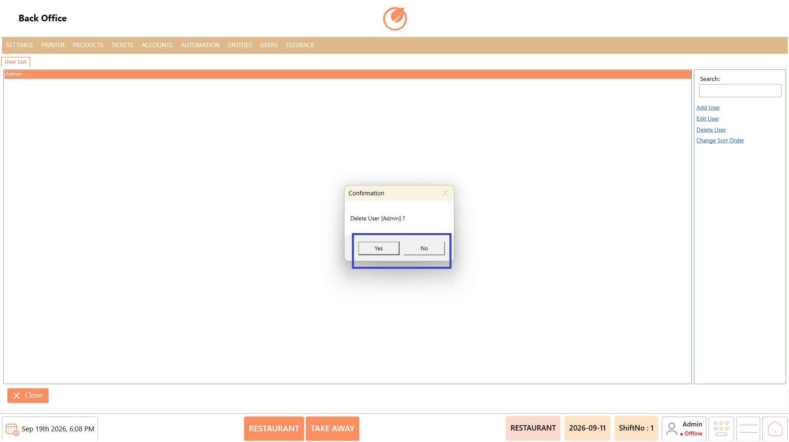
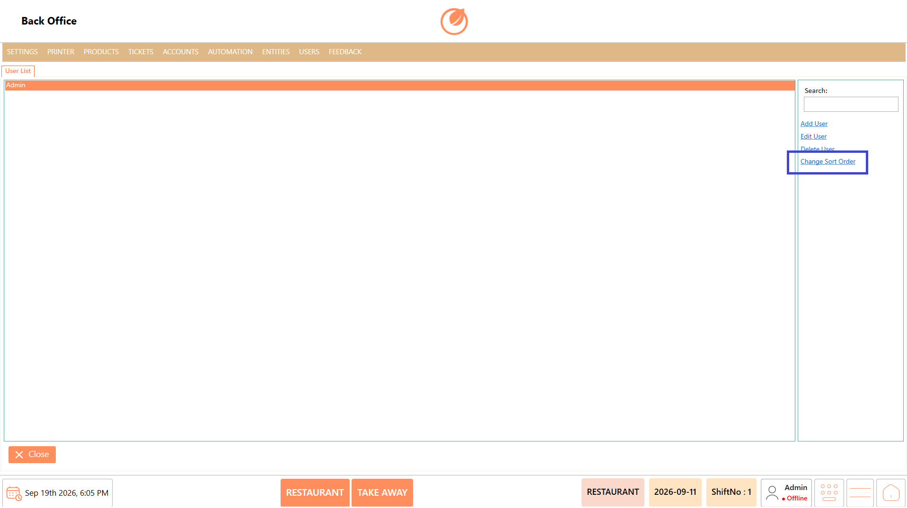

# Users

### **Overview** 

The Users setting allows administrators to manage users in DinePlan. Users can be added with login and access details, edited when required, deleted when no longer needed, and arranged in a preferred order.

<figure><figcaption></figcaption></figure>

### **Screen Elements** 

| **Screen Element** | **Description**                                                  |
| ------------------ | ---------------------------------------------------------------- |
| User List          | Displays the list of existing users.                             |
| Search             | Allows users to search for a specific user.                      |
| Add User           | Creates a new user and allows configuration of the user details. |
| Edit User          | Opens the selected user for editing.                             |
| Delete User        | Deletes the selected user after confirmation.                    |
| Change Sort Order  | Allows users to change the order in which users are displayed.   |
| User Name          | Specifies the name of the user.                                  |
| Pin                | Specifies the PIN used by the user.                              |
| Security Code      | Specifies the security code for the user.                        |
| User Role          | Specifies the role assigned to the user.                         |
| UI Language        | Specifies the language used in the DinePlan interface.           |
| Alternate Language | Specifies an alternate language for the user.                    |
| Save               | Saves the user details or changes.                               |
| Close              | Closes the User settings screen.                                 |

### **Working** 

#### **Add User** 

1. Select "Add User".

<figure><figcaption></figcaption></figure>

2. Enter the "User Name", "Pin", and "Security Code".
3. Select the required "User Role".
4. Select the "UI Language" and "Alternate Language", as required.

<figure><figcaption></figcaption></figure>

5. Select "Save" to create the user.

<figure><figcaption></figcaption></figure>

#### **Edit User** 

1. Select the required user from the User List.
2. Select "Edit User".

<figure><figcaption></figcaption></figure>

3. Update the required user details.
4. Select "Save" to save the changes.

<figure><figcaption></figcaption></figure>

#### **Delete User** 

1. Select the user you want to delete.
2. Select "Delete User".

<figure><figcaption></figcaption></figure>

3. A confirmation message is displayed.
4. Select "Yes" to delete the user or "No" to cancel.

<figure><figcaption></figcaption></figure>

#### **Change Sort Order** 

1. Select "Change Sort Order".

<figure><figcaption></figcaption></figure>

2. Arrange the users in the required order.
3. Save the updated order.

### **Use Case** 

* Create user accounts for restaurant staff.
* Assign appropriate User Roles to users.
* Configure PINs for user access.
* Configure security codes for users.
* Set the preferred UI language for each user.
* Edit user details when access information needs to be updated.
* Delete users who no longer require access.
* Arrange users in the required display order.

### **Notes** 

* User Name, Pin, User Role, and UI Language are required when creating a user.
* The Pin must contain between 4 and 20 characters.
* A confirmation is required before deleting a user.
