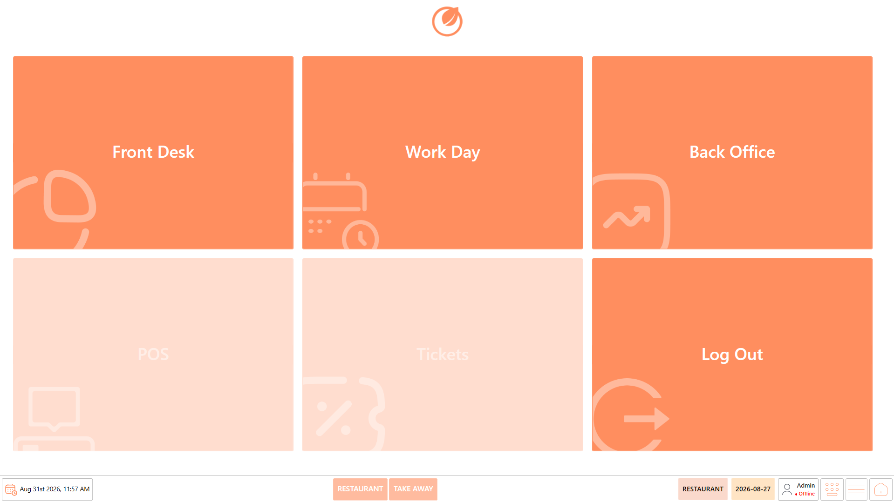
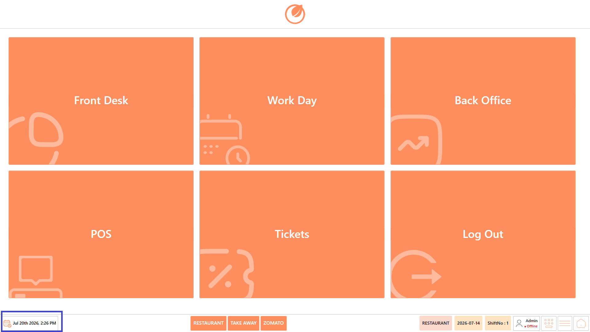
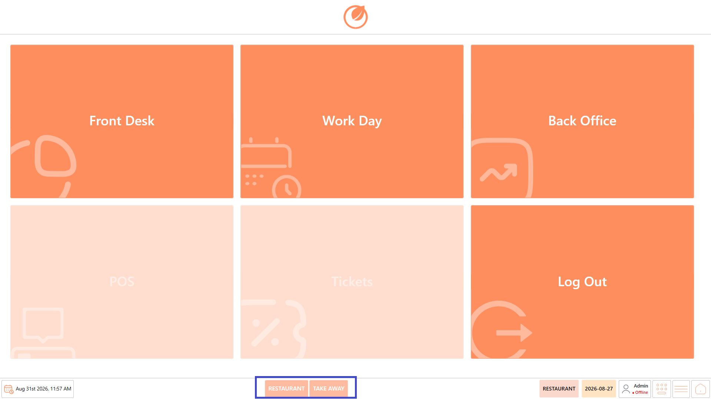
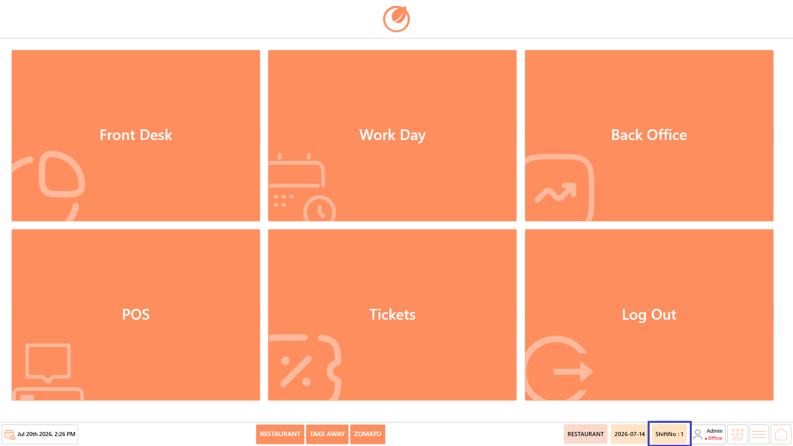
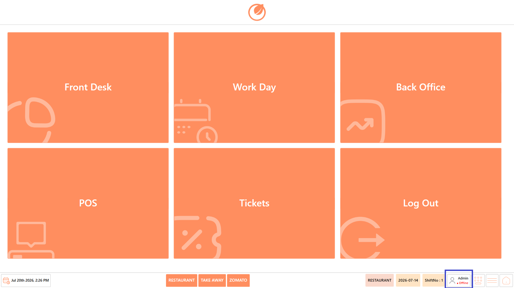
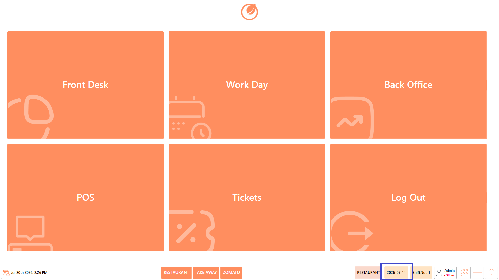
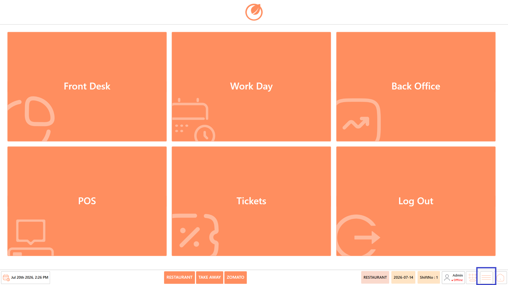
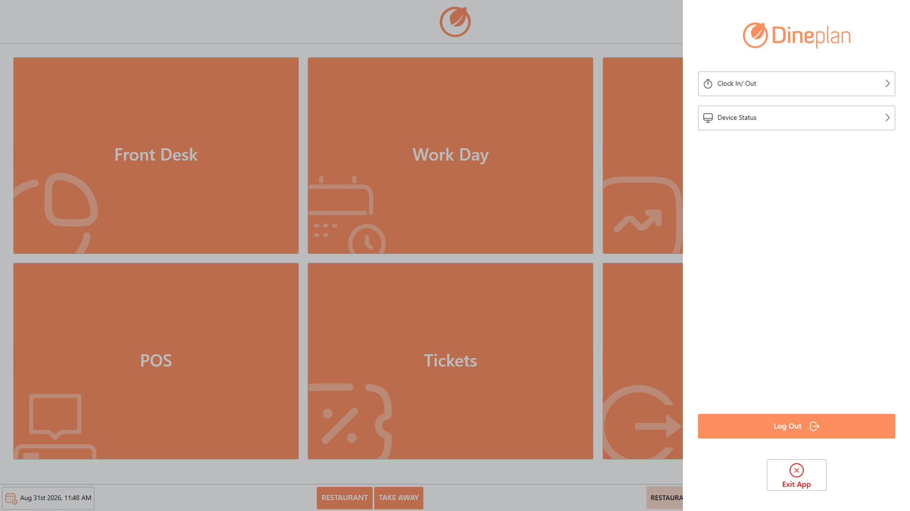

# Dashboard

## **Overview** 

It is the home screen of DinePlan after logging in. It provides quick access to all major operational modules required for restaurant billing and day-to-day restaurant operations.

From this screen, users can navigate to different functional areas based on their role and responsibilities.

## **Modules** 

The Dashboard provides access to the key modules required to manage daily restaurant operations. Each module supports a specific set of activities and becomes available based on the current operational status.

<figure><figcaption></figcaption></figure>

* [**Front Desk**](https://app.gitbook.com/s/0EE0WqKESoD8hlEpFQQL/front-desk) – Provides access to reports, till operations, sold-out items, and other front-desk functions. Use this module to review operational information and perform tasks related to front-desk and till management.
* [**Work Day**](https://app.gitbook.com/s/0EE0WqKESoD8hlEpFQQL/workday) – Used to manage the restaurant’s daily operations, including cashier attendance and the business day. Start the **Work Day** from this module to begin the day’s operations and enable the relevant system functions.
* [**Back Office**](https://app.gitbook.com/s/0EE0WqKESoD8hlEpFQQL/backoffice) – Provides access to restaurant administration, configuration, and management functions. Use this module to manage settings and perform administrative tasks that support the restaurant’s day-to-day operations.
* [**POS**](https://app.gitbook.com/s/0EE0WqKESoD8hlEpFQQL/pos) – Used to create customer orders, add items, generate bills, process payments, and complete transactions.

**Note:** The POS option becomes available once the **Work Day is started** and remains ready for processing customer transactions during the active work day.

* [**Tickets**](tickets/) – Used to view and manage active, pending, and completed order tickets throughout the restaurant.

**Note:** The Tickets option becomes available only after both the **Work Day and Work Shift are started**, allowing staff to manage and track order tickets.

* [**Log Out**](logout.md) – Allows the current user to securely sign out of the Dineplan application. Use this option when you have finished your activities or need to switch to a different user account.

## **Screen Elements** 

The screen includes quick-access options and status indicators that help users navigate the application. These elements provide important information about the current POS session and operational setup. Users should verify the department and shift details before proceeding with order-related activities.

### **Current Date & Time** 

**Purpose**

* Displays the current system date and time of the POS device.
* This helps users keep track of the current operating time and ensures that transactions are recorded with the correct date and time.

<figure><figcaption></figcaption></figure>

### **Department** 

**Purpose**

* Displays the available departments configured for the restaurant, such as Restaurant, Takeaway, or Drive-Thru.
* Each department may have different configurations for taxes, service charges, pricing, and other operational settings.
* Select the appropriate department before starting an order; if you access POS directly without selecting a department, the order will use the default Restaurant configuration.

<figure><figcaption></figcaption></figure>

### **Shift Number** 

**Purpose**

* Displays the active cashier shift assigned to the logged-in user.
* It indicates which work shift the user is currently operating under for processing transactions and managing cashier activities.
* The shift must be started as part of the work-day process before Tickets become available for use.

<figure><figcaption></figcaption></figure>

### **Logged-in User** 

**Purpose**

* Displays the name of the user currently logged in to the Dineplan application.
* It also indicates the current connection status of the POS, such as Online or Offline.
* This allows users to confirm the active account and quickly identify whether the POS has a network connection.

<figure><figcaption></figcaption></figure>

### **Keyboard** 

**Purpose**

* Select the Keyboard icon to open the on-screen keyboard for entering text within the application.
* It is useful when the POS device does not have a physical keyboard connected or when text needs to be entered using the touchscreen.

<figure><figcaption></figcaption></figure>

### **Business Date** 

**Purpose**

* Displays the active Business Date for the current workday.
* Use this date to confirm that the POS is operating under the correct business date before processing transactions.
* Verify that the previous business day has been closed before starting operations for the current business date.

<figure><figcaption></figcaption></figure>

### **Quick Menu** 

**Purpose**

* Select the **Quick Menu** icon to access commonly used utility and system options.
* This provides quick access to functions without having to navigate through the main Dashboard.

<figure><figcaption></figcaption></figure>

### **Available Options**

<figure><figcaption></figcaption></figure>

* **Clock In/Out** – Record employee clock-in and clock-out times and manage the user's attendance status.
* **Device Status** – View the current status of the POS device and check connected peripherals and system connectivity.
* **Log Out** – Securely log out of the current user account and return to the login screen.
* **Exit** – Close the Dineplan application completely and exit the POS system.

### **Home** 

**Purpose**

* Select the **Home** icon to return to the main Dashboard from the current screen.
* This provides a quick way to navigate back to the main modules without manually navigating through previous screens.

<figure><figcaption></figcaption></figure>

## Accessing the Modules

Once the user logs in to DinePlan, the **Dashboard** provides access to the available modules and features based on the user's permissions. Users can select the required module from the Dashboard to perform their respective restaurant operations.

**The following sections explain each module and the features available within it.**
