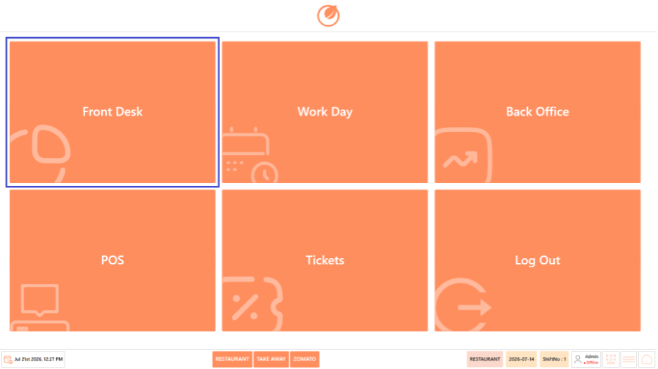
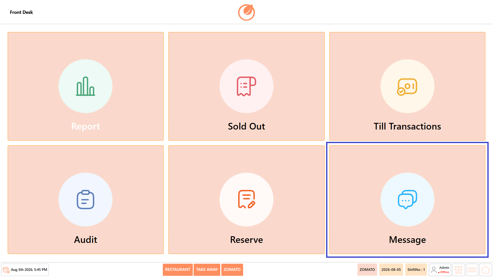
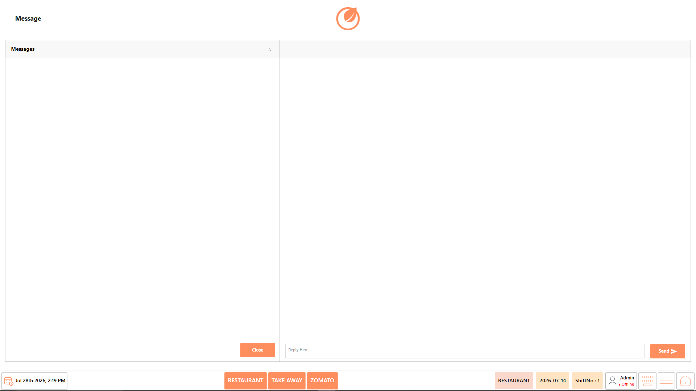
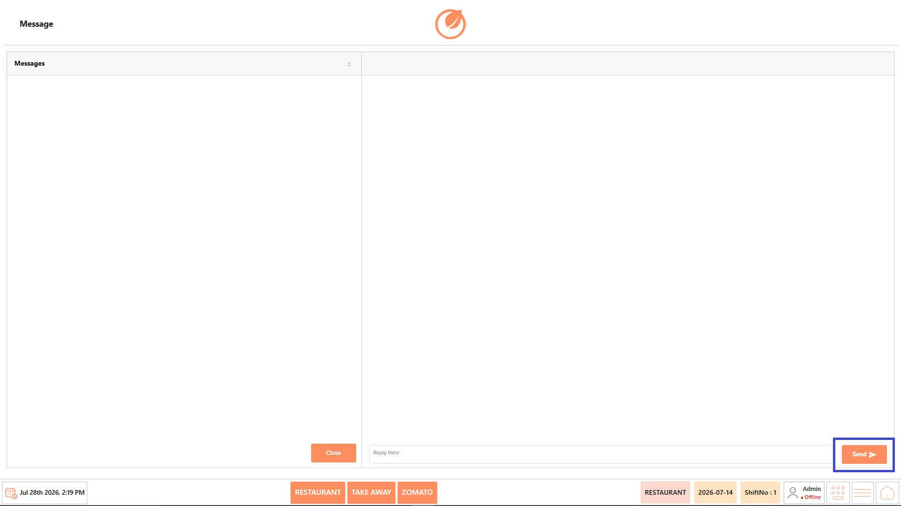

# Message

## **Overview** 

The Message screen allows users to view and respond to system or user-generated messages within DinePlan. It provides a centralized communication panel where incoming messages are displayed, conversations can be viewed, and replies can be sent without leaving the application.

## **Open the Message** 

1. Log in to DinePlan.
2. From the “Dashboard”, select “Front Desk”.

<figure><figcaption></figcaption></figure>

3. Select “Message”.

<figure><figcaption></figcaption></figure>

4. The Message screen opens.

## **Screen Elements** 

The Message screen allows users to view and respond to system or user-generated messages within DinePlan. It provides a centralized communication panel to view conversations, review message history, and send replies without leaving the application.

<figure><figcaption></figcaption></figure>

| **Screen Element** | **Description**                                                 |
| ------------------ | --------------------------------------------------------------- |
| Messages           | Displays the list of available messages or conversations.       |
| Conversation Panel | Displays the complete conversation for the selected message.    |
| Reply Here         | Enter your response to the selected message.                    |
| Send               | Sends the entered reply to the selected conversation.           |
| Close              | Closes the Message screen and returns to the Front Desk module. |

## **Screen Information** 

* **Message List** – Displays all available conversations or notifications.
* **Conversation Panel** – Displays the complete message history for the selected conversation.
* **Status Bar** – Displays the active business type (Restaurant, Take Away, Zomato), business date, shift number, logged-in user, and navigation controls.

## **Reply to a Message** 

Follow these steps to reply to a message:

1. Open the “Front Desk” module.
2. Select “Message”.

<figure><figcaption></figcaption></figure>

3. From the “Messages” list, select the required conversation.
4. Review the existing conversation in the Conversation Panel.
5. Enter your response in the Reply Here text box.
6. Select Send.

<figure><figcaption></figcaption></figure>

7. The reply is sent and the conversation is updated.

## **Use Case** 

Use the Message feature to:

* View incoming messages and conversations.
* Review the complete conversation history.
* Respond to messages from within DinePlan.
* Maintain communication without leaving the application.
