# Custom Reports

## **Overview** 

The Custom Reports category provides specialized reports for analyzing restaurant operations, product performance, service efficiency, and inventory activities. These reports help managers monitor service speed, track product returns, review sold-out items, and identify the best and least performing menu items based on sales quantity and revenue.

<figure>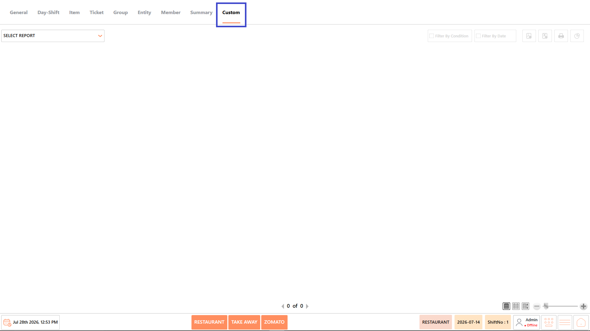<figcaption></figcaption></figure>

## **Reports Available** 

The Custom Reports category includes the following reports:

* Speed of Service Report
* Sold Out History Report
* Return Product Report
* Top Sell Report by Quantity
* Top Sell Report by Amount
* Down Sell Report by Quantity
* Down Sell Report by Amount

<figure>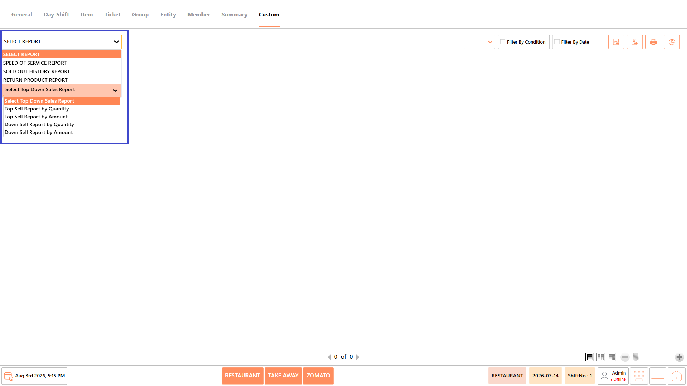<figcaption></figcaption></figure>

#### **Screen Elements** 

The following screen elements are common to all reports in the Custom Reports category.

**View Mode**

* Select how the report is displayed.
* Available options include:
  * **Compact** – Displays the report in a condensed format.
  * **Full** – Displays the complete report with all available information.
  * **Free** – Displays the report without predefined formatting, allowing flexible viewing.

<figure>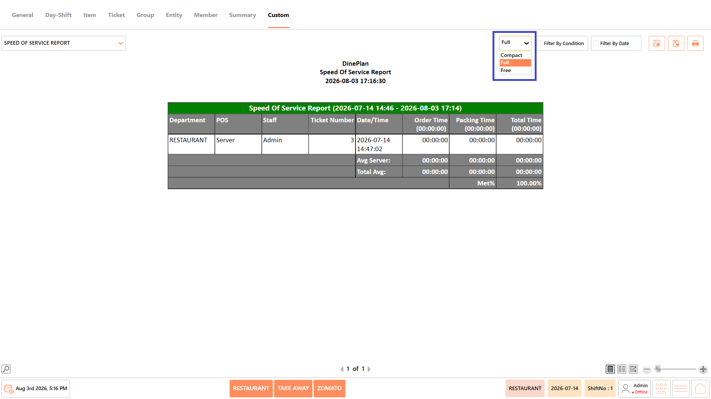<figcaption></figcaption></figure>

**Filter by Condition**

* Apply report-specific filters such as department, product, cashier, staff, ticket number, date, or other available conditions before generating the report.

<figure>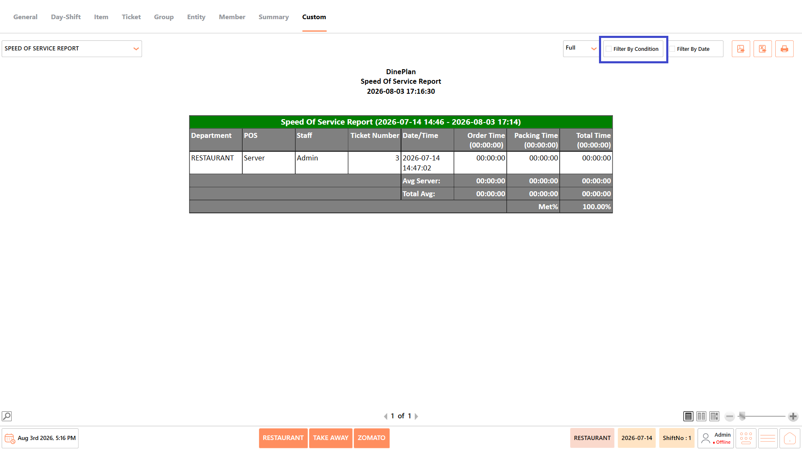<figcaption></figcaption></figure>

**Filter by Date**

* Specify the required date or date range for generating the report.

<figure>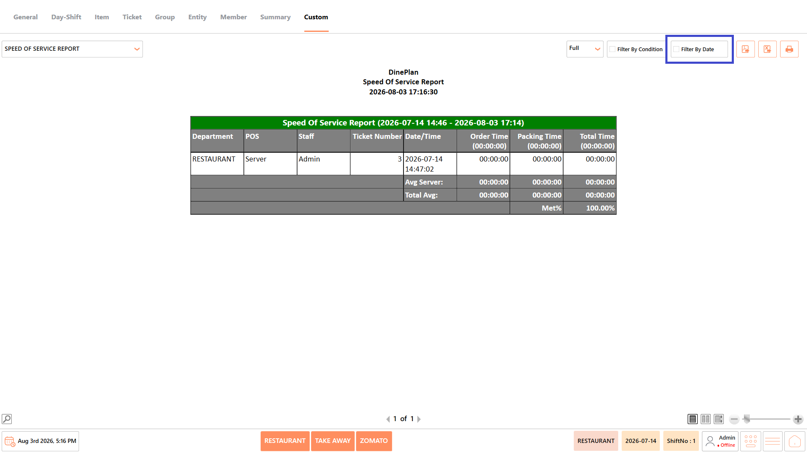<figcaption></figcaption></figure>

**Export as PDF**

* Exports the generated report as a PDF document.

<figure>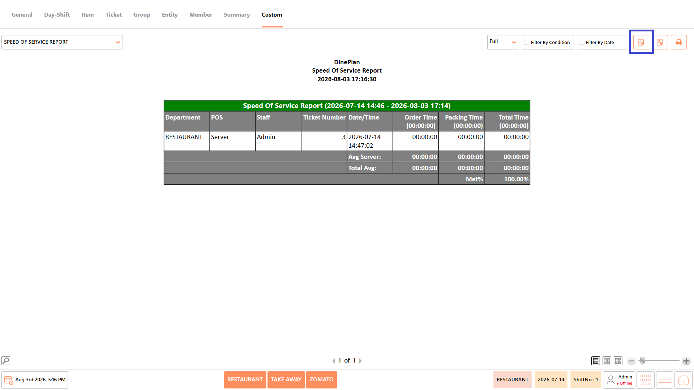<figcaption></figcaption></figure>

**Export to Excel**

* Exports the generated report as an Excel file.

**Print**

* Prints the currently displayed report.

<figure><figcaption></figcaption></figure>

### **Speed of Service Report** 

The Speed of Service Report displays the time taken to process customer orders from order placement until completion. It helps managers evaluate staff efficiency, monitor service performance, and ensure service time targets are consistently achieved.

<figure>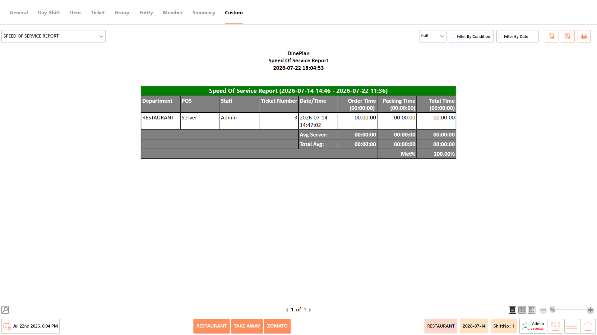<figcaption></figcaption></figure>

#### **Report Fields** 

The report includes information such as:

| **Field**     | **Description**                                                                                                                             |
| ------------- | ------------------------------------------------------------------------------------------------------------------------------------------- |
| Department    | Displays the restaurant department where the order was processed. It helps identify service performance across different operational areas. |
| POS           | Displays the point-of-sale terminal used to process the order. It helps identify the workstation handling each transaction.                 |
| Staff         | Displays the staff member responsible for processing the order. It helps evaluate employee performance and service efficiency.              |
| Ticket Number | Displays the ticket number assigned to the order. It helps locate the corresponding transaction for verification.                           |
| Date/Time     | Displays the date and time when the order was created. It helps analyze service activity during different business periods.                 |
| Order Time    | Displays the time taken to prepare the customer's order. It helps measure kitchen preparation efficiency.                                   |
| Packing Time  | Displays the time taken to pack the completed order. It helps evaluate packaging performance before delivery or pickup.                     |
| Total Time    | Displays the overall service time from order initiation to completion. It helps measure the total customer service duration.                |
| Avg Server    | Displays the average service time achieved by the selected server or staff member. It helps compare staff performance.                      |
| Total Avg     | Displays the overall average service time for all processed orders. It helps evaluate operational efficiency during the selected period.    |
| Met %         | Displays the percentage of orders completed within the defined service target. It helps measure compliance with service-level expectations. |

_Note - The information displayed may vary depending on restaurant configuration and available transaction data._

#### **Use Case** 

Use the Speed of Service Report to:

* Monitor service efficiency.
* Evaluate staff performance.
* Measure order processing time.
* Identify service delays.
* Improve customer experience.

### **Sold Out History Report** 

The Sold Out History Report displays the history of menu items marked as sold out during the selected period. It helps managers review inventory shortages, monitor stock availability, and analyze sold-out trends.

<figure>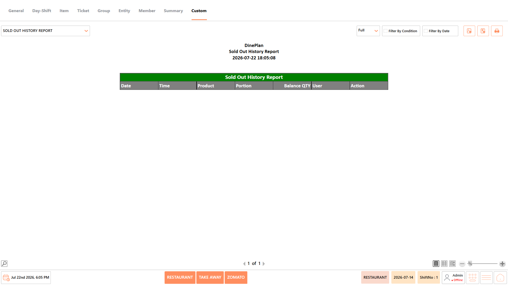<figcaption></figcaption></figure>

#### **Report Fields** 

The report includes information such as:

| **Field**   | **Description**                                                                                                                           |
| ----------- | ----------------------------------------------------------------------------------------------------------------------------------------- |
| Date        | Displays the date when the product was marked as sold out. It helps identify stock shortages on specific business days.                   |
| Time        | Displays the time the sold-out status was recorded. It helps analyze inventory depletion during operating hours.                          |
| Product     | Displays the name of the menu item marked as sold out. It helps identify frequently unavailable products.                                 |
| Portion     | Displays the product portion that became unavailable. It helps distinguish sold-out quantities for different serving sizes.               |
| Balance Qty | Displays the remaining inventory quantity at the time of the update. It helps verify stock availability before the product was exhausted. |
| User        | Displays the user who updated the sold-out status. It helps maintain accountability for inventory changes.                                |
| Action      | Displays the action performed, such as marking or restoring product availability. It helps review inventory management activities.        |

_Note - The information displayed may vary depending on restaurant configuration and available transaction data._

#### **Use Case** 

Use the Sold Out History Report to:

* Monitor stock shortages.
* Review inventory updates.
* Track sold-out items.
* Analyze product availability.
* Improve inventory planning.

### **Return Product Report** 

The Return Product Report displays detailed information about returned menu items, including customer details, refund information, and return reasons. It helps managers review product returns, verify refunds, and monitor return trends.

<figure>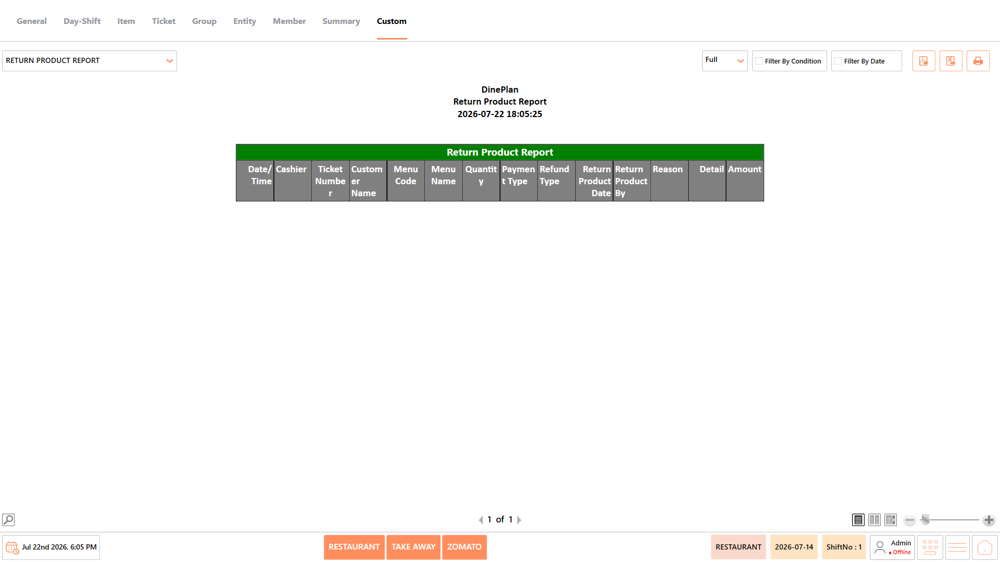<figcaption></figcaption></figure>

#### **Report Fields** 

The report includes information such as:

| **Field**           | **Description**                                                                                                          |
| ------------------- | ------------------------------------------------------------------------------------------------------------------------ |
| Date/Time           | Displays the date and time when the product was returned. It helps identify when return transactions occurred.           |
| Cashier             | Displays the cashier who processed the return. It helps maintain accountability for return transactions.                 |
| Ticket Number       | Displays the ticket number associated with the returned product. It helps locate the original sales transaction.         |
| Customer Name       | Displays the customer associated with the returned item. It helps verify customer-related return requests.               |
| Menu Code           | Displays the unique code assigned to the returned menu item. It helps identify products within the system.               |
| Menu Name           | Displays the name of the returned menu item. It helps quickly recognize the product being returned.                      |
| Quantity            | Displays the quantity of items returned. It helps review the volume of returned products.                                |
| Payment Type        | Displays the payment method used for the original purchase. It helps verify payment information during refunds.          |
| Refund Type         | Displays the method used to process the refund. It helps distinguish between cash, card, or other refund types.          |
| Return Product Date | Displays the date when the product return was processed. It helps maintain accurate return records.                      |
| Return Product By   | Displays the user or staff member who processed the return. It helps support auditing and accountability.                |
| Reason              | Displays the reason provided for returning the product. It helps identify common return patterns.                        |
| Detail              | Displays additional information related to the return transaction. It helps provide further clarification when required. |
| Amount              | Displays the total value refunded for the returned product. It helps verify refund accuracy.                             |

_Note - The information displayed may vary depending on restaurant configuration and available transaction data._\
**Use Case**

Use the Return Product Report to:

* Review product returns.
* Verify refund transactions.
* Monitor return reasons.
* Analyze return trends.
* Support audit activities.

### **Top Sell Report by Quantity** 

The Top Sell Report by Quantity displays the highest-selling menu items based on the number of units sold during the selected period. It helps managers identify popular products and understand customer purchasing trends.

<figure><figcaption></figcaption></figure>

#### **Report Fields** 

The report includes information such as:

| **Field**    | **Description**                                                                                                  |
| ------------ | ---------------------------------------------------------------------------------------------------------------- |
| Product Code | Displays the unique code assigned to the product. It helps identify menu items within the system.                |
| Product Name | Displays the name of the menu item. It helps easily recognize the product being analyzed.                        |
| Unit Price   | Displays the selling price of a single unit. It helps compare pricing across products.                           |
| Quantity     | Displays the total quantity sold during the reporting period. It helps measure product popularity.               |
| % Quantity   | Displays the percentage contribution of the product to total quantity sold. It helps compare product demand.     |
| Amount       | Displays the total sales value generated by the product. It helps evaluate product revenue.                      |
| % Amount     | Displays the percentage contribution of the product to total sales value. It helps analyze revenue distribution. |

_Note - The information displayed may vary depending on restaurant configuration and available transaction data._

#### **Use Case** 

Use the Top Sell Report by Quantity to:

* Identify best-selling products.
* Monitor product demand.
* Analyze sales volume.
* Support inventory planning.
* Improve menu decisions.

### **Top Sell Report by Amount** 

The **Top Sell Report by Amount** displays the highest revenue-generating menu items during the selected reporting period. It helps managers identify profitable products and evaluate revenue contribution.

<figure><figcaption></figcaption></figure>

#### **Report Fields** 

The report includes information such as:

| **Field**    | **Description**                                                                                                  |
| ------------ | ---------------------------------------------------------------------------------------------------------------- |
| Product Code | Displays the unique code assigned to the product. It helps identify menu items within the system.                |
| Product Name | Displays the name of the menu item. It helps easily recognize the product being analyzed.                        |
| Unit Price   | Displays the selling price of a single unit. It helps compare pricing across products.                           |
| Quantity     | Displays the total quantity sold during the reporting period. It helps measure product popularity.               |
| % Quantity   | Displays the percentage contribution of the product to total quantity sold. It helps compare product demand.     |
| Amount       | Displays the total sales value generated by the product. It helps evaluate product revenue.                      |
| % Amount     | Displays the percentage contribution of the product to total sales value. It helps analyze revenue distribution. |

_Note - The information displayed may vary depending on restaurant configuration and available transaction data._

#### **Use Case** 

Use the Top Sell Report by Amount to:

* Identify high-revenue products.
* Compare product profitability.
* Analyze revenue contribution.
* Support pricing decisions.
* Improve menu performance.

### **Down Sell Report by Quantity** 

The Down Sell Report by Quantity displays the lowest-selling menu items based on quantity sold. It helps managers identify slow-moving products and evaluate menu performance.

<figure>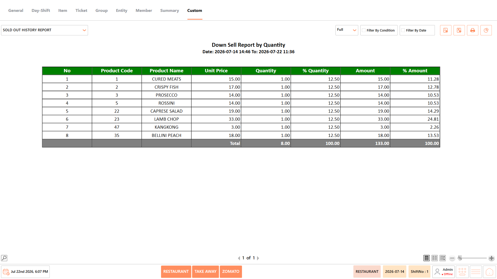<figcaption></figcaption></figure>

#### **Report Fields** 

The report includes information such as:

| **Field**    | **Description**                                                                                                  |
| ------------ | ---------------------------------------------------------------------------------------------------------------- |
| Product Code | Displays the unique code assigned to the product. It helps identify menu items within the system.                |
| Product Name | Displays the name of the menu item. It helps easily recognize the product being analyzed.                        |
| Unit Price   | Displays the selling price of a single unit. It helps compare pricing across products.                           |
| Quantity     | Displays the total quantity sold during the reporting period. It helps measure product popularity.               |
| % Quantity   | Displays the percentage contribution of the product to total quantity sold. It helps compare product demand.     |
| Amount       | Displays the total sales value generated by the product. It helps evaluate product revenue.                      |
| % Amount     | Displays the percentage contribution of the product to total sales value. It helps analyze revenue distribution. |

_Note - The information displayed may vary depending on restaurant configuration and available transaction data._

#### **Use Case** 

Use the Down Sell Report by Quantity to:

* Identify slow-moving products.
* Monitor low sales volume.
* Review menu performance.
* Optimize inventory levels.
* Improve product offerings.

### **Down Sell Report by Amount** 

The Down Sell Report by Amount displays the menu items generating the lowest sales revenue during the selected period. It helps managers identify underperforming products and evaluate profitability.

<figure>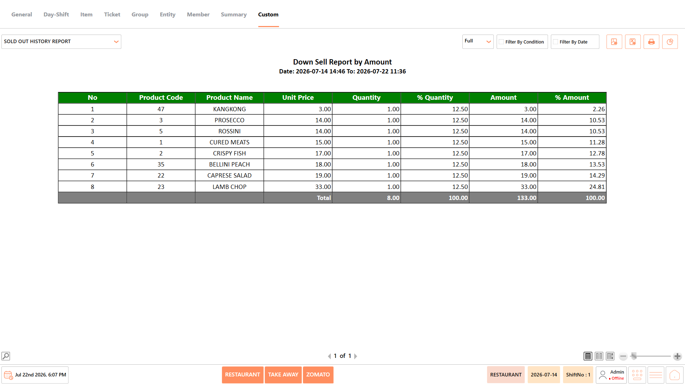<figcaption></figcaption></figure>

#### **Report Fields** 

The report includes information such as:

| **Field**    | **Description**                                                                                                  |
| ------------ | ---------------------------------------------------------------------------------------------------------------- |
| Product Code | Displays the unique code assigned to the product. It helps identify menu items within the system.                |
| Product Name | Displays the name of the menu item. It helps easily recognize the product being analyzed.                        |
| Unit Price   | Displays the selling price of a single unit. It helps compare pricing across products.                           |
| Quantity     | Displays the total quantity sold during the reporting period. It helps measure product popularity.               |
| % Quantity   | Displays the percentage contribution of the product to total quantity sold. It helps compare product demand.     |
| Amount       | Displays the total sales value generated by the product. It helps evaluate product revenue.                      |
| % Amount     | Displays the percentage contribution of the product to total sales value. It helps analyze revenue distribution. |

_Note - The information displayed may vary depending on restaurant configuration and available transaction data._

#### **Use Case** 

Use the Down Sell Report by Amount to:

* Identify low-revenue products.
* Analyze product profitability.
* Review underperforming items.
* Support menu optimization.
* Improve sales performance.

## **Notes** 

* The information displayed in the reports may vary depending on the selected report, available transaction data, and restaurant configuration.
* Report results are generated based on the selected date range and applied conditions.
* Some fields, such as Cost, Total Cost, and Profit, are available only when costing is configured in the system.
* Empty reports indicate that no transactions match the selected date range or filter conditions.
* Report totals are displayed based on the transactions included in the generated report.
* Use Export to PDF, Export to Excel, or Print to save or share the generated report as required.
