# Day-Shift Reports

## **Overview** 

The Day-Shift category contains reports related to restaurant workdays, cashier shifts, cash audits, and day-end operations. These reports help managers monitor daily business activities, verify shift closures, reconcile cash transactions, and review overall business performance for a specific workday or shift.

<figure>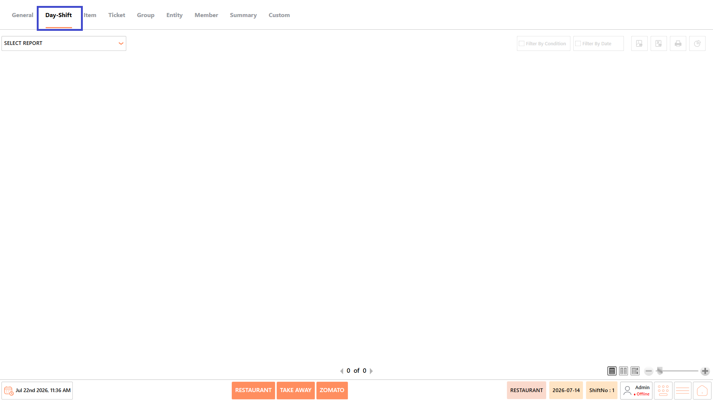<figcaption></figcaption></figure>

## **Reports Available** 

The Day-Shift category includes the following reports:

* Work Day Report
* Work Shift Report
* Abnormal End Day Report
* Cash Audit Report
* Day Summary

<figure>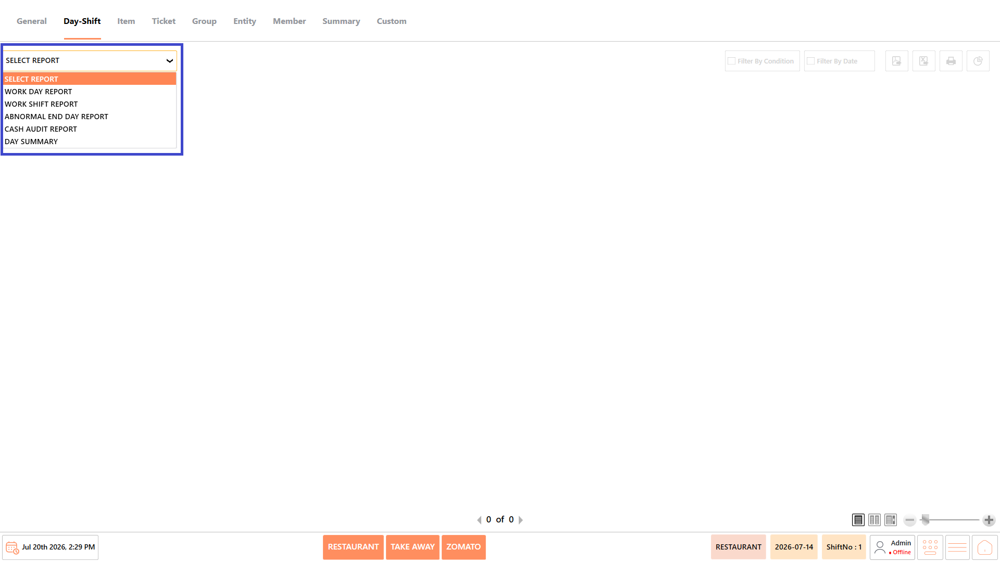<figcaption></figcaption></figure>

#### **Screen Elements** 

The following screen elements are common to all reports in the **Day-Shift** category.

**View Mode**

* Choose how the report is displayed.
* Available options include:
  * **Compact** – Displays the report in a condensed format.
  * **Full** – Displays the complete report with all available information.
  * **Free** – Displays the report without predefined formatting, allowing flexible viewing.

<figure>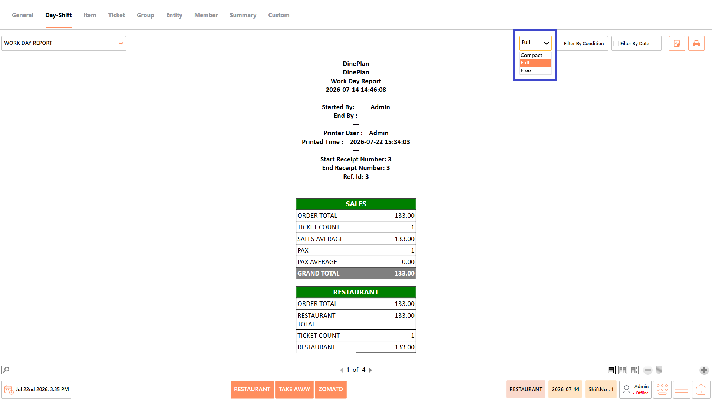<figcaption></figcaption></figure>

**Filter by Condition**

* Apply available conditions, such as terminal, cashier, or other report-specific filters, before generating the report.

<figure>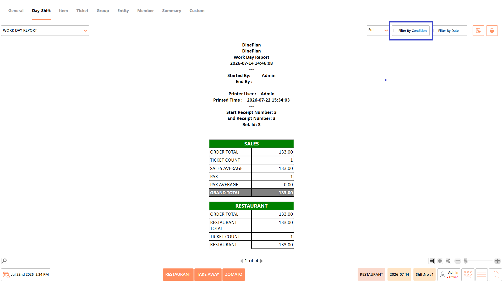<figcaption></figcaption></figure>

**Filter by Date**

* Specify a date or date range to generate the report for a particular business period.

<figure><figcaption></figcaption></figure>

**Export as PDF**

* Exports the generated report as a PDF document.

<figure>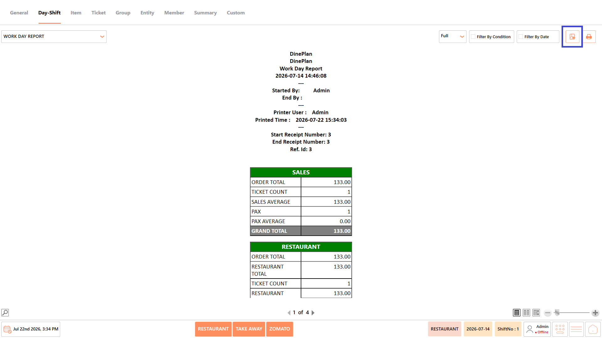<figcaption></figcaption></figure>

**Print**

* Prints the currently displayed report.

<figure>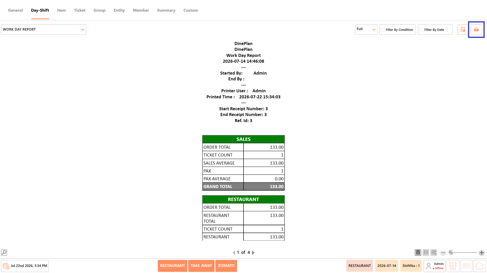<figcaption></figcaption></figure>

### **Work Day Report** 

The Work Day Report provides a consolidated summary of restaurant operations for a completed business day. It includes sales figures, order statistics, payment information, department-wise sales, category-wise sales, and other operational summaries to help managers review daily business performance.

<figure>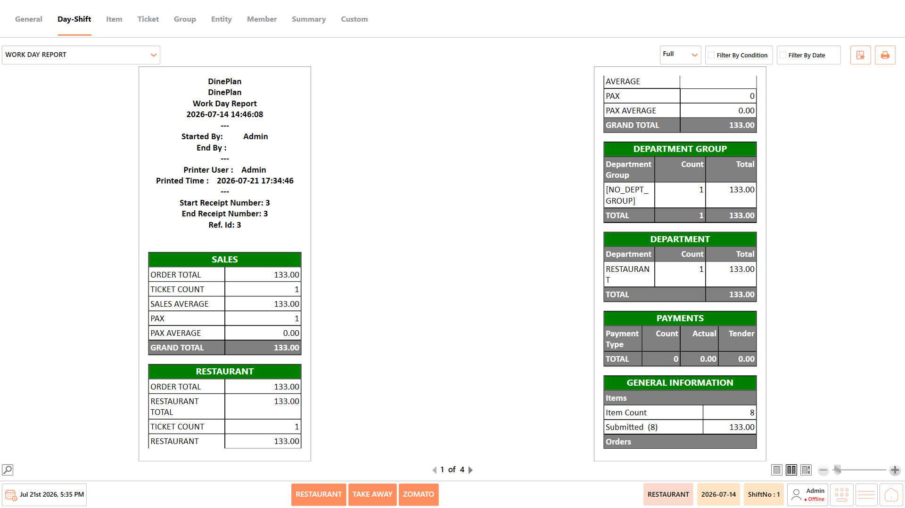<figcaption></figcaption></figure>

<figure>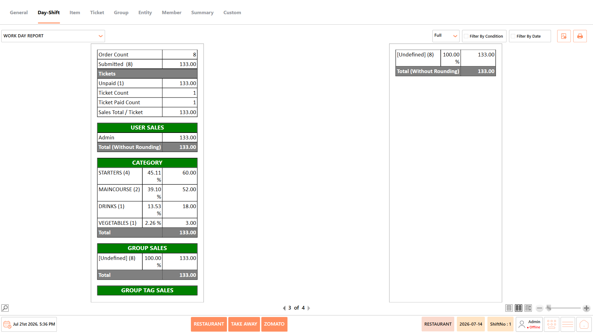<figcaption></figcaption></figure>

#### **Report Fields** 

The report includes information such as:

| **Field**                             | **Description**                                                          |
| ------------------------------------- | ------------------------------------------------------------------------ |
| **Business day details**              | Displays key information related to the selected business day.           |
| **Start and end workday information** | Displays the start and end details of the business day.                  |
| **Receipt number range**              | Displays the range of receipt numbers generated during the business day. |
| **Sales summary**                     | Provides an overview of the sales recorded during the business day.      |
| **Restaurant sales summary**          | Displays a summary of sales generated from restaurant operations.        |
| **Department-wise sales**             | Displays sales totals grouped by department.                             |
| **Department group summary**          | Summarizes sales based on the configured department groups.              |
| **Payment summary**                   | Provides a summary of payments recorded during the business day.         |
| **General information**               | Displays general operational information related to the business day.    |
| **Ticket summary**                    | Provides a summary of tickets generated during the business day.         |
| **User sales**                        | Displays sales information grouped by user.                              |
| **Category sales**                    | Displays sales totals grouped by menu category.                          |
| **Group sales**                       | Displays sales totals based on the configured sales groups.              |
| **Group tag sales**                   | Displays sales information grouped by the configured group tags.         |

_Note - The information displayed may vary depending on restaurant configuration and available transaction data._

#### **Use Case** 

Use the Work Day Report to:

* Review the complete sales performance for a business day.
* Verify the day's operational summary before closing.
* Compare department and category sales.
* Review payment and ticket statistics.
* Analyze daily business performance for reporting and reconciliation.

### **Work Shift Report** 

The Work Shift Report provides a summary of transactions performed during a specific cashier shift. It includes shift details, sales information, payment summaries, department sales, and cashier-related information for the selected shift.

<figure>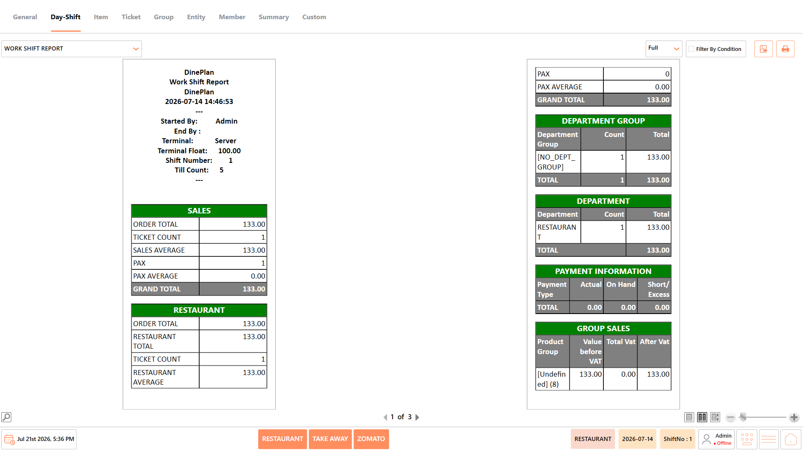<figcaption></figcaption></figure>

<figure>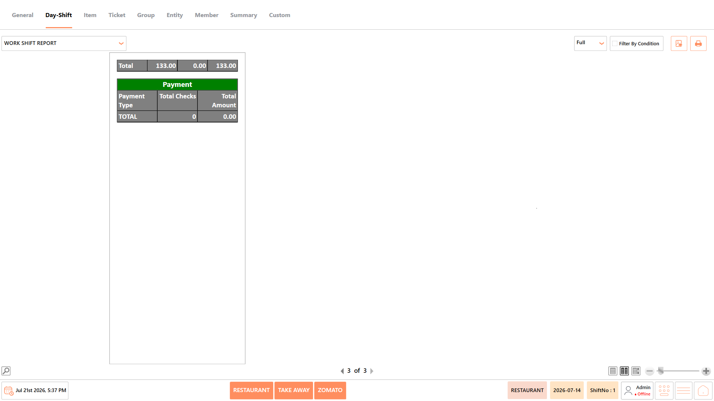<figcaption></figcaption></figure>

#### **Report Fields** 

The report includes information such as:

| **Field**                    | **Description**                                                           |
| ---------------------------- | ------------------------------------------------------------------------- |
| **Shift details**            | Displays the key information related to the selected cashier shift.       |
| **Terminal information**     | Displays the terminal associated with the work shift.                     |
| **Shift number**             | Displays the unique number assigned to the work shift.                    |
| **Float amount**             | Displays the opening cash amount provided for the shift.                  |
| **Till count**               | Displays the till count recorded for the shift.                           |
| **Sales summary**            | Provides a summary of sales recorded during the shift.                    |
| **Restaurant sales**         | Displays the sales generated from restaurant operations during the shift. |
| **Department summary**       | Summarizes sales based on the restaurant departments.                     |
| **Department group summary** | Summarizes sales based on the configured department groups.               |
| **Payment information**      | Displays payment details recorded during the shift.                       |
| **Group sales**              | Displays sales totals grouped according to the configured sales groups.   |
| **Payment totals**           | Displays the total amounts recorded for each payment type.                |

_Note - The information displayed may vary depending on the shift activity and system configuration._

#### **Use Case** 

Use the Work Shift Report to:

* Review the performance of an individual cashier shift.
* Verify sales and payment totals before ending a shift.
* Compare shift-level business activity.
* Audit cashier transactions and shift summaries.
* Reconcile shift operations before closing.

### **Abnormal End Day Report** 

The Abnormal End Day Report identifies business days that were not closed correctly. It helps administrators detect workdays where the End Day process was missed or completed abnormally, allowing corrective action before continuing normal restaurant operations.

<figure>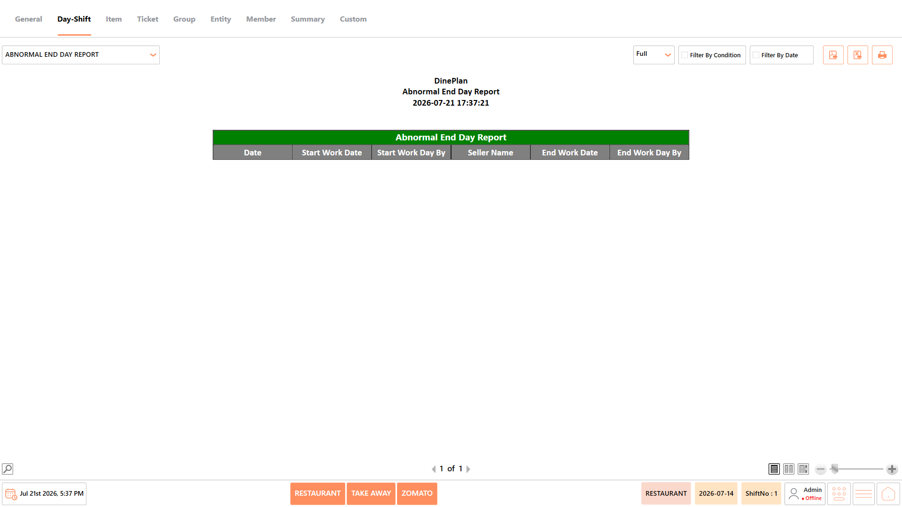<figcaption></figcaption></figure>

#### **Report Fields** 

The report displays information such as:

| **Field**                        | **Description**                                              |
| -------------------------------- | ------------------------------------------------------------ |
| **Business Date**                | Displays the business date associated with the workday.      |
| **Workday Start Date**           | Displays the date when the workday was started.              |
| **User Who Started the Workday** | Displays the user who started the workday.                   |
| **Seller Name**                  | Displays the name of the seller associated with the workday. |
| **Workday End Date**             | Displays the date when the workday was ended.                |
| **User Who Ended the Workday**   | Displays the user who ended the workday.                     |

_Note - The information displayed may vary depending on restaurant configuration and available transaction data._

#### **Use Case** 

Use the Abnormal End Day Report to:

* Identify workdays that were not closed properly.
* Verify incomplete or missed End Day operations.
* Detect operational issues before starting a new business day.
* Maintain accurate business-day records.

### **Cash Audit Report** 

The Cash Audit Report provides details of cash audit activities performed during restaurant operations. It records audit values, cash movements, float amounts, and any cash differences, helping managers verify cash reconciliation.

<figure>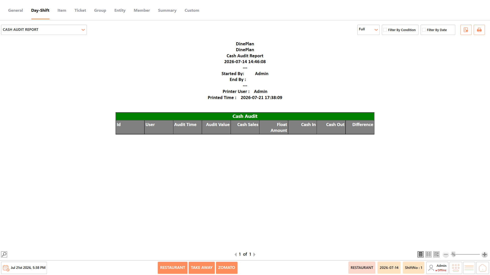<figcaption></figcaption></figure>

#### **Report Fields** 

The report displays information such as:

| **Field**           | **Description**                                                                              |
| ------------------- | -------------------------------------------------------------------------------------------- |
| **Audit ID**        | Displays the unique ID assigned to the cash audit record.                                    |
| **User**            | Displays the name of the user who performed the cash audit.                                  |
| **Audit Time**      | Displays the date and time when the cash audit was performed.                                |
| **Audit Value**     | Displays the cash value recorded during the audit.                                           |
| **Cash Sales**      | Displays the total cash sales recorded during the relevant period.                           |
| **Float Amount**    | Displays the opening cash amount provided for the till or shift.                             |
| **Cash In**         | Displays the total amount of cash added to the till during the selected period.              |
| **Cash Out**        | Displays the total amount of cash removed from the till during the selected period.          |
| **Cash Difference** | Displays the difference between the expected cash amount and the actual audited cash amount. |

_Note - The information displayed may vary depending on restaurant configuration and available transaction data._

#### **Use Case** 

Use the Cash Audit Report to:

* Review completed cash audits.
* Verify cash movements during a shift.
* Identify cash shortages or excess amounts.
* Support daily cash reconciliation.
* Maintain accurate financial records.

### **Day Summary** 

The Day Summary provides a high-level overview of the restaurant's business performance for a selected workday. It summarizes key sales figures, category-wise sales, taxes, discounts, media totals, and other important business metrics in a simplified format.

<figure>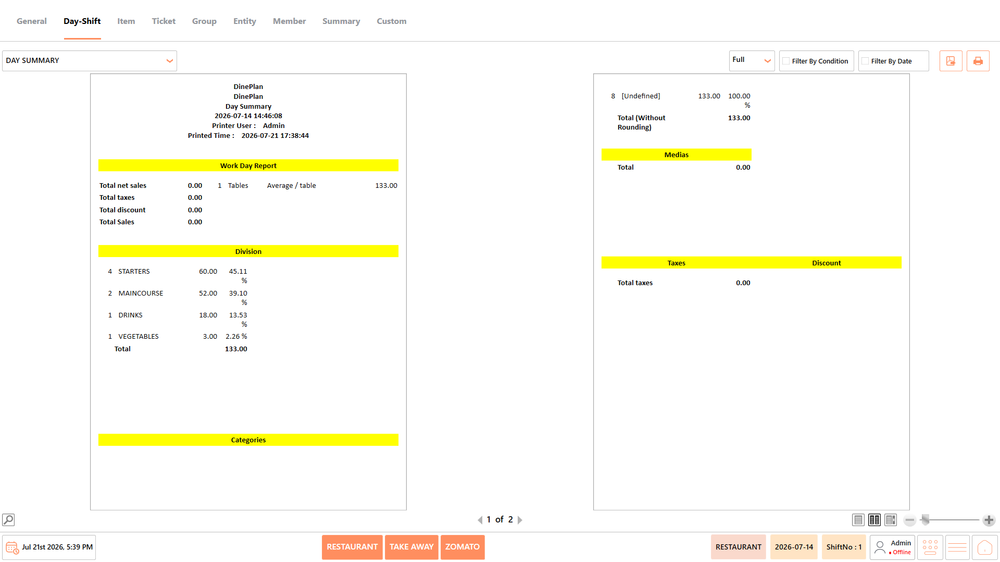<figcaption></figcaption></figure>

#### **Report Fields** 

The report includes information such as:

| **Field**                   | **Description**                                                                    |
| --------------------------- | ---------------------------------------------------------------------------------- |
| **Total Net Sales**         | Displays the total net sales generated after applicable discounts and adjustments. |
| **Total Taxes**             | Displays the total tax amount applied to the sales during the selected period.     |
| **Total Discounts**         | Displays the total value of discounts applied to the transactions.                 |
| **Total Sales**             | Displays the overall sales amount recorded during the selected period.             |
| **Average Sales per Table** | Displays the average sales value generated per table.                              |
| **Division Summary**        | Provides a summary of sales grouped by division.                                   |
| **Category Sales**          | Displays sales totals grouped by menu category.                                    |
| **Media Summary**           | Provides a summary of transaction amounts grouped by payment media.                |
| **Tax Summary**             | Provides a summary of taxes collected during the selected period.                  |
| **Discount Summary**        | Provides a summary of discounts applied during the selected period.                |

_Note - The information displayed may vary depending on restaurant configuration and available transaction data._

#### **Use Case** 

Use the Day Summary to:

* Get a quick overview of the day's business performance.
* Review key sales and financial metrics.
* Compare category-wise sales distribution.
* Verify tax and discount totals.
* Prepare daily operational or management reports.

## **Notes** 

* The information displayed in the reports may vary depending on the selected report, available transaction data, and restaurant configuration.
* Report results are generated based on the selected date range and applied conditions.
* Some fields, such as Cost, Total Cost, and Profit, are available only when costing is configured in the system.
* Empty reports indicate that no transactions match the selected date range or filter conditions.
* Report totals are displayed based on the transactions included in the generated report.
* Use Export to PDF, Export to Excel, or Print to save or share the generated report as required.
