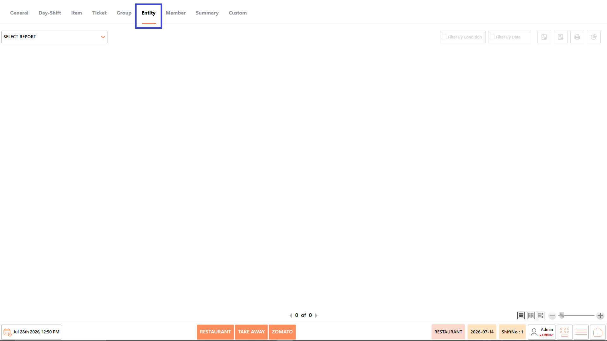
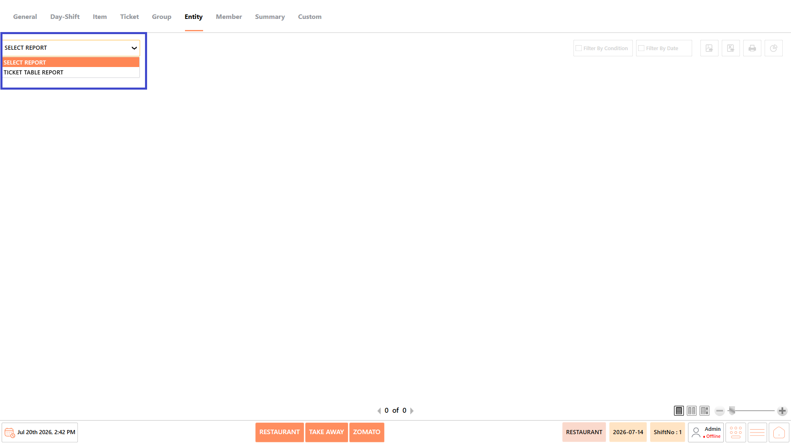
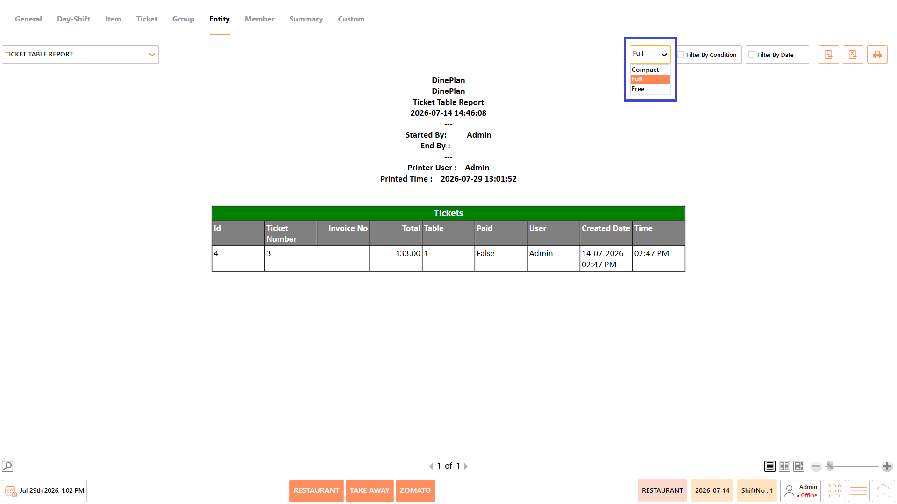
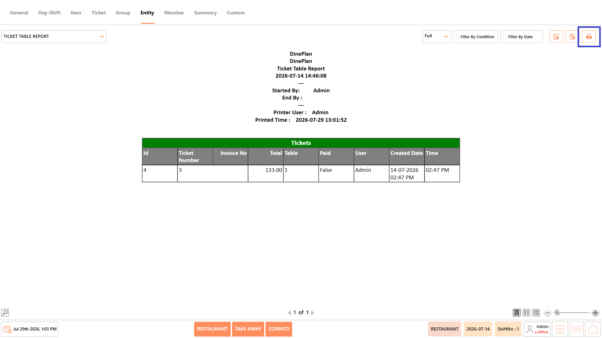
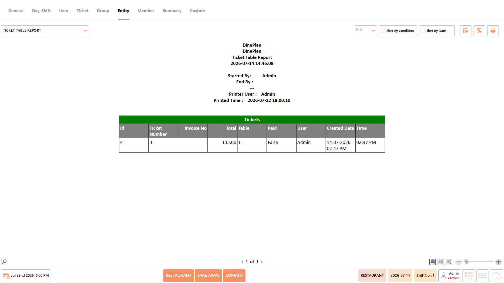

# Entity Reports

## **Overview** 

The Entity Reports category provides reports related to ticket activity associated with restaurant entities such as tables. These reports help restaurant managers monitor ticket details, table utilization, and transaction activity for operational analysis.

<figure><figcaption></figcaption></figure>

## **Reports Available** 

The Entity Reports category includes the following report:

* Ticket Table Report

<figure><figcaption></figcaption></figure>

#### **Screen Elements** 

The following screen elements are common to all reports in the Entity Reports category.

**View Mode**

* Select how the report is displayed.
* Available options include:
  * **Compact** – Displays the report in a condensed format.
  * **Full** – Displays the complete report with all available information.
  * **Free** – Displays the report without predefined formatting, allowing flexible viewing.

<figure><figcaption></figcaption></figure>

**Filter by Condition**

* Apply report-specific filters such as table, ticket number, user, entity, payment status, or other available conditions before generating the report.

<figure><figcaption></figcaption></figure>

**Filter by Date**

* Specify the required date or date range for generating the report.

<figure><figcaption></figcaption></figure>

**Export as PDF**

* Exports the generated report as a PDF document.

<figure><figcaption></figcaption></figure>

**Export to Excel**

* Exports the generated report as an Excel file.

<figure><figcaption></figcaption></figure>

**Print**

* Prints the currently displayed report.

<figure><figcaption></figcaption></figure>

### **Ticket Table Report** 

The Ticket Table Report displays ticket information associated with restaurant tables, including ticket details, invoice information, payment status, assigned user, and creation date. It helps monitor table activity and review ticket transactions during the selected business period.

<figure><figcaption></figcaption></figure>

#### **Report Fields** 

The report includes information such as:

| **Field**     | **Description**                                                                                                                         |
| ------------- | --------------------------------------------------------------------------------------------------------------------------------------- |
| ID            | Displays the unique identifier assigned to each ticket record. It helps uniquely identify and reference individual ticket transactions. |
| Ticket Number | Displays the unique ticket number generated for the order. It helps track and locate specific customer tickets.                         |
| Invoice No    | Displays the invoice number associated with the ticket, if available. It helps verify billing information and complete transactions.    |
| Total         | Displays the total bill amount for the ticket. It helps review the overall value of each transaction.                                   |
| Table         | Displays the table assigned to the ticket. It helps identify where the order was placed within the restaurant.                          |
| Paid          | Indicates whether the ticket has been fully paid. It helps distinguish between settled and pending transactions.                        |
| User          | Displays the user or staff member who created or handled the ticket. It helps monitor user activity and transaction ownership.          |
| Created Date  | Displays the date and time when the ticket was created. It helps track transaction history and business activity.                       |
| Time          | Displays the transaction time for the ticket. It helps analyze ticket activity during different operating hours.                        |

_Note - The information displayed may vary depending on restaurant configuration and available transaction data._

#### **Use Case** 

Use the Ticket Table Report to:

* Review ticket activity by table.
* Monitor payment status of table orders.
* Verify invoice and ticket information.
* Track user-wise ticket transactions.
* Support operational monitoring and auditing.

## **Notes** 

* The information displayed in the reports may vary depending on the selected report, available transaction data, and restaurant configuration.
* Report results are generated based on the selected date range and applied conditions.
* Some fields, such as Cost, Total Cost, and Profit, are available only when costing is configured in the system.
* Empty reports indicate that no transactions match the selected date range or filter conditions.
* Report totals are displayed based on the transactions included in the generated report.
* Use Export to PDF, Export to Excel, or Print to save or share the generated report as required.
