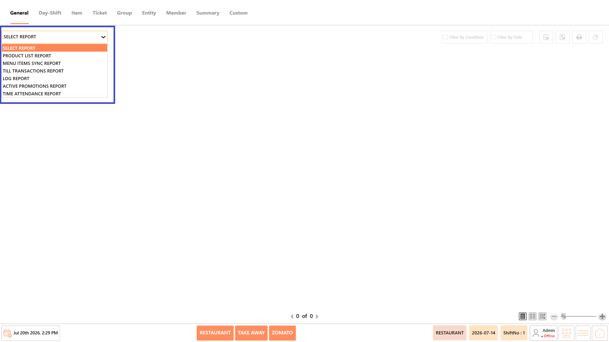
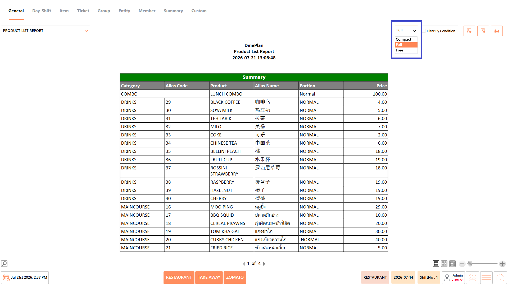
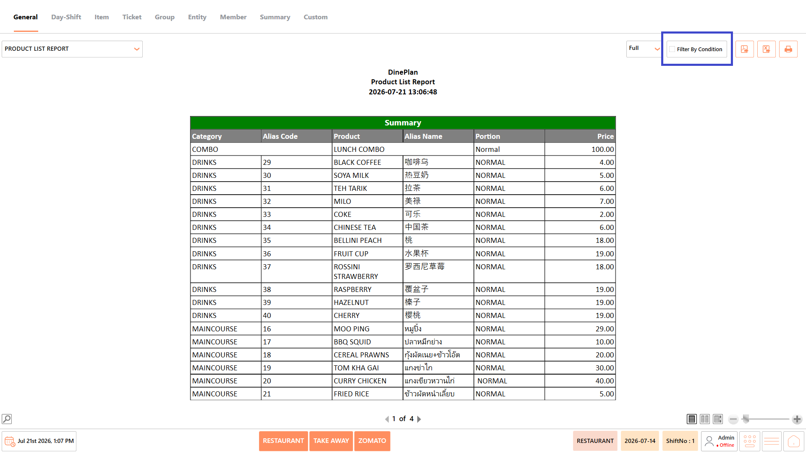
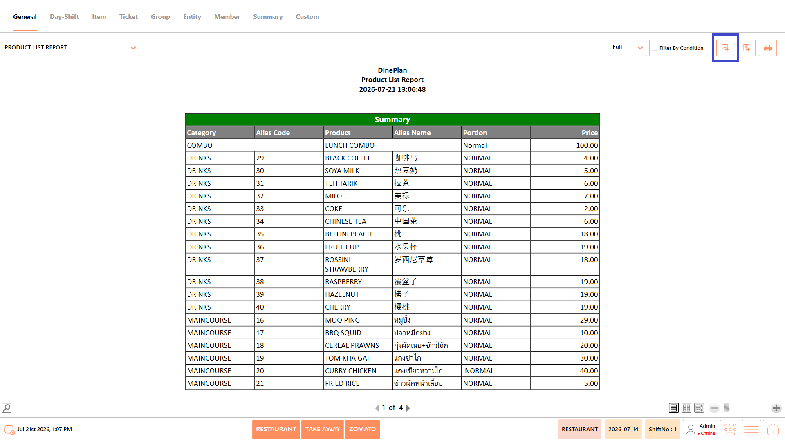
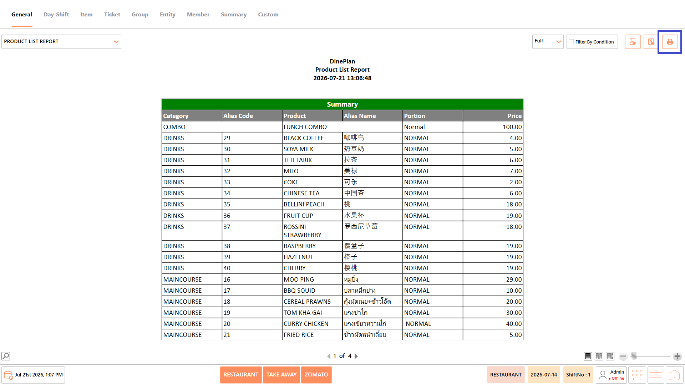
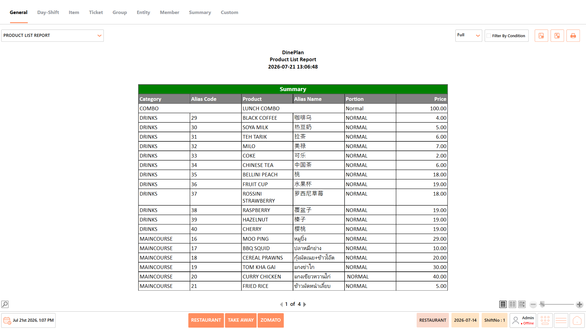
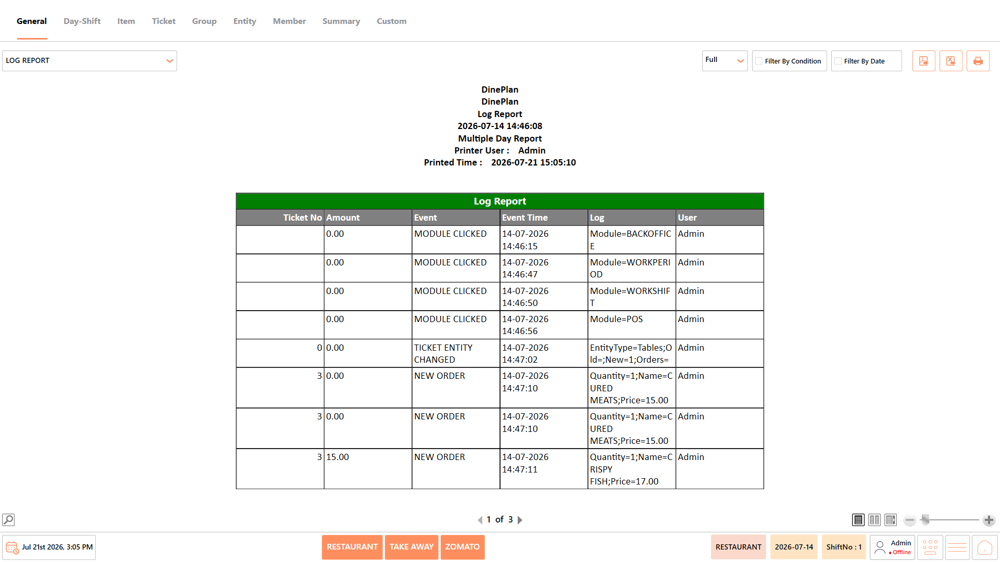
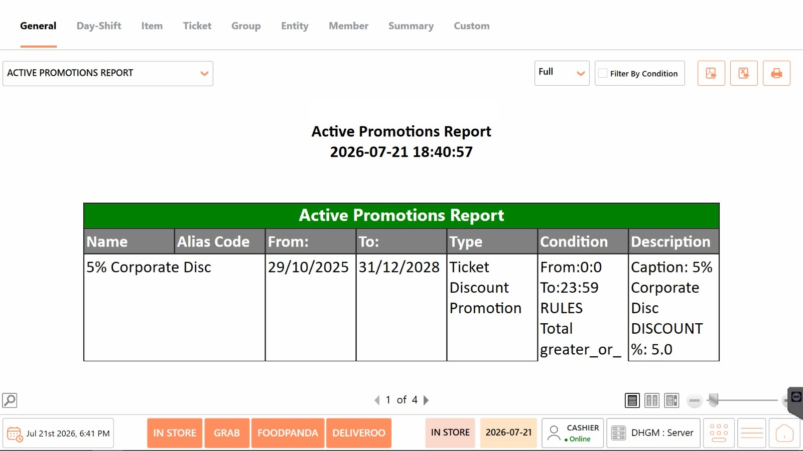
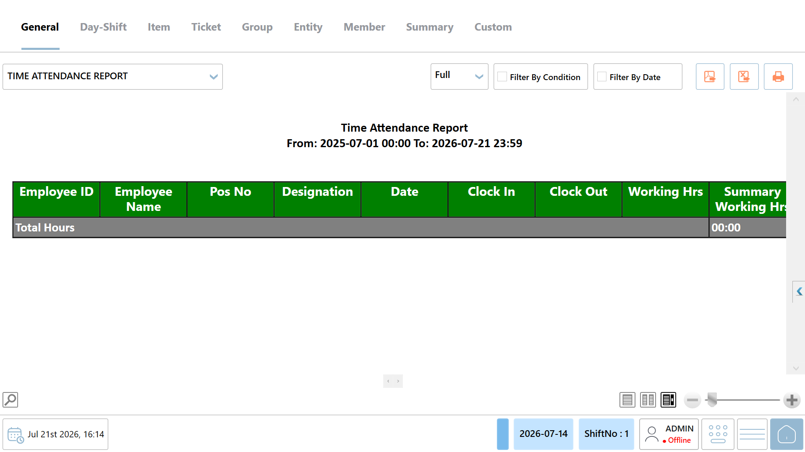

# General Reports

## **Overview** 

The General category provides access to reports related to products, menu synchronization, till transactions, system logs, promotions, and employee attendance. These reports help users review operational data, verify system configurations, and monitor daily restaurant activities.

<figure><figcaption></figcaption></figure>

## **Reports Available**  

The General category includes the following reports:

* Product List Report
* Menu Items Sync Report
* Till Transactions Report
* Log Report
* Active Promotions Report
* Time Attendance Report

<figure><figcaption></figcaption></figure>

#### **Screen Elements** 

**Report Actions**

The report actions become available after selecting a report. The available actions may vary depending on the selected report.

**View**

* Select the preferred report view.
* Available options include:
  * **Compact** – Displays the report in a condensed layout.
  * **Full** – Displays the complete report with all available details.
  * **Free** – Displays the report in a free-form layout, where applicable.

<figure><figcaption></figcaption></figure>

**Filter by Condition**

* Apply the available filters to refine the report results based on the selected criteria.

<figure><figcaption></figcaption></figure>

**Export to PDF**

* Export the generated report as a PDF file.

<figure><figcaption></figcaption></figure>

**Export to Excel**

* Export the generated report as a Microsoft Excel (.xlsx) file.

<figure><figcaption></figcaption></figure>

**Print**

* Print the generated report.

<figure><figcaption></figcaption></figure>

### **Product List Report** 

* The Product List Report displays all products configured in the DinePlan POS system. It provides information such as the product category, alias code, product name, alias name, portion, and price.
* This report helps users verify product configurations and review product information available in the POS.

<figure><figcaption></figcaption></figure>

#### **Report Fields** 

The report includes information such as:

| **Field**      | **Description**                                                         |
| -------------- | ----------------------------------------------------------------------- |
| **Category**   | Displays the category to which the product belongs.                     |
| **Alias Code** | Displays the unique alias code assigned to the product.                 |
| **Product**    | Displays the name of the product.                                       |
| **Alias Name** | Displays the alternate or localized name of the product, if configured. |
| **Portion**    | Displays the portion or serving size configured for the product.        |
| **Price**      | Displays the selling price of the product.                              |

_Note - The information displayed may vary depending on restaurant configuration and available transaction data._

#### **Use Case** 

Use the Product List Report to:

* Verify that products are configured correctly in the POS.
* Review product categories, portions, and pricing.
* Validate product information after menu updates or synchronization.
* Cross-check product details before restaurant operations.

### **Menu Items Sync Report** 

The Menu Items Sync Report displays the menu items that have been synchronized from the backend system to the DinePlan POS. It allows users to verify that the latest menu items and their details are available in the POS after synchronization.

This report helps ensure that menu updates, such as newly added items or modifications to existing items, have been successfully synchronized before restaurant operations begin.

<figure><figcaption></figcaption></figure>

#### **Report Fields** 

The report includes information such as:

| **Field**      | **Description**                                                           |
| -------------- | ------------------------------------------------------------------------- |
| **Category**   | Displays the category to which the menu item belongs.                     |
| **Alias Code** | Displays the unique alias code assigned to the menu item.                 |
| **Product**    | Displays the name of the synchronized menu item.                          |
| **Alias Name** | Displays the alternate or localized name of the menu item, if configured. |
| **Portion**    | Displays the configured portion or serving size of the menu item.         |
| **Price**      | Displays the selling price of the menu item.                              |

_Note - The information displayed may vary depending on restaurant configuration and available transaction data._

#### **Use Case** 

Use the Menu Items Sync Report to:

* Verify that menu items have been successfully synchronized to the POS.
* Confirm that newly added or updated menu items are available for billing.
* Review menu item details after performing a menu synchronization.
* Validate menu information before starting restaurant operations.

### **Log Report** 

The Log Report displays a record of user activities and system events performed in the DinePlan POS. It captures details such as the event performed, the time of the event, the associated transaction, and the user who performed the action.

This report helps administrators and supervisors monitor system activities, review user actions, and troubleshoot operational issues.

<figure><figcaption></figcaption></figure>

#### **Report Fields** 

The report includes information such as:

| **Field**      | **Description**                                                                                                            |
| -------------- | -------------------------------------------------------------------------------------------------------------------------- |
| **Ticket No**  | Displays the ticket number associated with the recorded event, if applicable.                                              |
| **Amount**     | Displays the transaction amount associated with the event.                                                                 |
| **Event**      | Displays the type of activity or action performed in the POS, such as Module Clicked, New Order, or Ticket Entity Changed. |
| **Event Time** | Displays the date and time when the event occurred.                                                                        |
| **Log**        | Displays detailed information about the recorded event, including the affected module, item, or operation.                 |
| **User**       | Displays the name of the user who performed the recorded action.                                                           |

_Note - The information displayed may vary depending on restaurant configuration and available transaction data._

#### **Use Case** 

Use the Log Report to:

* Review user activities performed in the POS.
* Audit operational events and transaction history.
* Investigate unexpected system or billing activities.
* Troubleshoot issues by reviewing the sequence of recorded events.
* Verify who performed a specific action and when it occurred.

### **Active Promotions Report** 

The Active Promotions Report displays all promotions that are currently configured and active in the DinePlan POS system. It provides details such as the promotion name, validity period, promotion type, conditions, and description.

This report helps users verify active promotional offers and ensure they are available for customers during the specified period.

<figure><figcaption></figcaption></figure>

#### **Report Fields** 

The report includes information such as:

| **Field**       | **Description**                                                                                                                       |
| --------------- | ------------------------------------------------------------------------------------------------------------------------------------- |
| **Name**        | Displays the name of the active promotion.                                                                                            |
| **Alias Code**  | Displays the unique alias code assigned to the promotion, if configured.                                                              |
| **From**        | Displays the date from which the promotion becomes active.                                                                            |
| **To**          | Displays the date until the promotion remains active.                                                                                 |
| **Type**        | Displays the type of promotion configured in the POS, such as Ticket Discount Promotion, Item Discount Promotion, or Combo Promotion. |
| **Condition**   | Displays the conditions or rules that must be met for the promotion to be applied.                                                    |
| **Description** | Displays additional information about the promotion, such as the discount percentage, offer details, or promotional description.      |

_Note - The information displayed may vary depending on restaurant configuration and available transaction data._

#### **Use Case** 

Use the Active Promotions Report to:

* Verify the promotions currently available in the POS.
* Review the validity period of active promotions.
* Confirm that promotion rules and conditions are configured correctly.
* Validate promotional offers before restaurant operations or marketing campaigns.
* Troubleshoot promotion-related issues during billing.

### **Time Attendance Report** 

The Time Attendance Report displays employee attendance records, including clock-in and clock-out times, working hours, and total hours worked during the selected period. It helps restaurant managers and administrators monitor employee attendance and review work hours.

<figure><figcaption></figcaption></figure>

#### **Report Fields** 

The report includes information such as:

| **Field**                 | **Description**                                                                    |
| ------------------------- | ---------------------------------------------------------------------------------- |
| **Employee ID**           | Displays the unique ID assigned to the employee.                                   |
| **Employee Name**         | Displays the name of the employee.                                                 |
| **POS No**                | Displays the POS terminal associated with the employee's attendance record.        |
| **Designation**           | Displays the employee's job designation.                                           |
| **Date**                  | Displays the date recorded for the employee's attendance.                          |
| **Clock In**              | Displays the time when the employee started their shift.                           |
| **Clock Out**             | Displays the time when the employee ended their shift.                             |
| **Working Hours**         | Displays the total number of hours worked by the employee for the day.             |
| **Summary Working Hours** | Displays the total working hours accumulated during the selected reporting period. |

_Note - The information displayed may vary depending on restaurant configuration and available transaction data._

#### **Use Case** 

Use the Time Attendance Report to:

* Review employee attendance records.
* Verify employee clock-in and clock-out times.
* Monitor daily and total working hours.
* Track attendance for payroll and shift management.
* Identify missing or incomplete attendance records.
