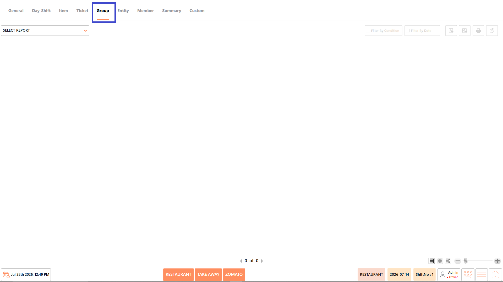
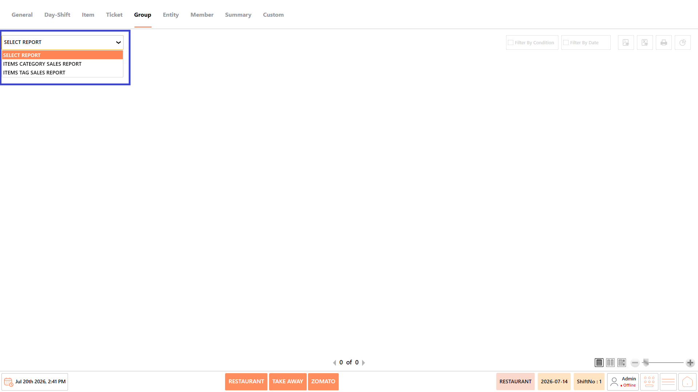
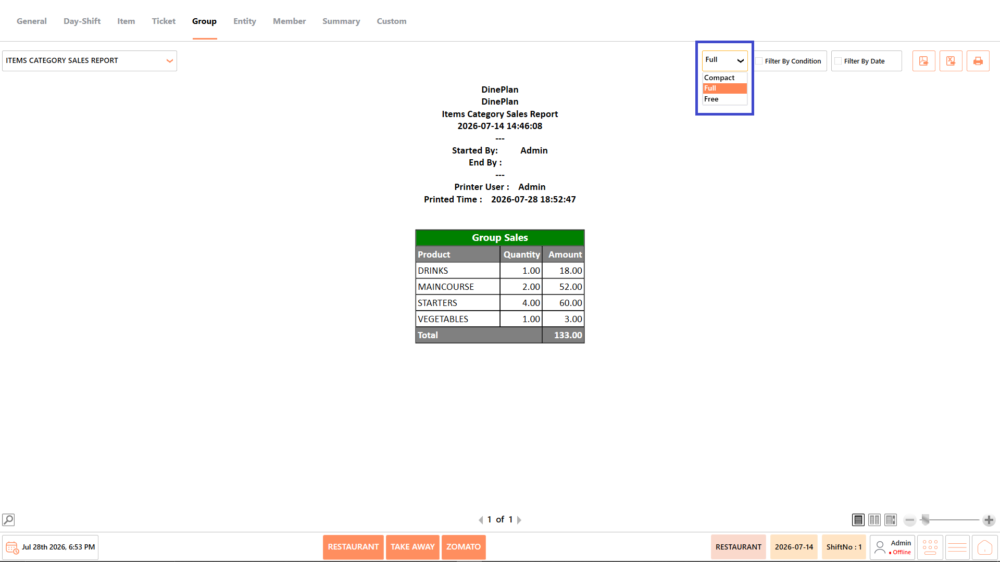
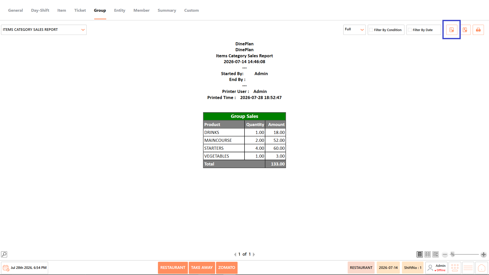
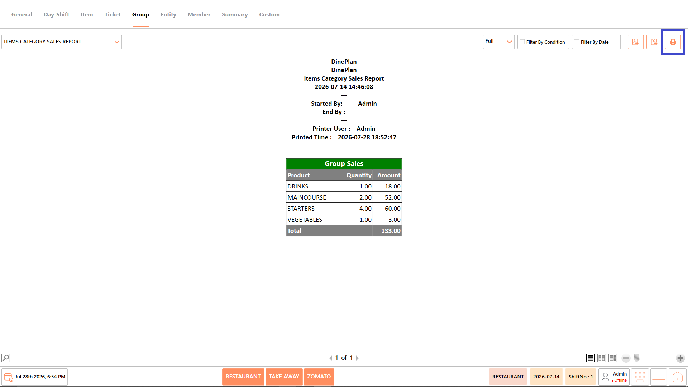
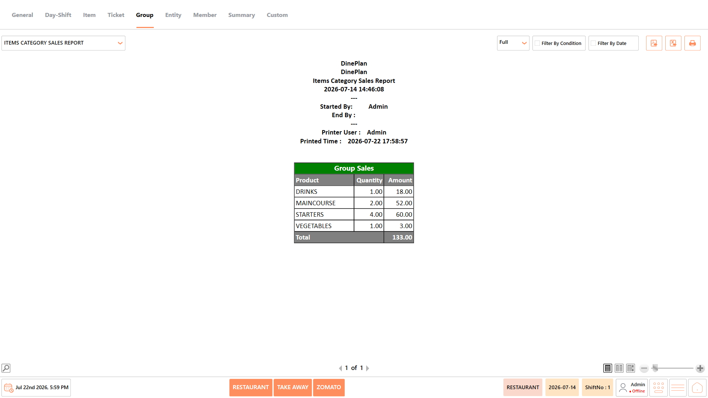
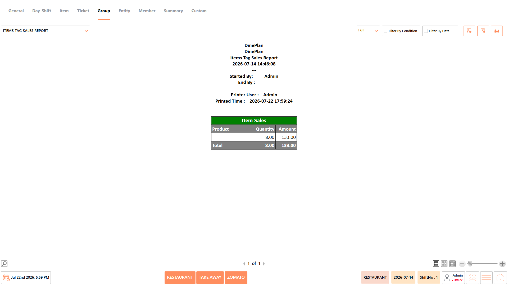

# Group Reports

## **Overview** 

The Group Reports category provides reports that summarize sales based on menu item groups and item tags. These reports help restaurant managers analyze category-level sales performance and monitor sales generated through tagged menu items.

<figure><figcaption></figcaption></figure>

## **Reports Available** 

The Group Reports category includes the following reports:

* Items Category Sales Report
* Items Tag Sales Report

<figure><figcaption></figcaption></figure>

#### **Screen Elements** 

The following screen elements are common to all reports in the Group Reports category.

**View Mode**

* Select how the report is displayed.
* Available options include:
  * **Compact** – Displays the report in a condensed format.
  * **Full** – Displays the complete report with all available information.
  * **Free** – Displays the report without predefined formatting, allowing flexible viewing.

<figure><figcaption></figcaption></figure>

**Filter by Condition**

* Apply report-specific filters such as item category, item tag, user, terminal, or other available conditions before generating the report.

<figure><figcaption></figcaption></figure>

**Filter by Date**

* Specify the required date or date range for generating the report.

<figure><figcaption></figcaption></figure>

**Export as PDF**

* Exports the generated report as a PDF document.

<figure><figcaption></figcaption></figure>

**Export to Excel**

* Exports the generated report as an Excel file.

<figure><figcaption></figcaption></figure>

**Print**

* Prints the currently displayed report.

<figure><figcaption></figcaption></figure>

### **Items Category Sales Report** 

The Items Category Sales Report displays sales grouped by menu categories, showing the quantity sold and total sales amount for each category. It helps evaluate category-wise performance and identify the highest revenue-generating menu groups.

<figure><figcaption></figcaption></figure>

#### **Report Fields** 

The report includes information such as:

| **Field**          | **Description**                                                                                                                    |
| ------------------ | ---------------------------------------------------------------------------------------------------------------------------------- |
| Product (Category) | Displays the menu category or product group included in the report. It helps identify which category generated the recorded sales. |
| Quantity           | Displays the total quantity of items sold within the selected category. It helps measure customer demand for each category.        |
| Amount             | Displays the total sales amount generated by the category. It helps compare the revenue contribution of different menu categories. |

_Note - The information displayed may vary depending on restaurant configuration and available transaction data._

#### **Use Case** 

Use the Items Category Sales Report to:

* Analyze category-wise sales performance.
* Compare revenue across menu categories.
* Identify high-performing product groups.
* Support menu planning and business decisions.

### **Items Tag Sales Report** 

The Items Tag Sales Report displays sales based on item tags, showing the quantity sold and total sales value for tagged menu items. It helps analyze tagged item performance and monitor sales associated with specific item classifications.

<figure><figcaption></figcaption></figure>

#### **Report Fields** 

The report includes information such as:

| **Field** | **Description**                                                                                                                |
| --------- | ------------------------------------------------------------------------------------------------------------------------------ |
| Product   | Displays the tagged menu item or product included in the report. It helps identify which tagged items contributed to sales.    |
| Quantity  | Displays the total quantity sold for the tagged item. It helps measure the popularity and demand of tagged products.           |
| Amount    | Displays the total sales amount generated by the tagged item. It helps evaluate the revenue contribution of tagged menu items. |

_Note - The information displayed may vary depending on restaurant configuration and available transaction data._

#### **Use Case** 

Use the Items Tag Sales Report to:

* Review tagged item sales.
* Compare sales across tagged products.
* Analyze item-level revenue.
* Support product performance analysis.

## **Notes** 

* The information displayed in the reports may vary depending on the selected report, available transaction data, and restaurant configuration.
* Report results are generated based on the selected date range and applied conditions.
* Some fields, such as Cost, Total Cost, and Profit, are available only when costing is configured in the system.
* Empty reports indicate that no transactions match the selected date range or filter conditions.
* Report totals are displayed based on the transactions included in the generated report.
* Use Export to PDF, Export to Excel, or Print to save or share the generated report as required.
