# Item Reports

## **Overview** 

The Item Reports category provides reports related to menu item sales, pricing, portions, categories, departments, discounts, users, combo items, and order tags. These reports help restaurant managers analyze item-level sales performance, monitor pricing and profitability, review discounts, and evaluate sales trends across different business dimensions.

<figure>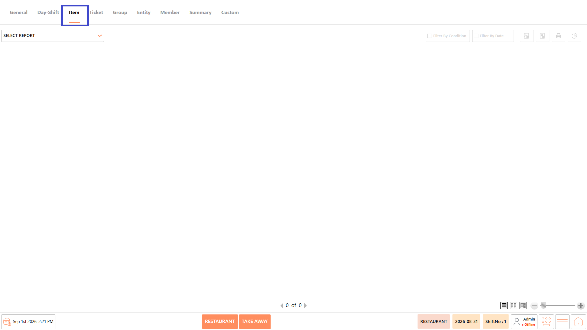<figcaption></figcaption></figure>

## **Reports Available** 

The Item Reports category includes the following reports:

* Items Sales Report
* Items Order Sales Report
* Items Portion Sales Report
* Item Sales by Category Report
* Items Department Sales Report
* Items Discount Report
* Items Hourly Sales Report
* Items User Sales Report
* Combo Sales Report
* Order Tag Report

<figure>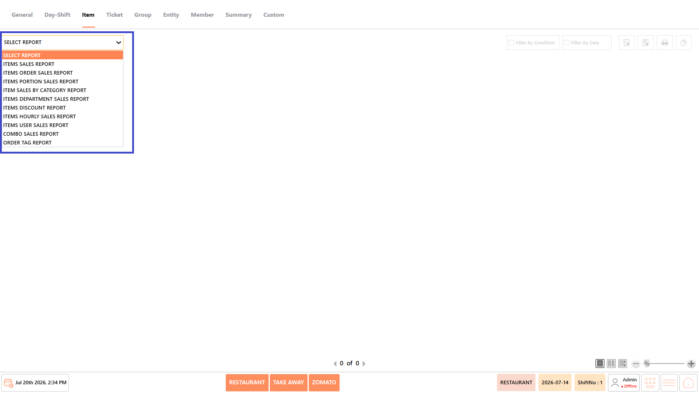<figcaption></figcaption></figure>

#### **Screen Elements** 

The following screen elements are common to all reports in the Item Reports category.

**View Mode**

* Choose how the report is displayed.
* Available options include:
  * **Compact** – Displays the report in a condensed format.
  * **Full** – Displays the complete report with all available information.
  * **Free** – Displays the report without predefined formatting, allowing flexible viewing.

<figure>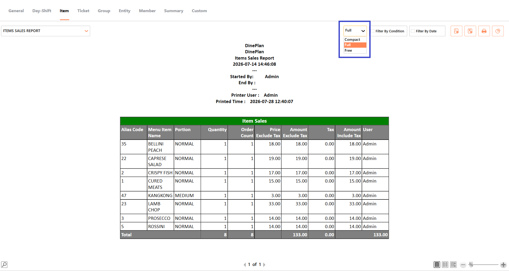<figcaption></figcaption></figure>

**Filter by Condition**

* Apply available conditions, such as menu item, category, department, user, terminal, or other report-specific filters before generating the report.

<figure>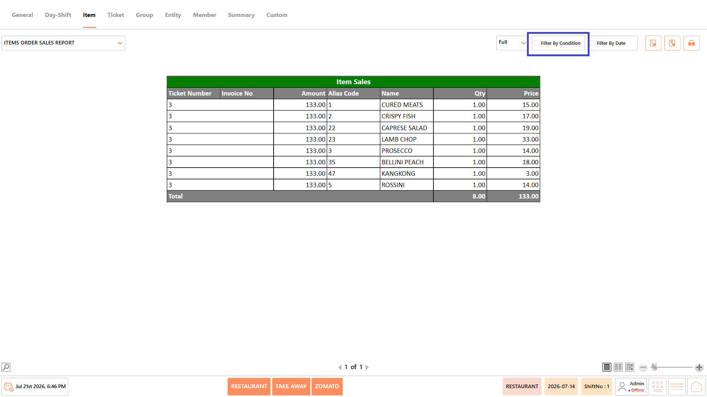<figcaption></figcaption></figure>

**Filter by Date**

* Specify a date or date range to generate the report for a particular business period.

<figure>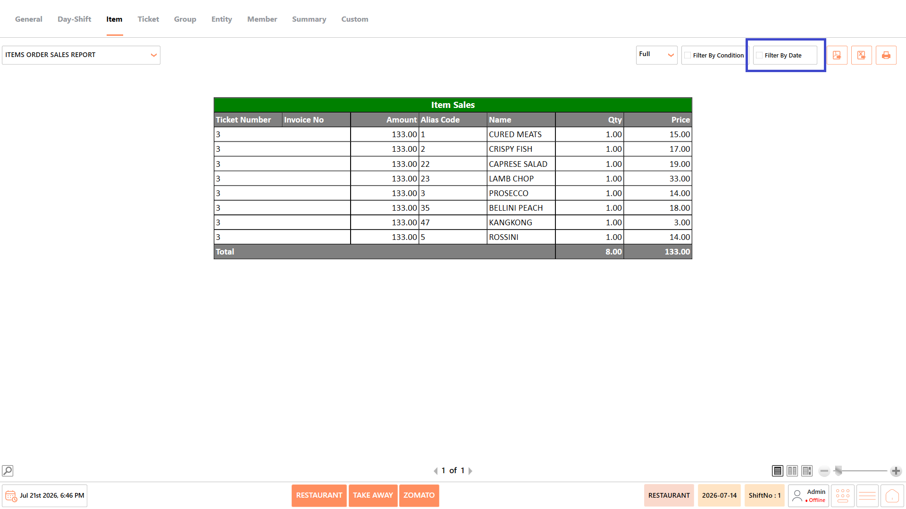<figcaption></figcaption></figure>

**Export as PDF**

* Exports the generated report as a PDF document.

<figure><figcaption></figcaption></figure>

**Export to Excel**

* Exports the generated report as an Excel file.

<figure><figcaption></figcaption></figure>

**Print**

* Prints the currently displayed report.

<figure><figcaption></figcaption></figure>

### **Items Sales Report** 

The Items Sales Report displays item-wise sales for the selected period, including quantities sold, order counts, pricing, taxes, and sales values. It helps managers monitor the performance of individual menu items and evaluate overall item sales.

<figure><figcaption></figcaption></figure>

#### **Screen Elements** 

The following screen elements are available in the Items Sales Report.

<figure>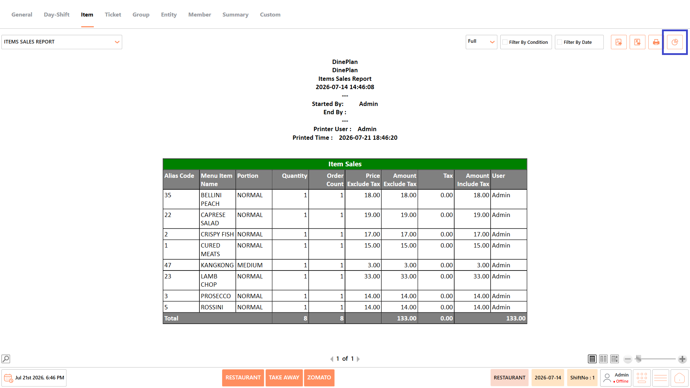<figcaption></figcaption></figure>

**Chart**

* Displays graphical representations of the generated report to help visualize item sales performance.
* The available charts include:
  * **Top 10 Profitable Items** – Displays the menu items generating the highest profit.
  * **Top 10 Sold Items** – Displays the menu items with the highest sales quantity.
* The charts are generated based on the currently selected report data and can be used to quickly identify top-performing menu items.

<figure>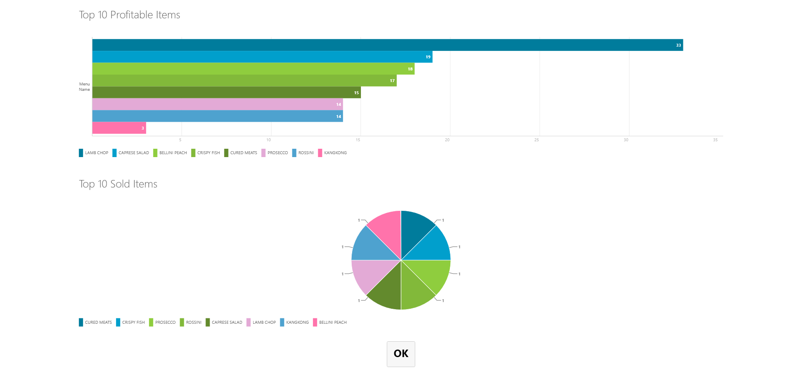<figcaption></figcaption></figure>

#### **Report Fields** 

The report displays information such as:

| **Field**                      | **Description**                                                               |
| ------------------------------ | ----------------------------------------------------------------------------- |
| **Alias Code**                 | Displays the unique alias code assigned to the menu item.                     |
| **Menu Item Name**             | Displays the name of the menu item sold during the selected period.           |
| **Portion**                    | Displays the portion or serving size associated with the menu item.           |
| **Quantity Sold**              | Displays the total quantity of the menu item sold during the selected period. |
| **Order Count**                | Displays the number of orders in which the menu item was sold.                |
| **Price Excluding Tax**        | Displays the selling price of the menu item before applicable taxes.          |
| **Sales Amount Excluding Tax** | Displays the total sales value of the menu item before applicable taxes.      |
| **Tax Amount**                 | Displays the total tax amount applied to the menu item sales.                 |
| **Sales Amount Including Tax** | Displays the total sales value of the menu item including applicable taxes.   |
| **User**                       | Displays the name of the user associated with the menu item transaction.      |

_Note - The information displayed may vary depending on restaurant configuration and available transaction data._

#### **Use Case** 

Use the Items Sales Report to:

* Review item-wise sales performance.
* Compare quantities sold across menu items.
* Analyze item revenue.
* Monitor sales by user.
* Support inventory planning.

### **Items Order Sales Report** 

The Items Order Sales Report displays menu items sold within each order, along with ticket information, invoice details, quantities, and item prices. It helps review item sales at the order level.

<figure>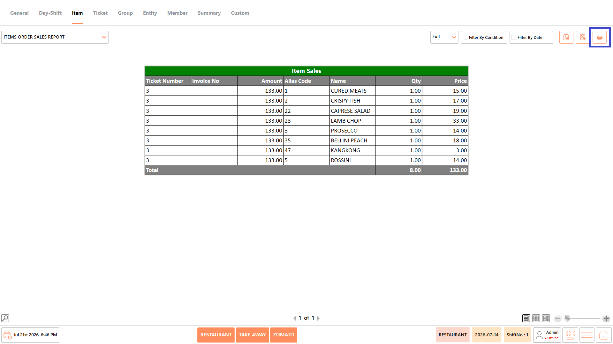<figcaption></figcaption></figure>

#### **Report Fields** 

The report displays information such as:

| **Field**          | **Description**                                               |
| ------------------ | ------------------------------------------------------------- |
| **Ticket Number**  | Displays the unique ticket number assigned to the order.      |
| **Invoice Number** | Displays the invoice number associated with the ticket.       |
| **Order Amount**   | Displays the total amount of the order.                       |
| **Alias Code**     | Displays the unique alias code assigned to the menu item.     |
| **Menu Item Name** | Displays the name of the menu item included in the order.     |
| **Quantity**       | Displays the quantity of the menu item included in the order. |
| **Price**          | Displays the selling price of the menu item.                  |

_Note - The information displayed may vary depending on restaurant configuration and available transaction data._

#### **Use Case** 

Use the Items Order Sales Report to:

* Review items sold in each order.
* Verify order-level sales.
* Analyze item sales by ticket.
* Validate invoice details.
* Support order reconciliation.

### **Items Portion Sales Report** 

The Items Portion Sales Report displays sales based on menu item portions, including pricing, cost, and profit details. It helps evaluate the sales performance of different item portions.

<figure><figcaption></figcaption></figure>

#### **Report Fields** 

The report displays information such as:

| **Field**                      | **Description**                                                                |
| ------------------------------ | ------------------------------------------------------------------------------ |
| **Alias Code**                 | Displays the unique alias code assigned to the menu item.                      |
| **Menu Item Name**             | Displays the name of the menu item sold during the selected period.            |
| **Portion**                    | Displays the portion or serving size associated with the menu item.            |
| **Quantity Sold**              | Displays the total quantity of the menu item sold during the selected period.  |
| **Price Excluding Tax**        | Displays the selling price of the menu item before applicable taxes.           |
| **Sales Amount Excluding Tax** | Displays the total sales value of the menu item before applicable taxes.       |
| **Tax Amount**                 | Displays the total tax amount applied to the menu item sales.                  |
| **Sales Amount Including Tax** | Displays the total sales value of the menu item including applicable taxes.    |
| **Cost**                       | Displays the cost associated with the menu item.                               |
| **Total Cost**                 | Displays the combined cost of the quantities sold for the menu item.           |
| **Profit**                     | Displays the profit generated from the menu item sales after applicable costs. |
| **User**                       | Displays the name of the user associated with the menu item transaction.       |

_Note - The information displayed may vary depending on restaurant configuration and available transaction data._

#### **Use Case** 

Use the Items Portion Sales Report to:

* Compare sales by portion size.
* Analyze portion profitability.
* Review portion-wise demand.
* Monitor item costs.
* Support pricing decisions.

### **Item Sales by Category Report** 

The Item Sales by Category Report groups item sales by menu category, helping managers evaluate category performance and identify high-performing menu sections.

<figure>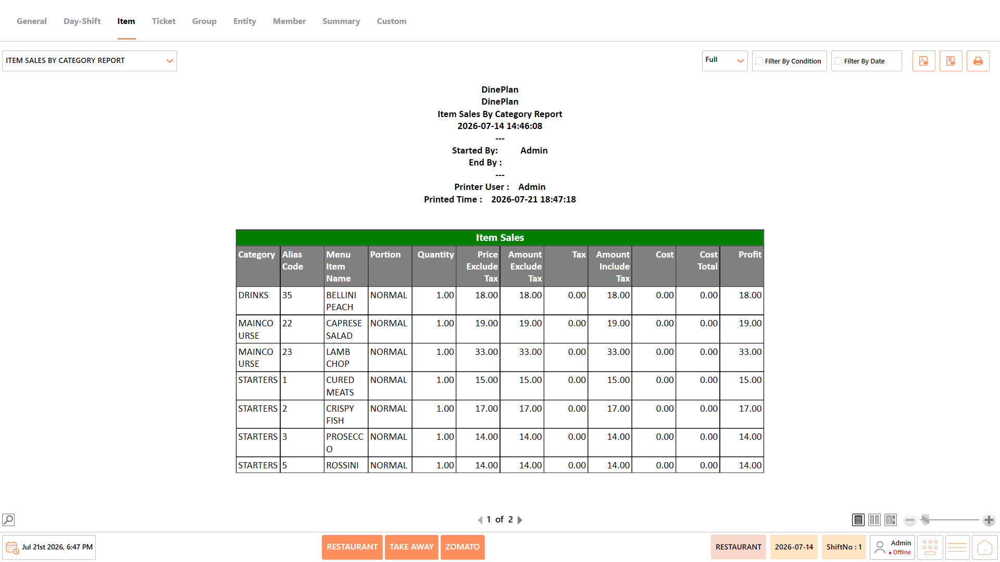<figcaption></figcaption></figure>

#### **Report Fields** 

The report displays information such as:

| **Field**                      | **Description**                                                                |
| ------------------------------ | ------------------------------------------------------------------------------ |
| **Category**                   | Displays the category to which the menu item belongs.                          |
| **Alias Code**                 | Displays the unique alias code assigned to the menu item.                      |
| **Menu Item Name**             | Displays the name of the menu item sold during the selected period.            |
| **Portion**                    | Displays the portion or serving size associated with the menu item.            |
| **Quantity Sold**              | Displays the total quantity of the menu item sold during the selected period.  |
| **Price Excluding Tax**        | Displays the selling price of the menu item before applicable taxes.           |
| **Sales Amount Excluding Tax** | Displays the total sales value of the menu item before applicable taxes.       |
| **Tax Amount**                 | Displays the total tax amount applied to the menu item sales.                  |
| **Sales Amount Including Tax** | Displays the total sales value of the menu item including applicable taxes.    |
| **Cost**                       | Displays the cost associated with the menu item.                               |
| **Total Cost**                 | Displays the combined cost of the quantities sold for the menu item.           |
| **Profit**                     | Displays the profit generated from the menu item sales after applicable costs. |

_Note - The information displayed may vary depending on restaurant configuration and available transaction data._

#### **Use Case** 

Use the Item Sales by Category Report to:

* Compare category-wise sales.
* Analyze category revenue.
* Monitor profitability by category.
* Identify high-performing menu categories.
* Support menu optimization.

### **Items Department Sales Report** 

The Items Department Sales Report displays sales grouped by restaurant department. It helps monitor department performance and evaluate department-wise revenue.

<figure><figcaption></figcaption></figure>

#### **Report Fields** 

The report displays information such as:

| **Field**                      | **Description**                                                                |
| ------------------------------ | ------------------------------------------------------------------------------ |
| **Department**                 | Displays the department to which the menu item belongs.                        |
| **Alias Code**                 | Displays the unique alias code assigned to the menu item.                      |
| **Menu Item Name**             | Displays the name of the menu item sold during the selected period.            |
| **Portion**                    | Displays the portion or serving size associated with the menu item.            |
| **Quantity Sold**              | Displays the total quantity of the menu item sold during the selected period.  |
| **Price Excluding Tax**        | Displays the selling price of the menu item before applicable taxes.           |
| **Sales Amount Excluding Tax** | Displays the total sales value of the menu item before applicable taxes.       |
| **Tax Amount**                 | Displays the total tax amount applied to the menu item sales.                  |
| **Sales Amount Including Tax** | Displays the total sales value of the menu item including applicable taxes.    |
| **Cost**                       | Displays the cost associated with the menu item.                               |
| **Total Cost**                 | Displays the combined cost of the quantities sold for the menu item.           |
| **Profit**                     | Displays the profit generated from the menu item sales after applicable costs. |

_Note - The information displayed may vary depending on restaurant configuration and available transaction data._

#### **Use Case** 

Use the Items Department Sales Report to:

* Compare department-wise sales.
* Review department performance.
* Analyze department revenue.
* Monitor profitability.
* Support operational planning.

### **Items Discount Report** 

The Items Discount Report displays discounts applied to individual menu items during the selected period. It helps verify discounted transactions and monitor discount activity.

<figure>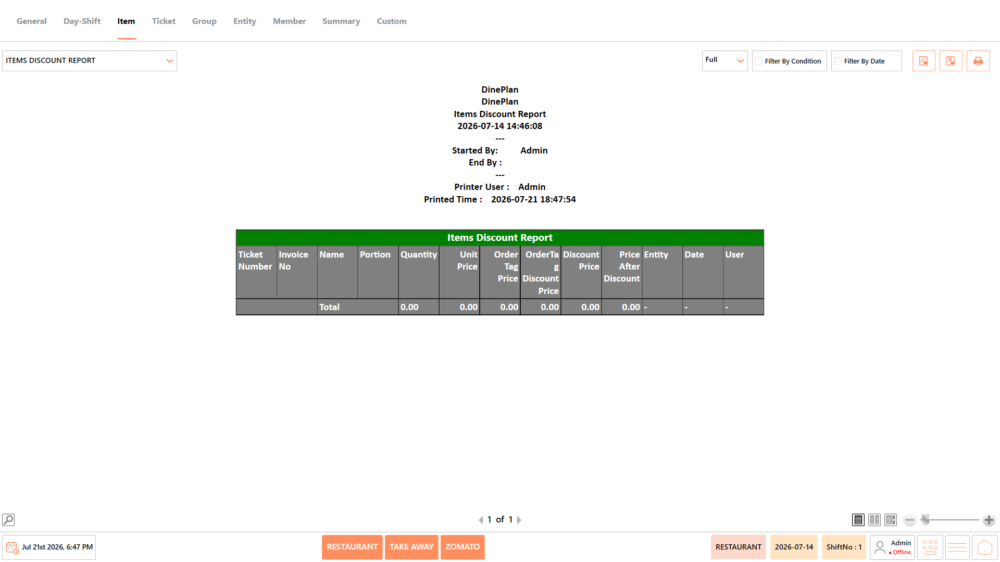<figcaption></figcaption></figure>

#### **Report Fields** 

The report displays information such as:

| **Field**                    | **Description**                                                             |
| ---------------------------- | --------------------------------------------------------------------------- |
| **Ticket Number**            | Displays the ticket number associated with the discounted item transaction. |
| **Invoice Number**           | Displays the invoice number associated with the ticket.                     |
| **Menu Item Name**           | Displays the name of the menu item for which the discount was applied.      |
| **Portion**                  | Displays the portion or serving size associated with the menu item.         |
| **Quantity**                 | Displays the quantity of the menu item included in the transaction.         |
| **Unit Price**               | Displays the original selling price of one unit of the menu item.           |
| **Order Tag Price**          | Displays the price associated with the applicable order tag.                |
| **Order Tag Discount Price** | Displays the discounted price resulting from the applicable order tag.      |
| **Discount Price**           | Displays the discount amount applied to the menu item.                      |
| **Price After Discount**     | Displays the final price of the menu item after the discount is applied.    |
| **Entity**                   | Displays the business entity associated with the transaction.               |
| **Date**                     | Displays the date on which the transaction was recorded.                    |
| **User**                     | Displays the name of the user associated with the transaction.              |

_Note - The information displayed may vary depending on restaurant configuration and available transaction data._

#### **Use Case** 

Use the Items Discount Report to:

* Review item-level discounts.
* Verify discounted transactions.
* Monitor discount usage.
* Compare original and discounted prices.
* Support financial audits.

### **Items Hourly Sales Report** 

The Items Hourly Sales Report displays item sales based on hourly business activity. It helps identify peak sales hours and analyze customer purchasing patterns throughout the day.

#### **Report Fields** 

#### **Use Case** 

Use the Items Hourly Sales Report to:

* Identify peak sales hours.
* Analyze hourly sales trends.
* Optimize staffing schedules.
* Review customer activity throughout the day.
* Support operational planning.

### **Items User Sales Report** 

The Items User Sales Report displays item sales grouped by user, including sales values, costs, and profit information. It helps evaluate user-wise sales performance.

<figure>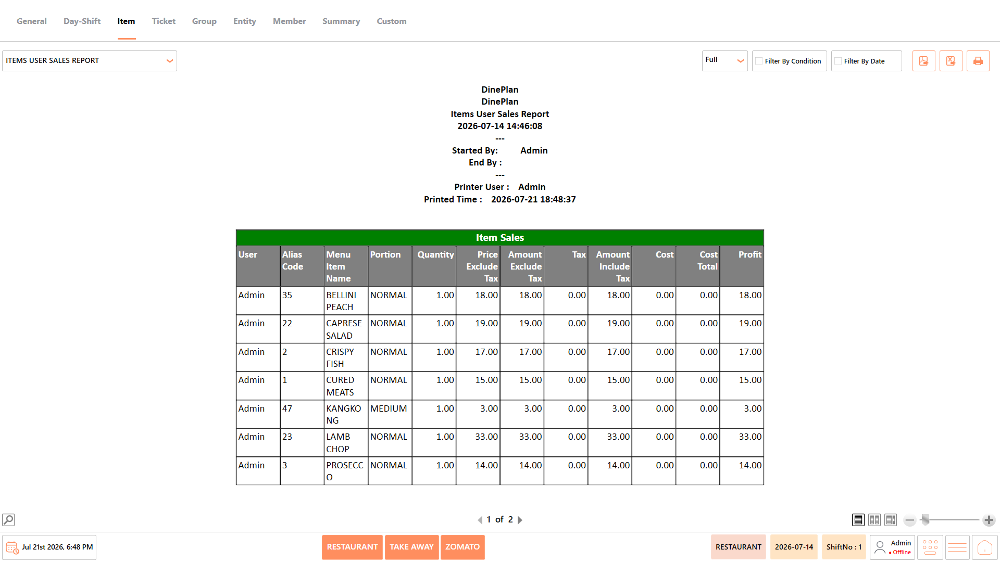<figcaption></figcaption></figure>

#### **Report Fields** 

The report displays information such as:

| **Field**                      | **Description**                                                                |
| ------------------------------ | ------------------------------------------------------------------------------ |
| **User**                       | Displays the name of the user associated with the menu item transaction.       |
| **Alias Code**                 | Displays the unique alias code assigned to the menu item.                      |
| **Menu Item Name**             | Displays the name of the menu item sold during the selected period.            |
| **Portion**                    | Displays the portion or serving size associated with the menu item.            |
| **Quantity Sold**              | Displays the total quantity of the menu item sold during the selected period.  |
| **Price Excluding Tax**        | Displays the selling price of the menu item before applicable taxes.           |
| **Sales Amount Excluding Tax** | Displays the total sales value of the menu item before applicable taxes.       |
| **Tax Amount**                 | Displays the total tax amount applied to the menu item sales.                  |
| **Sales Amount Including Tax** | Displays the total sales value of the menu item including applicable taxes.    |
| **Cost**                       | Displays the cost associated with the menu item.                               |
| **Total Cost**                 | Displays the combined cost of the quantities sold for the menu item.           |
| **Profit**                     | Displays the profit generated from the menu item sales after applicable costs. |

_Note - The information displayed may vary depending on restaurant configuration and available transaction data._

#### **Use Case** 

Use the Items User Sales Report to:

* Review user-wise sales.
* Compare employee performance.
* Analyze sales generated by each user.
* Monitor profitability.
* Support operational reviews.

### **Combo Sales Report** 

The Combo Sales Report displays sales information for combo items and their associated sub-items. It helps monitor combo performance and review the sales of bundled menu items.

<figure>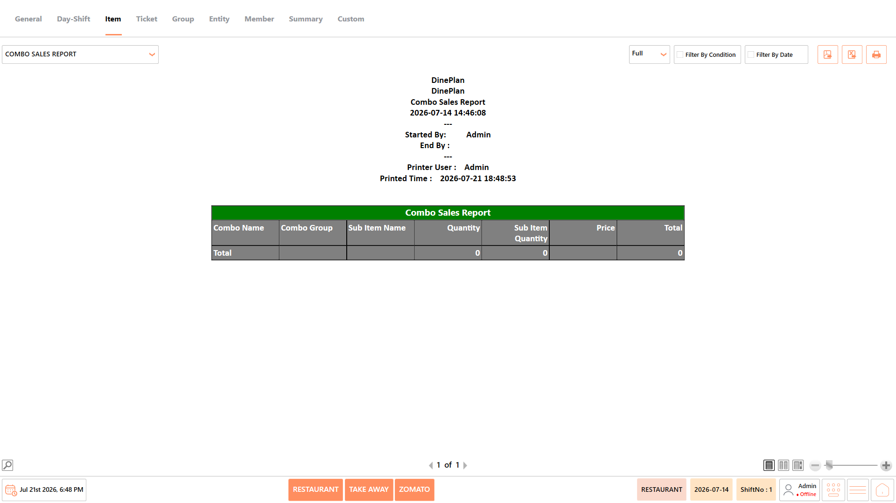<figcaption></figcaption></figure>

#### **Report Fields** 

The report displays information such as:

| **Field**             | **Description**                                                         |
| --------------------- | ----------------------------------------------------------------------- |
| **Combo Name**        | Displays the name of the combo item sold during the selected period.    |
| **Combo Group**       | Displays the group to which the combo item belongs.                     |
| **Sub-item Name**     | Displays the name of the individual item included in the combo.         |
| **Quantity**          | Displays the total quantity of the combo item sold.                     |
| **Sub-item Quantity** | Displays the quantity of the individual sub-item included in the combo. |
| **Price**             | Displays the selling price of the combo item.                           |
| **Total**             | Displays the total sales value of the combo item.                       |

_Note - The information displayed may vary depending on restaurant configuration and available transaction data._

#### **Use Case** 

Use the Combo Sales Report to:

* Review combo sales.
* Analyze combo popularity.
* Verify combo pricing.
* Monitor bundled item performance.
* Support menu planning.

### **Order Tag Report** 

The Order Tag Report displays sales associated with order tags and tag groups. It helps analyze order customization and monitor the usage of order tags during restaurant operations.

<figure><figcaption></figcaption></figure>

#### **Report Fields** 

The report displays information such as:

| **Field**            | **Description**                                                         |
| -------------------- | ----------------------------------------------------------------------- |
| **Order Tag Group**  | Displays the group to which the order tag belongs.                      |
| **Group Alias Name** | Displays the alternate or configured alias name of the order tag group. |
| **Order Tag**        | Displays the order tag associated with the transaction.                 |
| **Tag Alias Name**   | Displays the alternate or configured alias name of the order tag.       |
| **Quantity**         | Displays the total quantity associated with the order tag.              |
| **Price**            | Displays the price associated with the order tag.                       |
| **Total Amount**     | Displays the total amount generated from the order tag.                 |

_Note - The information displayed may vary depending on restaurant configuration and available transaction data._

#### **Use Case** 

Use the Order Tag Report to:

* Review order tag usage.
* Analyze tag-wise sales.
* Monitor popular order tags.
* Verify tagged item pricing.
* Support menu customization analysis.

## **Notes** 

* The information displayed in the reports may vary depending on the selected report, available transaction data, and restaurant configuration.
* Report results are generated based on the selected date range and applied conditions.
* Some fields, such as Cost, Total Cost, and Profit, are available only when costing is configured in the system.
* Empty reports indicate that no transactions match the selected date range or filter conditions.
* Report totals are displayed based on the transactions included in the generated report.
* Use Export to PDF, Export to Excel, or Print to save or share the generated report as required.
