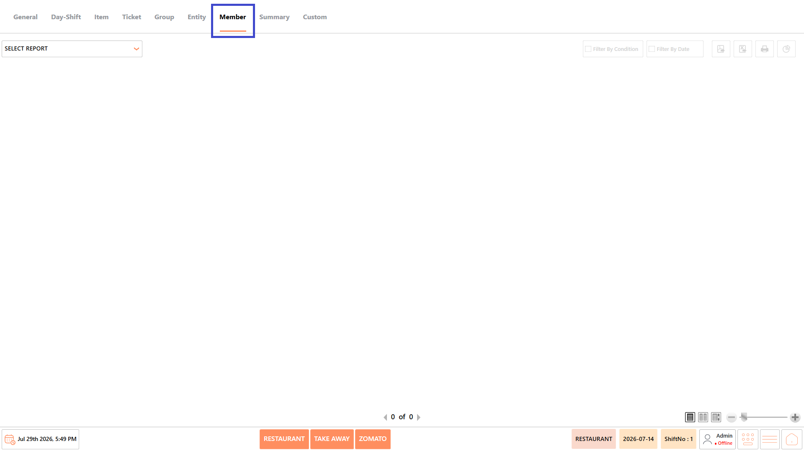
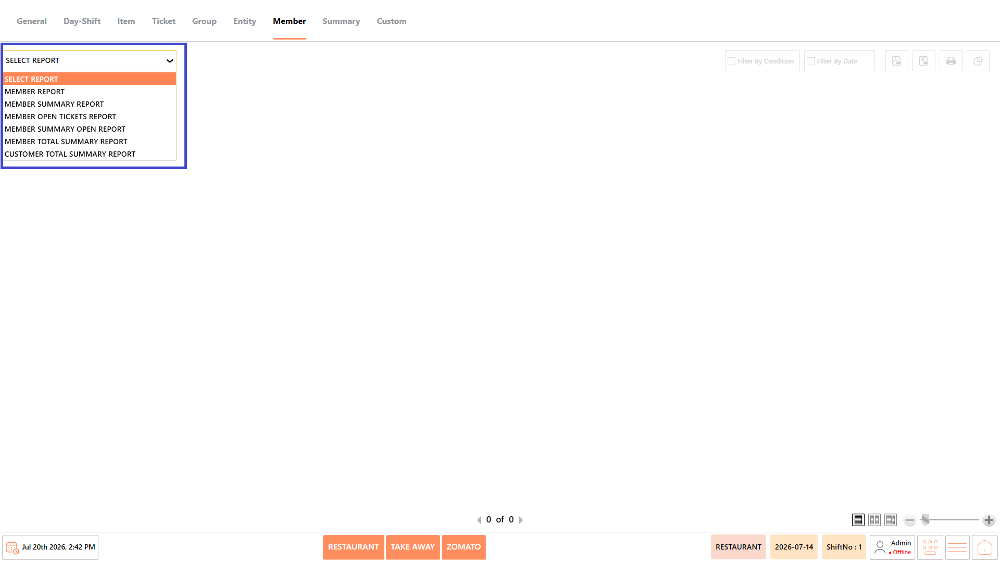
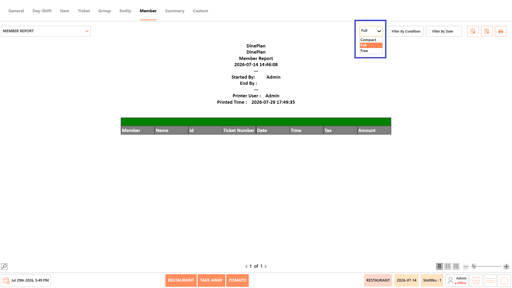
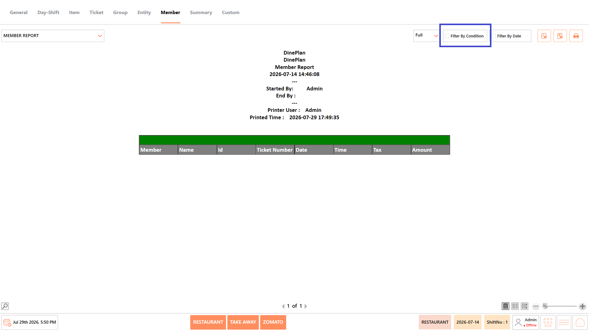
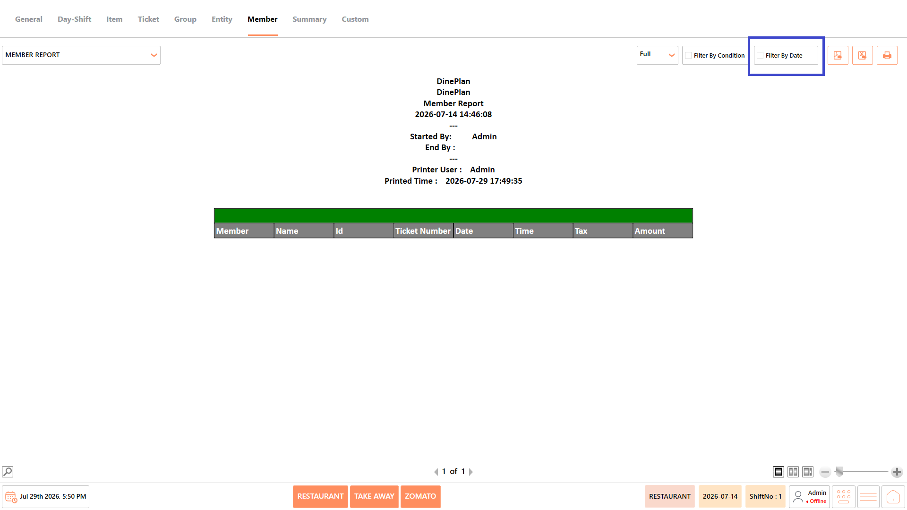
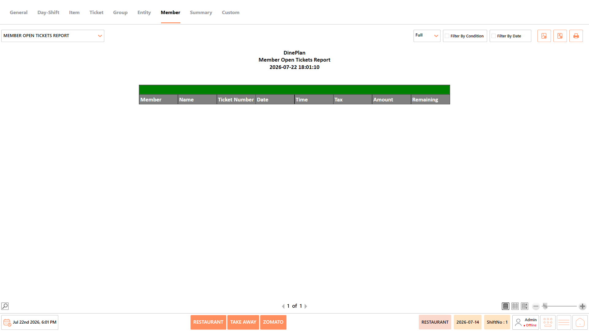
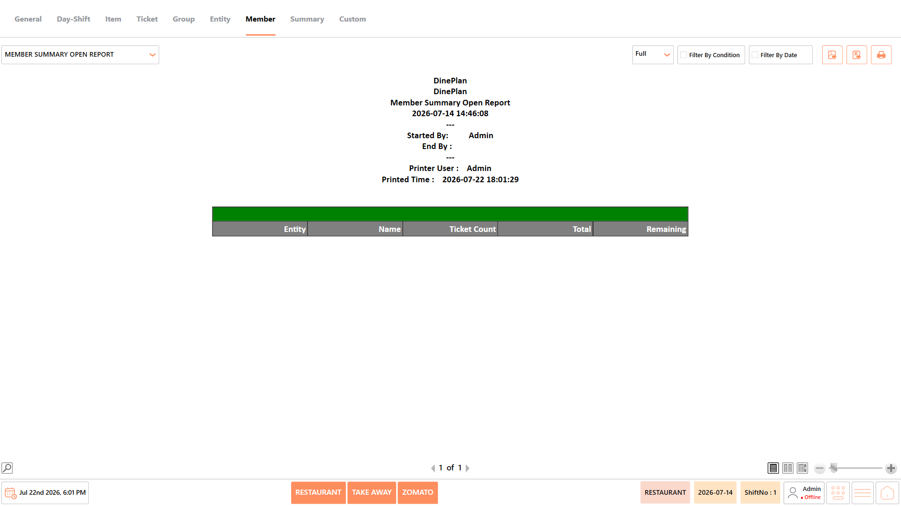
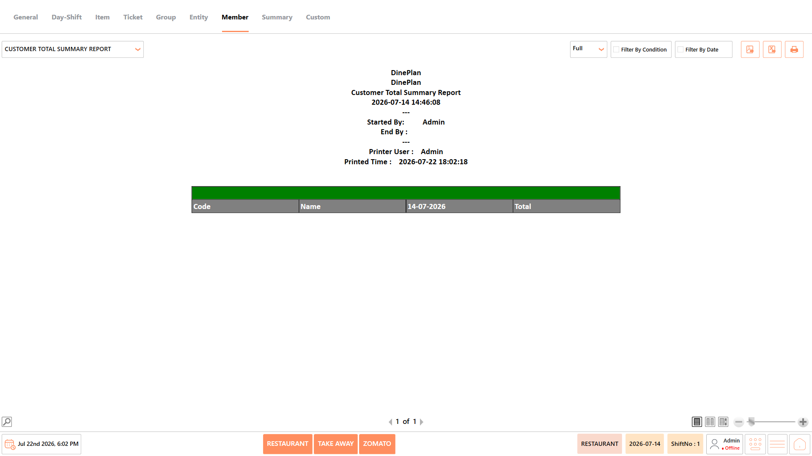

# Member Reports

## **Overview** 

The Member Reports category provides reports related to members, customer accounts, open tickets, and member transaction summaries. These reports help restaurant managers monitor member purchases, outstanding balances, customer activity, and overall member-wise sales performance.

<figure><figcaption></figcaption></figure>

## **Reports Available** 

The Member Reports category includes the following reports:

* Member Report
* Member Summary Report
* Member Open Tickets Report
* Member Summary Open Report
* Member Total Summary Report
* Customer Total Summary Report

<figure><figcaption></figcaption></figure>

#### **Screen Elements** 

The following screen elements are common to all reports in the Member Reports category.

**View Mode**

* Select how the report is displayed.
* Available options include:
  * **Compact** – Displays the report in a condensed format.
  * **Full** – Displays the complete report with all available information.
  * **Free** – Displays the report without predefined formatting, allowing flexible viewing.

<figure><figcaption></figcaption></figure>

**Filter by Condition**

* Apply report-specific filters such as member, customer, ticket number, entity, payment status, or other available conditions before generating the report.

<figure><figcaption></figcaption></figure>

**Filter by Date**

* Specify the required date or date range for generating the report.

<figure><figcaption></figcaption></figure>

**Export as PDF**

* Exports the generated report as a PDF document.

<figure><figcaption></figcaption></figure>

**Export to Excel**

* Exports the generated report as an Excel file.

<figure><figcaption></figcaption></figure>

**Print**

* Prints the currently displayed report.

<figure><figcaption></figcaption></figure>

### **Member Report** 

The Member Report displays detailed transaction information for individual members, including ticket details, tax, amount, and transaction date. It helps restaurant managers review member purchase history, verify transactions, and monitor customer activity over a selected period.

<figure><figcaption></figcaption></figure>

#### **Report Fields** 

The report includes information such as:

| **Field**     | **Description**                                                                                                                                                |
| ------------- | -------------------------------------------------------------------------------------------------------------------------------------------------------------- |
| Member        | Displays the unique member code or identifier assigned to the customer. It helps identify the member associated with each transaction recorded in the report.  |
| Name          | Displays the name of the member linked to the transaction. It makes it easier to recognize customers without referring to their member codes.                  |
| ID            | Displays the unique record or transaction identifier generated by the system. It helps distinguish each transaction for auditing and troubleshooting purposes. |
| Ticket Number | Displays the ticket number associated with the member transaction. It helps locate and verify the corresponding sales ticket quickly.                          |
| Date          | Displays the business date on which the transaction was created. It helps review member purchases for a specific reporting period.                             |
| Time          | Displays the time at which the transaction was recorded. It helps analyze customer activity during different business hours.                                   |
| Tax           | Displays the tax amount applied to the member transaction. It helps verify tax calculations and billing accuracy.                                              |
| Amount        | Displays the total value of the member transaction. It helps evaluate the overall purchase amount for each transaction.                                        |

_Note - The information displayed may vary depending on restaurant configuration and available transaction data._

#### **Use Case** 

Use the Member Report to:

* Review member purchase history.
* Verify customer transactions.
* Monitor member spending.
* Support customer service requests.
* Validate billing information.

### **Member Summary Report** 

The Member Summary Report provides a summarized view of member transactions by entity, including ticket count and total sales value. It helps managers evaluate member activity and compare overall customer spending across different business entities.

<figure><figcaption></figcaption></figure>

#### **Report Fields** 

The report includes information such as:

| **Field**    | **Description**                                                                                                                                        |
| ------------ | ------------------------------------------------------------------------------------------------------------------------------------------------------ |
| Entity       | Displays the business entity or outlet where the transactions were recorded. It helps organize member sales based on restaurant locations or entities. |
| Ticket Count | Displays the total number of tickets generated for the member. It helps measure transaction frequency during the selected period.                      |
| Total        | Displays the cumulative sales value for the member. It helps evaluate the member's overall spending during the reporting period.                       |

_Note - The information displayed may vary depending on restaurant configuration and available transaction data._

#### **Use Case** 

Use the Member Summary Report to:

* Review member sales summaries.
* Compare customer activity.
* Analyze ticket volumes.
* Monitor member spending.
* Generate management reports.

### **Member Open Tickets Report** 

The Member Open Tickets Report displays outstanding tickets that remain unpaid or partially settled for members. It helps managers monitor pending balances, identify overdue transactions, and follow up on customer payments.

<figure><figcaption></figcaption></figure>

#### **Report Fields** 

The report includes information such as:

| **Field**     | **Description**                                                                                                                      |
| ------------- | ------------------------------------------------------------------------------------------------------------------------------------ |
| Member        | Displays the member code associated with the outstanding ticket. It helps identify the customer responsible for the pending balance. |
| Name          | Displays the member's name linked to the open ticket. It provides an easy way to recognize the customer.                             |
| Ticket Number | Displays the number assigned to the open ticket. It helps locate the pending transaction within the system.                          |
| Date          | Displays the date when the ticket was created. It helps determine how long the ticket has remained open.                             |
| Time          | Displays the time the ticket was generated. It helps review transaction activity during business hours.                              |
| Tax           | Displays the tax amount included in the ticket total. It helps verify tax calculations for outstanding transactions.                 |
| Amount        | Displays the total value of the open ticket. It helps review the original amount billed to the customer.                             |
| Remaining     | Displays the unpaid balance remaining on the ticket. It helps track pending customer dues and outstanding payments.                  |

_Note - The information displayed may vary depending on restaurant configuration and available transaction data._

#### **Use Case** 

Use the Member Open Tickets Report to:

* Monitor unpaid tickets.
* Track outstanding balances.
* Review pending customer payments.
* Support collection activities.
* Verify open transactions.

### **Member Summary Open Report** 

The Member Summary Open Report provides a consolidated summary of outstanding member transactions, including ticket count, total amount, and remaining balance. It helps managers monitor pending payments and evaluate customer liabilities across business entities.

<figure><figcaption></figcaption></figure>

#### **Report Fields** 

The report includes information such as:

| **Field**    | **Description**                                                                                                                           |
| ------------ | ----------------------------------------------------------------------------------------------------------------------------------------- |
| Entity       | Displays the business entity associated with the member account. It helps organize outstanding balances by restaurant location or entity. |
| Name         | Displays the member's name associated with the outstanding transactions. It helps quickly identify the customer.                          |
| Ticket Count | 
Displays the total number of open tickets for the

member. It helps measure the volume of pending transactions.
               |
| Total        | Displays the combined value of all open tickets. It helps review the total outstanding sales amount.                                      |
| Remaining    | Displays the unpaid balance remaining for the member. It helps monitor pending dues that require collection.                              |

_Note - The information displayed may vary depending on restaurant configuration and available transaction data._

#### **Use Case** 

Use the Member Summary Open Report to:

* Review pending balances.
* Monitor outstanding member payments.
* Analyze open ticket summaries.
* Track customer liabilities.
* Support payment follow-ups.

### **Member Total Summary Report** 

The Member Total Summary Report provides an overall summary of sales generated by members during the selected reporting period. It helps compare member-wise sales performance and evaluate total customer purchases.

<figure><figcaption></figcaption></figure>

#### **Report Fields** 

The report includes information such as:

| **Field** | **Description**                                                                                                                    |
| --------- | ---------------------------------------------------------------------------------------------------------------------------------- |
| Code      | Displays the unique member code assigned to each customer. It helps uniquely identify members within the report.                   |
| Name      | Displays the member's name corresponding to the member code. It allows users to identify customers easily.                         |
| Date      | Displays the reporting date for which the sales summary is generated. It helps identify the business period covered by the report. |
| Total     | Displays the total sales value generated by the member. It helps evaluate the member's overall contribution to sales.              |

_Note - The information displayed may vary depending on restaurant configuration and available transaction data._

#### **Use Case** 

Use the Member Total Summary Report to:

* Compare member sales.
* Analyze customer spending.
* Review overall sales.
* Monitor member performance.
* Generate business summaries.

### **Customer Total Summary Report** 

The Customer Total Summary Report provides a consolidated summary of total purchases made by customers during the selected period. It helps managers analyze customer spending patterns and identify high-value customers.

<figure><figcaption></figcaption></figure>

#### **Report Fields** 

The report includes information such as:

| **Field** | **Description**                                                                                                                         |
| --------- | --------------------------------------------------------------------------------------------------------------------------------------- |
| Code      | Displays the unique customer code assigned by the system. It helps distinguish customers within the report.                             |
| Name      | Displays the customer's name associated with the customer code. It helps identify individual customers easily.                          |
| Date      | Displays the reporting date for which customer totals are generated. It helps identify the business period covered by the report.       |
| Total     | Displays the total purchase amount recorded for the customer. It helps evaluate customer spending during the selected reporting period. |

_Note - The information displayed may vary depending on restaurant configuration and available transaction data._

#### **Use Case** 

Use the Customer Total Summary Report to:

* Review customer purchase totals.
* Compare customer spending.
* Identify valuable customers.
* Analyze customer sales trends.

## **Notes** 

* The information displayed in the reports may vary depending on the selected report, available transaction data, and restaurant configuration.
* Report results are generated based on the selected date range and applied conditions.
* Some fields, such as Cost, Total Cost, and Profit, are available only when costing is configured in the system.
* Empty reports indicate that no transactions match the selected date range or filter conditions.
* Report totals are displayed based on the transactions included in the generated report.
* Use Export to PDF, Export to Excel, or Print to save or share the generated report as required.
