# Summary Reports

## **Overview** 

The Summary Reports category provides consolidated sales, payment, and business performance reports for the selected reporting period. These reports help restaurant managers analyze revenue, payment collections, terminal performance, meal-time sales, and overall sales trends for better operational and financial decision-making.

<figure>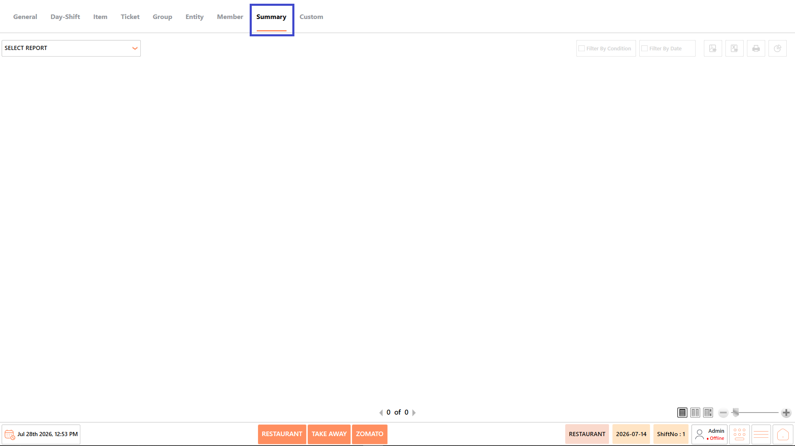<figcaption></figcaption></figure>

## **Reports Available** 

The Summary Reports category includes the following reports:

* Payment Summary by Terminal Report
* Payment Summary Report
* Daily Sales Summary Report
* Daily Terminal Sales Summary Report
* Meal Time Sales Report
* Sales by Period Report

<figure>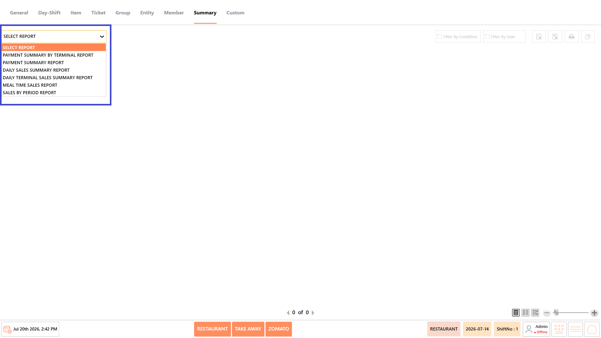<figcaption></figcaption></figure>

#### **Screen Elements** 

The following screen elements are common to all reports in the Summary Reports category.

**View Mode**

* Select how the report is displayed.
* Available options include:
  * **Compact** – Displays the report in a condensed format.
  * **Full** – Displays the complete report with all available information.
  * **Free** – Displays the report without predefined formatting, allowing flexible viewing.

<figure>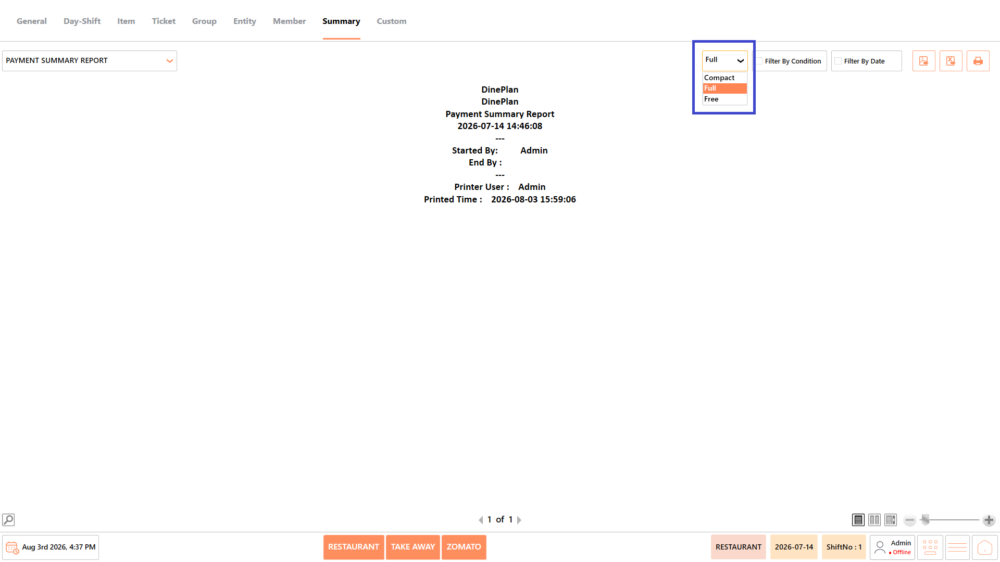<figcaption></figcaption></figure>

**Filter by Condition**

* Apply report-specific filters such as terminal, payment method, meal period, sales period, entity, or other available conditions before generating the report.

<figure>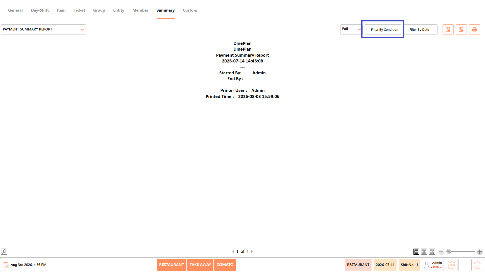<figcaption></figcaption></figure>

**Filter by Date**

* Specify the required date or date range for generating the report.

<figure>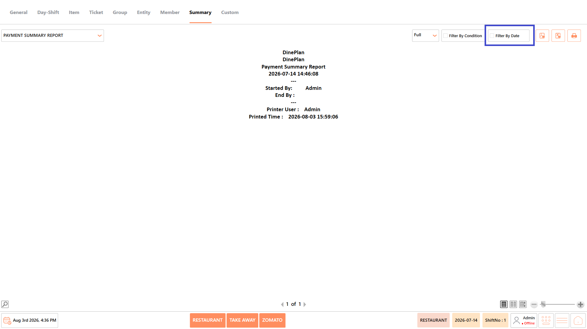<figcaption></figcaption></figure>

**Export as PDF**

* Exports the generated report as a PDF document.

<figure><figcaption></figcaption></figure>

**Export to Excel**

* Exports the generated report as an Excel file.

<figure>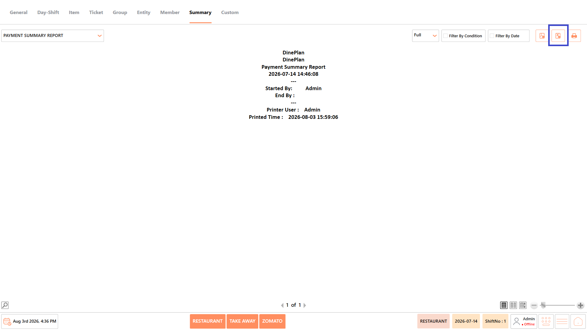<figcaption></figcaption></figure>

**Print**

* Prints the currently displayed report.

<figure><figcaption></figcaption></figure>

### **Payment Summary by Terminal Report** 

The Payment Summary by Terminal Report provides a consolidated summary of payments processed through each POS terminal during the selected reporting period. It helps managers compare terminal-wise payment collections and monitor transaction activity across different billing stations.

<figure>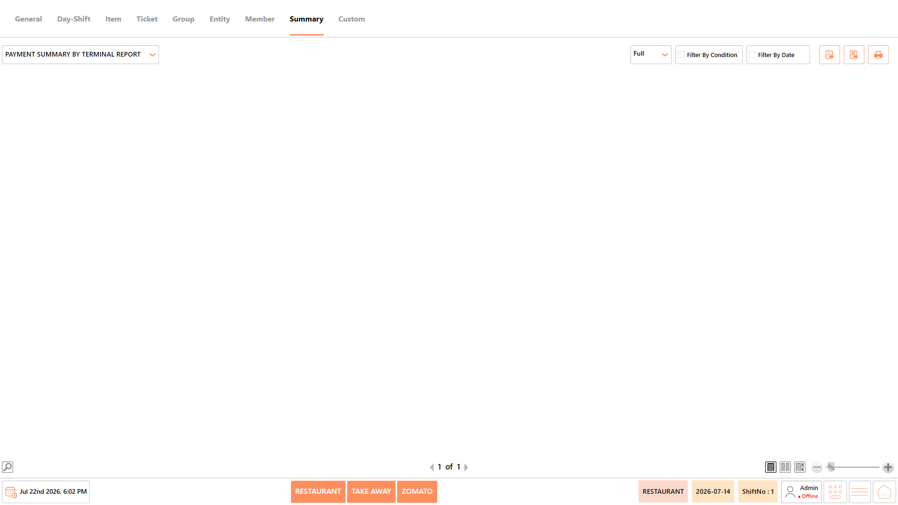<figcaption></figcaption></figure>

#### **Report Fields** 

The report includes information such as:

| **Field**       | **Description**                                                                                                                        |
| --------------- | -------------------------------------------------------------------------------------------------------------------------------------- |
| Terminal        | Displays the name of the POS terminal where payments were processed. It helps identify payment collections handled by each terminal.   |
| Cash            | Displays the total cash payments received through the terminal. It helps monitor cash collections for reconciliation purposes.         |
| Card            | Displays the total payments received through card transactions. It helps track electronic payment collections for the selected period. |
| Digital Payment | Displays the total amount received through digital payment methods such as UPI or wallets. It helps analyze non-cash payment trends.   |
| Total           | Displays the combined payment amount collected through all payment methods. It helps evaluate the terminal's total payment collection. |

_Note - The information displayed may vary depending on restaurant configuration and available transaction data._

#### **Use Case** 

Use the Payment Summary by Terminal Report to:

* Compare terminal-wise collections.
* Verify payment reconciliation.
* Monitor payment methods.
* Track billing performance.
* Review total payment collections.

### **Payment Summary Report** 

The Payment Summary Report provides an overall summary of payments received through different payment methods during the selected reporting period. It helps managers reconcile collections, monitor payment distribution, and analyze overall revenue.

<figure>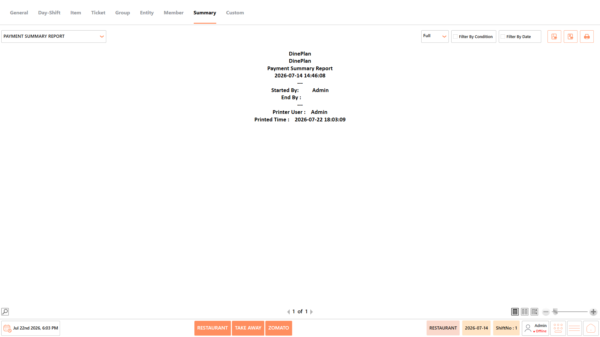<figcaption></figcaption></figure>

#### **Report Fields** 

The report includes information such as:

| **Field**         | **Description**                                                                                                                                   |
| ----------------- | ------------------------------------------------------------------------------------------------------------------------------------------------- |
| Payment Type      | Displays the payment method used for transactions, such as Cash, Card, or Digital Payment. It helps categorize collections based on payment mode. |
| Transaction Count | Displays the total number of transactions processed using each payment method. It helps measure payment method usage.                             |
| Amount            | Displays the total amount collected through each payment method. It helps evaluate revenue generated from different payment types.                |
| Percentage        | Displays the percentage contribution of each payment method to total collections. It helps analyze payment preferences among customers.           |

_Note - The information displayed may vary depending on restaurant configuration and available transaction data._

#### **Use Case** 

Use the Payment Summary Report to:

* Review payment collections.
* Compare payment methods.
* Reconcile daily revenue.
* Analyze customer payment preferences.
* Generate financial summaries.

### **Daily Sales Summary Report** 

The Daily Sales Summary Report provides a day-wise summary of sales, including ticket count, tax, and total sales amount. It helps managers review daily business performance and monitor sales trends over a selected period.

<figure>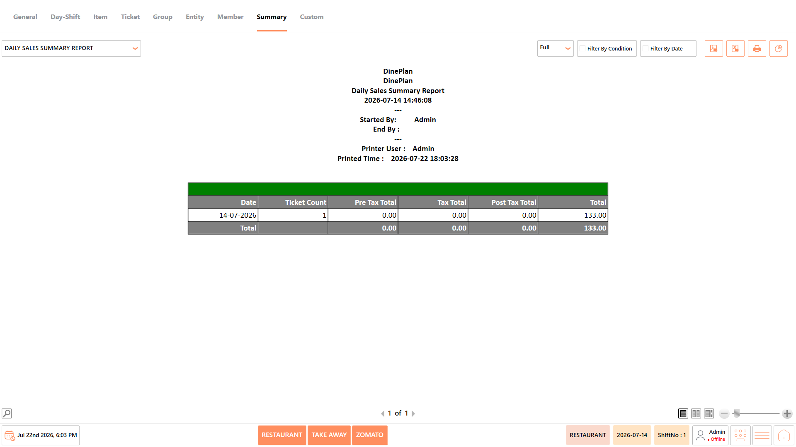<figcaption></figcaption></figure>

#### **Report Fields** 

The report includes information such as:

| **Field**      | **Description**                                                                                                            |
| -------------- | -------------------------------------------------------------------------------------------------------------------------- |
| Date           | Displays the business date for which the sales summary is generated. It helps organize sales information by reporting day. |
| Ticket Count   | Displays the total number of tickets generated on the selected date. It helps measure customer transaction volume.         |
| Pre Tax Total  | Displays the total sales amount before taxes are applied. It helps review the net value of sales.                          |
| Tax Total      | Displays the total tax collected from all sales transactions. It helps verify tax calculations for the reporting period.   |
| Post Tax Total | Displays the total sales amount after tax calculations. It helps review the final billed value before adjustments.         |
| Total          | Displays the final total sales amount for the reporting period. It helps evaluate the overall business revenue.            |

_Note - The information displayed may vary depending on restaurant configuration and available transaction data._

#### **Use Case** 

Use the Daily Sales Summary Report to:

* Review daily revenue.
* Monitor ticket volumes.
* Verify tax collections.
* Compare daily sales.
* Generate management reports.

### **Daily Terminal Sales Summary Report** 

The Daily Terminal Sales Summary Report provides a terminal-wise summary of daily sales, including ticket count, tax, and total sales value. It helps managers compare sales performance across billing terminals and monitor terminal activity.

<figure>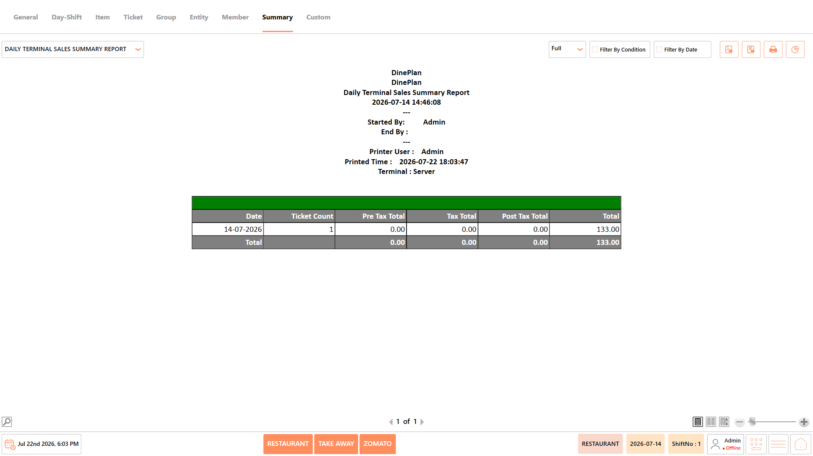<figcaption></figcaption></figure>

#### **Report Fields** 

The report includes information such as:

| **Field**      | **Description**                                                                                                             |
| -------------- | --------------------------------------------------------------------------------------------------------------------------- |
| Date           | Displays the business date for which the report is generated. It helps identify the reporting period.                       |
| Ticket Count   | Displays the total number of tickets processed through the terminal. It helps measure transaction volume for each terminal. |
| Pre Tax Total  | Displays the sales value before taxes are applied. It helps review the net sales amount generated by the terminal.          |
| Tax Total      | Displays the total tax collected through the terminal. It helps verify tax calculations for terminal transactions.          |
| Post Tax Total | Displays the sales value after tax calculations. It helps review the billed amount generated through the terminal.          |
| Total          | Displays the final sales value recorded for the terminal. It helps evaluate overall terminal performance.                   |

_Note - The information displayed may vary depending on restaurant configuration and available transaction data._

#### **Use Case** 

Use the Daily Terminal Sales Summary Report to:

* Compare terminal performance.
* Review terminal sales.
* Monitor ticket counts.
* Verify tax collections.
* Support terminal reconciliation.

### **Meal Time Sales Report** 

The Meal Time Sales Report summarizes sales generated during different meal periods such as breakfast, lunch, dinner, or other configured sessions. It helps managers identify peak business hours and evaluate sales performance across meal times.

<figure><figcaption></figcaption></figure>

#### **Report Fields** 

The report includes information such as:

| **Field**      | **Description**                                                                                                                |
| -------------- | ------------------------------------------------------------------------------------------------------------------------------ |
| Meal Time      | Displays the configured meal session, such as Breakfast, Lunch, or Dinner. It helps categorize sales based on service periods. |
| Ticket Count   | Displays the total number of tickets generated during the meal period. It helps measure customer traffic for each session.     |
| Pre Tax Total  | Displays the sales amount before taxes are applied. It helps review the actual sales value for the meal period.                |
| Tax Total      | Displays the total tax collected during the meal session. It helps verify tax amounts for each service period.                 |
| Post Tax Total | Displays the sales amount after tax calculations. It helps review the billed value for the meal session.                       |
| Total          | Displays the overall sales generated during the meal period. It helps evaluate revenue across different service timings.       |

_Note - The information displayed may vary depending on restaurant configuration and available transaction data._

#### **Use Case** 

Use the Meal Time Sales Report to:

* Analyze meal-wise sales.
* Identify peak service hours.
* Compare meal performance.
* Monitor customer traffic.
* Support operational planning.

### **Sales by Period Report** 

The Sales by Period Report summarizes sales generated across selected time intervals such as hourly, daily, weekly, or monthly periods. It helps managers identify sales trends, monitor business performance, and compare revenue across different reporting periods.

<figure>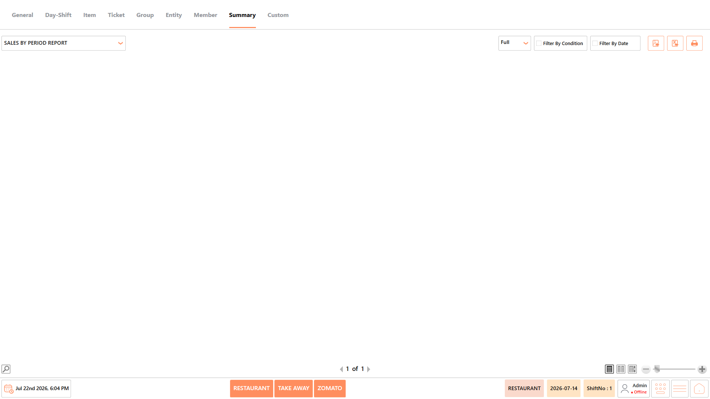<figcaption></figcaption></figure>

#### **Report Fields** 

The report includes information such as:

| **Field**      | **Description**                                                                                                                         |
| -------------- | --------------------------------------------------------------------------------------------------------------------------------------- |
| Period         | Displays the selected reporting interval, such as hourly, daily, weekly, or monthly. It helps organize sales information based on time. |
| Ticket Count   | Displays the total number of tickets generated during the selected period. It helps measure customer transaction volume.                |
| Pre Tax Total  | Displays the sales amount before taxes are applied. It helps evaluate the actual revenue generated.                                     |
| Tax Total      | Displays the total tax collected during the reporting period. It helps verify tax calculations and reporting accuracy.                  |
| Post Tax Total | Displays the sales amount after tax calculations. It helps review the billed sales value for the selected period.                       |
| Total          | Displays the final total sales amount for the reporting period. It helps analyze overall revenue performance.                           |

_Note - The information displayed may vary depending on restaurant configuration and available transaction data._

#### **Use Case** 

Use the Sales by Period Report to:

* Compare sales across periods.
* Monitor revenue trends.
* Analyze transaction volumes.
* Verify tax collections.
* Support business performance analysis.

## **Notes** 

* The information displayed in the reports may vary depending on the selected report, available transaction data, and restaurant configuration.
* Report results are generated based on the selected date range and applied conditions.
* Some fields, such as Cost, Total Cost, and Profit, are available only when costing is configured in the system.
* Empty reports indicate that no transactions match the selected date range or filter conditions.
* Report totals are displayed based on the transactions included in the generated report.
* Use Export to PDF, Export to Excel, or Print to save or share the generated report as required.
