# Ticket Reports

## **Overview** 

The Ticket Reports category provides reports related to ticket transactions, taxes, order tags, discounts, refunds, tenders, exchanges, promotions, and sales reconciliation. These reports help restaurant managers monitor ticket-level sales, verify financial transactions, review discounts and refunds, analyze order tags, and reconcile daily business operations.

<figure>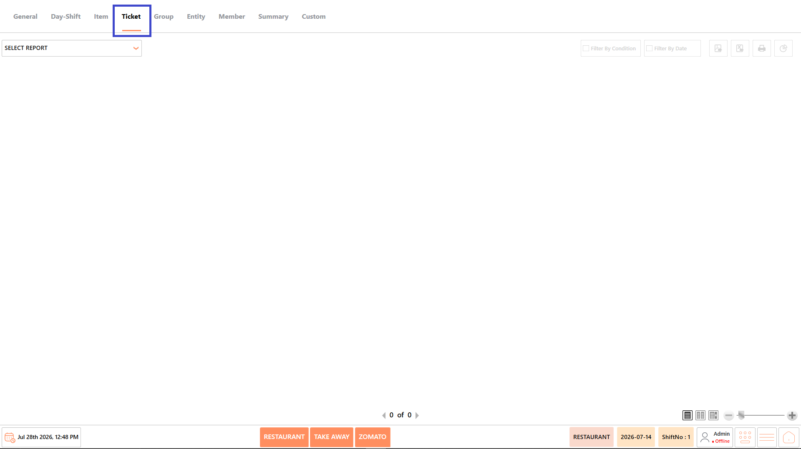<figcaption></figcaption></figure>

## **Reports Available** 

The Ticket Reports category includes the following reports:

* Tickets Report
* Tickets Tag Detail Report
* Ticket Tag Sales Report
* Tickets Tax Report
* Ticket and Orders Report
* Daily Reconciliation Report
* Tickets Hourly Sales Report
* Order State Report
* Void Report
* Gift Report
* Comp Report
* Refund Report
* Tickets Tag Report
* Ticket Tag Group Sales Report
* Ticket Tag Items Sales Report
* Detail Discount Report
* Tender Report
* Exchange Report
* Sales Promotion Report

<figure>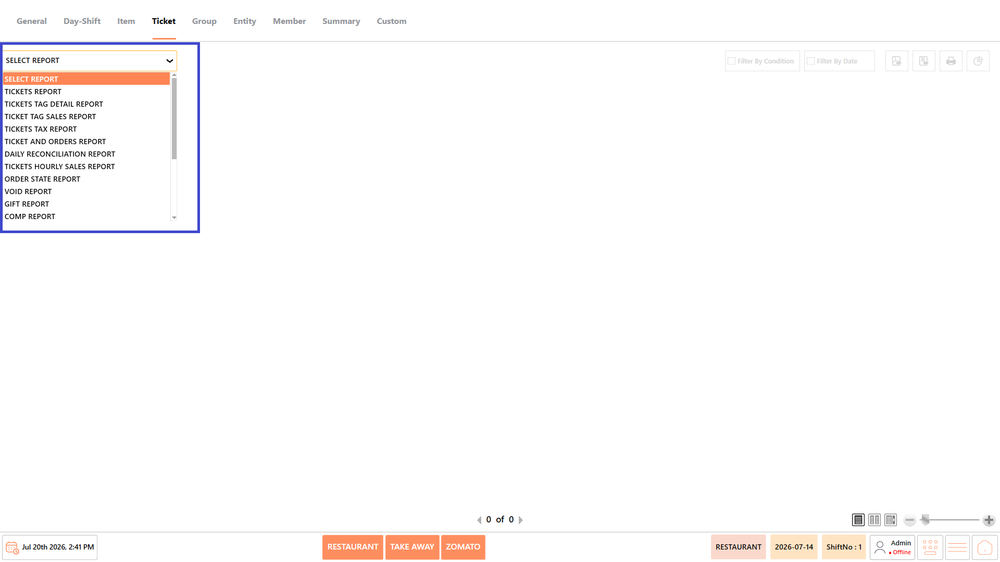<figcaption></figcaption></figure>

<figure>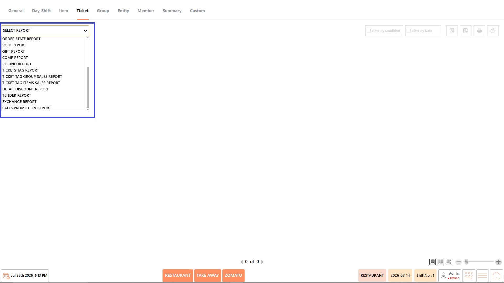<figcaption></figcaption></figure>

#### **Screen Elements** 

The following screen elements are common to all reports in the Ticket Reports category.

**View Mode**

* Choose how the report is displayed.
* Available options include:
  * **Compact** – Displays the report in a condensed format.
  * **Full** – Displays the complete report with all available information.
  * **Free** – Displays the report without predefined formatting, allowing flexible viewing.

<figure>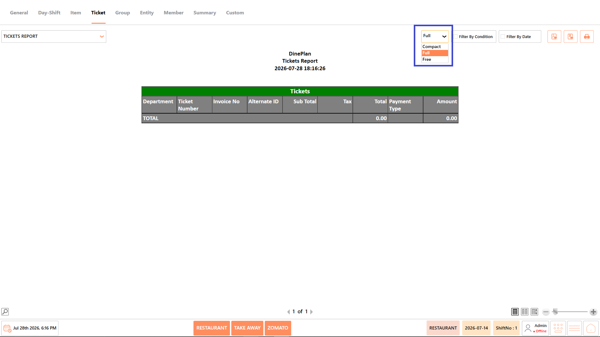<figcaption></figcaption></figure>

**Filter by Condition**

* Apply report-specific filters such as ticket number, user, order status, entity, payment type, or other available conditions before generating the report.

<figure><figcaption></figcaption></figure>

**Filter by Date**

* Specify the required date or date range for generating the report.

<figure><figcaption></figcaption></figure>

**Export as PDF**

* Exports the generated report as a PDF document.

<figure><figcaption></figcaption></figure>

**Export to Excel**

* Exports the generated report as an Excel file.

<figure><figcaption></figcaption></figure>

**Print**

* Prints the currently displayed report.

<figure>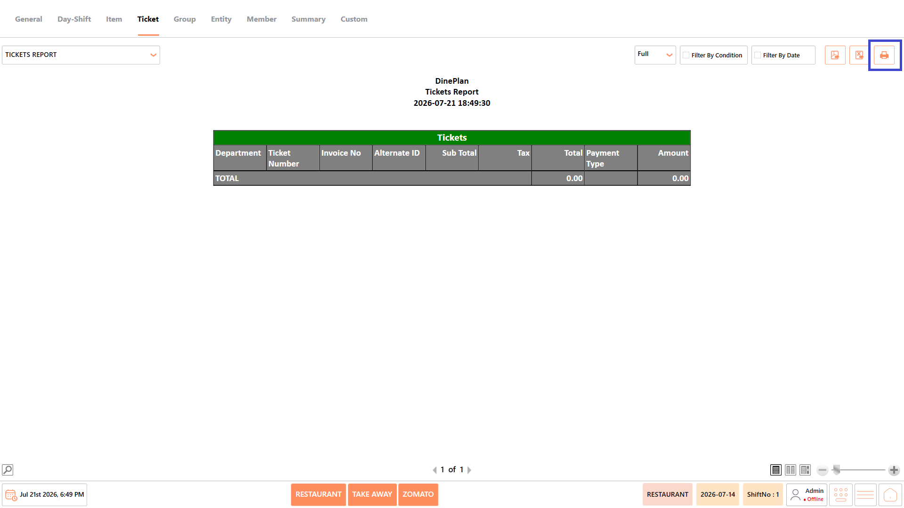<figcaption></figcaption></figure>

### **Tickets Report** 

The Tickets Report provides a summary of ticket-level transactions for the selected business period. It displays sales, billing, payment, and user information, helping managers review completed transactions and monitor overall business activity.

<figure>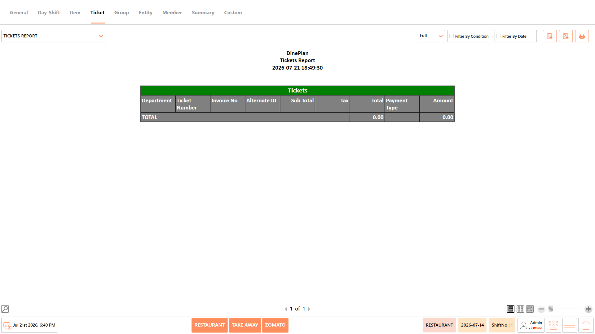<figcaption></figcaption></figure>

#### **Report Fields** 

The report includes information such as:

| **Field**      | **Description**                                                                                                                                                     |
| -------------- | ------------------------------------------------------------------------------------------------------------------------------------------------------------------- |
| Ticket Number  | Displays the unique identification number assigned to the ticket. This number helps locate and track a specific transaction within the system.                      |
| Invoice Number | Displays the invoice number generated for the completed transaction. It is useful for billing verification and financial reconciliation.                            |
| Date and Time  | Displays the date and time when the transaction was created or completed. This information helps identify when the sale occurred and supports transaction tracking. |
| User           | Displays the employee who created or processed the ticket. This helps monitor employee activity and provides accountability for transactions.                       |
| Entity         | Displays the restaurant branch or business entity where the transaction occurred. This is useful for organizations managing multiple locations.                     |
| Guest Count    | Displays the number of guests associated with the ticket. It helps analyze customer volume and average spending per guest.                                          |
| Subtotal       | Displays the total value of all ordered items before discounts and taxes are applied. This value represents the base sales amount.                                  |
| Tax            | Displays the total tax calculated for the ticket. It helps verify tax collection and supports financial reporting.                                                  |
| Discount       | Displays the total discount applied to the transaction. This helps review promotional offers and discount usage.                                                    |
| Grand Total    | Displays the final amount payable after applying taxes and discounts. This represents the amount collected from the customer.                                       |
| Payment Status | Displays whether the ticket has been paid, is pending, or is partially paid. This helps monitor outstanding and completed transactions.                             |

_Note - The information displayed may vary depending on restaurant configuration and available transaction data._

#### **Use Case** 

Use the Tickets Report to:

* Review ticket-level transactions.
* Verify completed sales.
* Monitor billing activity.
* Support daily operational reviews.

### **Tickets Tag Detail Report** 

The Tickets Tag Detail Report displays detailed information about order tags applied to tickets and menu items. It helps track customized orders, verify tagged items, and analyze order modifications made during sales.

<figure>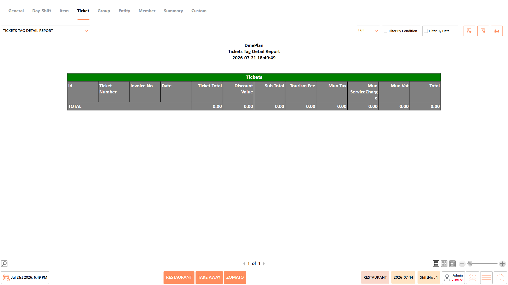<figcaption></figcaption></figure>

#### **Report Fields** 

The report includes information such as:

| **Field**       | **Description**                                                                                                               |
| --------------- | ----------------------------------------------------------------------------------------------------------------------------- |
| Ticket Number   | Displays the ticket associated with the tagged order. It helps identify the transaction where the order tag was applied.      |
| Order Tag Group | Displays the category under which the order tag is organized. This helps classify different types of order customizations.    |
| Order Tag       | Displays the specific order tag assigned to the menu item. It helps identify customer preferences or special requests.        |
| Tagged Item     | Displays the menu item linked to the selected order tag. This helps review customized orders and item modifications.          |
| Quantity        | Displays the number of tagged items sold. It helps analyze the usage frequency of tagged items.                               |
| Price           | Displays the selling price of the tagged item. This helps verify pricing for customized orders.                               |
| User            | Displays the employee who processed the transaction. This information helps monitor employee activities and responsibilities. |

_Note - The information displayed may vary depending on restaurant configuration and available transaction data._

#### **Use Case** 

Use the Tickets Tag Detail Report to:

* Review order tag usage by ticket.
* Verify tagged item pricing.
* Analyze customized orders.
* Support operational audits.

### **Ticket Tag Sales Report** 

The Ticket Tag Sales Report summarizes sales generated through order tags during the selected period. It helps managers analyze the popularity and revenue contribution of tagged menu options and customizations.

<figure>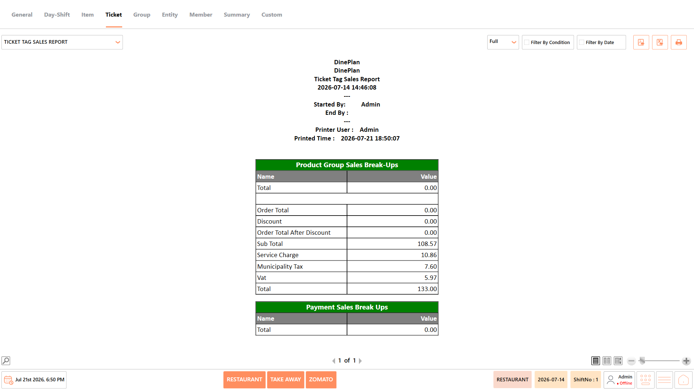<figcaption></figcaption></figure>

#### **Report Fields** 

The report includes information such as:

| **Field**    | **Description**                                                                                                      |
| ------------ | -------------------------------------------------------------------------------------------------------------------- |
| Order Tag    | Displays the order tag associated with the sale. It helps identify the type of customization requested by customers. |
| Tag Group    | Displays the group to which the order tag belongs. This makes it easier to analyze similar order tags together.      |
| Quantity     | Displays the total number of times the order tag was used. It helps identify frequently used customizations.         |
| Price        | Displays the selling price associated with the order tag. This helps verify pricing for tagged items.                |
| Total Amount | Displays the total revenue generated by the order tag. It helps measure the financial contribution of tagged sales.  |

_Note - The information displayed may vary depending on restaurant configuration and available transaction data._

#### **Use Case** 

Use the Ticket Tag Sales Report to:

* Analyze tag-wise revenue.
* Review popular order tags.
* Monitor customized item sales.
* Support menu analysis.

### **Tickets Tax Report** 

The Tickets Tax Report provides tax-related information for ticket transactions, including tax amounts collected during the selected period. It helps verify tax calculations and supports financial reporting and audit requirements.

<figure><figcaption></figcaption></figure>

#### **Report Fields** 

The report includes information such as:

| **Field**      | **Description**                                                                                                                      |
| -------------- | ------------------------------------------------------------------------------------------------------------------------------------ |
| Ticket Number  | Displays the ticket associated with the tax transaction. It helps locate the original sales transaction for verification.            |
| Invoice Number | Displays the invoice generated for the transaction. This field is useful when reviewing financial and tax records.                   |
| Tax Type       | Displays the type of tax applied to the transaction. It helps distinguish between different tax categories configured in the system. |
| Tax Amount     | Displays the total tax collected for the transaction. It helps verify tax calculations and ensure accurate reporting.                |
| Sales Amount   | Displays the taxable sales amount used to calculate the tax. It helps understand how the tax value was determined.                   |
| User           | Displays the employee who processed the transaction. This supports transaction auditing and user accountability.                     |

_Note - The information displayed may vary depending on restaurant configuration and available transaction data._

#### **Use Case** 

Use the Tickets Tax Report to:

* Review tax collections.
* Verify tax calculations.
* Support financial reporting.
* Prepare tax audits.

### **Ticket and Orders Report** 

The Ticket and Orders Report displays ticket information along with the individual orders associated with each ticket. It helps managers review order-level details, verify transactions, and analyze customer purchases.

<figure>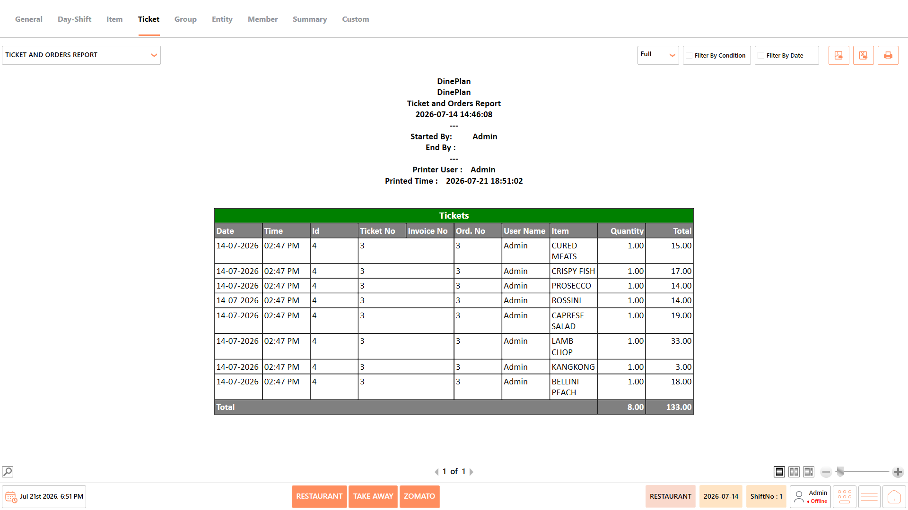<figcaption></figcaption></figure>

#### **Report Fields** 

The report includes information such as:

| **Field**     | **Description**                                                                                                   |
| ------------- | ----------------------------------------------------------------------------------------------------------------- |
| Ticket Number | Displays the ticket associated with the order. It helps identify the complete customer transaction.               |
| Order Number  | Displays the unique number assigned to each order. It helps distinguish individual orders within the same ticket. |
| Menu Item     | Displays the menu item included in the order. This helps review the products sold during the transaction.         |
| Quantity      | Displays the quantity ordered for each menu item. It helps analyze customer purchasing patterns and item demand.  |
| Price         | Displays the selling price of each ordered menu item. It helps verify billing accuracy and item pricing.          |
| User          | Displays the employee who processed the order. This helps monitor user activities and operational performance.    |

_Note - The information displayed may vary depending on restaurant configuration and available transaction data._

#### **Use Case** 

Use the Ticket and Orders Report to:

* Review ticket and order details.
* Verify customer orders.
* Analyze order history.
* Support operational audits.

### **Daily Reconciliation Report** 

The Daily Reconciliation Report summarizes daily sales, payments, taxes, discounts, refunds, and cash movements. It helps reconcile end-of-day transactions and verify the accuracy of business operations.

<figure>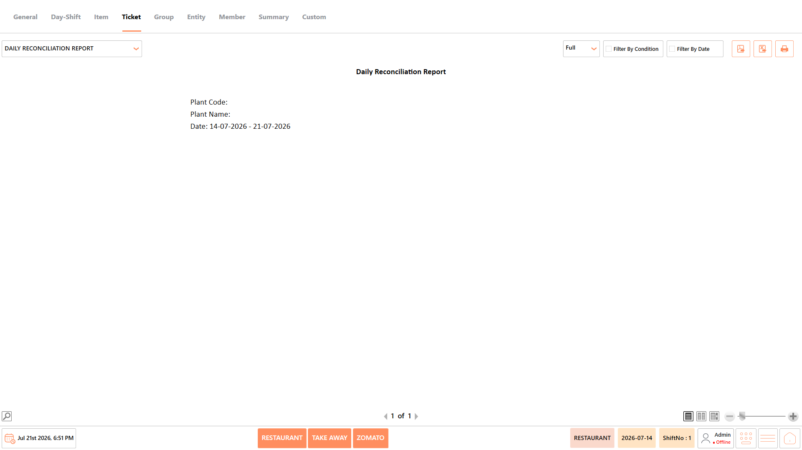<figcaption></figcaption></figure>

#### **Report Fields** 

The report includes information such as:

_Note - The information displayed may vary depending on restaurant configuration and available transaction data._

#### **Use Case** 

Use the Daily Reconciliation Report to:

* Reconcile daily sales.
* Verify cash balances.
* Review business performance.
* Support end-of-day closing.

### **Tickets Hourly Sales Report** 

The Tickets Hourly Sales Report displays ticket sales grouped by hourly intervals throughout the business day. It helps identify peak business hours, monitor customer activity, and support staffing and operational planning.

<figure>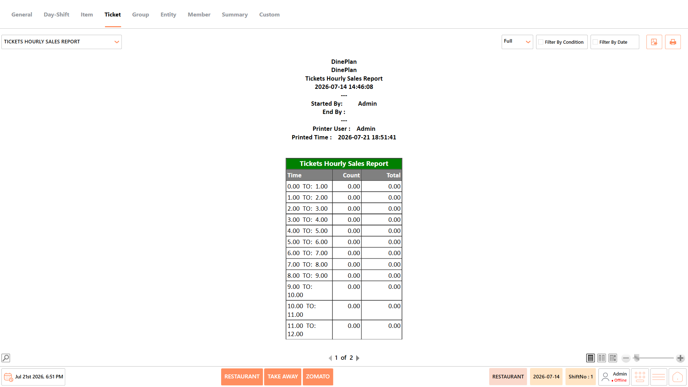<figcaption></figcaption></figure>

#### **Report Fields** 

The report includes information such as:

| **Field** | **Description**                                                                        |
| --------- | -------------------------------------------------------------------------------------- |
| Time      | Displays the hourly time interval for which ticket sales are summarized.               |
| Count     | Displays the total number of tickets generated during the corresponding time interval. |
| Total     | Displays the total sales amount generated during the corresponding time interval.      |

_Note - The information displayed may vary depending on restaurant configuration and available transaction data._

#### **Use Case** 

Use the Tickets Hourly Sales Report to:

* Identify peak business hours.
* Analyze customer traffic.
* Optimize staffing schedules.
* Review hourly sales performance.

### **Order State Report** 

The Order State Report displays orders based on their current processing status, such as pending, completed, or cancelled. It helps monitor order progress and identify operational delays during service.

<figure>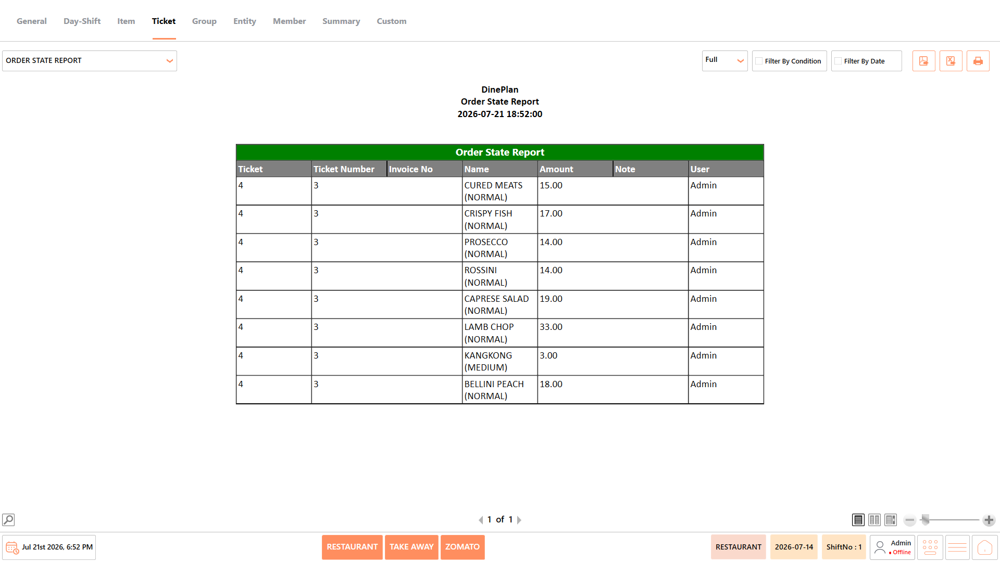<figcaption></figcaption></figure>

#### **Report Fields** 

The report includes information such as:

| **Field**     | **Description**                                                                                                                                       |
| ------------- | ----------------------------------------------------------------------------------------------------------------------------------------------------- |
| Ticket Number | Displays the unique ticket number associated with the order. It helps identify and track the transaction within the system.                           |
| Order Number  | Displays the unique number assigned to the order. This field helps distinguish individual orders under a ticket.                                      |
| Order State   | Displays the current status of the order, such as Open, Prepared, Served, or Closed. It helps monitor the progress of order processing.               |
| Date and Time | Displays the date and time when the order was created or updated. This information is useful for tracking order timelines and operational activities. |
| User          | Displays the employee who created or managed the order. It helps monitor user activities and provides accountability for order processing.            |

_Note - The information displayed may vary depending on restaurant configuration and available transaction data._

#### **Use Case** 

Use the Order State Report to:

* Monitor order progress.
* Review pending orders.
* Verify completed orders.
* Support kitchen operations.

### **Void Report** 

The Void Report displays all tickets or menu items that have been voided during the selected period. It helps managers review void transactions, verify approvals, and monitor operational compliance.

<figure><figcaption></figcaption></figure>

#### **Report Fields** 

The report includes information such as:

| **Field**     | **Description**                                                                                                             |
| ------------- | --------------------------------------------------------------------------------------------------------------------------- |
| Ticket Number | Displays the ticket associated with the voided transaction. It helps identify the original sale in which the void occurred. |
| Menu Item     | Displays the menu item that was voided from the ticket. This helps review which items were removed from customer orders.    |
| Quantity      | Displays the quantity of the item that was voided. It helps verify the extent of the void transaction.                      |
| Void Amount   | Displays the value of the voided item or transaction. This information is useful for financial verification and reporting.  |
| Void Reason   | Displays the reason entered when the item or ticket was voided. It helps managers review and audit void transactions.       |
| User          | Displays the employee who performed the void operation. This helps maintain accountability and supports operational audits. |

_Note - The information displayed may vary depending on restaurant configuration and available transaction data._

#### **Use Case** 

Use the Void Report to:

* Review voided transactions.
* Monitor employee activity.
* Verify authorization.
* Support financial audits.

### **Gift Report** 

The Gift Report displays menu items or tickets provided as complimentary gifts to customers. It helps monitor promotional giveaways and track complimentary transactions for business analysis.

<figure>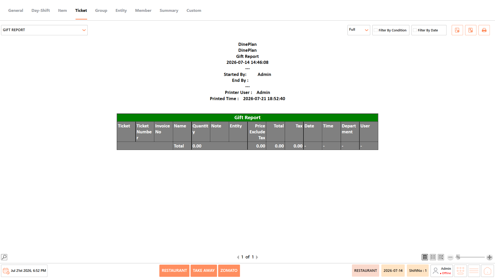<figcaption></figcaption></figure>

#### **Report Fields** 

The report includes information such as:

| **Field**     | **Description**                                                                                                                      |
| ------------- | ------------------------------------------------------------------------------------------------------------------------------------ |
| Ticket Number | Displays the ticket that contains the gifted item or transaction. It helps identify the related customer order.                      |
| Menu Item     | Displays the menu item that was provided as a complimentary gift. This helps review items issued without charge.                     |
| Quantity      | Displays the quantity of gifted items provided to the customer. It helps monitor the frequency of complimentary items.               |
| Gift Amount   | Displays the total value of the gifted item or items. This information is useful for reviewing promotional or goodwill expenses.     |
| User          | Displays the employee who processed the gift transaction. It helps monitor staff activities and supports operational accountability. |

_Note - The information displayed may vary depending on restaurant configuration and available transaction data._

#### **Use Case** 

Use the Gift Report to:

* Review gifted items.
* Monitor promotional giveaways.
* Verify complimentary transactions.
* Support management reviews.

### **Comp Report** 

The Comp Report displays complimentary items and tickets issued without charge during the selected period. It helps verify authorized complimentary transactions and monitor their impact on sales.

<figure><figcaption></figcaption></figure>

#### **Report Fields** 

The report includes information such as:

| **Field**     | **Description**                                                                                                                                     |
| ------------- | --------------------------------------------------------------------------------------------------------------------------------------------------- |
| Ticket Number | Displays the ticket associated with the complimentary transaction. It helps identify the original customer order.                                   |
| Menu Item     | Displays the menu item that was provided as a complimentary item. This helps review products issued without charge.                                 |
| Quantity      | Displays the quantity of complimentary items provided. It helps analyze the frequency of comp transactions.                                         |
| Comp Amount   | Displays the total value of the complimentary items. This information helps monitor the financial impact of comp transactions.                      |
| Reason        | Displays the reason entered for providing the complimentary item or ticket. It helps managers verify whether the comp was appropriately authorized. |
| User          | Displays the employee who processed the complimentary transaction. It supports accountability and operational auditing.                             |

_Note - The information displayed may vary depending on restaurant configuration and available transaction data._

#### **Use Case** 

Use the Comp Report to:

* Review complimentary sales.
* Monitor comp activity.
* Verify approvals.
* Support financial control.

### **Refund Report** 

The Refund Report displays ticket transactions that have been refunded, along with refund amounts and related details. It helps managers verify refund activity and maintain accurate financial records.

<figure>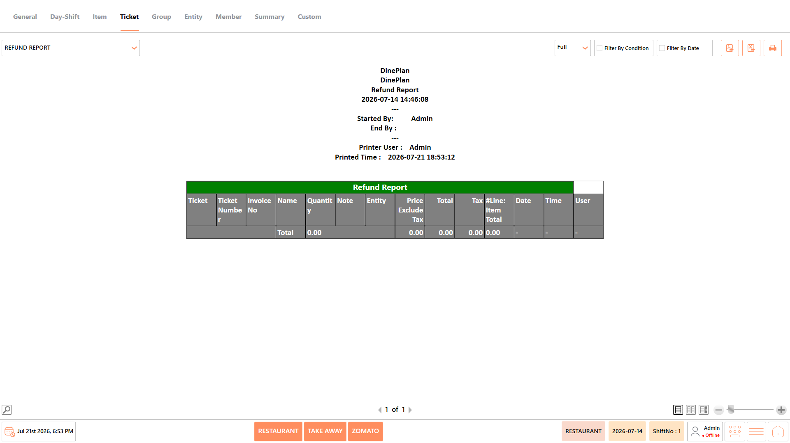<figcaption></figcaption></figure>

#### **Report Fields** 

The report includes information such as:

| **Field**      | **Description**                                                                                                                      |
| -------------- | ------------------------------------------------------------------------------------------------------------------------------------ |
| Refund Number  | Displays the unique identification number assigned to the refund transaction. It helps track and reference individual refunds.       |
| Ticket Number  | Displays the ticket associated with the refunded transaction. It helps identify the original customer sale.                          |
| Invoice Number | Displays the invoice related to the refunded transaction. This field is useful for financial verification and reconciliation.        |
| Refund Amount  | Displays the total amount refunded to the customer. It helps verify refund values and monitor refund activities.                     |
| Refund Reason  | Displays the reason entered for processing the refund. This information helps managers review and audit refund transactions.         |
| User           | Displays the employee who processed the refund. It helps monitor staff activities and provides accountability for refund processing. |

_Note - The information displayed may vary depending on restaurant configuration and available transaction data._

#### **Use Case** 

Use the Refund Report to:

* Review refunded transactions.
* Verify refund approvals.
* Monitor refund trends.
* Support financial reconciliation.

### **Tickets Tag Report** 

The Tickets Tag Report summarizes ticket transactions based on applied order tags. It helps analyze order customization trends and evaluate the usage of tags across restaurant operations.

<figure><figcaption></figcaption></figure>

#### **Report Fields** 

The report includes information such as:

| **Field**       | **Description**                                                                                                                               |
| --------------- | --------------------------------------------------------------------------------------------------------------------------------------------- |
| Order Tag Group | Displays the group under which the order tag is categorized. It helps organize and analyze similar order tags together.                       |
| Order Tag       | Displays the name of the order tag applied to the transaction. This helps identify the customization or option selected by the customer.      |
| Quantity        | Displays the total number of times the order tag was used during the selected period. It helps measure the popularity of specific order tags. |
| Total Amount    | Displays the total sales value generated by the selected order tag. It helps evaluate the revenue contribution of tagged transactions.        |

_Note - The information displayed may vary depending on restaurant configuration and available transaction data._

#### **Use Case** 

Use the Tickets Tag Report to:

* Review tag usage.
* Analyze tagged ticket sales.
* Monitor customization trends.
* Support menu planning.

### **Ticket Tag Group Sales Report** 

The Ticket Tag Group Sales Report displays sales grouped by order tag categories. It helps compare the performance of different tag groups and understand customer preferences for customized orders.

<figure><figcaption></figcaption></figure>

#### **Report Fields** 

The report includes information such as:

_Note - The information displayed may vary depending on restaurant configuration and available transaction data._

#### **Use Case** 

Use the Ticket Tag Group Sales Report to:

* Compare tag group performance.
* Review sales by tag category.
* Analyze customer preferences.
* Support business reporting.

### **Ticket Tag Items Sales Report** 

The Ticket Tag Items Sales Report displays sales of menu items associated with specific order tags. It helps evaluate the performance of tagged items and analyze customer ordering patterns.

<figure>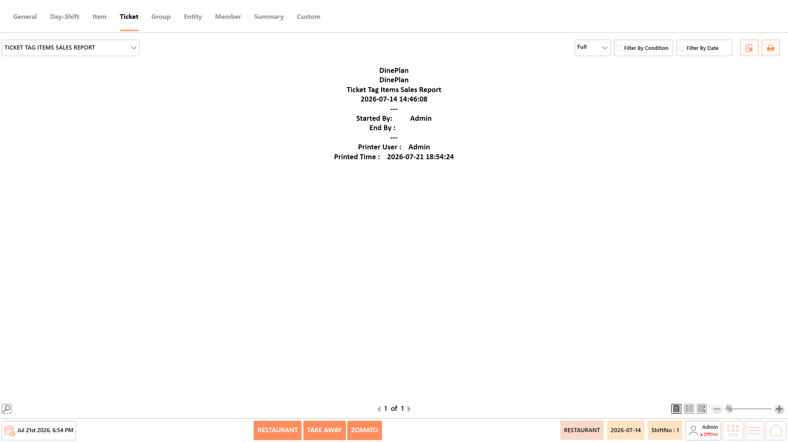<figcaption></figcaption></figure>

#### **Report Fields** 

The report includes information such as:

_Note - The information displayed may vary depending on restaurant configuration and available transaction data._

#### **Use Case** 

Use the Ticket Tag Items Sales Report to:

* Review tagged item sales.
* Analyze customized menu items.
* Monitor tag popularity.
* Support sales analysis.

### **Detail Discount Report** 

The Detail Discount Report displays detailed information about discounts applied to ticket transactions during the selected period. It helps verify discount usage, monitor promotional activities, and support financial audits.

<figure><figcaption></figcaption></figure>

#### **Report Fields** 

The report includes information such as:

| **Field**       | **Description**                                                                                                                 |
| --------------- | ------------------------------------------------------------------------------------------------------------------------------- |
| Ticket Number   | Displays the ticket on which the discount was applied. It helps identify the original transaction associated with the discount. |
| Invoice Number  | Displays the invoice generated for the discounted transaction. It is useful for verifying billing and financial records.        |
| Discount Name   | Displays the name of the discount or promotion applied to the transaction. It helps identify the type of discount provided.     |
| Discount Amount | Displays the total value of the discount applied. It helps verify discount calculations and review promotional usage.           |
| Date and Time   | Displays the date and time when the discount was applied. It helps track when the transaction occurred for auditing purposes.   |
| User            | Displays the employee who applied the discount. It supports user accountability and helps review discount authorization.        |

_Note - The information displayed may vary depending on restaurant configuration and available transaction data._

#### **Use Case** 

Use the Detail Discount Report to:

* Review discount activity.
* Verify discount approvals.
* Monitor promotional usage.
* Support financial audits.

### **Tender Report** 

The Tender Report displays payment transactions grouped by payment method, such as cash, card, or digital payments. It helps review payment collections, reconcile tender balances, and analyze payment preferences.

<figure><figcaption></figcaption></figure>

#### **Report Fields** 

The report includes information such as:

| **Field**         | **Description**                                                                                                                                     |
| ----------------- | --------------------------------------------------------------------------------------------------------------------------------------------------- |
| Payment Method    | Displays the payment method used to complete the transaction, such as Cash, Card, or Digital Wallet. It helps analyze customer payment preferences. |
| Transaction Count | Displays the total number of transactions processed using the selected payment method. It helps compare the usage of different payment types.       |
| Amount Received   | Displays the total amount collected through the selected payment method. It helps verify payment collections and reconcile financial records.       |
| User              | Displays the employee who processed the payment transaction. It helps monitor cashier activities and supports operational auditing.                 |

_Note - The information displayed may vary depending on restaurant configuration and available transaction data._

#### **Use Case** 

Use the Tender Report to:

* Review payment collections.
* Compare payment methods.
* Verify tender balances.
* Support cash reconciliation.

### **Exchange Report** 

The Exchange Report displays transactions involving exchanged menu items or modified orders. It helps verify exchange activities, monitor pricing differences, and maintain accurate transaction records.

<figure>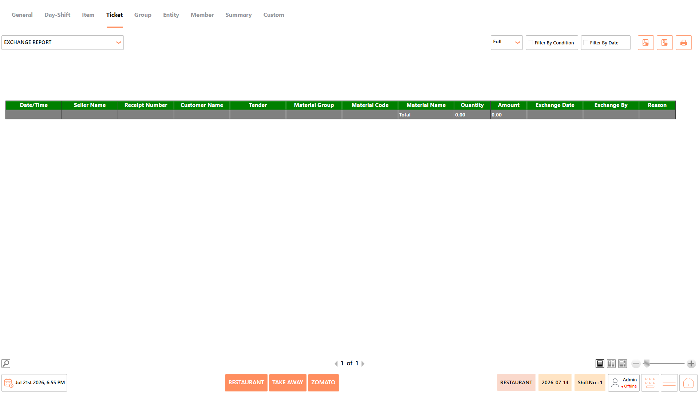<figcaption></figcaption></figure>

#### **Report Fields** 

The report includes information such as:

| **Field**         | **Description**                                                                                                                       |
| ----------------- | ------------------------------------------------------------------------------------------------------------------------------------- |
| Ticket Number     | Displays the ticket associated with the exchange transaction. It helps identify the original customer order.                          |
| Original Item     | Displays the menu item that was exchanged. It helps review the item initially sold before the exchange.                               |
| Exchanged Item    | Displays the replacement menu item provided to the customer. It helps verify the updated order details.                               |
| Difference Amount | Displays the price difference between the original and exchanged items. It helps determine any additional payment or refund required. |
| User              | Displays the employee who processed the exchange transaction. It helps monitor staff activities and supports transaction auditing.    |

_Note - The information displayed may vary depending on restaurant configuration and available transaction data._

#### **Use Case** 

Use the Exchange Report to:

* Review exchanged orders.
* Verify exchange transactions.
* Monitor operational adjustments.
* Support customer service reviews.

### **Sales Promotion Report** 

The Sales Promotion Report displays transactions where promotional offers or campaigns have been applied. It helps evaluate promotion effectiveness, measure promotional sales, and support marketing decisions.

<figure>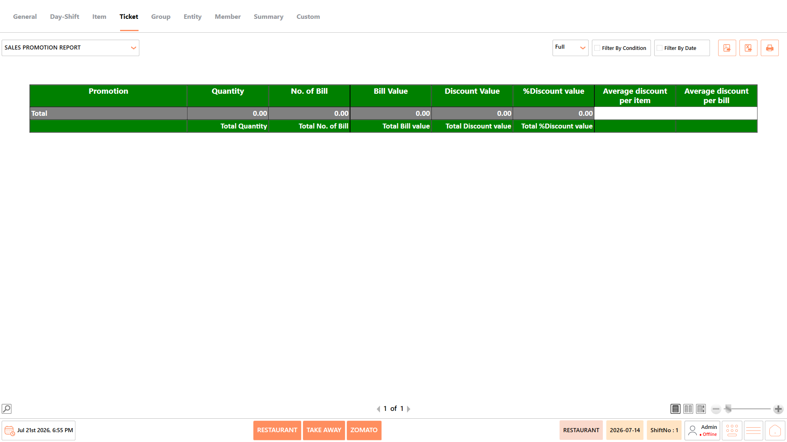<figcaption></figcaption></figure>

#### **Report Fields** 

The report includes information such as:

| **Field**      | **Description**                                                                                                                          |
| -------------- | ---------------------------------------------------------------------------------------------------------------------------------------- |
| Promotion Name | Displays the name of the promotion applied to the transaction. It helps identify the promotional campaign used during the sale.          |
| Ticket Number  | Displays the ticket associated with the promotional transaction. It helps locate the original customer order for verification.           |
| Discount Value | Displays the total discount applied through the promotion. It helps evaluate the financial impact of promotional offers.                 |
| Sales Amount   | Displays the final sales amount after the promotion has been applied. It helps compare promotional sales with regular sales.             |
| User           | Displays the employee who processed the promotional transaction. It helps monitor user activity and supports operational accountability. |

_Note - The information displayed may vary depending on restaurant configuration and available transaction data._

#### **Use Case** 

Use the Sales Promotion Report to:

* Review promotion performance.
* Analyze promotional sales.
* Measure campaign effectiveness.
* Support marketing decisions.

## **Notes** 

* The information displayed in the reports may vary depending on the selected report, available transaction data, and restaurant configuration.
* Report results are generated based on the selected date range and applied conditions.
* Some fields, such as Cost, Total Cost, and Profit, are available only when costing is configured in the system.
* Empty reports indicate that no transactions match the selected date range or filter conditions.
* Report totals are displayed based on the transactions included in the generated report.
* Use Export to PDF, Export to Excel, or Print to save or share the generated report as required.
