# Reserve

## **Overview** 

The Reserve feature allows users to create and manage customer table reservations. It enables restaurant staff to schedule reservations, capture guest details, assign tables, monitor reservation status, and export reservation records for operational planning.

## **Open the Reserve Feature** 

1. Log in to “DinePlan”.
2. From the “Dashboard”, select “Front Desk”.

<figure>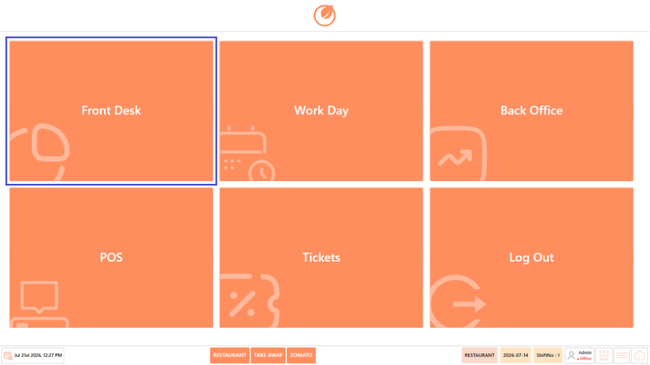<figcaption></figcaption></figure>

3. Select “Reserve”.

<figure>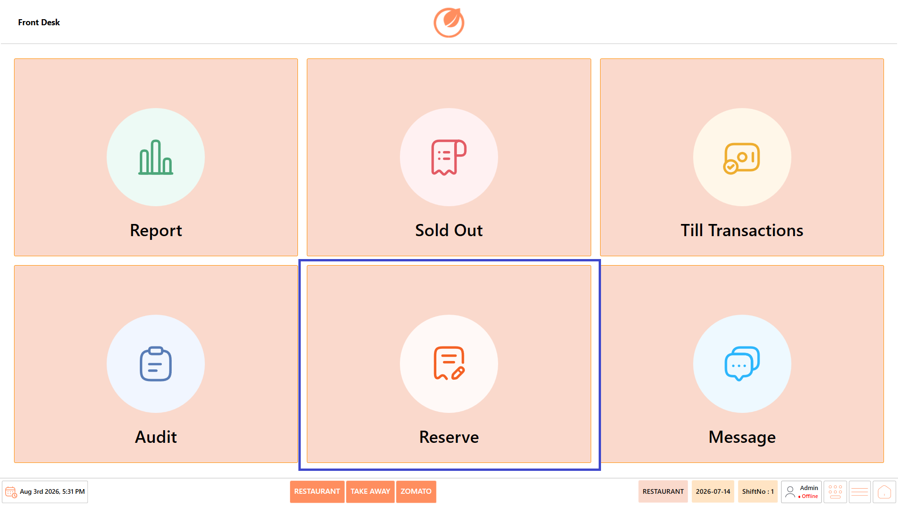<figcaption></figcaption></figure>

4. The Reserve screen opens.

## **Screen Elements** 

The Reserve screen allows users to create and manage customer reservations. It provides options to view and filter reservations, add or edit reservation details, assign tables, cancel reservations, and export reservation records for reporting and record keeping.

<figure><figcaption></figcaption></figure>

| **Screen Element** | **Description**                                                                                                             |
| ------------------ | --------------------------------------------------------------------------------------------------------------------------- |
| From               | Select the start date to display reservations created from the specified date onwards.                                      |
| To                 | Select the end date to display reservations up to the specified date.                                                       |
| Status             | Filter reservations based on their current status. Available options are **Not Assigned**, **Assigned**, and **Cancelled**. |
| Phone Number       | Displays the customer's contact number.                                                                                     |
| Name               | Displays the name of the customer who made the reservation.                                                                 |
| Email              | Displays the customer's email address.                                                                                      |
| PAX                | Displays the total number of guests included in the reservation.                                                            |
| Child PAX          | Displays the number of children included in the reservation.                                                                |
| Adults             | Displays the number of adults included in the reservation.                                                                  |
| Deposit Type       | Displays the payment method or deposit type used for the reservation.                                                       |
| Deposit            | Displays the deposit amount collected for the reservation.                                                                  |
| Reservation Date   | Displays the date scheduled for the reservation.                                                                            |
| Reservation Time   | Displays the reserved time slot.                                                                                            |
| Remark             | Displays any notes or special requests added to the reservation.                                                            |
| Created Date       | Displays the date on which the reservation was created.                                                                     |
| Previous           | Navigates to the previous page of reservation records.                                                                      |
| Next               | Navigates to the next page of reservation records.                                                                          |
| Refresh            | Reloads the reservation list using the selected date range and status filters.                                              |
| Reset              | Clears all applied filters and reloads the default reservation list.                                                        |
| Add                | Opens the **Add Reservation** screen to create a new reservation.                                                           |
| Edit               | Modifies the details of the selected reservation.                                                                           |
| Cancel             | Cancels the selected reservation.                                                                                           |
| Assign             | Assigns a table to the selected reservation.                                                                                |
| Export             | Exports the displayed reservation list for reporting or record keeping.                                                     |

## **Screen Information** 

* **Reservation List** – Displays all reservations that match the selected date range and reservation status.
* **Status Bar** – Displays the active business type (Restaurant, Take Away, Zomato), business date, shift number, logged-in user, and navigation controls.

## **Working with Reservations** 

### **Add a Reservation** 

Use this option to create a new customer reservation.

1. Open “Front Desk” → “Reserve”.

<figure><figcaption></figcaption></figure>

2. Select “Add”.

<figure>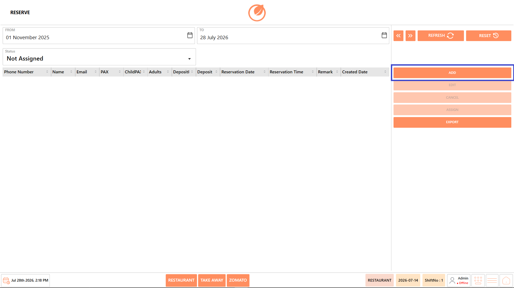<figcaption></figcaption></figure>

3. Enter the reservation details:
   1. Reservation Date
   2. Reservation Time
   3. Phone Number
   4. Customer Name
   5. Email Address (optional)
   6. PAX (Total Guests)
   7. Adult PAX
   8. Child PAX
   9. Deposit Paid (if applicable)
   10. Deposit Reference Number (if applicable)
   11. Remarks

<figure>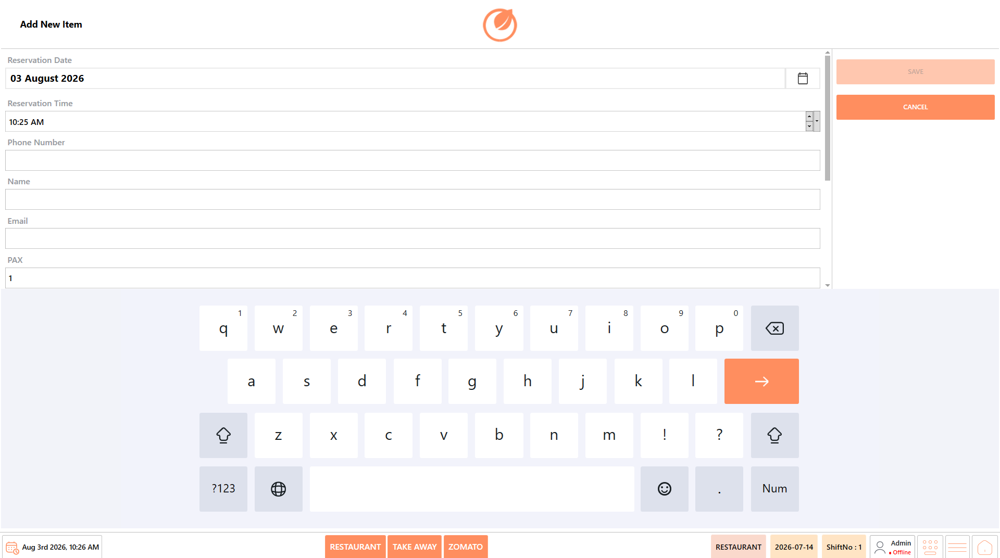<figcaption></figcaption></figure>

<figure>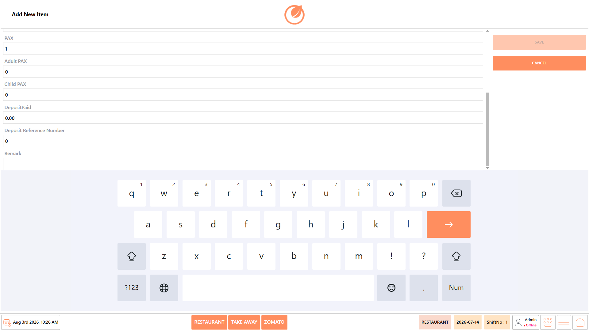<figcaption></figcaption></figure>

4. Select “Save”.

<figure>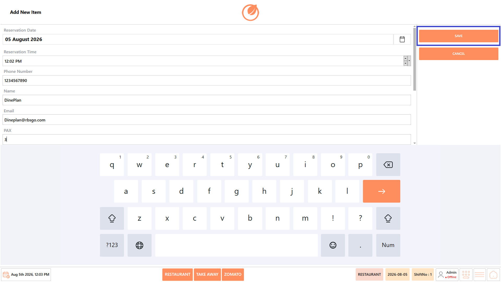<figcaption></figcaption></figure>

5. The reservation is created and appears in the reservation list.

### **Edit a Reservation** 

Use this option to update an existing reservation.

1. Open “Front Desk” → “Reserve”.

<figure><figcaption></figcaption></figure>

2. Select the required reservation.

<figure>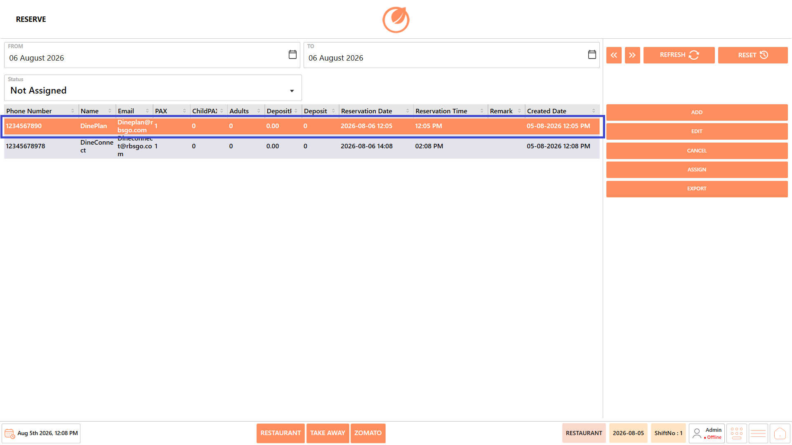<figcaption></figcaption></figure>

3. Select “Edit”.

<figure>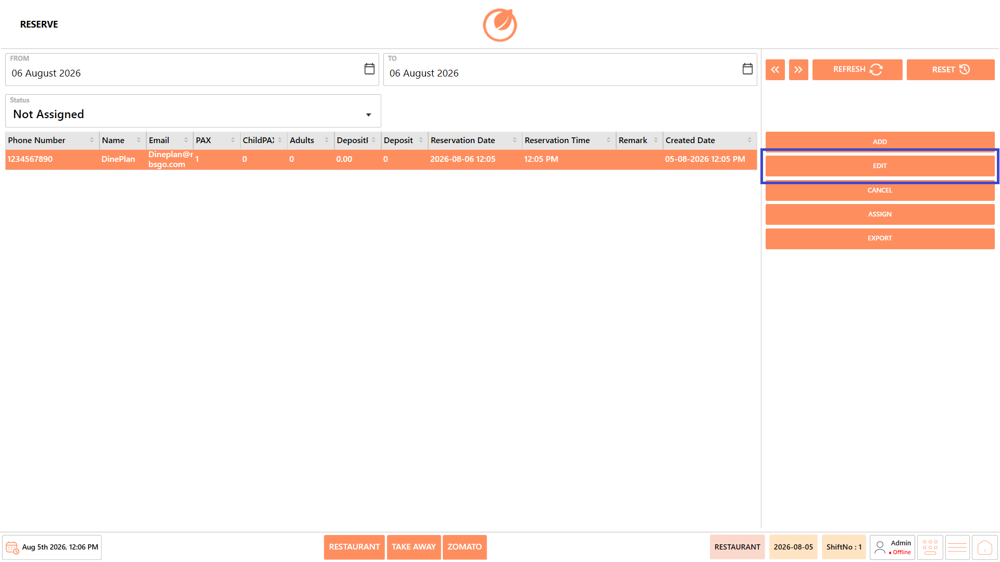<figcaption></figcaption></figure>

4. Modify the required reservation details.

<figure>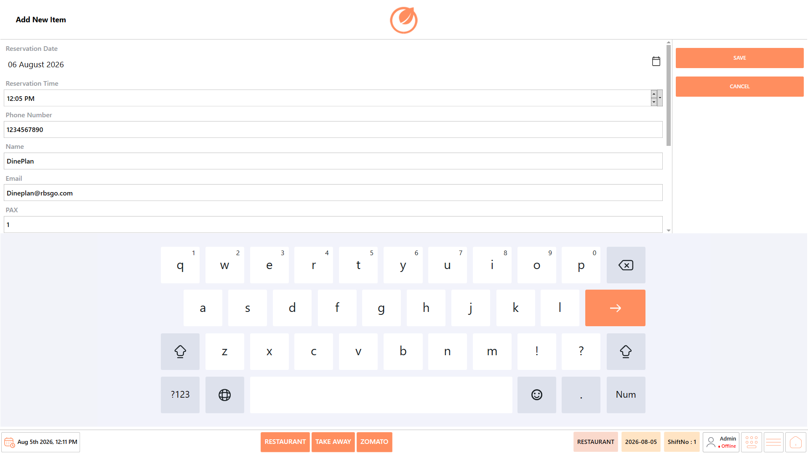<figcaption></figcaption></figure>

5. Select “Save”.

<figure>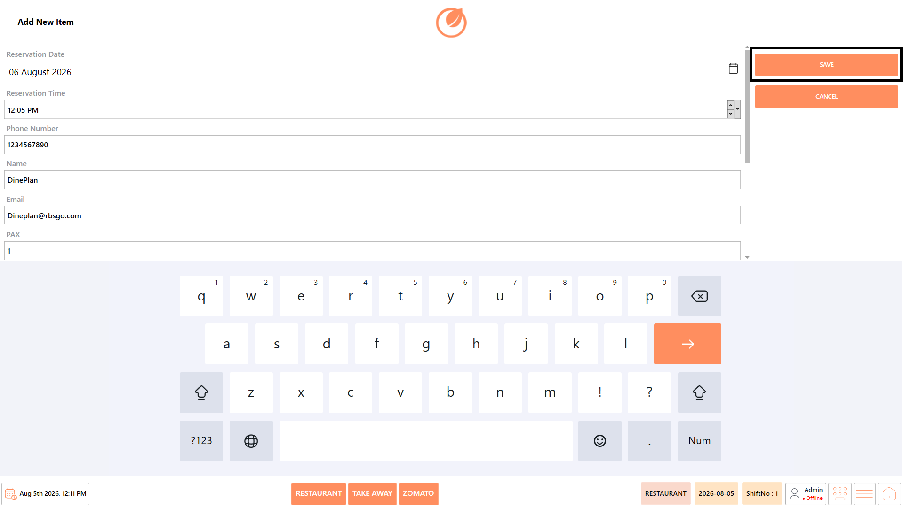<figcaption></figcaption></figure>

6. The reservation details are updated.

### **Assign a Reservation** 

Use this option to assign a reservation to an available table.

1. Open “Front Desk” → “Reserve”.

<figure><figcaption></figcaption></figure>

2. Select the required reservation.

<figure><figcaption></figcaption></figure>

3. Select “Assign”.

<figure>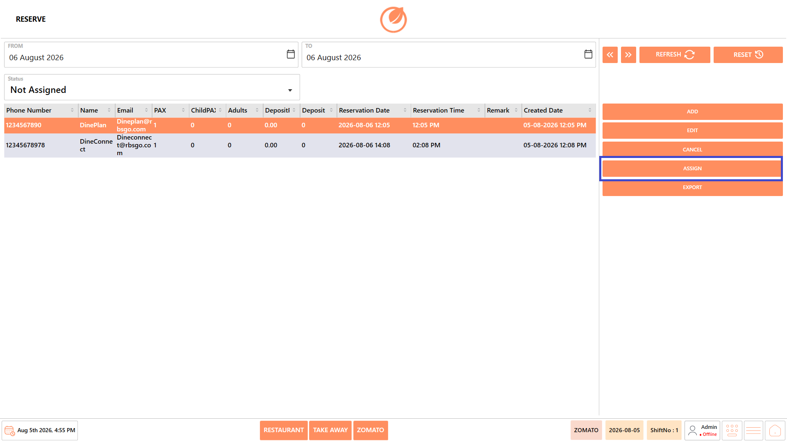<figcaption></figcaption></figure>

4. Select the appropriate table.
5. Confirm the assignment.
6. The reservation status changes to Assigned.

### **Cancel a Reservation** 

Use this option to cancel an existing reservation.

1. Open “Front Desk” → “Reserve”.

<figure><figcaption></figcaption></figure>

2. Select the required reservation.

<figure><figcaption></figcaption></figure>

3. Select “Cancel”.

<figure>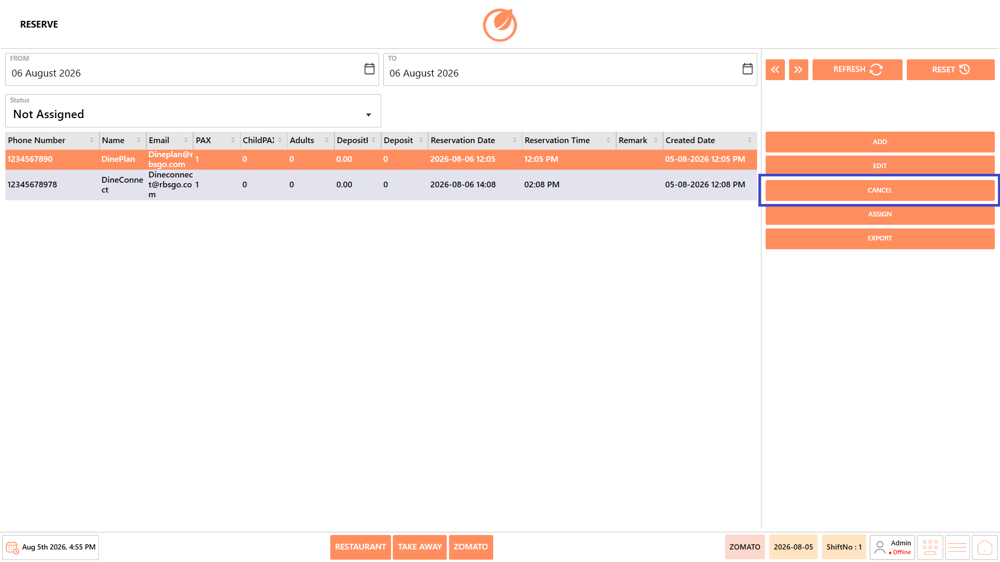<figcaption></figcaption></figure>

4. Confirm the cancellation.
5. The reservation status changes to Cancelled.

### **Search Reservations** 

Use this option to locate reservations using filters.

1. Open “Front Desk” → “Reserve”.

<figure><figcaption></figcaption></figure>

2. Select the required “From” and “To” dates.

<figure>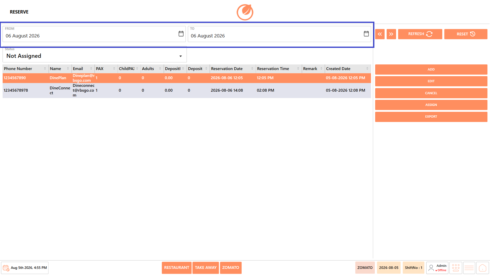<figcaption></figcaption></figure>

3. Select the required “Status”.

<figure>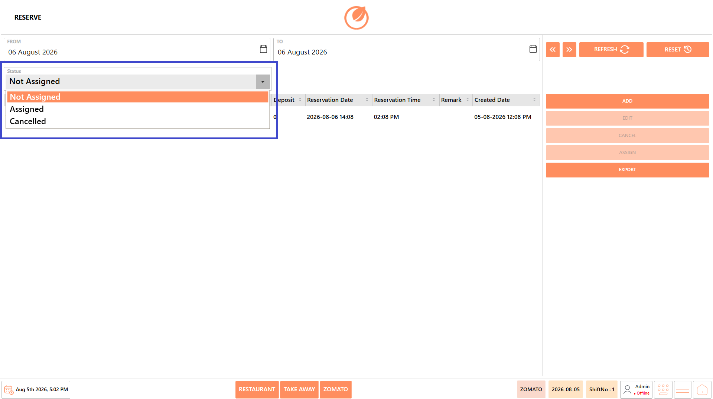<figcaption></figcaption></figure>

4. Select “Refresh”.

<figure>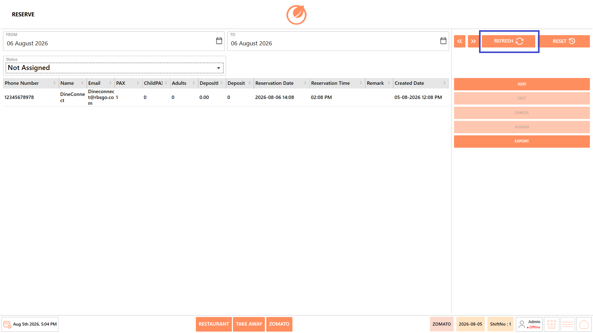<figcaption></figcaption></figure>

5. The system displays all reservations matching the selected criteria.

### **Export Reservations** 

Use this option to export reservation records.

1. Open “Front Desk” → “Reserve”.

<figure><figcaption></figcaption></figure>

2. Apply the required date range and status filters.

<figure><figcaption></figcaption></figure>

3. Select “Export”.

<figure>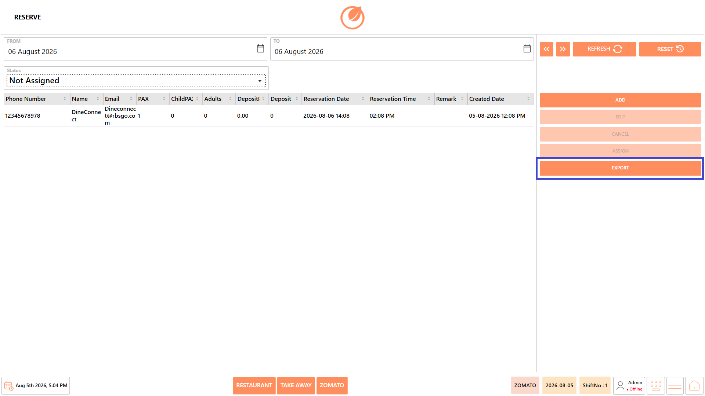<figcaption></figcaption></figure>

4. The reservation list is exported for reporting or record keeping.

## **Use Case** 

Use the Reserve feature to:

* Create customer reservations.
* Schedule reservations in advance.
* Record guest and contact information.
* Track reservation status.
* Assign reservations to available tables.
* Cancel reservations when required.
* Export reservation records for reporting.
