# Sold Out

## **Overview** 

The Sold Out feature allows users to temporarily mark menu items, order tags, or entire product groups as unavailable. Once marked as sold out, these items cannot be ordered through the POS until they are removed from the sold-out list. This helps restaurants manage inventory shortages and prevent unavailable items from being sold.

## **Open the Sold Out** 

1. Log in to “DinePlan”.
2. From the Dashboard, select “Front Desk”.

<figure><figcaption></figcaption></figure>

3. Select “Sold Out”.

<figure><figcaption></figcaption></figure>

4. The Sold Out screen opens.

## **Screen Elements** 

The Sold Out screen allows users to manage menu items that are temporarily unavailable. It provides options to search existing sold-out items, add new sold-out entries, remove them when they become available, and import or export sold-out records.

<figure><figcaption></figcaption></figure>

| **Screen Element**      | **Description**                                                                                   |
| ----------------------- | ------------------------------------------------------------------------------------------------- |
| Search                  | Search for a sold-out item by entering the product name or related keyword.                       |
| Product                 | Displays the name of the menu item that has been marked as sold out.                              |
| Portion                 | Displays the portion or serving size of the sold-out item.                                        |
| Counter                 | Displays the counter or outlet where the item is marked as sold out.                              |
| User                    | Displays the user who marked the item as sold out.                                                |
| Import                  | Imports sold-out item records from an external file.                                              |
| Export                  | Exports the current sold-out item list for reporting or backup purposes.                          |
| Delete                  | Removes the selected sold-out entry, making the item available for ordering again.                |
| Add Item Tag            | Opens the Order Tag Sold Out screen to mark menu items as sold out based on predefined item tags. |
| Add New Item            | Opens the Add New Item screen to mark a specific menu item and portion as sold out.               |
| Add Group Sold Out Item | Opens the **A**dd Group Sold Out Item screen to mark an entire item group as sold out.            |

## **Screen Information** 

* **Sold Out List** – Displays all currently unavailable menu items.
* **Status Bar** – Shows the active business type (Restaurant, Take Away, Zomato), business date, shift number, logged-in user, and navigation controls.

## **Working with Sold Out** 

The Sold Out feature supports three methods of marking products as unavailable.

### **Method 1: Mark an Order Tag as Sold Out** 

Use this option to make all items associated with a specific order tag unavailable.

1. Open “Front Desk” → “Sold Out”.

<figure><figcaption></figcaption></figure>

2. Select “Add Item Tag”.

<figure>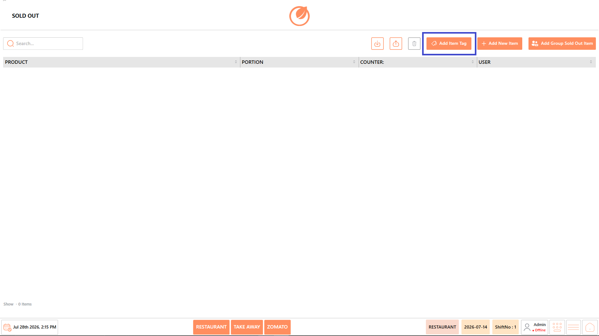<figcaption></figcaption></figure>

3. On the Order Tag Sold Out screen, select “Add Sold Out”.

<figure>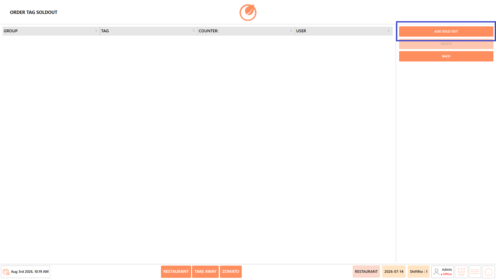<figcaption></figcaption></figure>

4. In the Add Sold Out screen:
   1. Select the required “Group”.

<figure>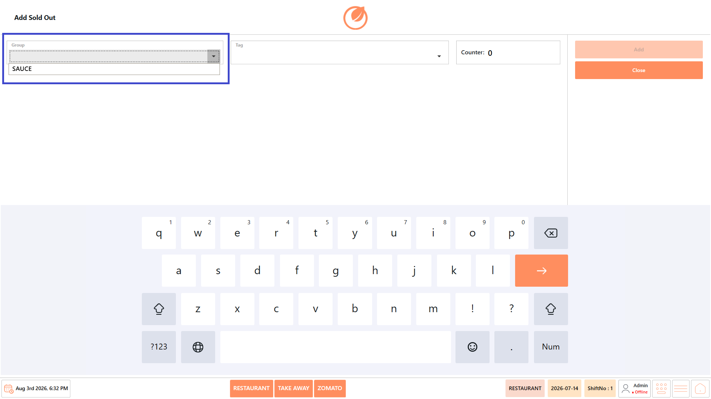<figcaption></figcaption></figure>

5. Select the required “Tag”.

<figure>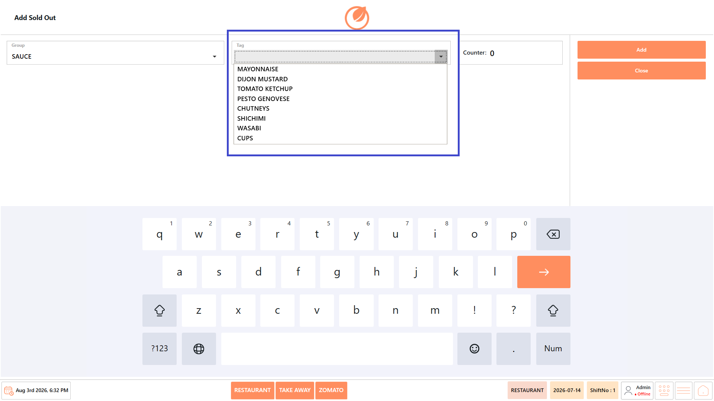<figcaption></figcaption></figure>

6. Verify or enter the “Counter Number”, if applicable.

<figure><figcaption></figcaption></figure>

7. Select “Add”.

<figure>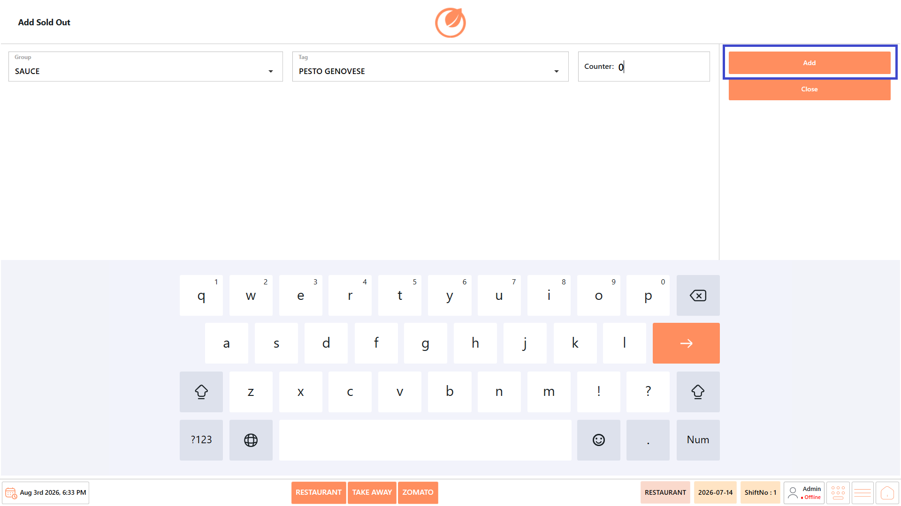<figcaption></figcaption></figure>

8. The selected item tag is added to the Sold Out list and is unavailable for ordering until it is removed.

<figure><figcaption></figcaption></figure>

9. You will get a message popup in the POS when the sold out item is updated.

<figure><figcaption></figcaption></figure>

### **Method 2: Mark an Individual Item as Sold Out** 

Use this option when only a specific menu item is unavailable.

1. Open “Front Desk” → “Sold Out”.

<figure>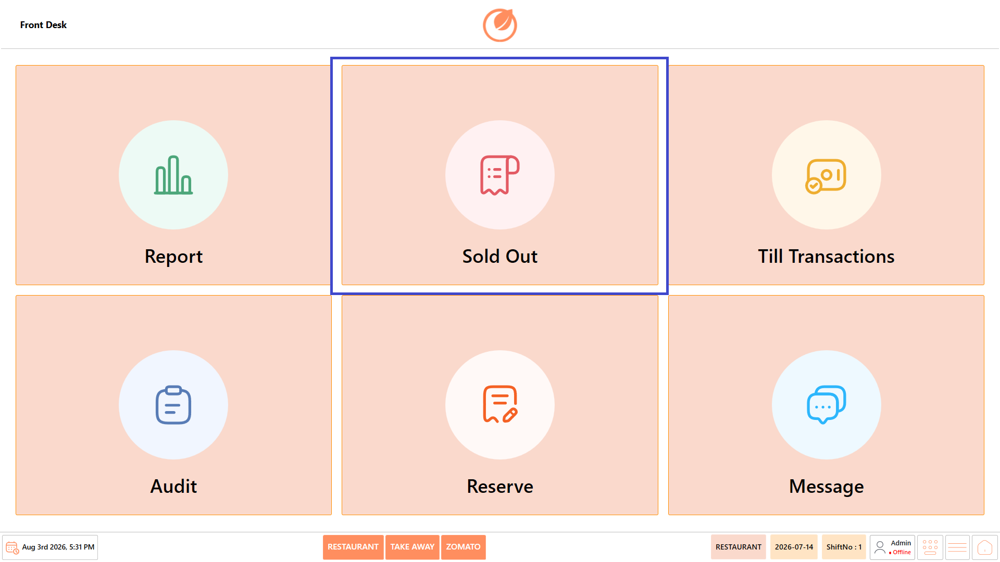<figcaption></figcaption></figure>

2. Select “Add New Item”.

<figure>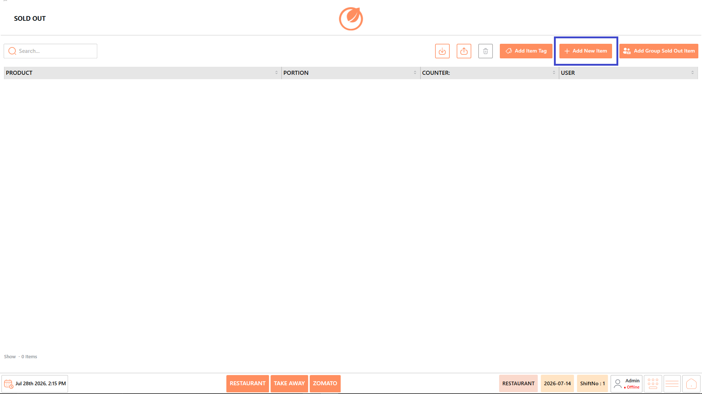<figcaption></figcaption></figure>

3. Select the required “Category”.

<figure>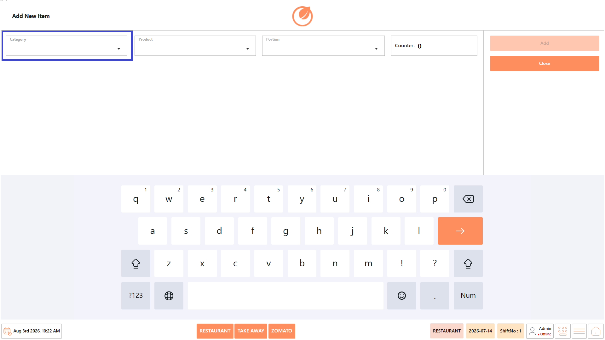<figcaption></figcaption></figure>

4. Select the “Product”.

<figure>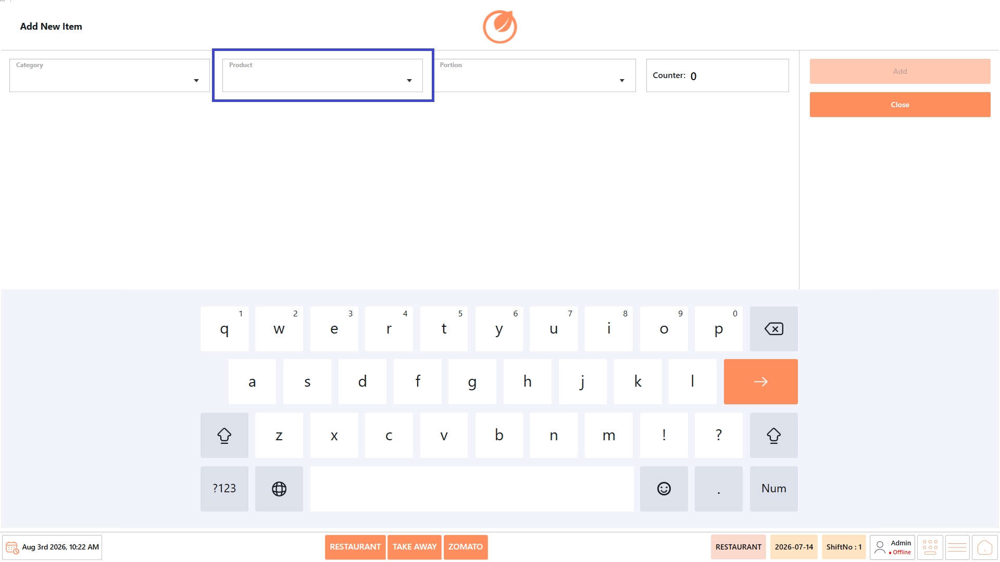<figcaption></figcaption></figure>

5. Select the required “Portion” (if applicable).

<figure>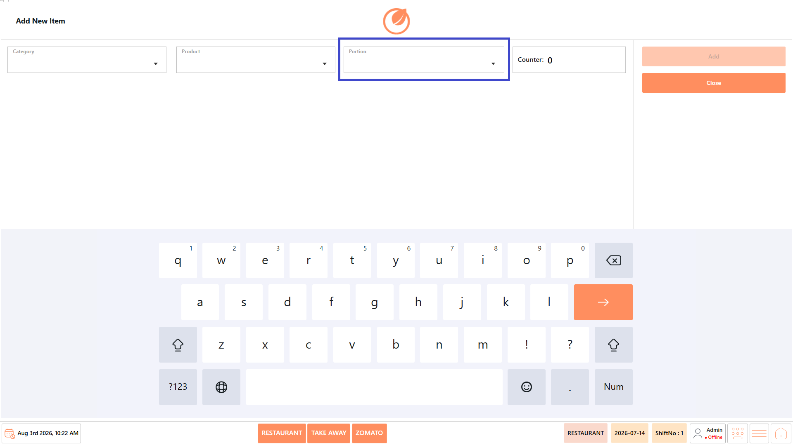<figcaption></figcaption></figure>

6. Verify the “Counter”.

<figure>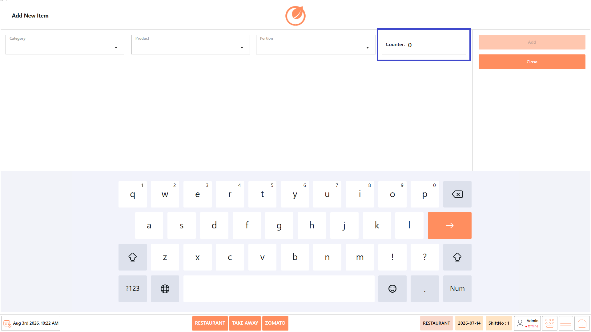<figcaption></figcaption></figure>

7. Select “Add”.

<figure>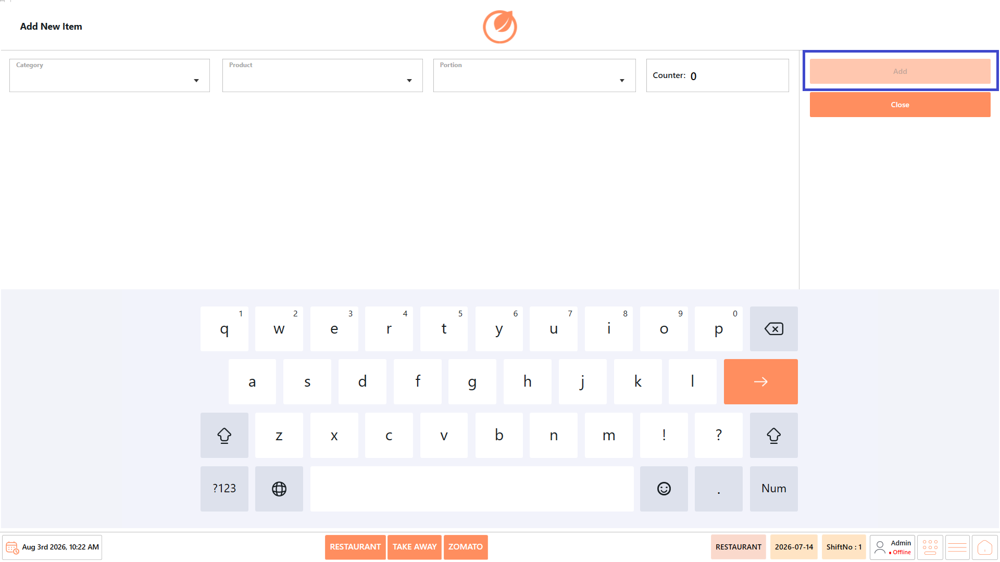<figcaption></figcaption></figure>

8. The selected menu item is added to the sold-out list and cannot be ordered until it is removed.

<figure><figcaption></figcaption></figure>

9. The popup will appear when you update the sold-out item.

<figure><figcaption></figcaption></figure>

### **Method 3: Mark a Product Group as Sold Out** 

Use this option when an entire product group is unavailable.

1. Open “Front Desk” → “Sold Out”.

<figure><figcaption></figcaption></figure>

3. Select “Add Group Sold Out Item”.

<figure>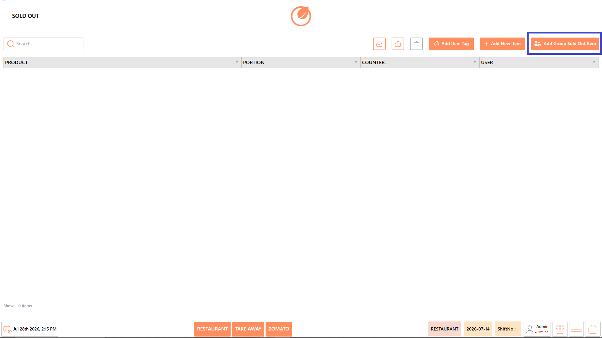<figcaption></figcaption></figure>

4. Select the required “Group”.

<figure>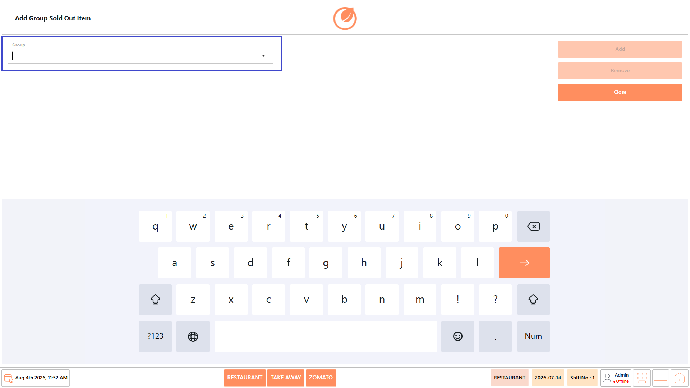<figcaption></figcaption></figure>

5. Select “Add”.

<figure>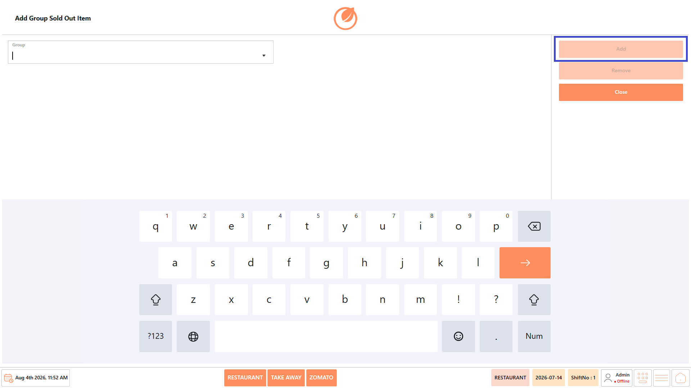<figcaption></figcaption></figure>

6. All products belonging to the selected group are marked as sold out.

### **Remove a Sold Out Item** 

When the item becomes available again:

1. Open “Front Desk” → “Sold Out”.

<figure><figcaption></figcaption></figure>

2. Select the required sold-out entry.
3. Select “Delete”.

<figure>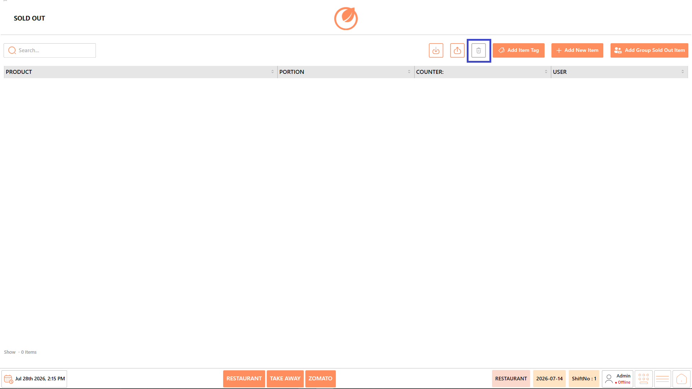<figcaption></figcaption></figure>

4. Confirm the action, if prompted.
5. The selected item, tag, or group is removed from the sold-out list and becomes available for ordering again.

## **Use Case** 

Use the Sold Out feature to:

* Temporarily mark menu items as unavailable.
* Prevent customers from ordering out-of-stock products.
* Mark entire product groups or order tags as unavailable.
* Restore products when inventory becomes available.
* Ensure accurate menu availability during restaurant operations.
