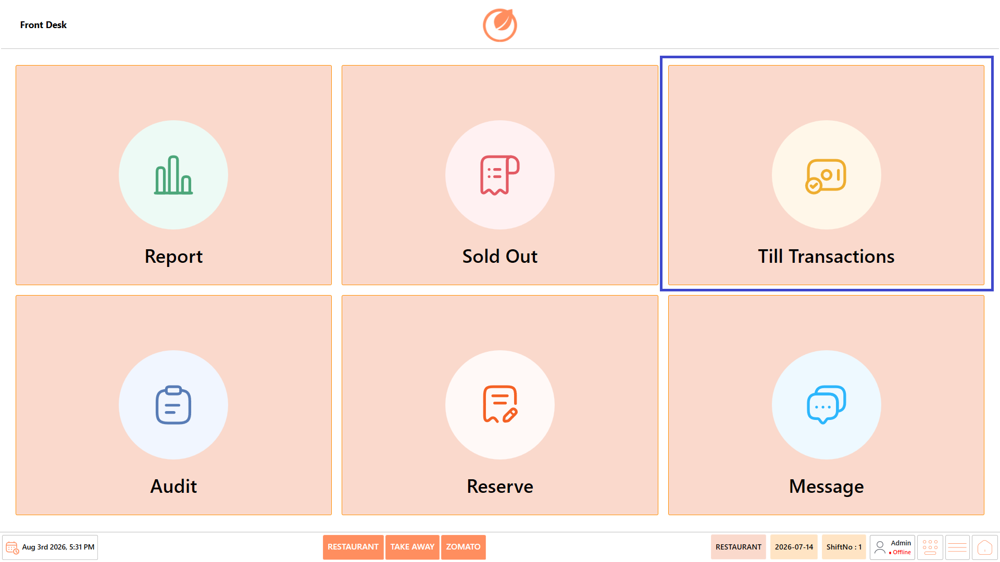
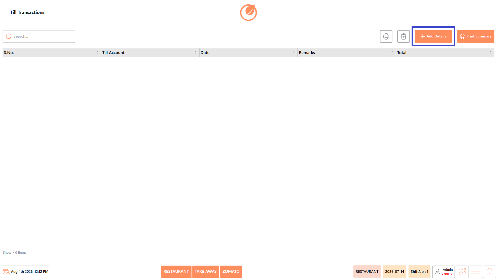
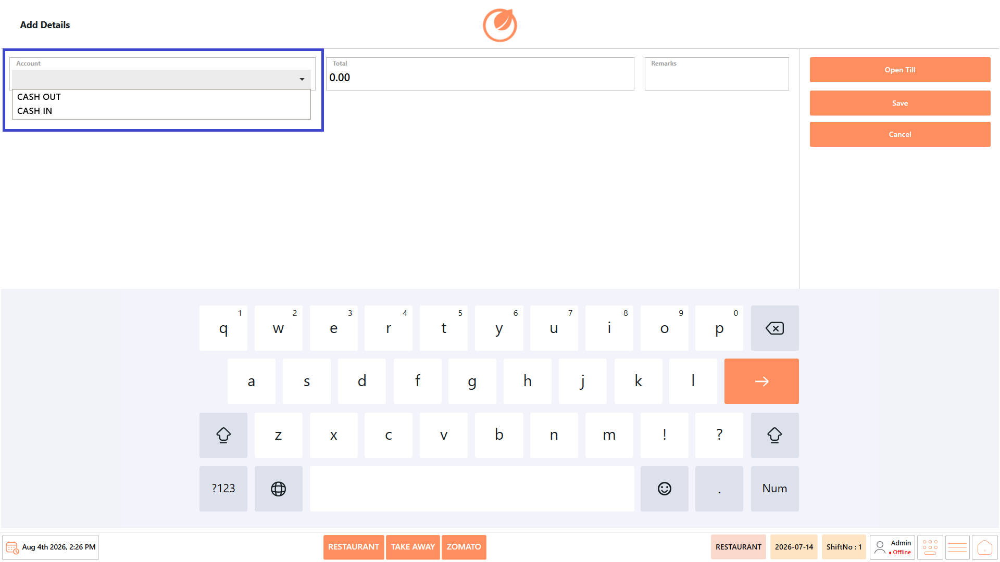
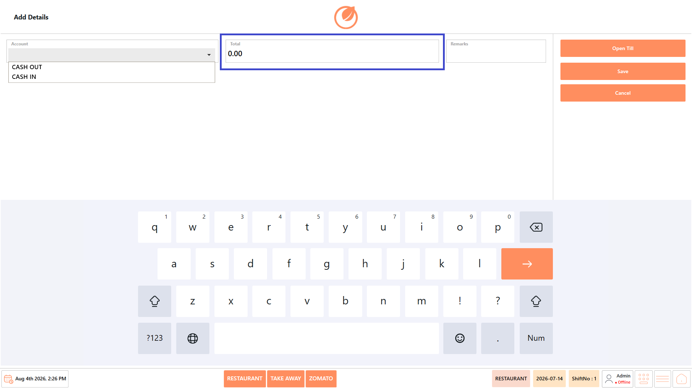
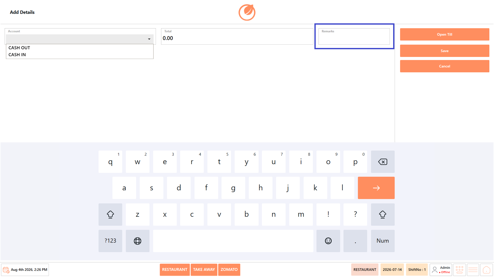
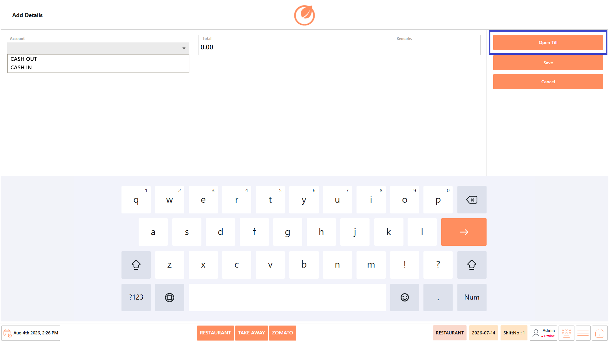
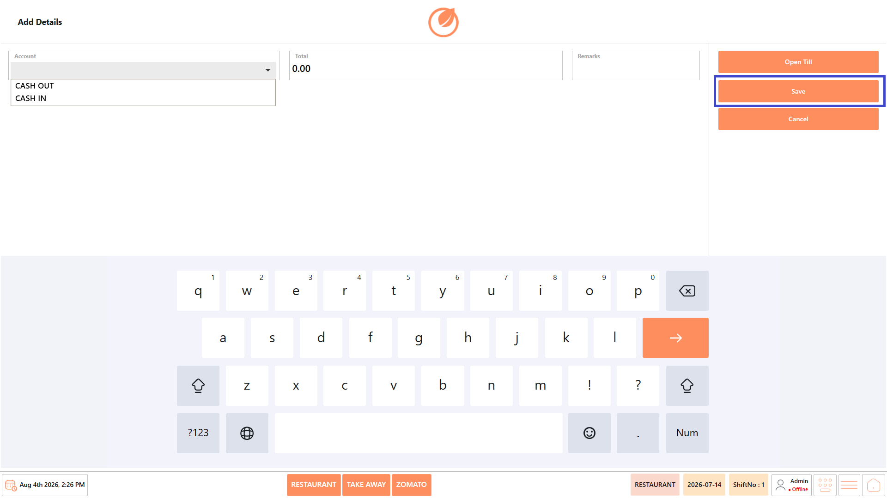
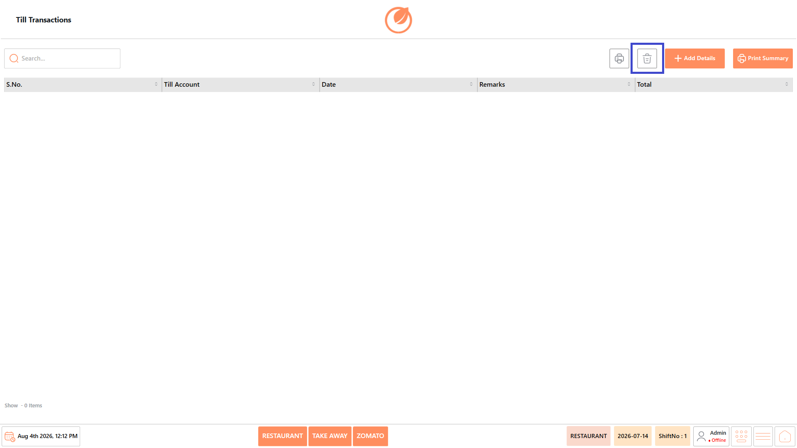

# Till Transaction

## **Overview** 

The Till Transactions feature allows users to manage cashier till accounts by recording opening balances and maintaining till transaction details. It enables administrators and cashiers to create till entries, record remarks, print till summaries, and review previously created till transactions for reconciliation and auditing purposes.

## **Open the Till Transactions** 

1. Log in to “DinePlan”.
2. From the “Dashboard”, select “Front Desk”.

<figure><figcaption></figcaption></figure>

3. Select “Till Transactions”.

<figure><figcaption></figcaption></figure>

4. The Till Transactions screen opens.

## **Screen Elements** 

The Till Transactions screen allows users to manage cashier till activities by creating, viewing, printing, importing, and exporting till transaction records.

<figure><figcaption></figcaption></figure>

| **Screen Element** | **Description**                                                                   |
| ------------------ | --------------------------------------------------------------------------------- |
| Search             | Search for a till transaction using keywords such as the till account or remarks. |
| S.No.              | Displays the serial number of each till transaction record.                       |
| Till Account       | Displays the till account associated with the transaction.                        |
| Date               | Displays the date on which the till transaction was created.                      |
| Remarks            | Displays additional notes or comments entered for the transaction.                |
| Total              | Displays the total amount recorded for the till transaction.                      |
| Import             | Imports till transaction records from an external file.                           |
| Export             | Exports till transaction records for reporting or backup purposes.                |
| Add Details        | Opens the **Add Details** screen to create a new till transaction.                |
| Print Summary      | Prints a summary report of the selected till transaction.                         |

## **Screen Information** 

* **Till Transaction List** – Displays all recorded till transactions with their account details, date, remarks, and total amount.
* **Status Bar** – Displays the active business type (Restaurant, Take Away, Zomato), business date, shift number, logged-in user, and navigation controls.

## **Working with Till Transactions** 

### **Add a Till Transaction** 

Use this option to create a new till transaction and record the opening till balance.

1. Open “Front Desk” → “Till Transactions”.

<figure><figcaption></figcaption></figure>

2. Select “Add Details”.

<figure><figcaption></figcaption></figure>

3. Select the required “Account” from the drop-down list.

<figure><figcaption></figcaption></figure>

4. Enter the “Total” (opening amount for the till).

<figure><figcaption></figcaption></figure>

5. Enter remarks in the “Remarks” field, if required.

<figure><figcaption></figcaption></figure>

6. Select “Open Till” to initialize the till for the selected account.

<figure><figcaption></figcaption></figure>

7. Select “Save”.

<figure><figcaption></figcaption></figure>

8. The till transaction is created and displayed in the Till Transactions list.

<figure><figcaption></figcaption></figure>

### **Print a Till Summary** 

Use this option to generate a summary of a till transaction.

1. Open “Front Desk” → “Till Transactions”.

<figure><figcaption></figcaption></figure>

2. Select the required till transaction.
3. Select “Print Summary”.

<figure><figcaption></figcaption></figure>

5. The system generates and prints the summary of the selected till transaction.

### **Delete a Till Transaction** 

Use this option to remove a till transaction record.

1. Open “Front Desk” → “Till Transactions”.

<figure><figcaption></figcaption></figure>

2. Select the required till transaction.
3. Select “Delete”.

<figure><figcaption></figcaption></figure>

4. Confirm the action, if prompted.
5. The selected till transaction is removed from the list.

## **Use Case** 

Use the Till Transactions feature to:

* Create new till transaction records.
* Record opening till balances.
* Maintain till account information.
* Print till summaries for reconciliation.
* Review and manage cashier till records.
* Support daily cash reconciliation and auditing.
