# Login

## Overview

The **Login** screen provides different options for users to securely access DinePlan and record their attendance.

Users can access DinePlan using the following options:

* **Login with PIN** – Enter the assigned PIN to access the application.
* **Biometric Login** – Use the configured biometric authentication method to log in.
* **Attendance** – Record attendance when starting the work session.

The Login screen provides the required options for accessing DinePlan and managing the user's login and attendance activities.

## **Purpose** 

* It authenticates restaurant staff before they can access DinePlan.
* Depending on restaurant configuration, users can log in using a PIN or a registered biometric fingerprint.
* Besides authentication, the screen also provides access to attendance marking, cloud synchronization, business date information, and application exit.

## **Login Using PIN** 

1. Open the DinePlan application.

<figure>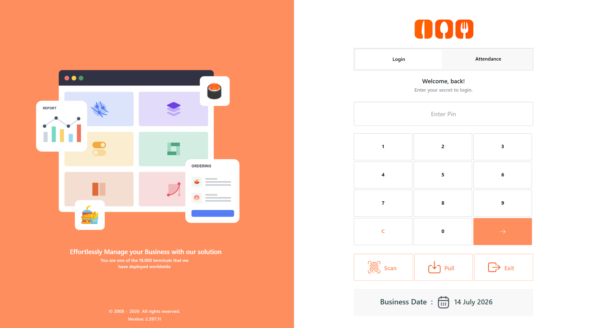<figcaption></figcaption></figure>

2. Enter your “PIN”.

<figure>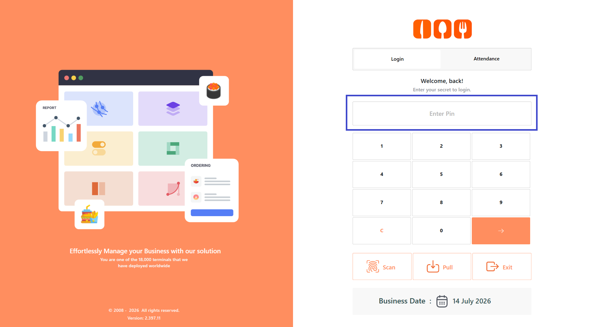<figcaption></figcaption></figure>

3. Select “Enter”.

<figure>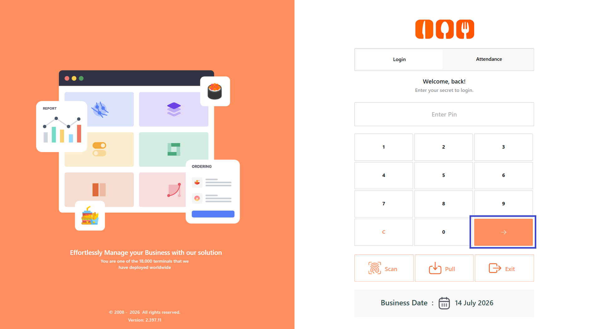<figcaption></figcaption></figure>

3. You are logged in to the application.

## **Login Using Biometric Authentication** 

1. Open the DinePlan application.
2. Select “Scan”.

<figure>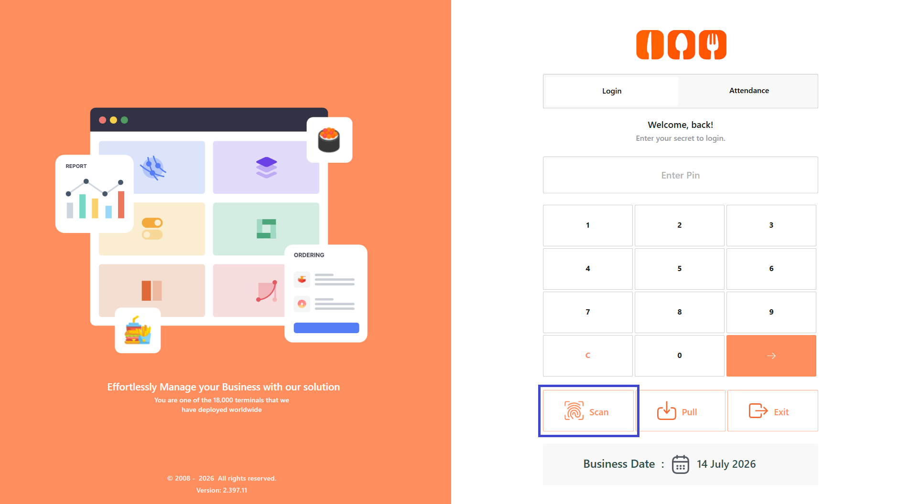<figcaption></figcaption></figure>

3. Place your registered finger on the biometric scanner.
4. Wait for the fingerprint to be verified.

<figure>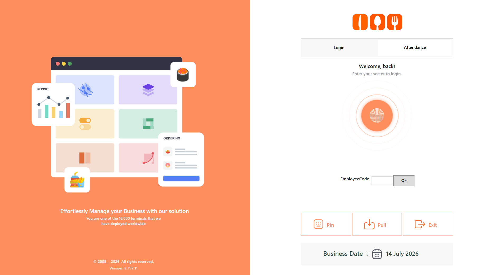<figcaption></figcaption></figure>

5. Once the fingerprint is successfully verified, you are automatically logged in to the application.

## **Record Attendance** 

1. Select “Attendance”.

<figure>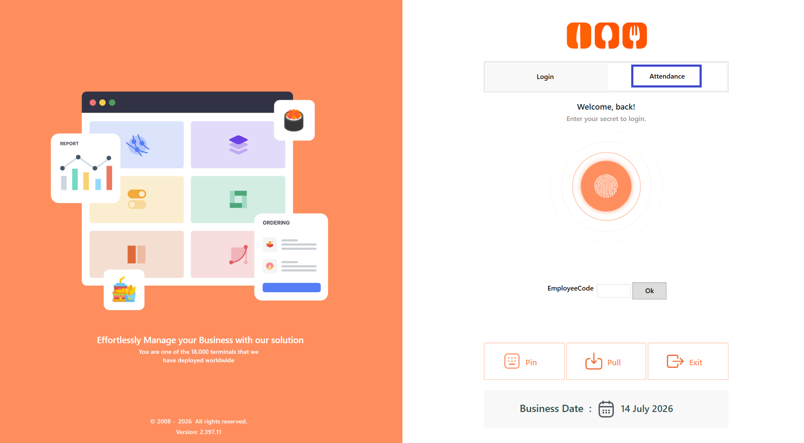<figcaption></figcaption></figure>

2. Log in using one of the following methods:
   1. Biometric Finger Scan
      1. Place your registered finger on the biometric scanner.
      2. Your attendance is recorded after successful fingerprint verification.

<figure>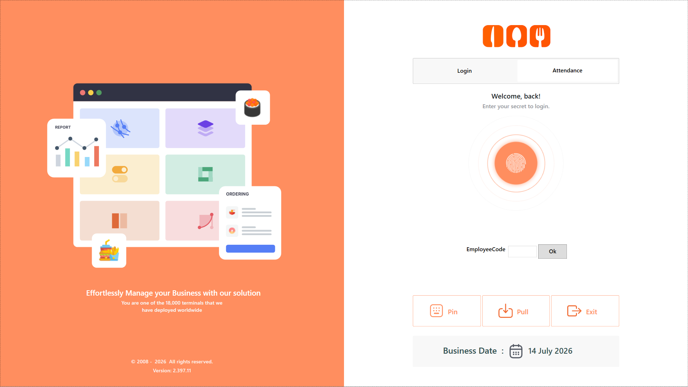<figcaption></figcaption></figure>

3. PIN
   1. Select “PIN”.

<figure>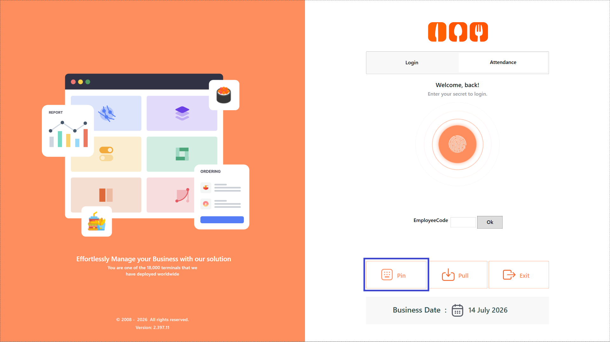<figcaption></figcaption></figure>

b. Enter the "PIN"

<figure>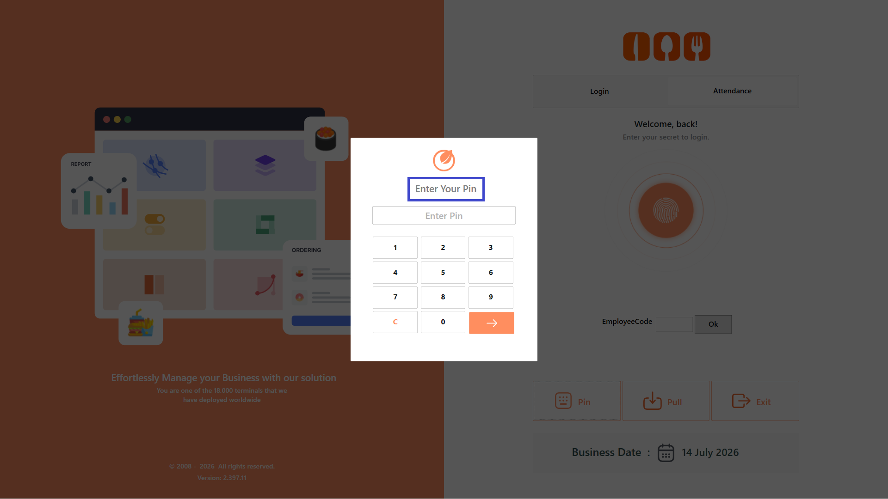<figcaption></figcaption></figure>

c. Select “Enter”.

<figure>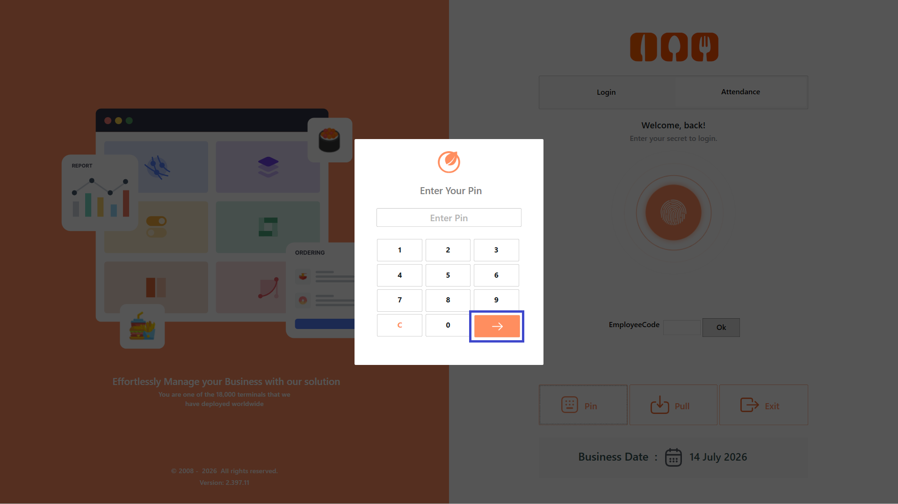<figcaption></figcaption></figure>

4. Employee Code
   1. Enter the “Employee Code”.
      1. Select “OK”.
      2. Your attendance is recorded.

<figure>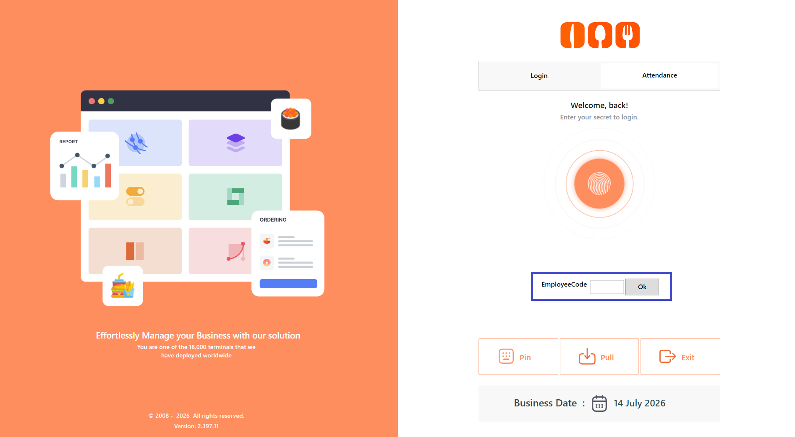<figcaption></figcaption></figure>

5. Your attendance is recorded.

## **Screen Elements** 

**PIN Login**

* Log in using your assigned employee PIN.

<figure>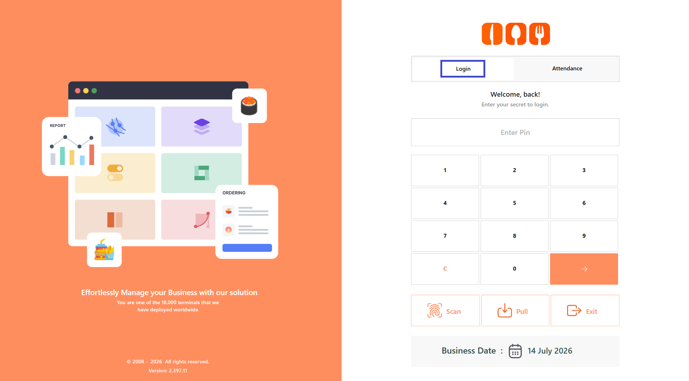<figcaption></figcaption></figure>

**Biometric Login**

* Log in by scanning your registered fingerprint using the biometric scanner.

<figure><figcaption></figcaption></figure>

**Attendance**

* Record cashier attendance before starting work.

<figure><figcaption></figcaption></figure>

**Pull**

* Pulls the latest data and configuration updates from DineConnect.
* Use this option when:
  * New menu items are added
  * Prices are updated
  * Configuration changes are made
  * You are instructed to sync the POS

<figure>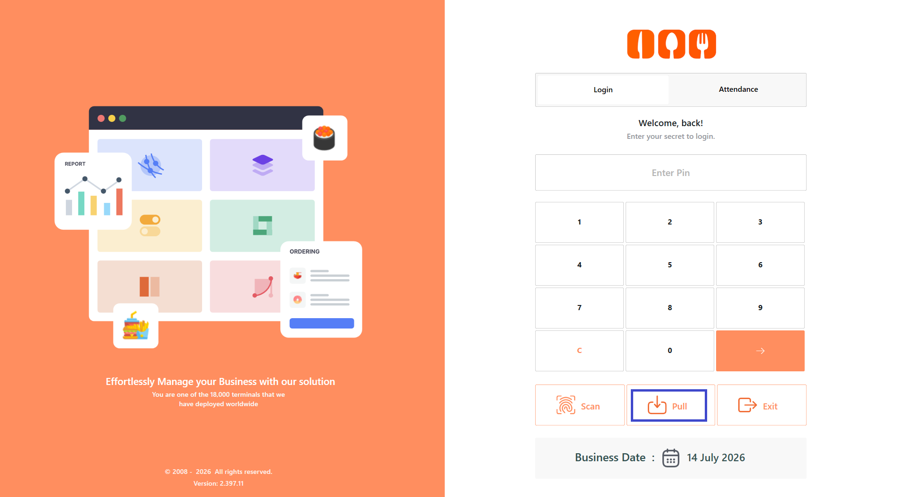<figcaption></figcaption></figure>

**Business Date**

* Displays the active business date used for restaurant transactions.

<figure>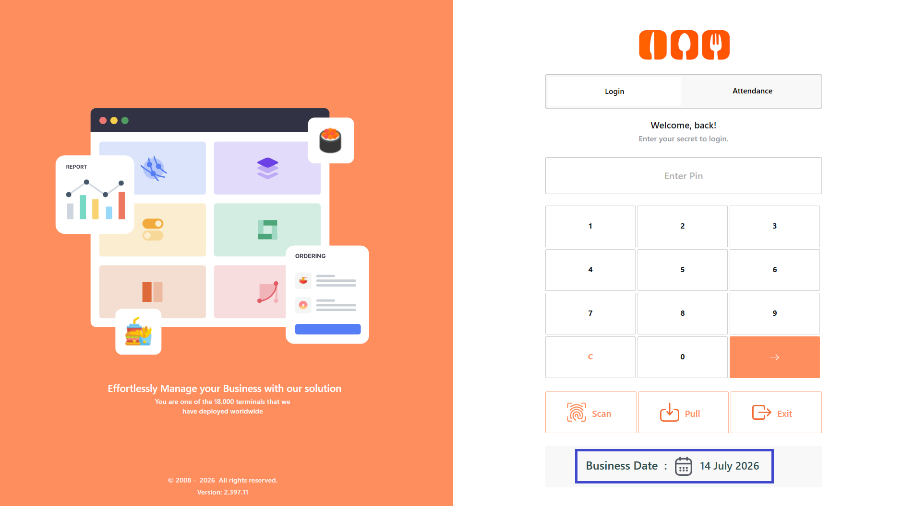<figcaption></figcaption></figure>

**Exit**

* Closes the DinePlan application.

<figure>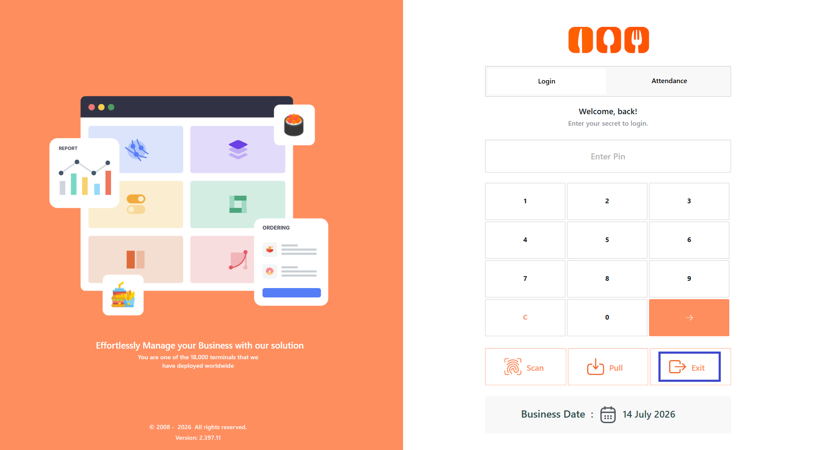<figcaption></figcaption></figure>

## Accessing the Dashboard

Once the user successfully logs in to DinePlan, the **Dashboard** is displayed. The Dashboard provides access to the main modules and features available to the user based on their permissions.

The following section explains the Dashboard and the features available in it.
