# Merge Tickets

## **Overview** 

The Merge Tickets function allows restaurant staff to combine tickets from multiple tables into a single ticket when a customer wants to make one payment for orders placed across different tables.

## **Before You Begin** 

Before merging tickets, ensure that:

* The tables that need to be combined have active tickets.
* You have identified all the tables that the customer wants to combine.
* You are logged in to the appropriate POS terminal.
* You have access to the "Change Table" option.
* You have confirmed with the customer which tables should be included in the combined bill.

**Example:** A customer wants to make one payment for Tables 3, 4, and 7.

### **Screen Elements** 

The following elements are used during the Merge Tickets process:

<figure>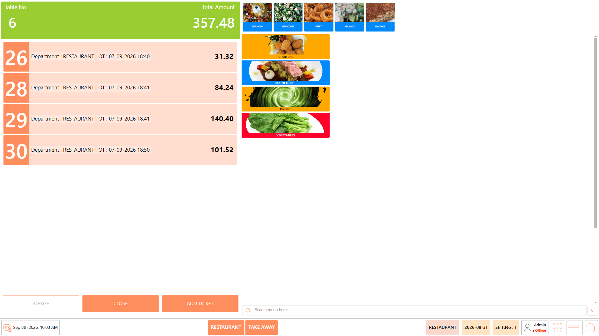<figcaption></figcaption></figure>

| **Screen Element**     | **Description**                                                                                                                                                                                    |
| ---------------------- | -------------------------------------------------------------------------------------------------------------------------------------------------------------------------------------------------- |
| Table                  | Displays the tables available on the POS screen. Select the required table to open its active order or to bring another table into the merge process.                                              |
| Change Table           | Opens the table selection screen and allows the current table or order to be associated with another table. Use this option to bring the tables that need to be combined into the same table view. |
| Table Selection Screen | Displays the available tables after selecting **"Change Table"**. Select the next table that needs to be included in the merge.                                                                    |
| Ticket List            | Displays the tickets available for the selected or merged table. Review this list to identify the tickets that need to be combined.                                                                |
| Ticket Number          | Identifies an individual ticket within the table. Click the ticket number to select the ticket for merging.                                                                                        |
| Selected Ticket        | Indicates a ticket that has been selected for the merge. Select all the tickets that the customer wants to combine before proceeding.                                                              |
| Merge                  | Combines the selected tickets into a single ticket. This option becomes active after the required tickets have been selected.                                                                      |
| Order Details          | Displays the items and other information associated with the selected ticket. Use this information to verify that the correct ticket has been selected before merging.                             |
| Ticket Amount          | Displays the amount associated with the ticket. Review the amount to confirm that the correct ticket is being included in the merge.                                                               |

**Note:** The provided Merge Tickets reference specifically shows the "Change Table" option, table selection, ticket numbers, ticket selection, and "Merge" action. The descriptions above are limited to the elements supported by the reference.

## **Merge Tickets** 

### **About Merge Tickets** 

The merge process brings tickets from multiple tables together so that the required tickets can be selected and combined into a single ticket.

The process is performed in two stages:

1. Use "Change Table" to bring the required tables together.

<figure><figcaption></figcaption></figure>

2. Select the required tickets and use "Merge" to combine them.

<figure>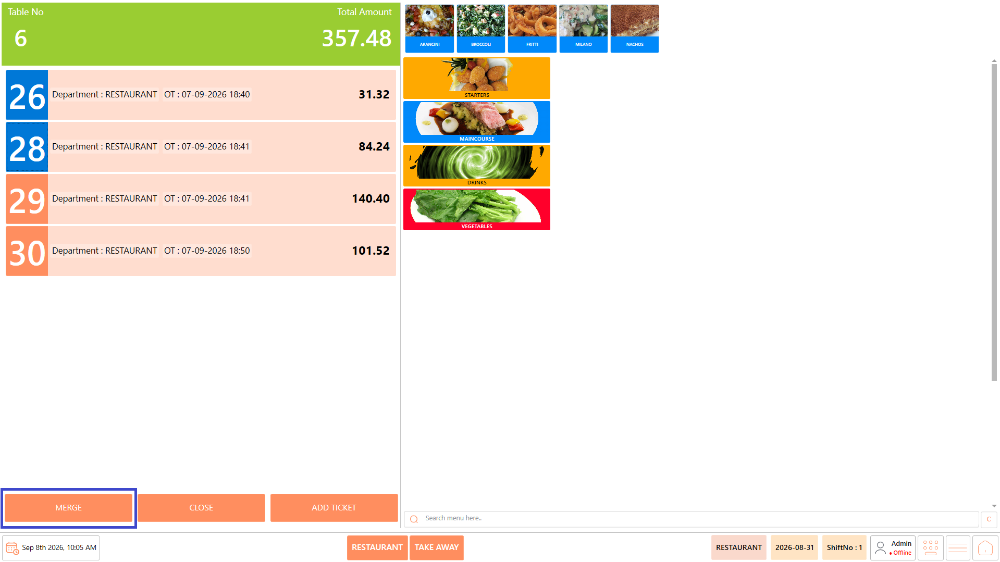<figcaption></figcaption></figure>

### **Procedure** 

#### **Step 1: Open the First Table** 

1. Open the POS module.
2. Locate the first table that the customer wants to include in the combined bill.

<figure>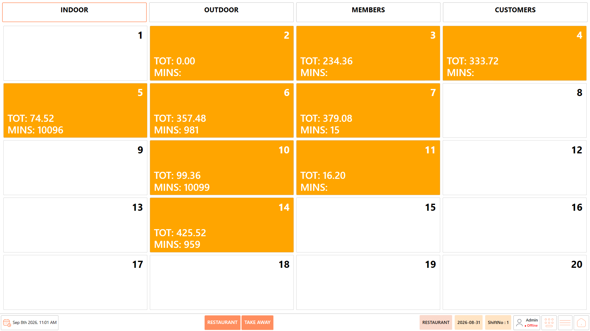<figcaption></figcaption></figure>

3. Select the required table.\
   **Example:** In this case, select "Table 3".

<figure>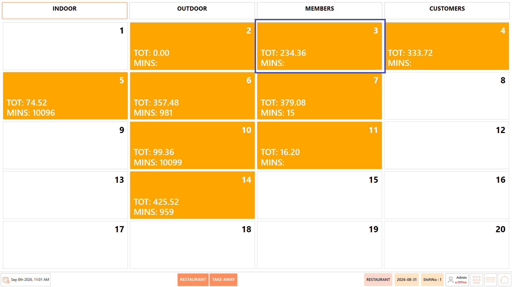<figcaption></figcaption></figure>

4. The ordering screen for the selected table opens.
5. Click "Change Table" in the top-left corner of the screen.

<figure><figcaption></figcaption></figure>

#### **Step 2: Select the Next Table** 

1. The table selection screen is displayed.
2. Locate the next table that needs to be included in the merge.
3. Select the required table.\
   **Example:** In this case, select "Table 7".

<figure>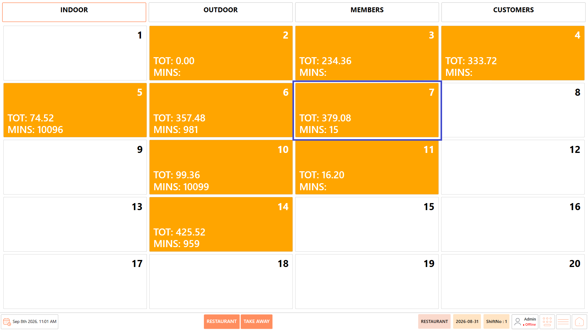<figcaption></figcaption></figure>

4. The selected table is merged with the current table.

<figure>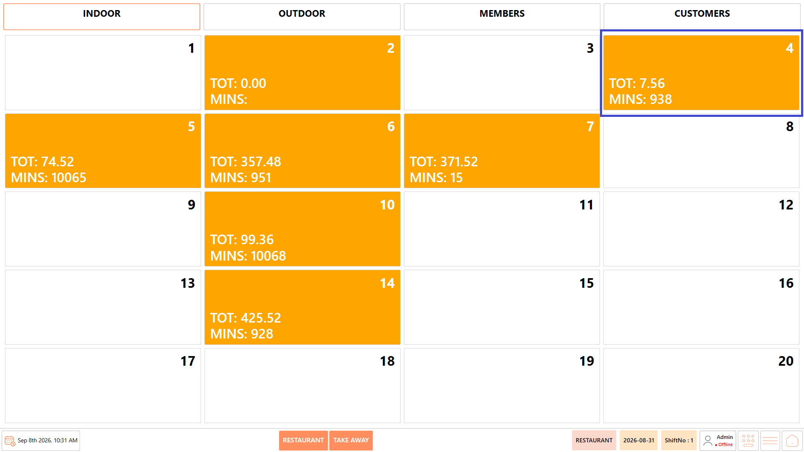<figcaption></figcaption></figure>

#### **Step 3: Add the Next Table** 

If more than two tables need to be combined, repeat the same process to add the remaining tables.

1. Select "Change Table".
2. Select the next table that needs to be included.\
   **Example:** After merging "Table 7", select "Table 4".

<figure>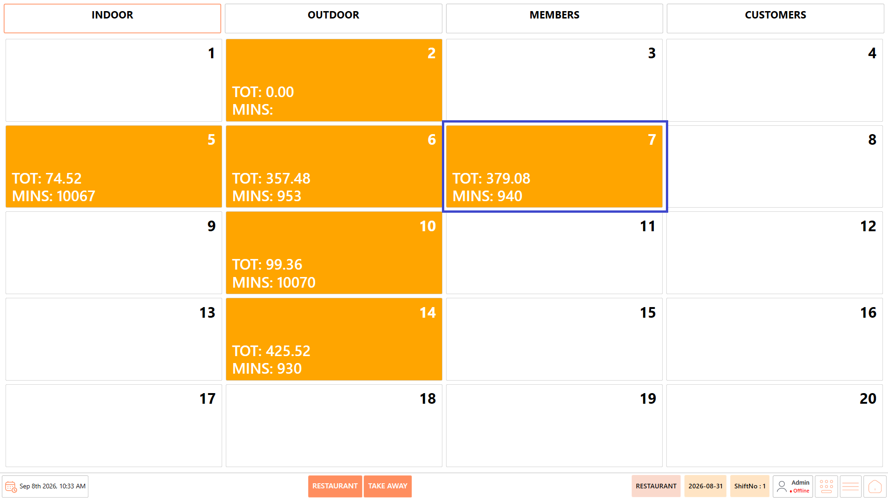<figcaption></figcaption></figure>

3. Continue the same process until all required tables have been brought together.

<figure><figcaption></figcaption></figure>

#### **Step 4: Open the Merged Table** 

1. Select the table containing the merged tickets.
2. The ordering screen is displayed.

<figure>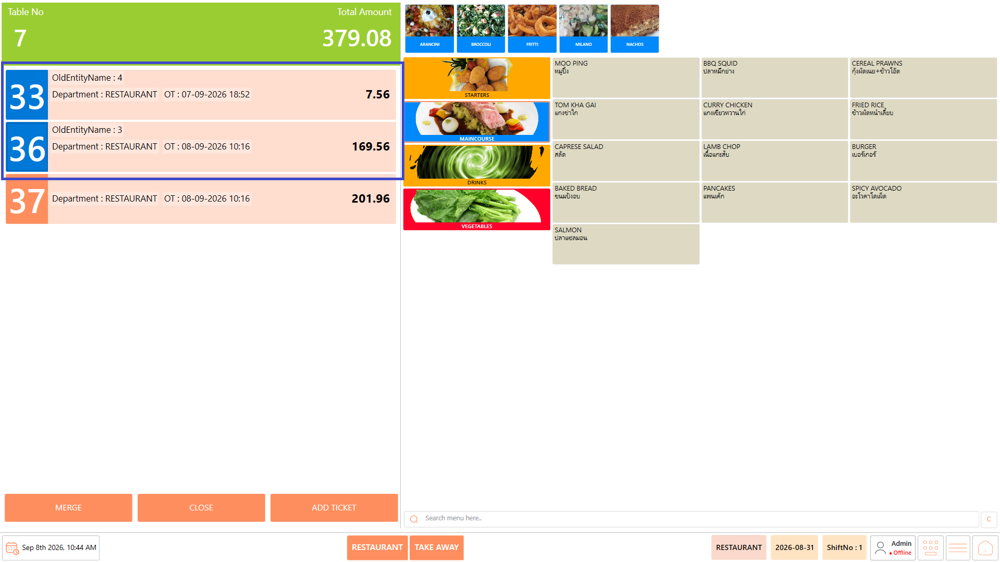<figcaption></figcaption></figure>

3. The tickets from the merged tables are displayed individually.
4. Review the displayed tickets before selecting the ones to be combined.

**Example:** If "Table 3", "Table 7", and "Table 4" were merged, review the tickets from all three tables before selecting the required tickets.

**Important:** Check the ticket details carefully to make sure that only the customer's required tickets are selected.

#### **Step 5: Select the Tickets** 

1. Locate the ticket numbers displayed on the left side of the ordering screen.
2. Select the ticket that needs to be included in the merge.\
   **Example:** Select the ticket from "Table 3" that the customer wants to combine.
3. Select each additional ticket that needs to be included.\
   **Example:** Select the required tickets from "Table 7" and "Table 4".

<figure><figcaption></figcaption></figure>

4. Verify that all the required tickets are selected.

Selected tickets are highlighted, making it easy to identify the tickets that will be merged.

#### **Step 6: Merge the Selected Tickets** 

1. Make sure all the required tickets are selected.
2. The "Merge" button becomes active once the required tickets are selected.
3. Review the selected tickets one more time.
4. Select "Merge" to combine the selected tickets.

<figure>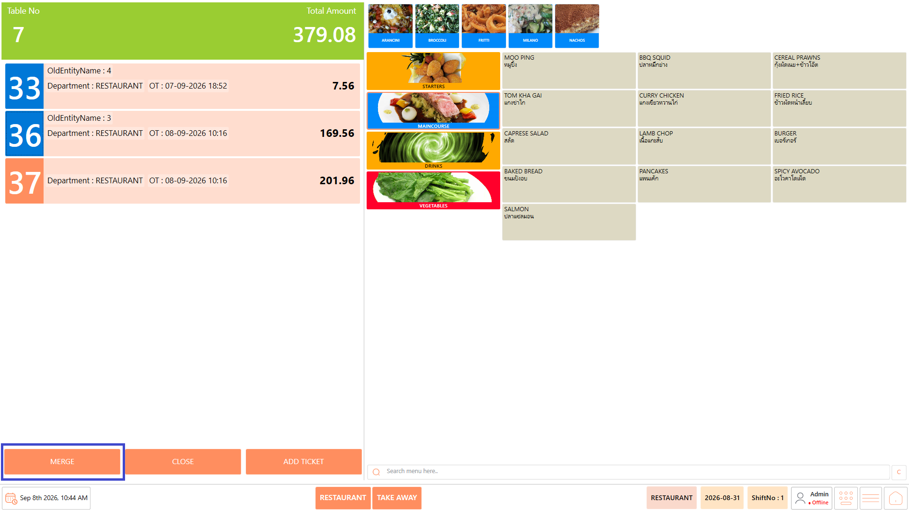<figcaption></figcaption></figure>

## **Verify the Merged Ticket** 

After the merge is completed:

1. Review the ticket displayed on the ordering screen.

<figure>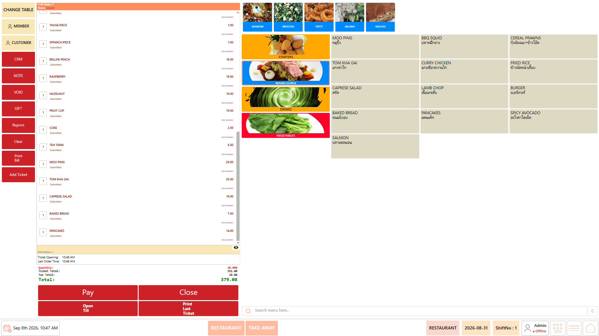<figcaption></figcaption></figure>

2. Verify that the required tickets have been combined.
3. Check that the expected items are included.
4. Verify the combined ticket amount.

<figure><figcaption></figcaption></figure>

5. Confirm that no unrelated ticket has been included.

### **Result** 

* The selected tickets are successfully merged into a single ticket.
* The combined ticket is now ready to be reviewed and processed for payment.

## **Process the Combined Payment** 

After merging the required tickets:

1. Review the combined ticket and verify the total amount.
2. Select "Pay".

<figure><figcaption></figcaption></figure>

3. Select the payment method used by the customer.
4. Complete the payment.
5. If the customer wants to split the combined bill, select the applicable split-payment option.

<figure>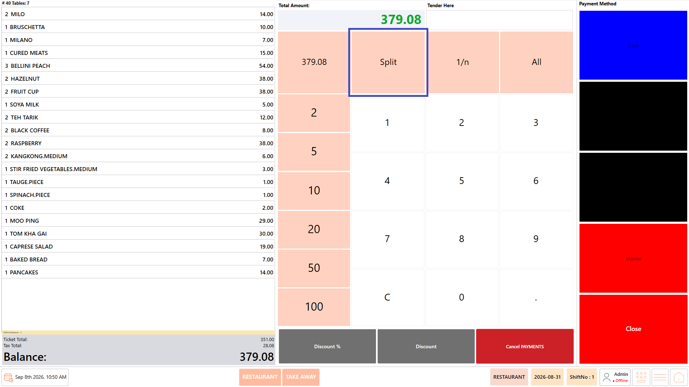<figcaption></figcaption></figure>

## **Example: Merge Tables 3, 4, and 7** 

Suppose a customer wants to pay for orders from **Table 3, Table 4, and Table 7** as one bill.

Follow this sequence:

<figure><figcaption></figcaption></figure>

This is the workflow demonstrated in the provided Merge Tickets reference document.

## **Notes** 

* Confirm with the customer which tables need to be combined before starting the merge.
* Verify the table selected at each stage of the "Change Table" process.
* Review all tickets displayed after the tables have been brought together.
* Select only the tickets that need to be combined.
* The "Merge" button becomes active after the required tickets are selected.
* Always verify the merged ticket and total amount before proceeding to payment.
