# Ordering

## **Overview** 

The DinePlan Ordering screen is used to create, manage, review, and process customer orders. The ordering process starts with selecting a table and adding menu items, followed by managing customer and ticket information, reviewing the order, submitting it, and completing payment.

### **Complete Ordering Flow** 

Use the following flow as a quick reference for the complete ordering process:

<figure><figcaption></figcaption></figure>

The following sections explain each stage of this flow in detail.

## **Select the Table** 

The first step in the ordering process is to select the table for which the order needs to be created or continued.

#### **Procedure** 

1. From the DinePlan home screen, click "POS".

<figure>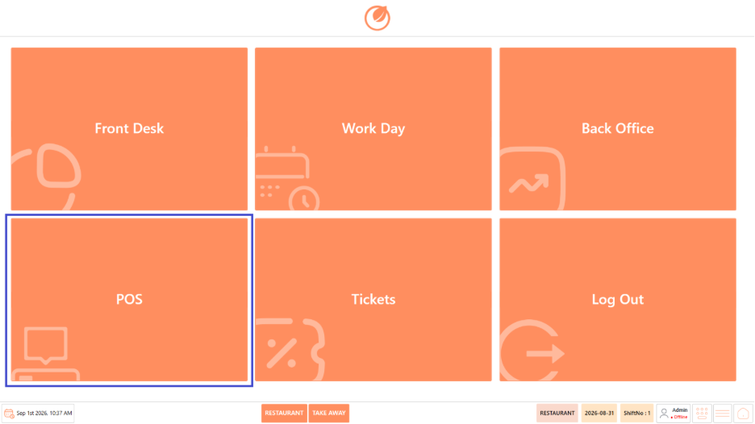<figcaption></figcaption></figure>

2. The POS screen displays the available tables.

<figure>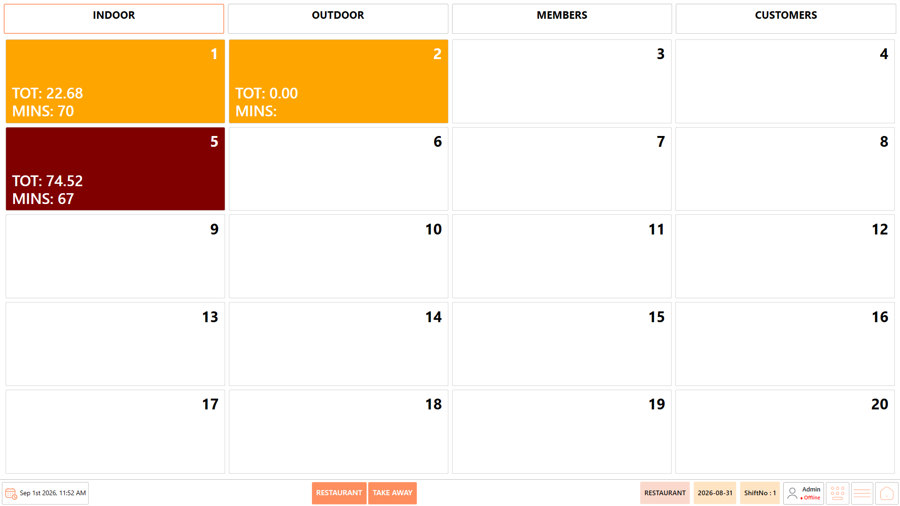<figcaption></figcaption></figure>

3. Identify the table for which the customer wants to place an order.
4. Review the table status.
5. Click the required table.
6. If the table already has an active order, the existing order is displayed.

<figure>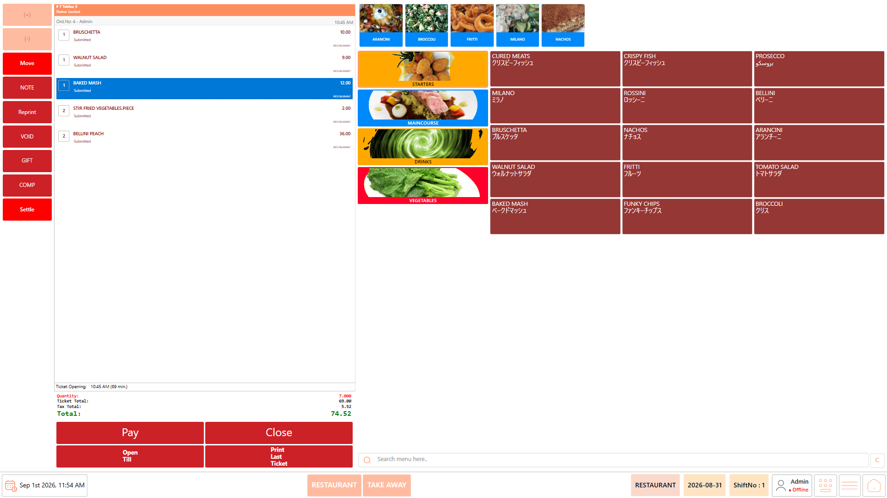<figcaption></figcaption></figure>

7. If the table does not have an active order, the Ordering screen opens for creating a new order.

#### **Table Status** 

The table colour indicates its current status:

* **White** – The table is available.
* **Yellow** – The table is occupied.
* **Brown** – The table is waiting for payment.

<figure><figcaption></figcaption></figure>

## **Select the Menu Category** 

After selecting the table, select the menu category containing the item requested by the customer.

#### **Procedure** 

1. Review the available menu categories.

<figure><figcaption></figcaption></figure>

2. Click the required category.

<figure><figcaption></figcaption></figure>

3. The menu items configured under the selected category are displayed.

<figure>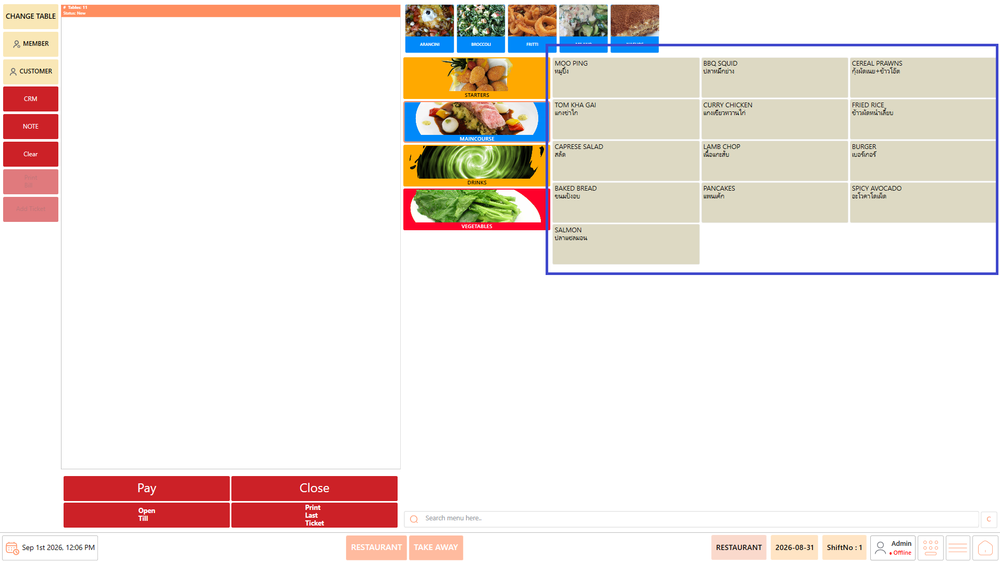<figcaption></figcaption></figure>

4. Select another category when additional items are required from a different category.
5. Category Selection provides a quick way to locate menu items without searching through the complete menu.

## **Select Menu Items** 

After selecting the required category, select the menu items requested by the customer.

#### **Procedure** 

1. Review the menu items displayed under the selected category.

<figure>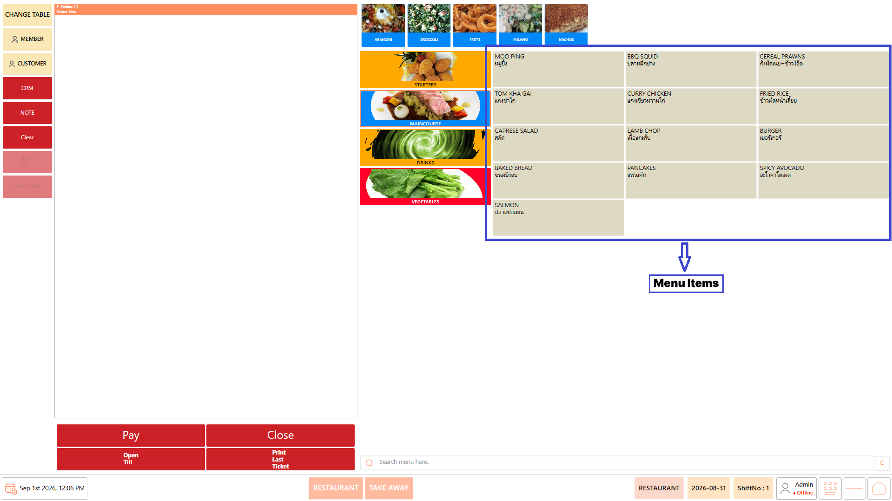<figcaption></figcaption></figure>

2. Click the required menu item.
3. The selected item is added to the Order Summary.

<figure>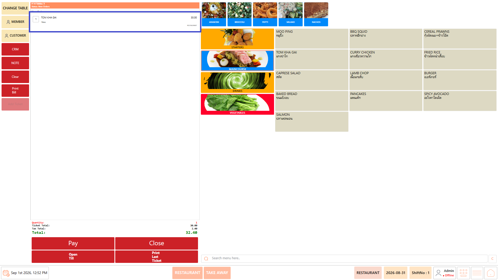<figcaption></figcaption></figure>

4. Verify that the correct item has been added.
5. Repeat the process for all items requested by the customer.
6. Select another menu category when additional items are required.

#### **Update Item Quantity** 

* Select the item from the Order Summary.

<figure><figcaption></figcaption></figure>

* Use **+** to increase the selected item's quantity.

<figure><figcaption></figcaption></figure>

* Use **−** to decrease the selected item's quantity.

<figure>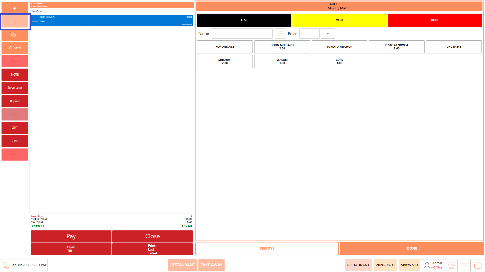<figcaption></figcaption></figure>

* Use **Q+** when more than one item needs to be selected.

<figure><figcaption></figcaption></figure>

* Select **Cancel** to remove the selected item from the order.

<figure><figcaption></figcaption></figure>

* Select **Note** to add additional information to the order.

<figure><figcaption></figcaption></figure>

* Use **Serve Later** when the selected item needs to be served later.

<figure><figcaption></figcaption></figure>

* Use **Reprint** to reprint the applicable ticket.

<figure><figcaption></figcaption></figure>

* Use **Void, Gift, Comp,** or **Settle** where applicable and based on the user's permissions.

<figure>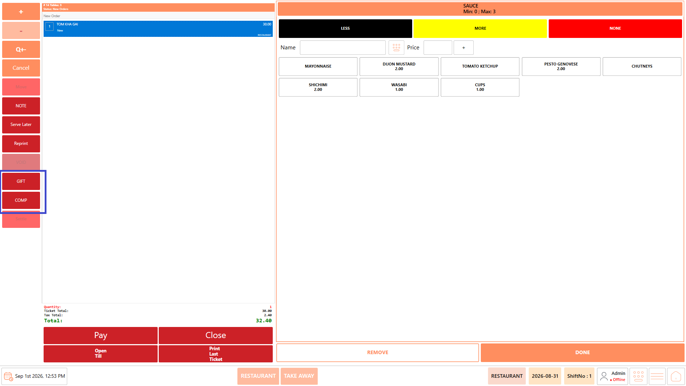<figcaption></figcaption></figure>

The Ordering screen provides controls for increasing or decreasing the item quantity and removing an item from the order.

## **Review the Order Summary** 

The Order Summary displays all items currently added to the order.

Before continuing, review the order to make sure that it accurately reflects the customer's request.

#### **Procedure** 

1. Review every item displayed in the Order Summary.
2. Verify the quantity of each item.
3. Remove any incorrect item.
4. Update quantities when required.
5. Continue adding items if the customer has requested additional items.
6. Verify that all requested items are included.
7. Continue to Customer Operations.

<figure>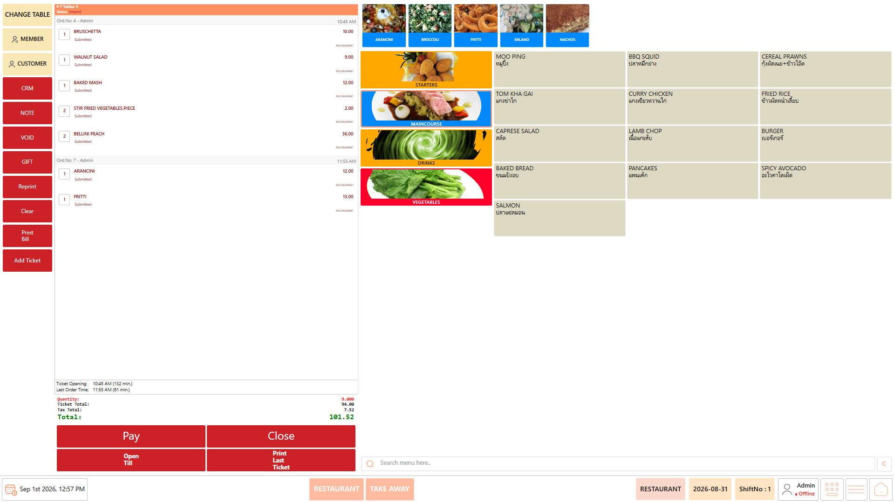<figcaption></figcaption></figure>

The Order Summary should be reviewed throughout the ordering process and again before the order is submitted.

## **Select Customer** 

The Customers section can be used when a transaction needs to be associated with a registered customer.

#### **Select an Existing Customer** 

1. Open “Customers”.

<figure>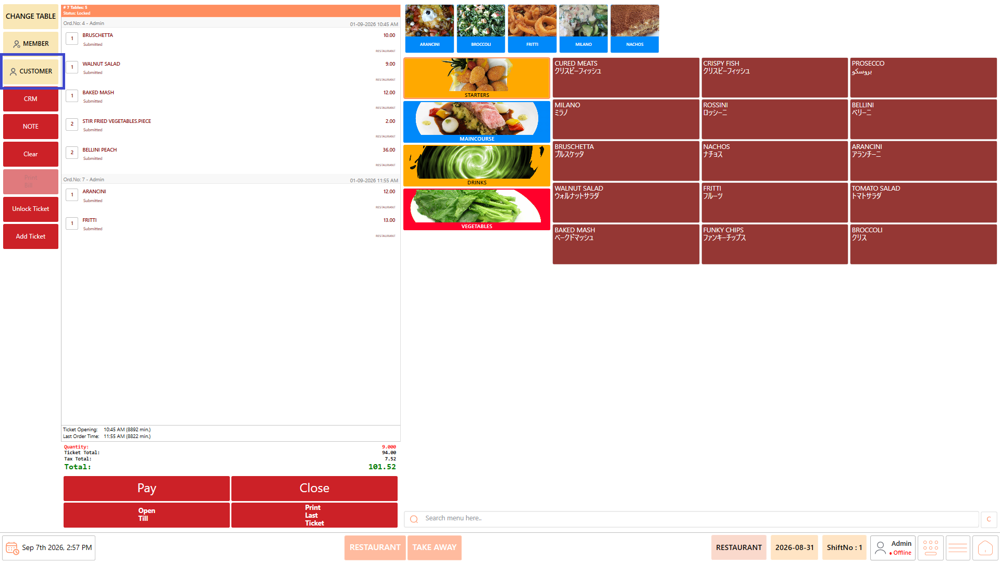<figcaption></figcaption></figure>

2. Use the available Search field to locate the required customer.
3. Select the required customer.

<figure>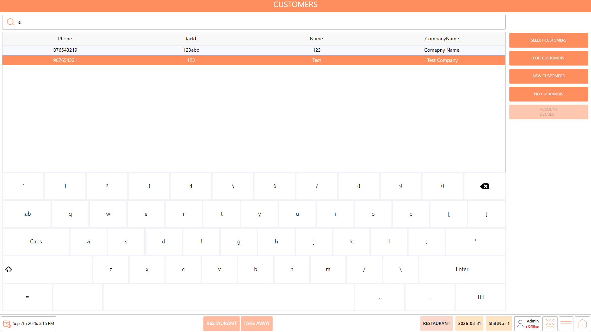<figcaption></figcaption></figure>

4. Select "Select Customer”.
5. The selected customer is associated with the transaction.

<figure>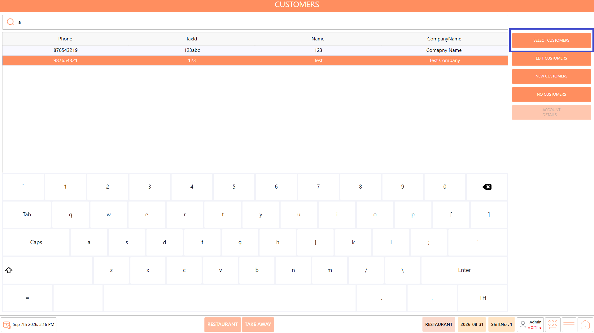<figcaption></figcaption></figure>

#### **Create a New Customer** 

If the required customer does not exist:

1. Open “Customers”.

<figure><figcaption></figcaption></figure>

2. Select “New Customer”.

<figure><figcaption></figcaption></figure>

3. The New Customer screen is displayed.

<figure>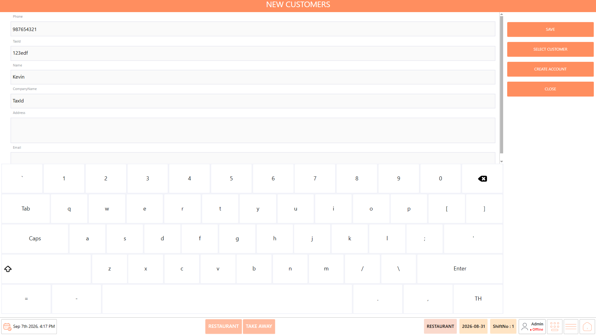<figcaption></figcaption></figure>

4. Enter the required “Mobile Number”.
5. Enter the “Customer's Name”.
6. Enter the “Tax Id”, where applicable.
7. Enter the “Company Name”, where applicable.
8. Review the entered information.
9. Select “Save”.

<figure>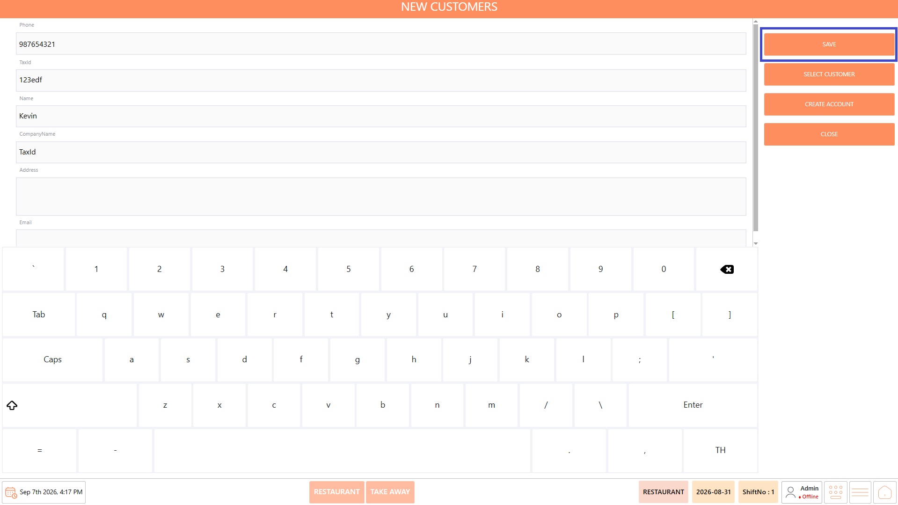<figcaption></figcaption></figure>

10. The new customer record is created.

The New Customer screen also provides the following options:

* **Select Customer** – Directly selects the newly created customer and links the customer to the current transaction.
* **Create Account** – Creates an account for the customer. Once created, the customer is available in the Customers list.
* **Close** – Closes the New Customer screen.

**Note:** Use Select Customer when the newly created customer needs to be associated with the current transaction. Use Create Account when an account needs to be created for the customer.

## **Select Member** 

The Members section can be used when a transaction needs to be associated with a registered member.

#### **Select an Existing Member** 

1. Open "Members".

<figure>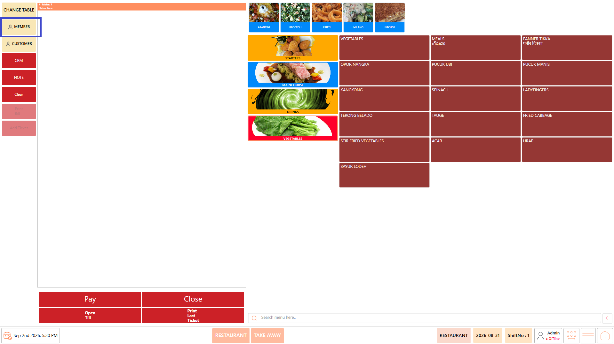<figcaption></figcaption></figure>

2. Use the available search field to locate the required member.

<figure>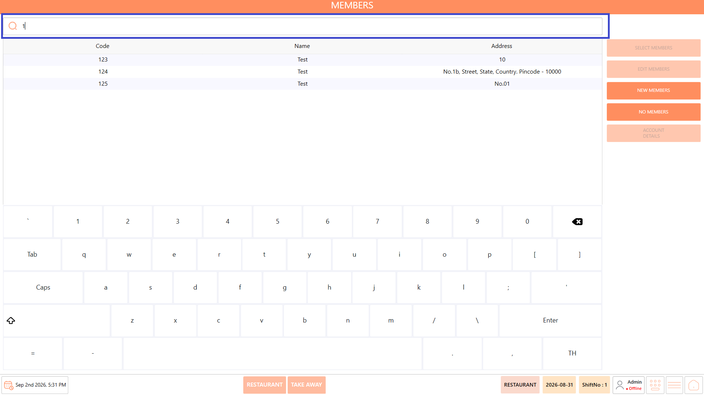<figcaption></figcaption></figure>

3. Select the required member.

<figure>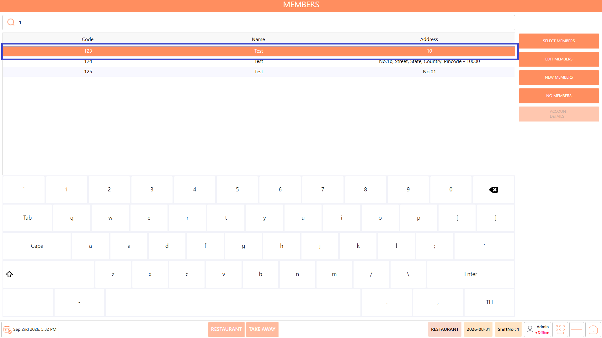<figcaption></figcaption></figure>

4. Select "Select Members".

<figure>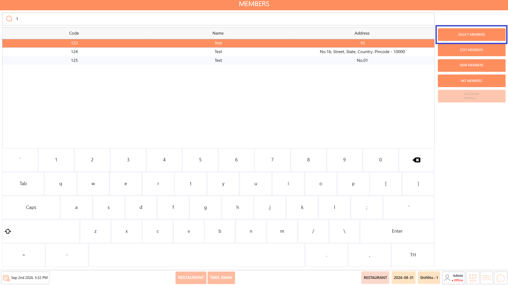<figcaption></figcaption></figure>

5. The selected member is associated with the transaction.

<figure>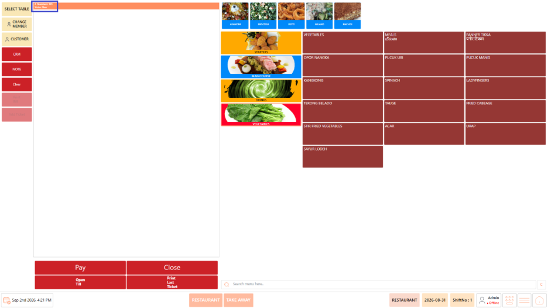<figcaption></figcaption></figure>

#### **Create a New Member** 

If the required member does not exist:

1. Open "Members".
2. Select "New Members".

<figure>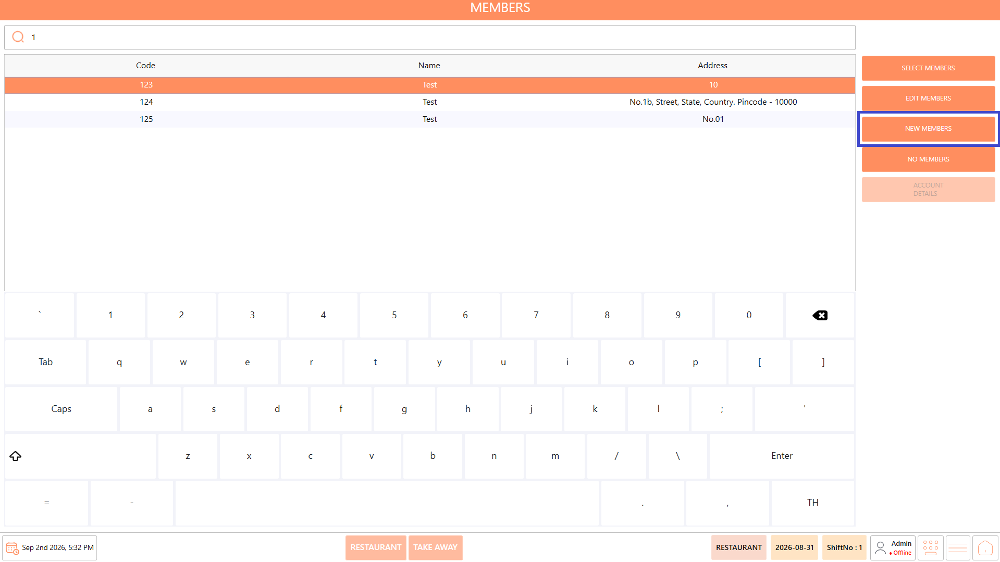<figcaption></figcaption></figure>

3. The New Members screen is displayed.
4. Enter the required "Code".
5. Enter the member's "Name".
6. Enter the "Address", where applicable.

<figure>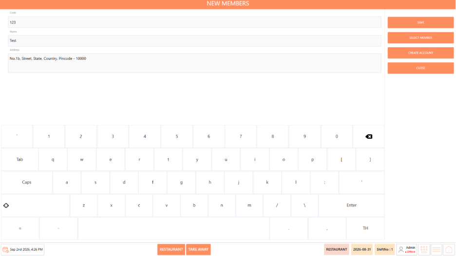<figcaption></figcaption></figure>

7. Review the entered information.
8. Select "Save".

<figure>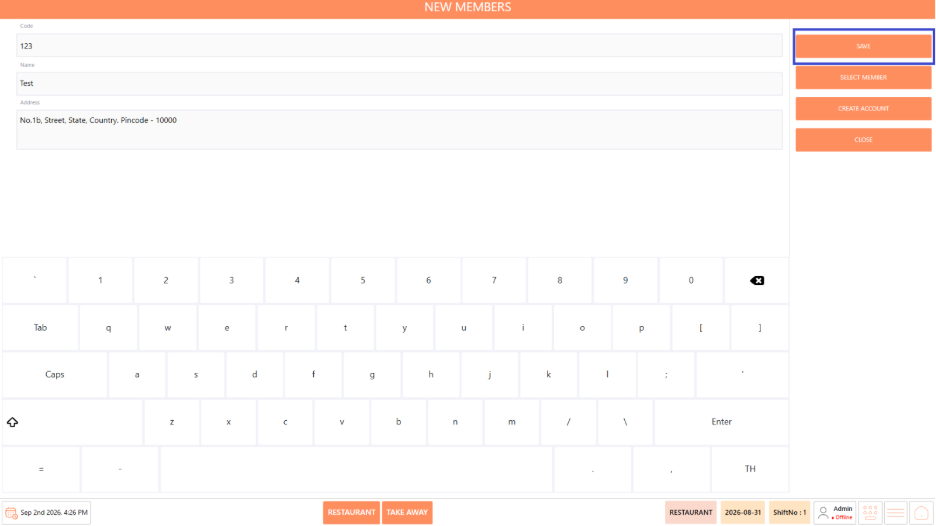<figcaption></figcaption></figure>

9. The new member record is created.

The New Members screen also provides the following options:

* **Select Member** – Directly selects the newly created member and links the member to the current transaction.
* **Create Account** – Creates an account for the member. Once created, the member is available in the Members list.
* **Close** – Closes the New Members screen.

**Note:** Use Select Member when the newly created member needs to be associated with the current transaction. Use Create Account when an account needs to be created for the member.

## **Add Notes and Special Instructions** 

Use "Note" when an instruction or remark needs to be associated with the order or a specific item.

#### **Procedure** 

1. Select the relevant order or item.
2. Click "Note".

<figure>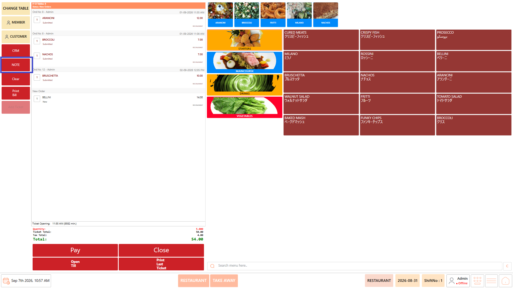<figcaption></figcaption></figure>

3. Enter the required instruction or remark.
4. Select “Ok”

<figure>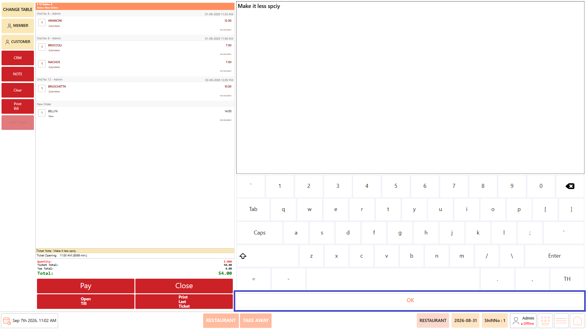<figcaption></figcaption></figure>

5. Review the entered information.
6. The note will be displayed at the bottom of the order.

<figure>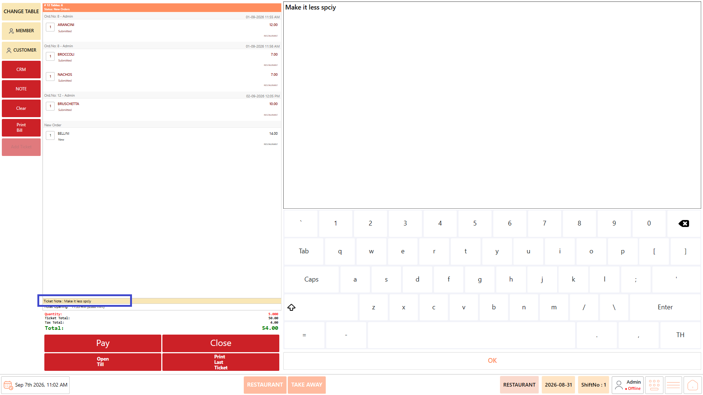<figcaption></figcaption></figure>

7. Continue with the order.
8. Notes can be added for both orders and individual items.

## **Manage Tickets** 

Ticket management is required when an order needs to be divided into separate tickets or when items need to be reorganized between tickets.

The main ticket operations are:

**"Add Ticket" → Add Items → "Move" Items → "Serve Later" → "Settle"**

### **Add Ticket** 

Use "Add Ticket" when separate tickets are required for the same table.

1. Click "Add Ticket".

<figure>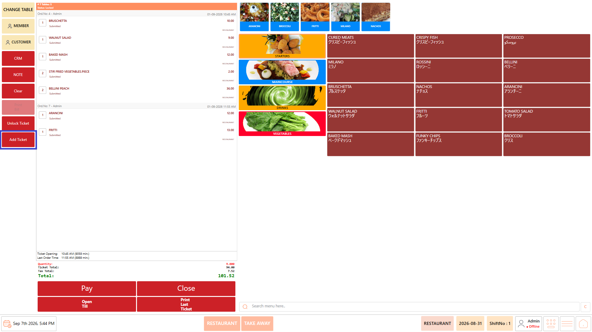<figcaption></figcaption></figure>

2. A new ticket is created for the same table.
3. Add the required items to the new ticket.

<figure>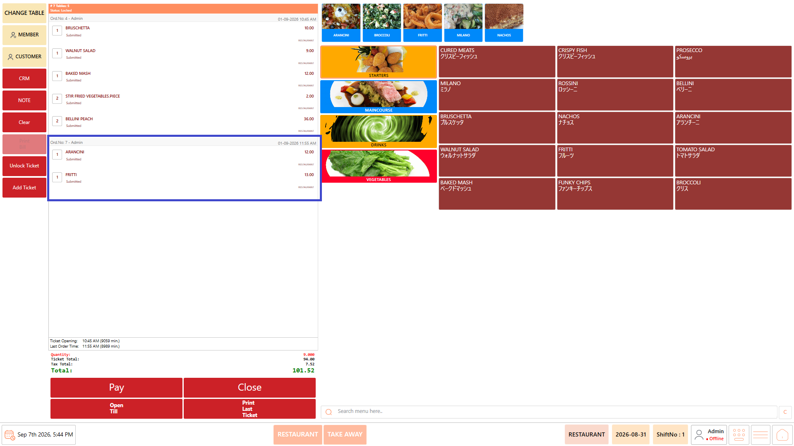<figcaption></figcaption></figure>

4. Review the tickets.
5. Verify that the correct items are assigned to each ticket.

Note: Tickets can be managed separately and can be merged later or paid individually.

### **Move Items Between Tickets** 

Use "Move" when an item needs to be transferred from one ticket to another ticket on the same table.

1. Select the item that needs to be moved.
2. Click "Move".

<figure>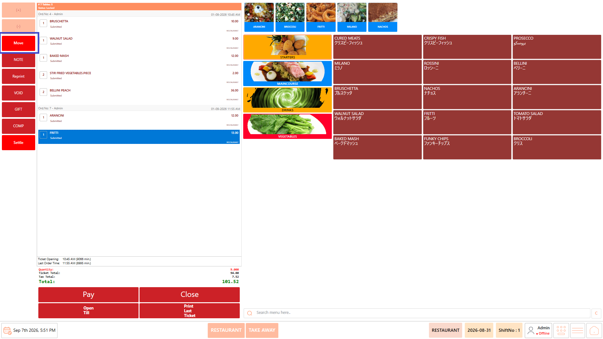<figcaption></figcaption></figure>

3. Select the destination ticket.

<figure>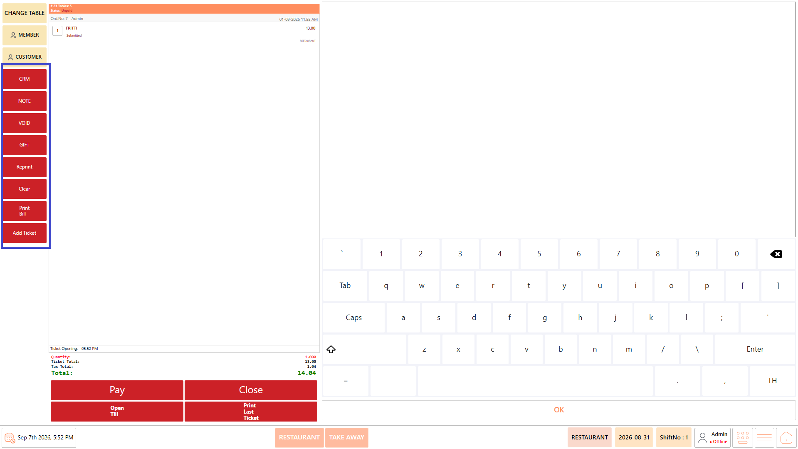<figcaption></figcaption></figure>

4. Verify that the item appears under the correct ticket.

### **Serve an Item Later** 

Use "Serve Later" when an item needs to be served separately from the remaining items.

1. Select the required item.
2. Click "Serve Later".

<figure>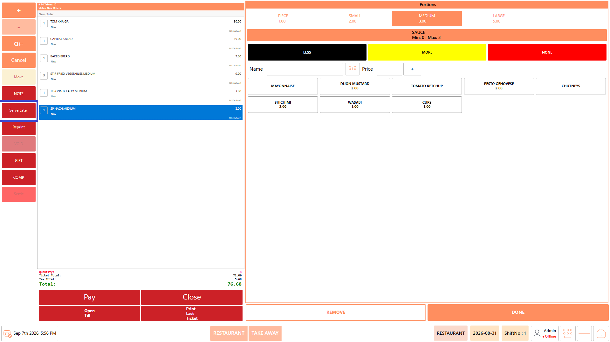<figcaption></figcaption></figure>

3. Verify that the item is marked for later service.
4. Continue processing the remaining items.

### **Settle a Selected Item** 

Use "Settle" when payment is required for a selected item instead of the complete ticket.

1. Select the required item.
2. Click "Settle".

<figure>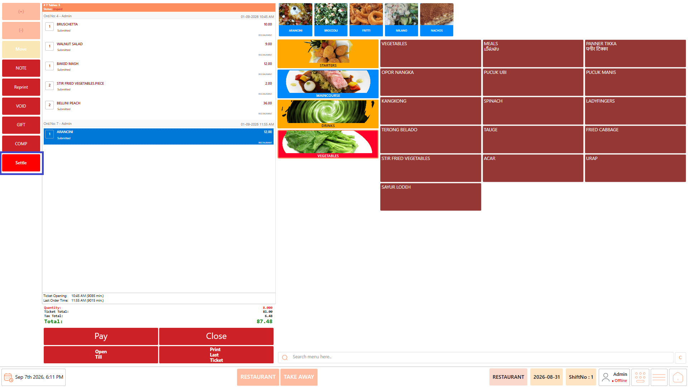<figcaption></figcaption></figure>

3. Verify the selected item and amount.
4. Continue with the payment process.

## **Apply Item-Level Operations** 

Item-level operations are used when an individual item requires special handling.

The available operations include:

**"Void" → "Comp" → "Gift"**

### **Void an Item** 

Use "Void" when a customer cancels an item that has already been sent to the kitchen.

1. Select the item to be cancelled.
2. Select "Void".

<figure><figcaption></figcaption></figure>

3. The "Reason/Void" screen is displayed.
4. Enter the reason for voiding the item in the "Reason/Void" field.

<figure><figcaption></figcaption></figure>

5. Select "OK" to confirm.

<figure>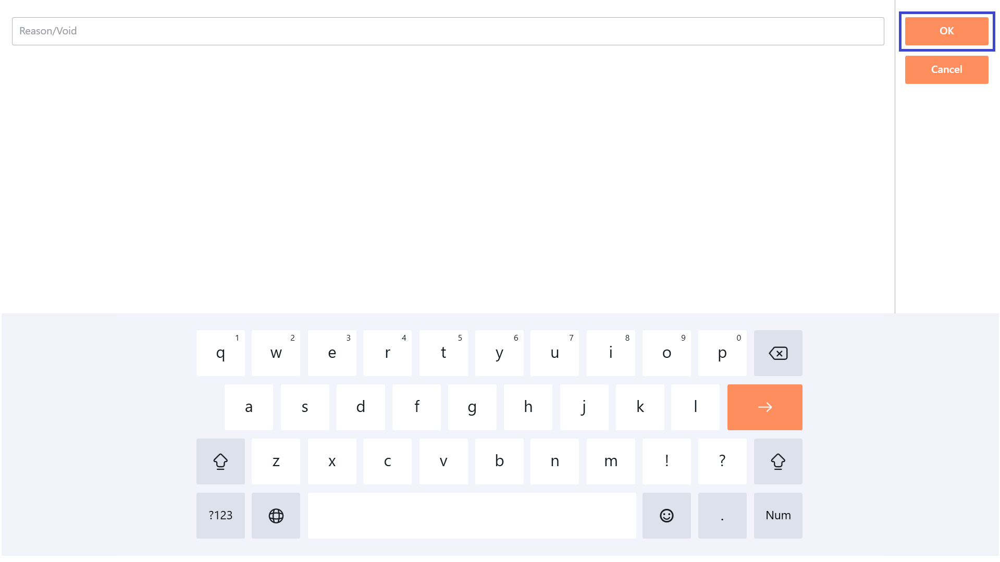<figcaption></figcaption></figure>

6. Verify the updated order.

**Note:** The void information is sent to the kitchen so that the chef can stop working on the item. Select "Cancel" on the "Reason/Void" screen to cancel the void action.

### **Apply Comp** 

Use "Comp" when an already prepared item is cancelled and cannot be reused.

1. Select the applicable item.
2. Select "Comp".

<figure>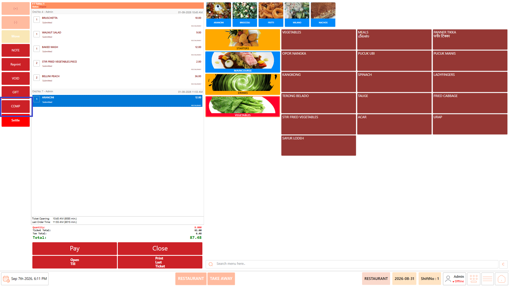<figcaption></figcaption></figure>

3. The "Reason/Comp" screen is displayed.
4. Enter the reason for applying the comp in the "Reason/Comp" field.

<figure>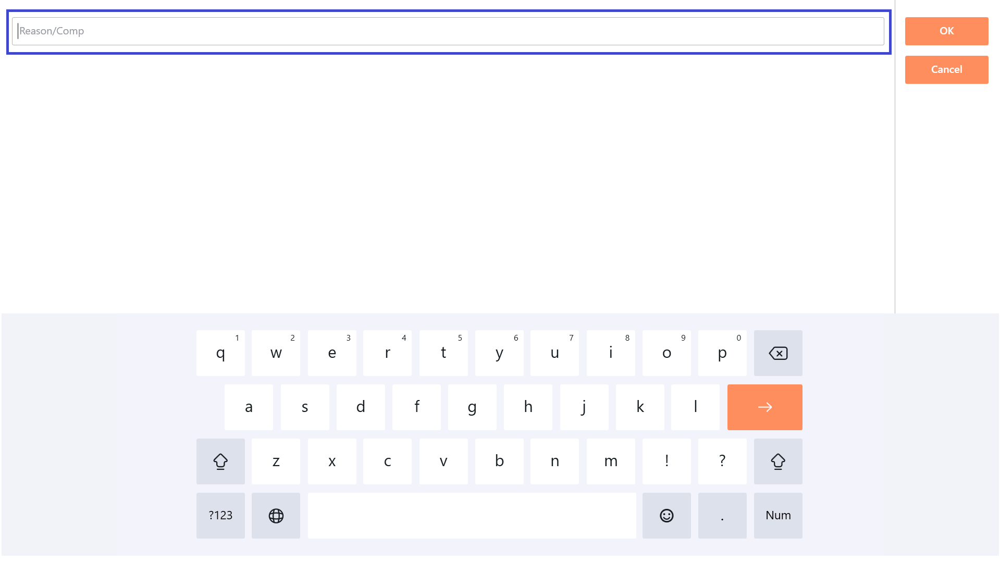<figcaption></figcaption></figure>

5. Select "OK" to confirm.

<figure><figcaption></figcaption></figure>

6. Verify that the item is treated as a complimentary item.

**Note:** Select "Cancel" on the "Reason/Comp" screen to cancel the comp action.

### **Gift an Item** 

Use "Gift" when an item is provided to the customer free of charge.

1. Select the required item.
2. Select "Gift".

<figure>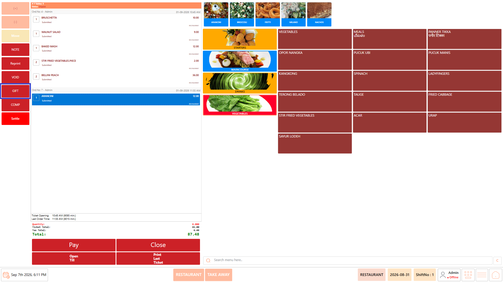<figcaption></figcaption></figure>

3. The "Reason/Gift" screen is displayed.
4. Enter the reason for gifting the item in the "Reason/Gift" field.

<figure>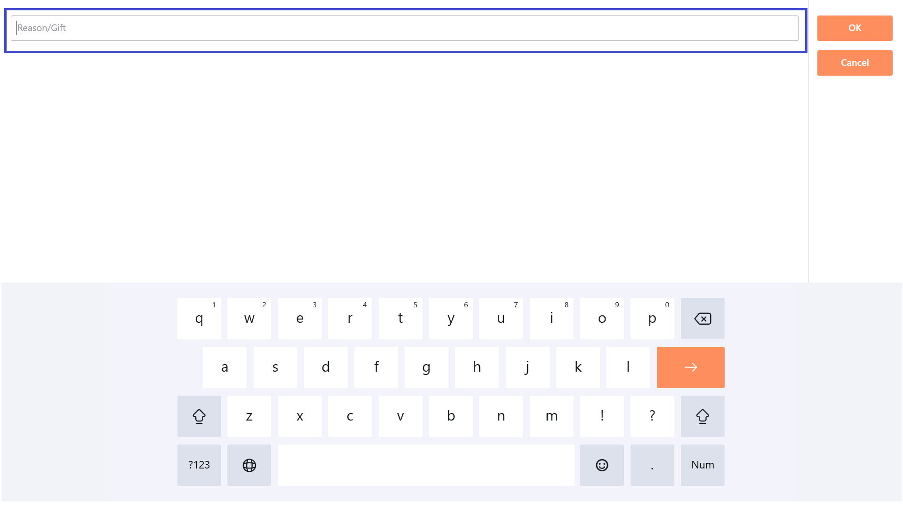<figcaption></figcaption></figure>

5. Select "OK" to confirm.

<figure><figcaption></figcaption></figure>

6. Verify that the item is treated as a gift item.

**Note:** An item marked as "Gift" is priced as zero. Select "Cancel" on the "Reason/Gift" screen to cancel the gift action.

<figure>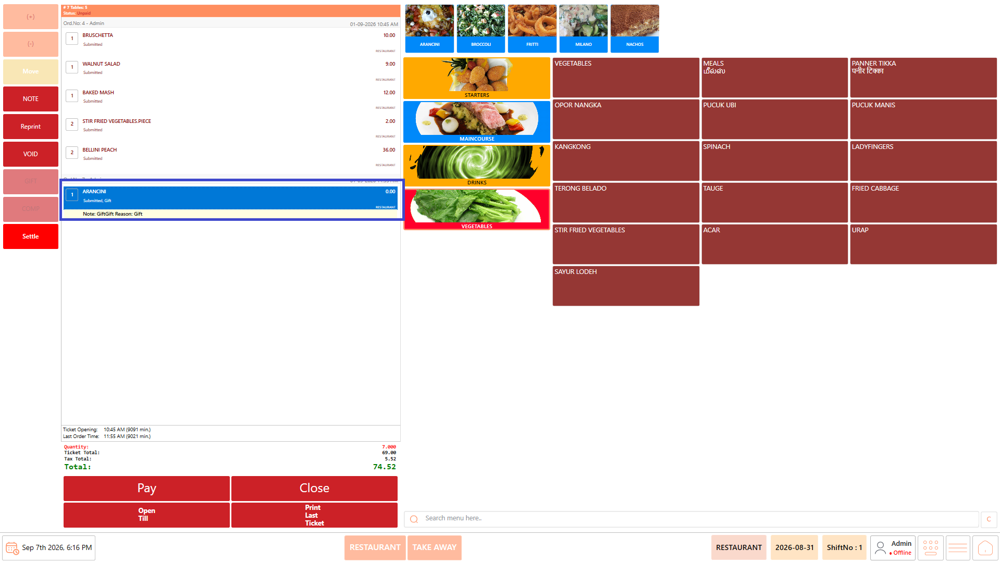<figcaption></figcaption></figure>

## **Review and Submit the Order** 

Before submitting the order, complete a final review.

#### **Review Checklist** 

1. Verify the table number.
2. Review all items in the Order Summary.
3. Verify the quantity of each item.
4. Confirm the customer information, if applicable.
5. Confirm the member information, if applicable.
6. Verify the PAX count.
7. Verify the assigned waiter.
8. Review all notes and special instructions.
9. Verify any "Serve Later", "Void", "Comp", or "Gift" actions.
10. Verify that items are assigned to the correct tickets.
11. Review the order total.
12. Make any required corrections.

The order is ready for submission once all information has been verified.

## **Submit the Order** 

DinePlan submits the current order when specific actions are performed.

The current order is submitted when:

* The Ordering screen is closed.
* The table is changed.
* The bill is printed.

#### **Important Order Behaviour** 

After the current order is submitted, any additional items added to the table are treated as a **new order**.

For example:

**Existing Order → Submit Order → Add New Item → New Order**

Therefore, always complete the required order review before closing the Ordering screen, changing the table, or printing the bill.

<figure>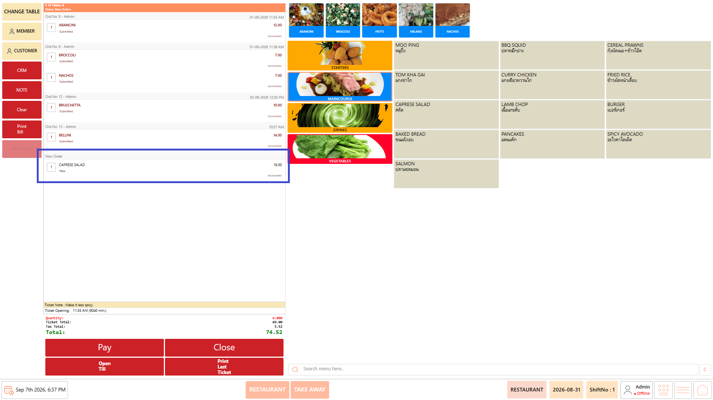<figcaption></figcaption></figure>

## **Print the Bill** 

Use "Print Bill" when the customer is ready to review or settle the bill.

#### **Procedure** 

1. Review the complete order.
2. Verify all item quantities.
3. Verify the order total.
4. Click "Print Bill".

<figure>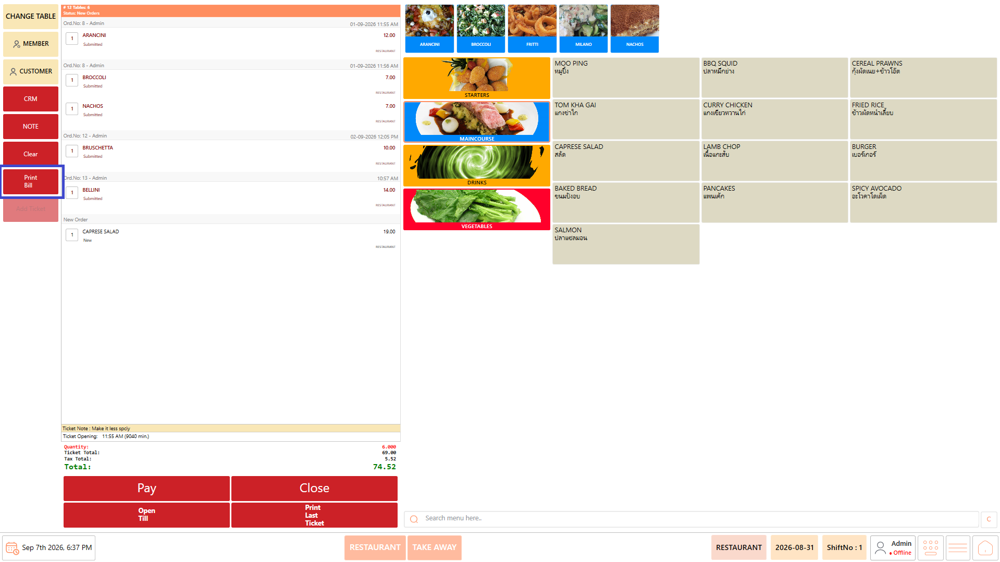<figcaption></figcaption></figure>

5. The bill is generated for printing.
6. Verify the printed bill before providing it to the customer.

Printing the bill can submit the current order, so verify the order before selecting "Print Bill".

## **Reprint** 

Use "Reprint" when another copy of a previously generated printout is required.

#### **Procedure** 

1. Open the required order or ticket.
2. Click "Reprint".

<figure><figcaption></figcaption></figure>

3. DinePlan generates another copy of the applicable printout.
4. Verify the generated printout.

## **Unlock a Ticket** 

After printing the bill, the ticket may become locked.

If further changes are required, an authorized user can use "Unlock Ticket".

#### **Procedure** 

1. Open the locked ticket.
2. Click "Unlock Ticket".
3. Make the required changes.
4. Review the updated order.
5. Continue with order processing as required.

## **Proceed to Payment** 

Once the order has been reviewed and the customer is ready to settle the bill:

#### **Complete Payment for the Order** 

1. Verify the final order total.
2. Click "Pay".

<figure>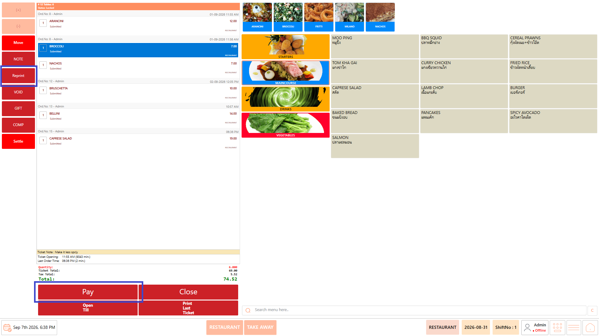<figcaption></figcaption></figure>

3. Continue with the applicable payment process.

#### **Pay for a Selected Item** 

When the customer needs to pay for an individual item:

1. Select the required item.
2. Click "Settle".

<figure>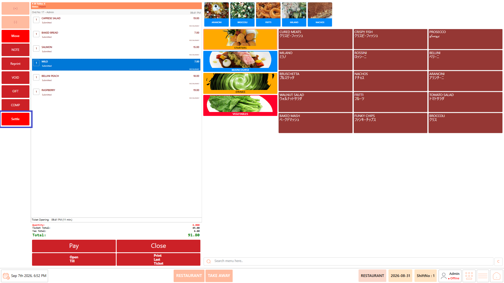<figcaption></figcaption></figure>

3. Verify the selected item and amount.
4. Continue with the payment process.

<figure>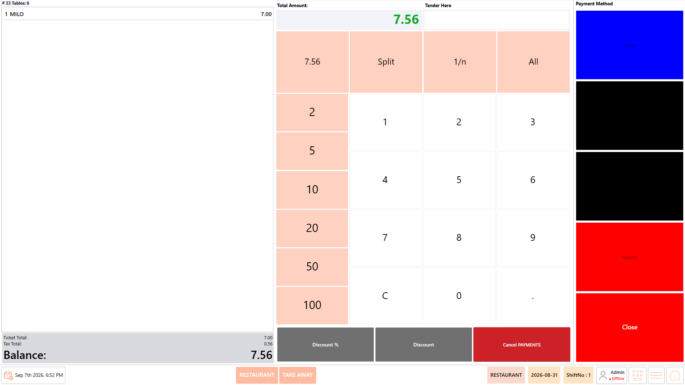<figcaption></figcaption></figure>

## **Additional Ordering Operations** 

These options can be used when required during the ordering process.

### **Change Table** 

Use "Change Table" when the customer moves to another table, an order has been assigned to the wrong table, or a ticket needs to be merged with a ticket on another table.

1. Open the required order.
2. Click "Change Table".

<figure><figcaption></figcaption></figure>

3. Select the destination table.
4. The order will be moved to the table.
5. Continue processing the order.

### **Clear** 

Use "Clear" to clear applicable selected items before the order is submitted.

1. Select the applicable items.
2. Click "Clear".

<figure>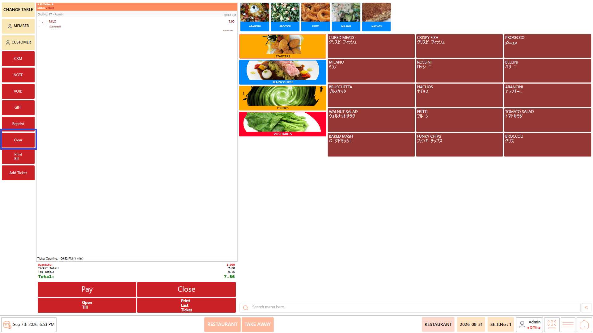<figcaption></figcaption></figure>

3. Verify that the selected items have been cleared.
4. Add or select the required items again.

### **Open Till** 

"Open Till" provides access to the till-opening function from the Ordering screen.

<figure><figcaption></figcaption></figure>

## **Notes** 

* Always select the correct table before starting an order.
* Review the Order Summary regularly while entering items.
* Verify item quantities before submitting the order.
* Enter customer, member, PAX, and waiter information when applicable.
* Use "Note" for additional instructions or remarks associated with an order or item.
* Use "Add Ticket" when separate tickets are required for the same table.
* Use "Move" to transfer an item between tickets on the same table.
* Use "Serve Later" when an item needs to be served later during the dining experience.
* Use "Void" for applicable cancelled items that have already been sent to the kitchen.
* Use "Comp" when an already prepared item is cancelled and cannot be reused.
* Use "Gift" when an item is provided to the customer free of charge.
* Always review the complete order before submitting it.
* Closing the Ordering screen, changing the table, or printing the bill submits the current order.
* After an order is submitted, subsequently added items are treated as a new order.
* Use "Unlock Ticket" when further changes are required after the ticket has been locked.
* Use "Reprint" when another copy of a required printout is needed.
* Use "Change Table" to move an order to another table or merge applicable tickets.
* The availability of specific features may depend on the configured DinePlan setup and user permissions.
