# Payment

## **Overview** 

The Payment process allows you to print and confirm the customer's bill, select the amount to be paid, choose the required payment method, and complete the payment through DinePlan POS.

DinePlan supports payment in full, payment for individual or similar items, split payments, equal bill division, and applicable discounts. The available payment methods depend on the restaurant configuration.

### **Complete Payment Flow** 

<figure><figcaption></figcaption></figure>

The payment option selected depends on how the customer wants to pay:

* **Pay in Full:** Select "All" and complete the payment.
* **Split Payment:** Select "Split" when the customer wants to pay different amounts using different payment methods.
* **Divide Equally:** Select "1/n" to divide the bill equally among multiple customers.
* **Individual Item:** Select the required item and "Settle" before proceeding to payment.
* **Similar Items:** Adjust the quantity of the item and select "Settle" before proceeding to payment.

### **Prerequisites** 

Before starting the payment process:

* The customer order is created.
* All required items and quantities are verified.
* Required order changes are completed.
* The order total is reviewed.
* The customer is ready to review and settle the bill.

## **Print the Customer Bill** 

Print the bill so the customer can review and confirm the amount before payment.

#### **Steps** 

1. From the POS table screen, select the required "Table".

<figure>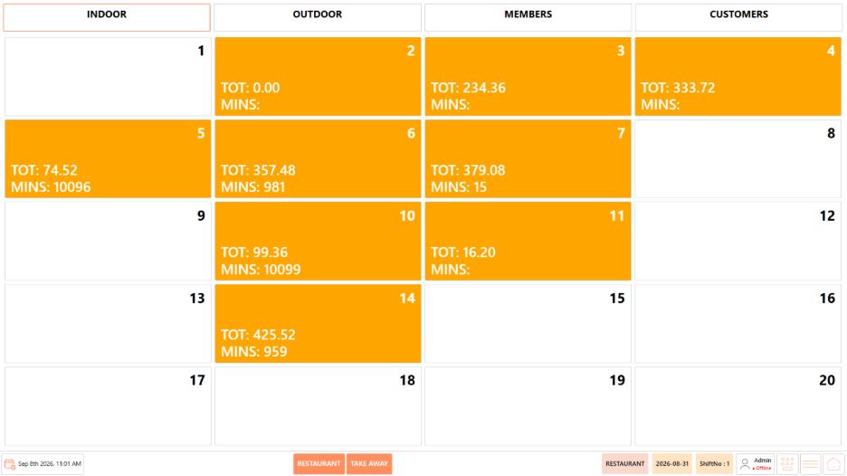<figcaption></figcaption></figure>

2. Select "Print Bill".

<figure>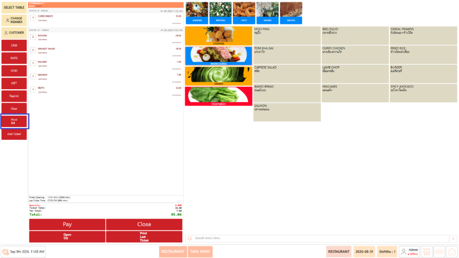<figcaption></figcaption></figure>

3. The bill is printed for the customer to review.
4. Allow the customer to verify and confirm the bill.
5. The table colour changes to Brown after the bill is printed.

<figure>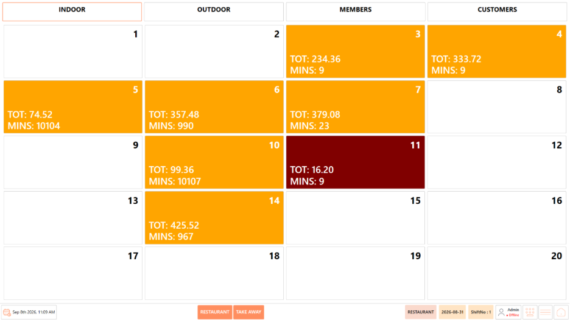<figcaption></figcaption></figure>

6. Select the same "Table" after customer confirmation.
7. Select the required bill to proceed to the Payment page.

<figure>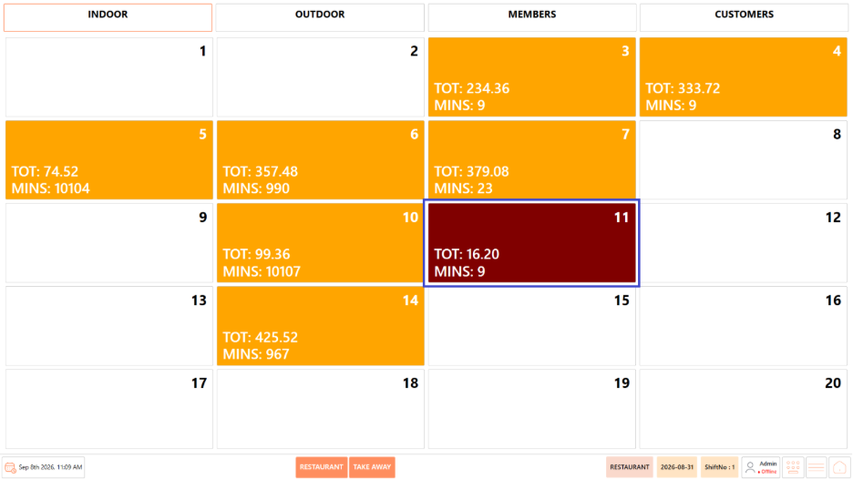<figcaption></figcaption></figure>

**Note:** The Brown table indicates that the bill has been printed and is ready for payment.

## **Payment Page** 

The Payment page provides the options required to select the payment amount, apply discounts, choose a payment method, and complete or cancel the payment.

<figure>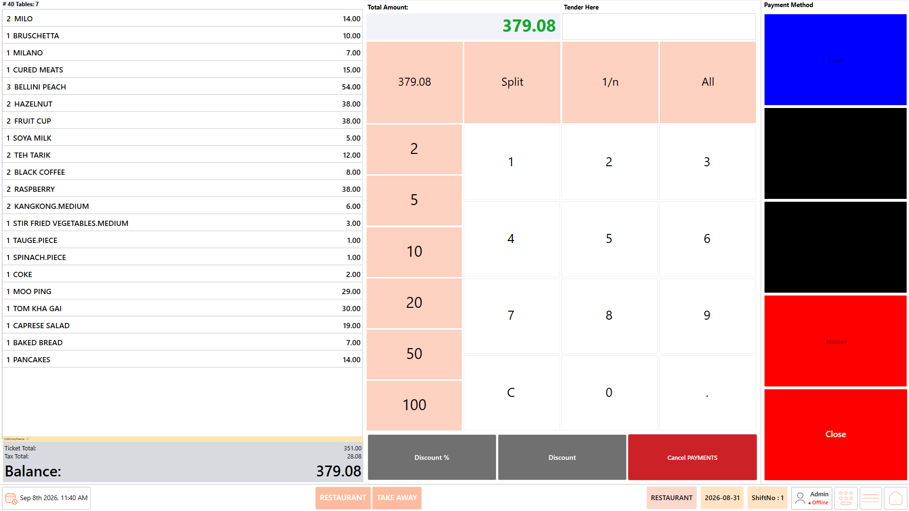<figcaption></figcaption></figure>

#### **Screen Elements** 

| **Screen Element**  | **Description**                                                                                 |
| ------------------- | ----------------------------------------------------------------------------------------------- |
| **Total Amount**    | Displays the total amount due for the bill.                                                     |
| **Tender Here**     | Displays the amount being entered or tendered for payment.                                      |
| **Amount**          | Displays the amount currently selected for payment.                                             |
| **Split**           | Divides the payment so the customer can pay different amounts using different payment methods.  |
| **1/n**             | Divides the total bill equally among the specified number of customers.                         |
| **All**             | Selects the complete bill amount for payment.                                                   |
| **Number Pad**      | Allows you to enter the required payment amount or other numeric values.                        |
| **Payment Method**  | Displays the payment methods available for the restaurant, such as Cash, Nets, Visa, or Master. |
| **Discount %**      | Applies a discount based on a percentage entered by the user.                                   |
| **Discount**        | Applies a discount based on a specific amount entered by the user.                              |
| **Cancel PAYMENTS** | Cancels the current payment process.                                                            |
| **Close**           | Closes the Payment page.                                                                        |

## **Payment in Full** 

Use this option when the customer wants to pay the complete bill using one payment method.

#### **Steps** 

1. From the Payment page, select "All".

<figure>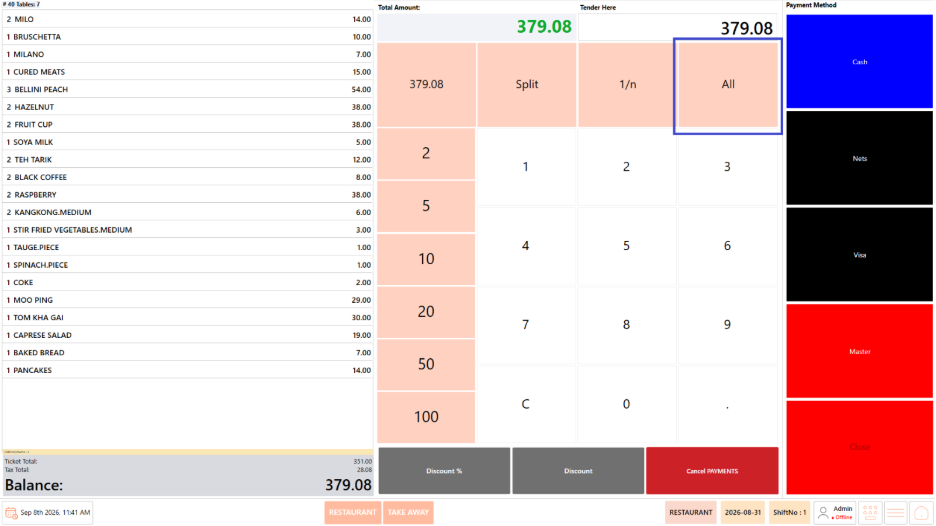<figcaption></figcaption></figure>

2. Select the required payment method.

<figure>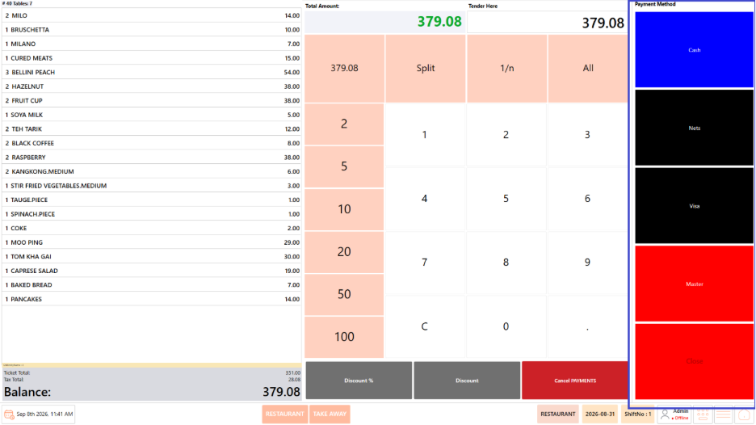<figcaption></figcaption></figure>

3. Enter the amount received, if required.
4. Verify the payment amount and change, if applicable.
5. Complete the payment.
6. Verify that the payment has been recorded and the bill is settled.

## **Split Payment** 

Use "Split" when the customer wants to pay the bill using different amounts or payment methods.

For example, a customer can pay part of the bill in cash and the remaining amount by card.

#### **Steps** 

1. In the Payment page, enter the amount to be paid.

<figure>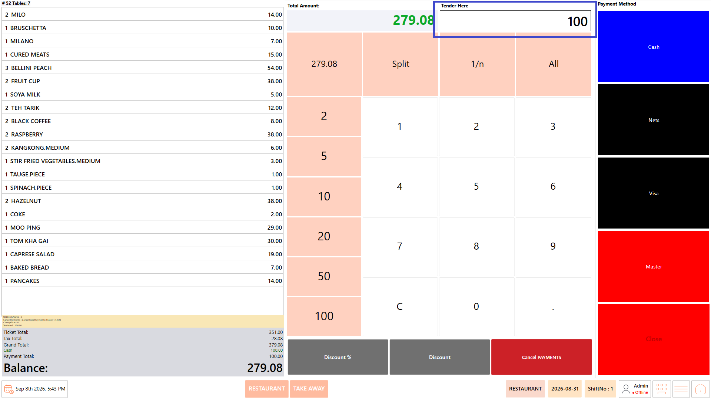<figcaption></figcaption></figure>

2. Select "Split".

<figure>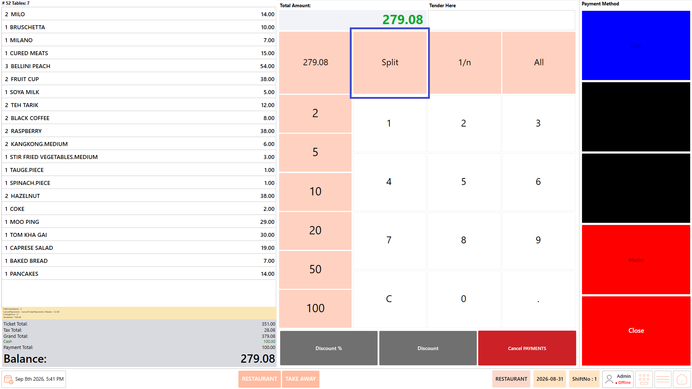<figcaption></figcaption></figure>

3. The entered amount will be displayed in the Total Amount place.

<figure>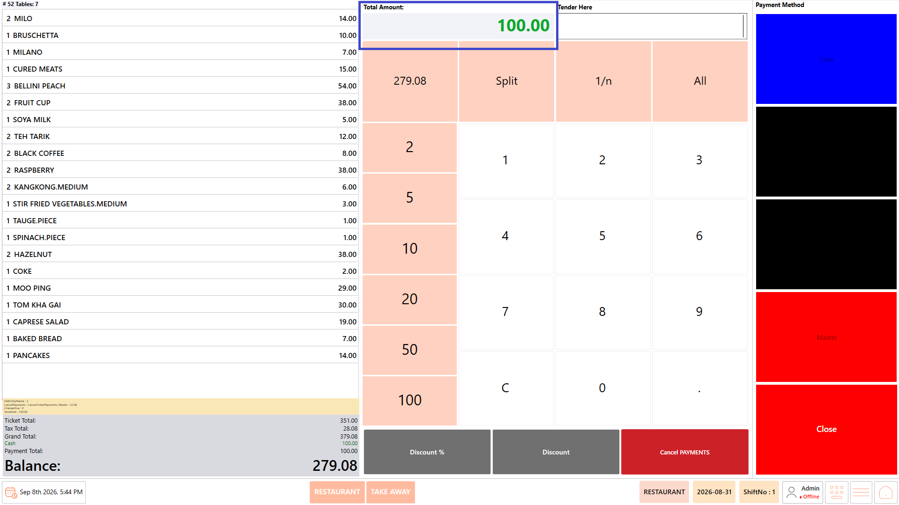<figcaption></figcaption></figure>

4. Select the required payment method.
5. Complete the payment.
6. Repeat for the remaining amount using the required payment method.
7. Continue until the full bill is settled.

**Example:** For a bill of 279.08, the customer can pay 100.00 in cash and the remaining 179.08 by card.

#### **Correct a Split Amount** 

If an incorrect amount is selected:

1. Select "Split" again.
2. The selected amount is reset.
3. Enter the correct amount.
4. Continue with the payment.

## **Divide the Bill Equally** 

Use "1/n" when the total bill needs to be divided equally among multiple customers.

Here, n represents the number of customers.

#### **Steps** 

1. Enter the number of customers.

<figure>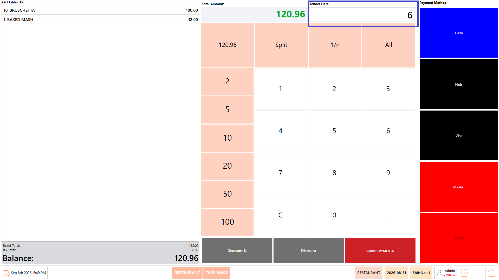<figcaption></figcaption></figure>

2. Select "1/n".

<figure><figcaption></figcaption></figure>

3. Review the amount calculated for each customer.

<figure><figcaption></figcaption></figure>

4. Select the required payment method.

<figure>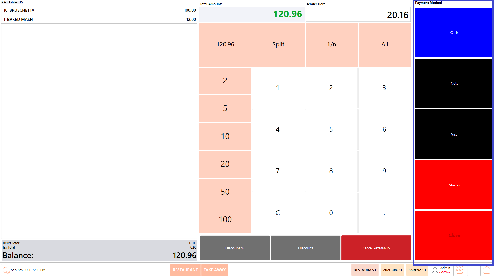<figcaption></figcaption></figure>

5. Complete the payment for each customer.

**Example:** If the total bill is 120.96 and there are 6 customers, the bill is divided into 6 equal payments of 20.16.

## **Payment by Individual Item** 

Use this option when a customer wants to pay for a specific item instead of the complete order.

#### **Steps** 

1. From the Order page, select the item to be paid for.

<figure>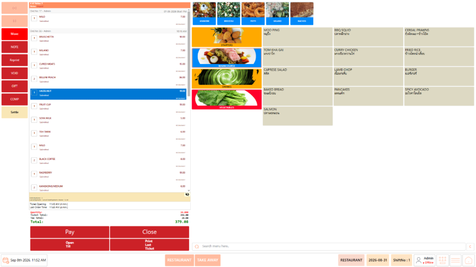<figcaption></figcaption></figure>

2. Select "Settle".

<figure>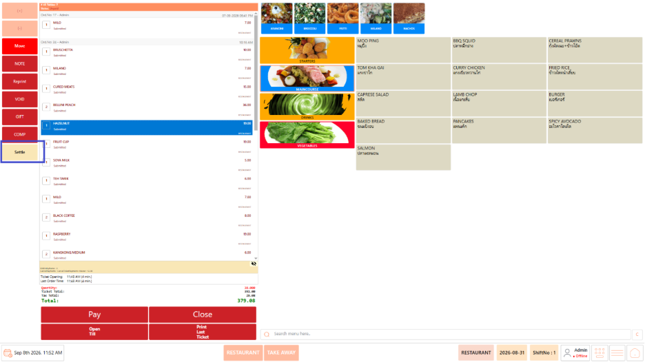<figcaption></figcaption></figure>

3. The Payment page is displayed.

<figure><figcaption></figcaption></figure>

4. Allow the customer to review and confirm the bill.
5. Select "All".

<figure>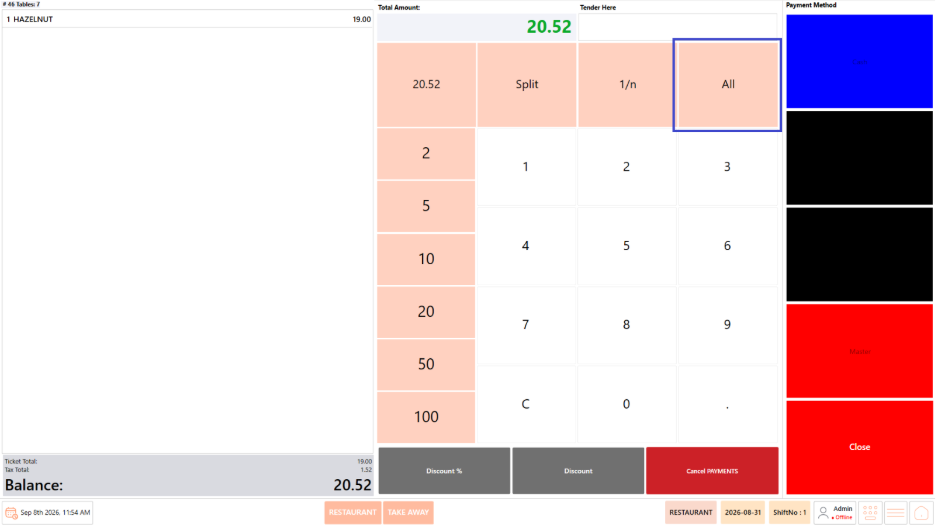<figcaption></figcaption></figure>

6. Select the required payment mode on the right.
7. Verify the payment amount.
8. Complete the payment.
9. If there are remaining items or balances to be paid, repeat the payment process for the remaining items.

Note - The Payment screen allows specific items to be selected when the customer needs to pay for only selected items.

## **Payment by Similar Items** 

Use this option when a customer wants to pay for a specific quantity of the same item.

**Example:** The order contains 3 coffees, but the customer wants to pay for only 1 coffee.

#### **Steps** 

1. Select the required item.
2. Select "(-)" or “(+)”to reduce or increase the quantity

<figure>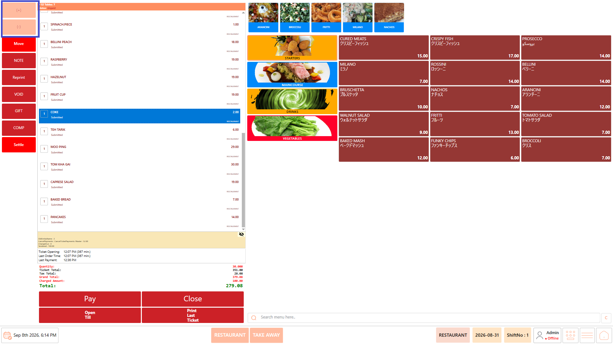<figcaption></figcaption></figure>

3. Continue until the quantity to be paid is displayed.
4. Select "Settle".

<figure>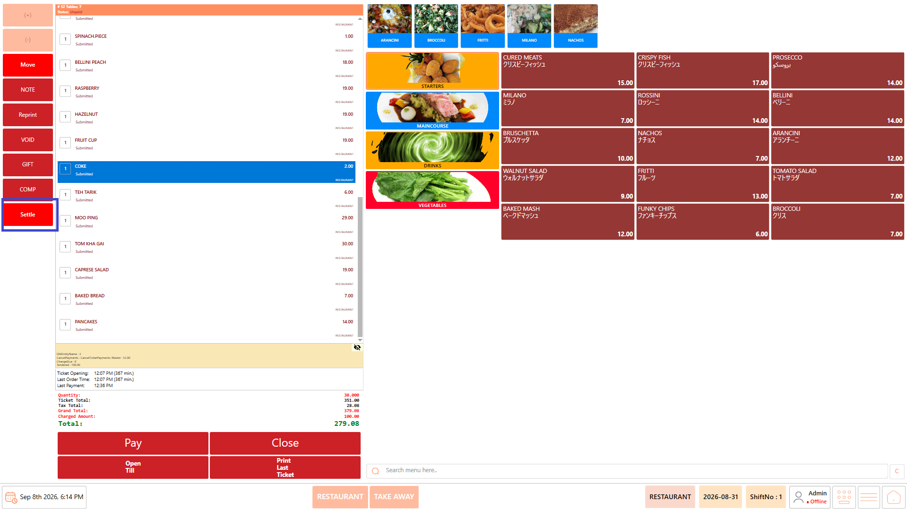<figcaption></figcaption></figure>

5. The Payment page is displayed.

<figure>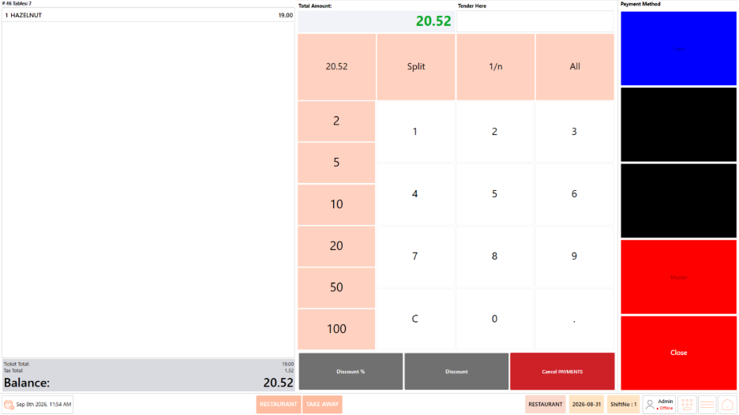<figcaption></figcaption></figure>

6. Allow the customer to review and confirm the bill.
7. Select "All".

<figure><figcaption></figcaption></figure>

8. Select the required payment mode on the right.
9. Verify the payment amount.
10. Complete the payment.

## **Apply a Discount** 

Discounts can be applied from the Payment page before completing the payment.

#### **Discount %** 

Use "Discount %" when the discount needs to be applied as a percentage of the bill amount.

#### **Steps** 

1. Enter the required discount percentage.

<figure>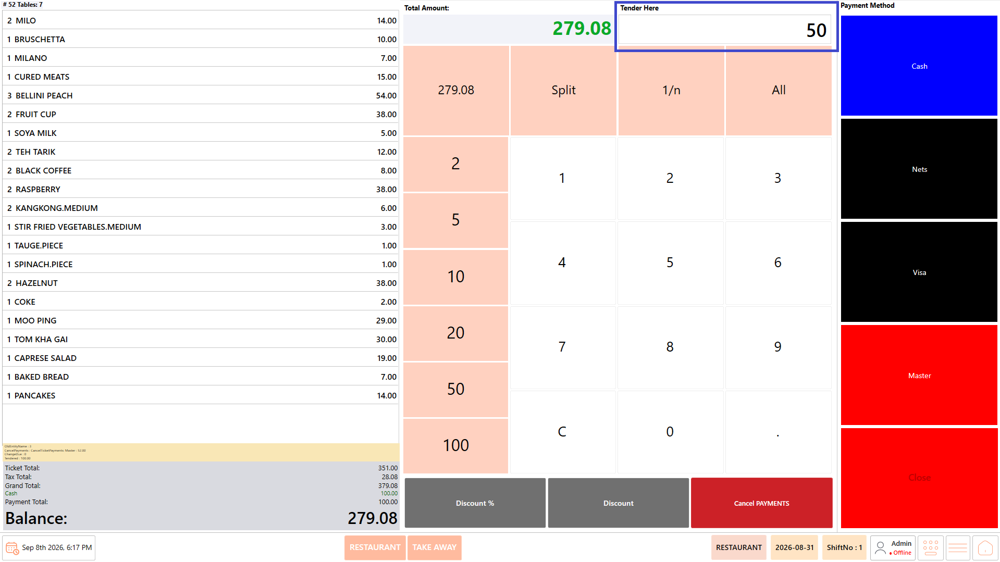<figcaption></figcaption></figure>

2. Select "Discount %".

<figure>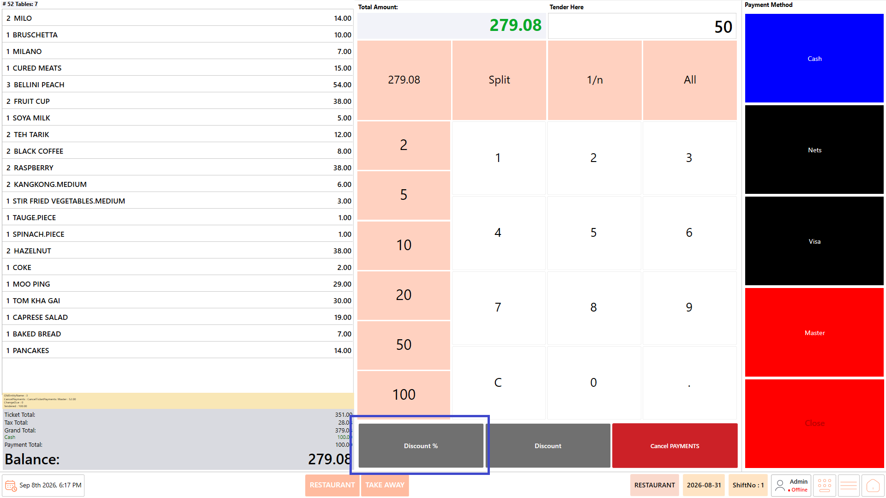<figcaption></figcaption></figure>

3. Verify the updated "Total Amount".

<figure>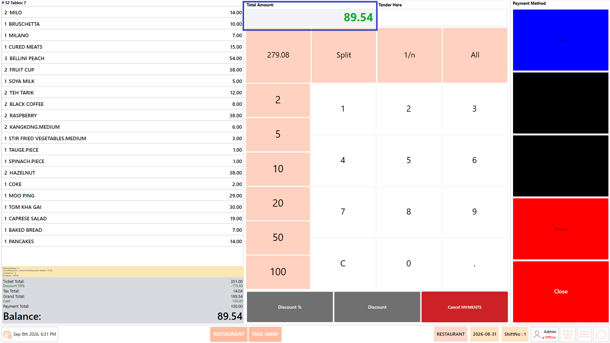<figcaption></figcaption></figure>

4. Continue with the payment.

**Example:** Enter 50 and select "Discount %" to apply a 50% discount.

#### **Discount** 

Use "Discount" when the discount needs to be applied as a specific amount.

#### **Steps** 

1. Enter the required discount amount.

<figure><figcaption></figcaption></figure>

2. Select "Discount".

<figure>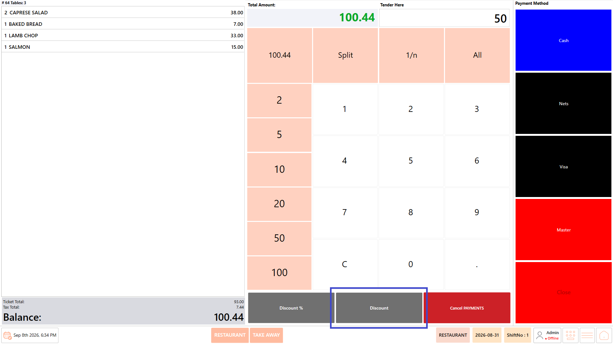<figcaption></figcaption></figure>

3. Verify the updated "Total Amount".

<figure>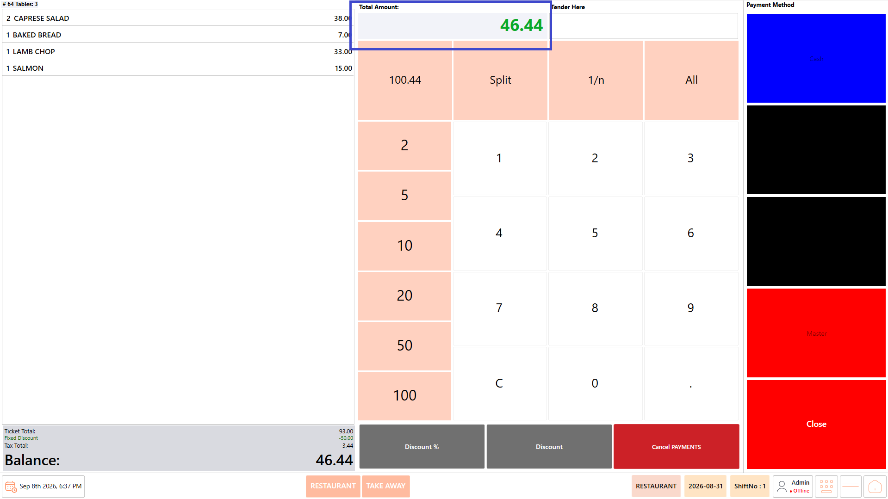<figcaption></figcaption></figure>

4. Continue with the payment.

**Example:** Enter 50.00 and select "Discount" to apply a 50.00 discount.

## **Payment Receipt Handling** 

Receipt handling depends on the payment method used.

<figure>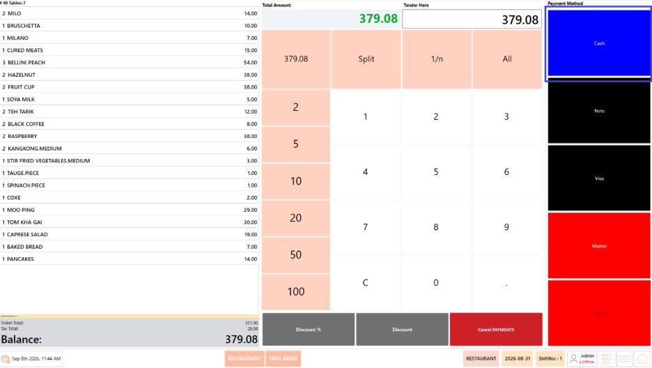<figcaption></figcaption></figure>

#### **Cash Payment** 

1. The first bill receipt is printed for verification.
2. Complete the payment and discard the verification copy.
3. Two bill receipts are then printed.
4. Place one copy in the bill sleeve for the customer.
5. Place the other copy in the designated place.

#### **Credit Card Payment** 

1. The first bill receipt is printed for verification.
2. Complete the payment and discard the verification copy.
3. The POS and card terminal generate the required receipt copies.
4. Staple the customer POS receipt and card slip together.
5. Place the customer copies in the bill sleeve and hand them.
6. Staple the merchant POS receipt and card slip together.
7. Place the merchant copies in the designated place.
8. If a signature is required, place the slip in the bill folder and pass it for the signature.

## **Return to the POS Order Page** 

Use this option when you need to return from the Payment page to the Order page without completing the payment.

#### **Steps** 

1. Select "C".
2. Select "Close".
3. The Order page is displayed.

## **Complete the Payment** 

Before completing the payment, verify the following:

1. Confirm the items being paid for.

<figure><figcaption></figcaption></figure>

2. Verify the "Total Amount".

<figure><figcaption></figcaption></figure>

3. Verify the selected payment amount.
4. Confirm the payment method.

<figure><figcaption></figcaption></figure>

5. If using "Split", verify the current payment amount and remaining balance.

<figure>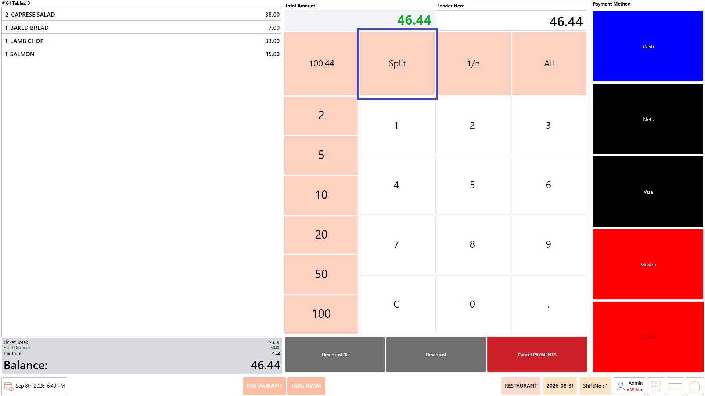<figcaption></figcaption></figure>

6. If using "1/n", verify the amount calculated for each customer.

<figure><figcaption></figcaption></figure>

7. Verify the discount, if applied.
8. Check the change amount, if applicable.
9. Complete the payment.
10. Verify that the payment has been recorded successfully and the bill is settled.

## **Notes** 

* Always allow the customer to review and confirm the bill before payment.
* The table colour changes to Brown after "Print Bill".
* Use "All" to pay the complete bill.
* Use "Split" when the customer wants to pay different amounts using different payment methods.
* Use "1/n" to divide the bill equally among multiple customers.
* Use "Settle" to pay for a selected item.
* Use "(-)" to adjust the quantity when paying for similar items.
* Use "Discount %" for a percentage-based discount.
* Use "Discount" for an amount-based discount.
* Always verify the final amount and payment method before completing the transaction.
* Available payment methods and payment options depend on the restaurant configuration.

&#x20;
