# Table

## **Overview** 

The Table Screen allows restaurant staff to view the configured table layout, identify the

current status of each table, and access the ordering screen for a selected table. Tables can be arranged according to the restaurant's requirements, including separate areas such as Indoor and Outdoor.

The screen also provides options to manage member and customer information when required for a transaction.

### **Screen Elements** 

<figure>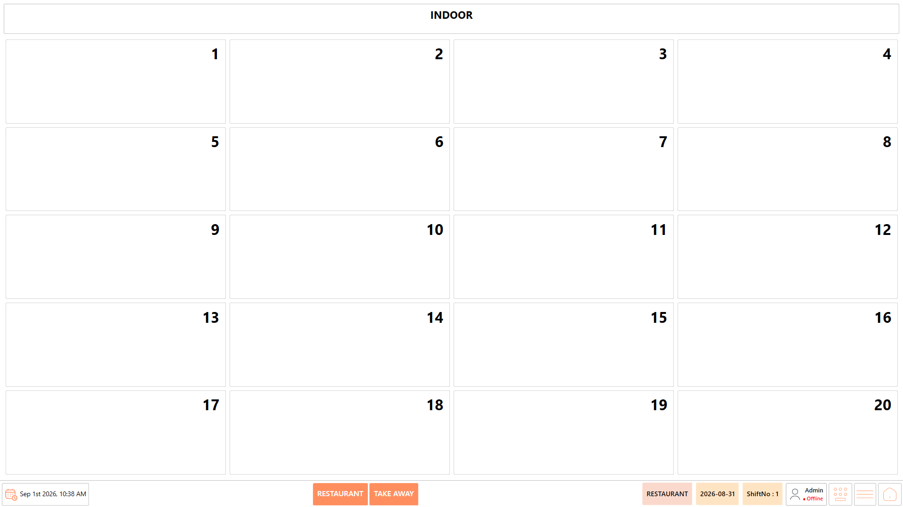<figcaption></figcaption></figure>

| **Screen Element** | **Description**                                                                                     |
| ------------------ | --------------------------------------------------------------------------------------------------- |
| Indoor             | Displays the tables configured for the indoor dining area.                                          |
| Outdoor            | Displays the tables configured for the outdoor dining area.                                         |
| Members            | Displays the member records associated with the outlet.                                             |
| Customers          | Displays the customer records associated with the outlet.                                           |
| Search             | Allows users to search for a member or customer.                                                    |
| Table Number       | Identifies the configured table.                                                                    |
| Table Colour       | Indicates the current status of the table.                                                          |
| Select Members     | Allows an existing member to be selected.                                                           |
| Edit Members       | Allows the selected member details to be modified.                                                  |
| New Members        | Opens the screen to create a new member.                                                            |
| Select Customers   | Allows an existing customer to be selected.                                                         |
| Edit Customers     | Allows the selected customer details to be modified.                                                |
| New Customers      | Opens the screen to create a new customer.                                                          |
| Account Details    | Displays the account information associated with the selected member or customer, where applicable. |

### **Access the Table Screen** 

1. Log in to DinePlan.
2. Select "POS".

<figure>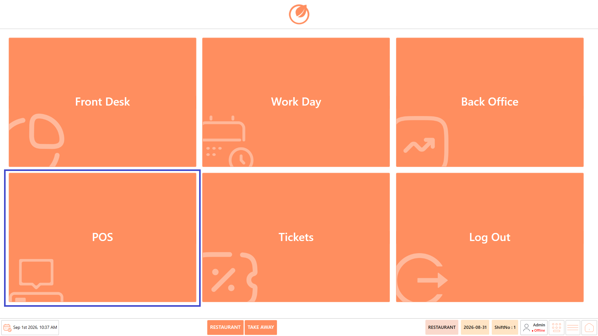<figcaption></figcaption></figure>

3. Select "Table".
4. The Table Screen is displayed.

<figure><figcaption></figcaption></figure>

5. Select the required table area, such as "Indoor" or "Outdoor".

<figure>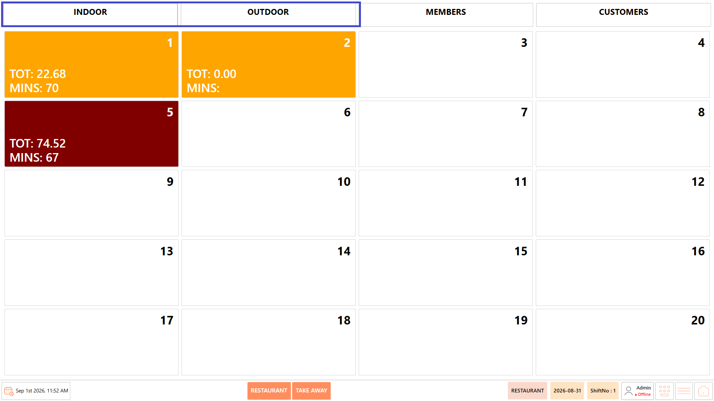<figcaption></figcaption></figure>

6. The tables configured under the selected area are displayed.

**Note:** The table arrangement and the number of tables displayed depend on the configuration of the outlet.

### **Table Status** 

The table status is displayed using different colours.

<figure><figcaption></figcaption></figure>

| **Colour** | **Status**                        | **Description**                                                                              |
| ---------- | --------------------------------- | -------------------------------------------------------------------------------------------- |
| Yellow     | Occupied                          | The table has an active transaction.                                                         |
| Brown      | Bill Print Taken                  | The bill has been printed for the table.                                                     |
| White      | Available / Transaction Completed | The table is available for a new transaction or the previous transaction has been completed. |

### **Manage Members** 

The Members section can be used when a transaction needs to be associated with a registered member.

#### **Select an Existing Member** 

1. Open "Members".

<figure><figcaption></figcaption></figure>

2. Use the available search field to locate the required member.

<figure>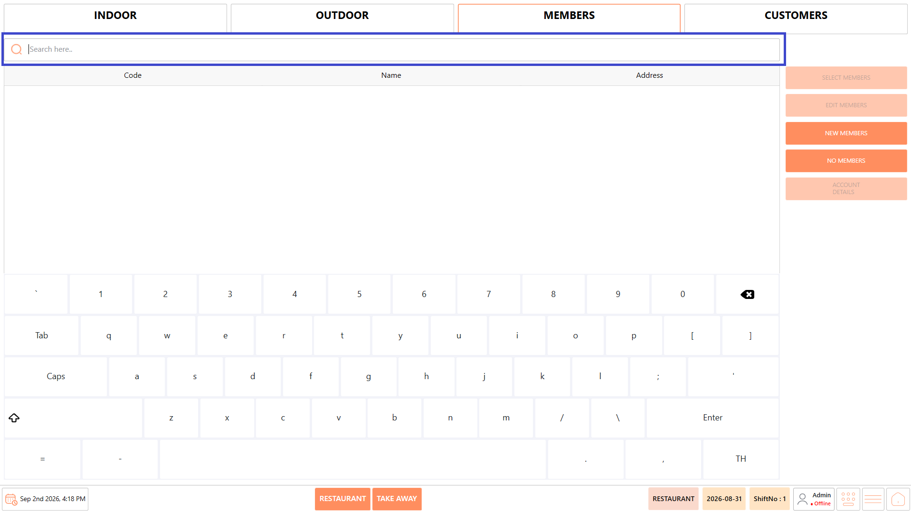<figcaption></figcaption></figure>

3. Select the required member.

<figure>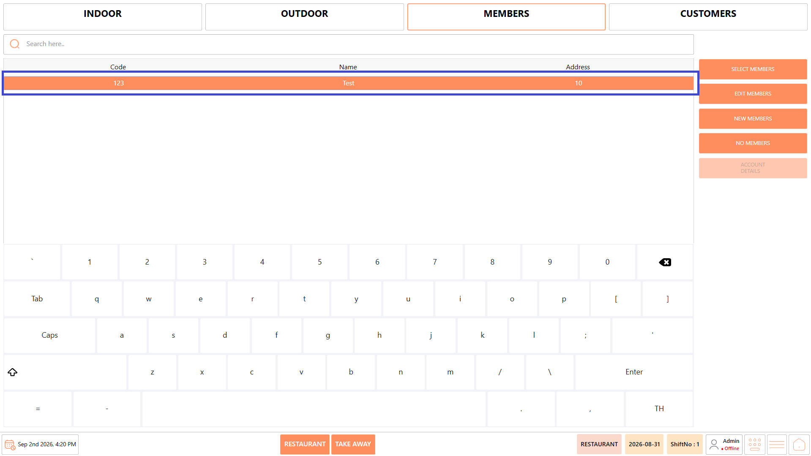<figcaption></figcaption></figure>

4. Select "Select Members".

<figure>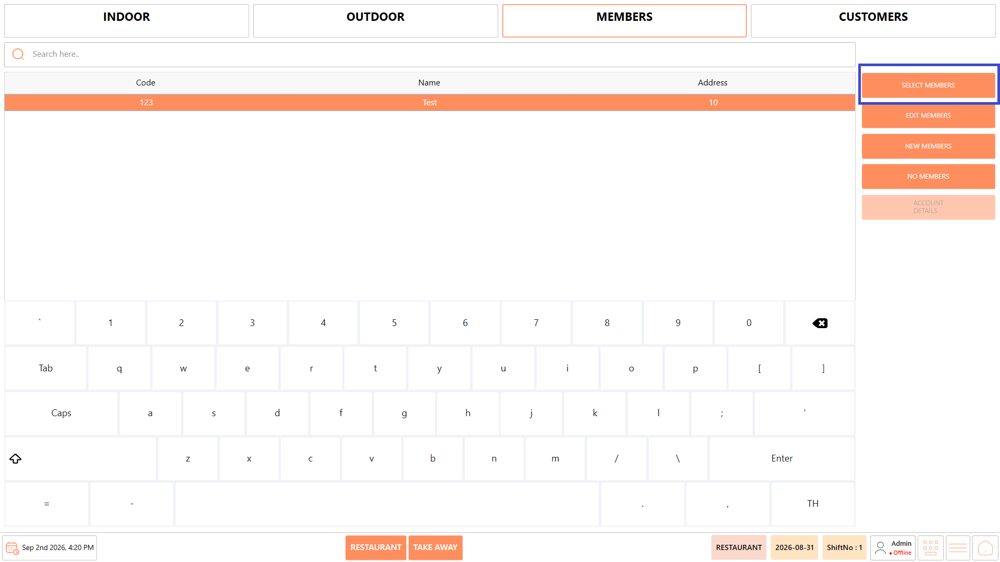<figcaption></figcaption></figure>

5. The selected member is associated with the transaction.

<figure>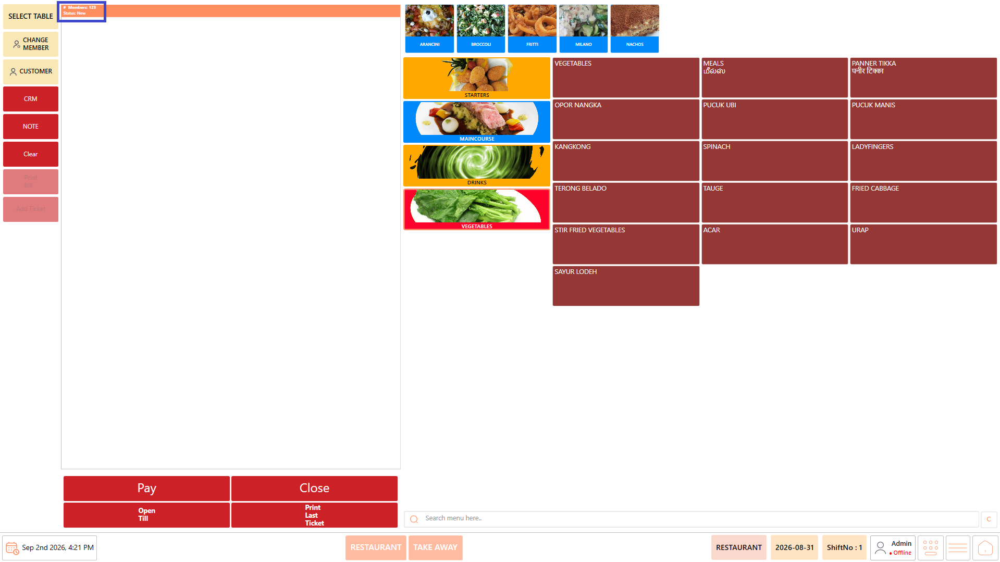<figcaption></figcaption></figure>

#### **Create a New Member** 

If the required member does not exist:

1. Open "Members".

<figure>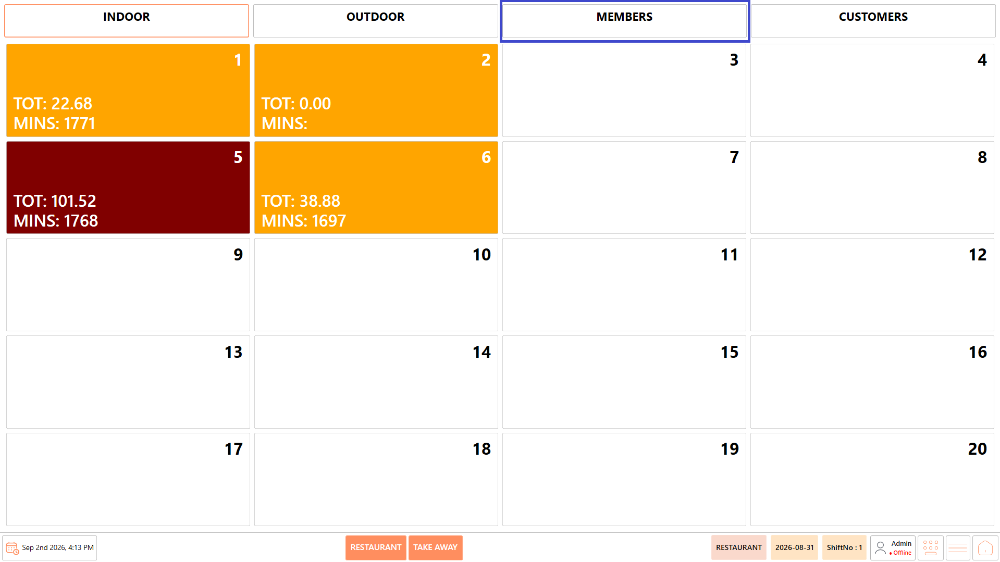<figcaption></figcaption></figure>

2. Select "New Members".

<figure>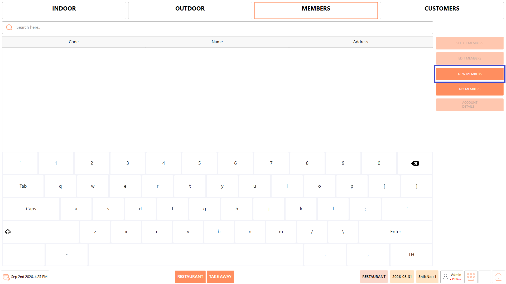<figcaption></figcaption></figure>

3. The New Members screen is displayed.
4. Enter the required "Code".
5. Enter the member's "Name".
6. Enter the "Address", where applicable.

<figure>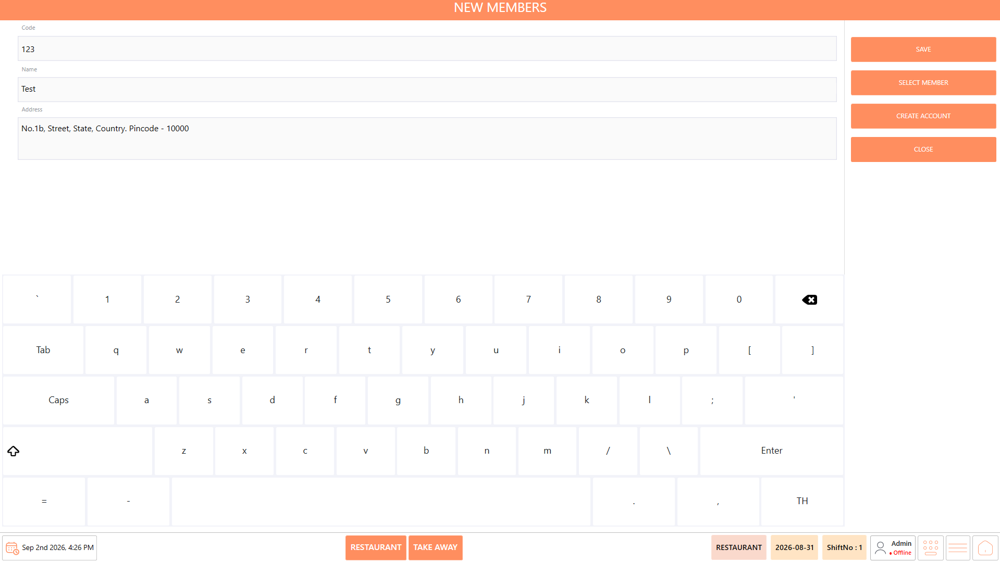<figcaption></figcaption></figure>

7. Review the entered information.
8. Select "Save".

<figure>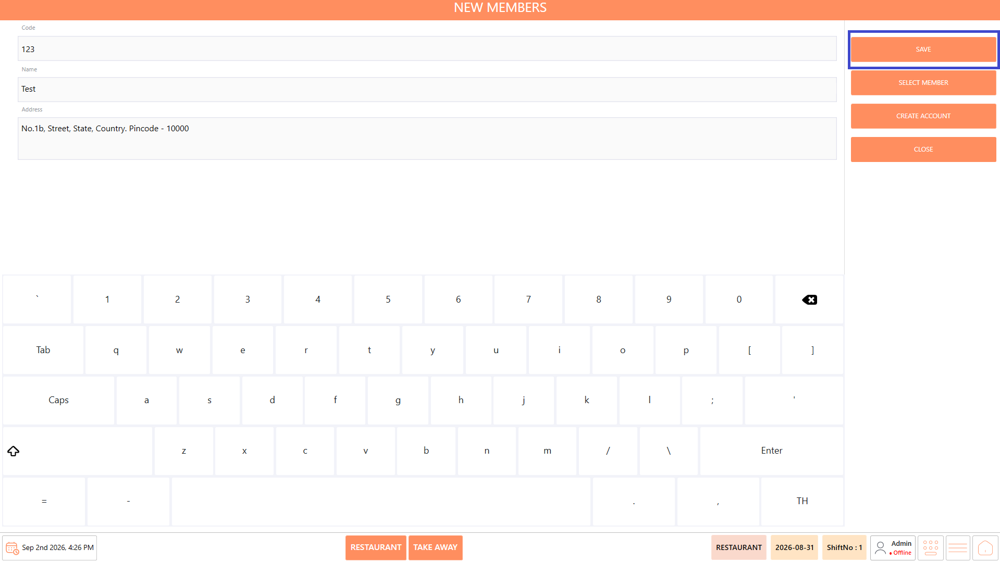<figcaption></figcaption></figure>

9. The new member record is created.

The New Members screen also provides the following options:

* **Select Member** – Directly selects the newly created member and links the member to the current transaction.
* **Create Account** – Creates an account for the member. Once created, the member is available in the Members list.
* **Close** – Closes the New Members screen.

**Note:** Use Select Member when the newly created member needs to be associated with the current transaction. Use Create Account when an account needs to be created for the member.

### **Manage Customers** 

The Customers section can be used when customer information needs to be associated with a transaction.

#### **Select an Existing Customer** 

1. Open "Customers".

<figure>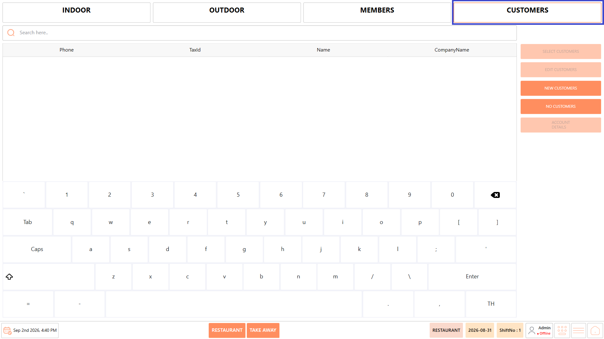<figcaption></figcaption></figure>

2. Use the available search field to locate the required customer.

<figure><figcaption></figcaption></figure>

3. Select the required customer.

<figure>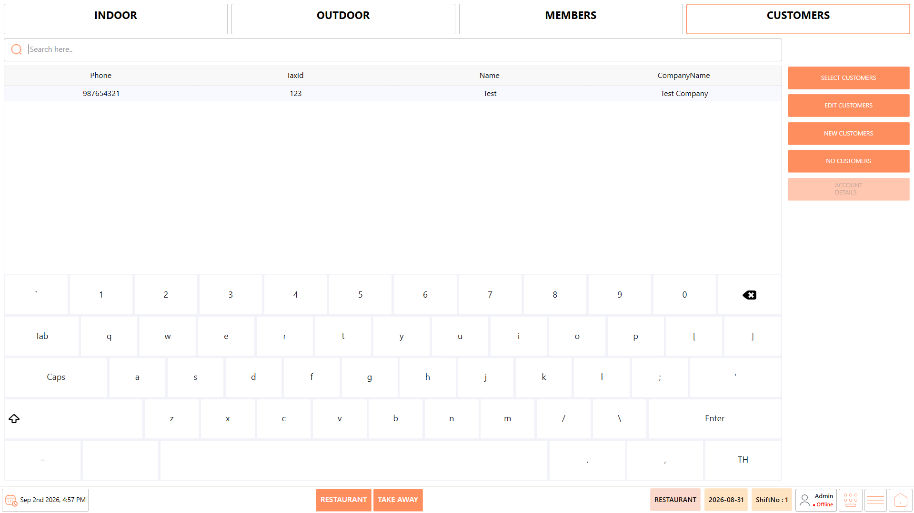<figcaption></figcaption></figure>

4. Select "Select Customers".

<figure>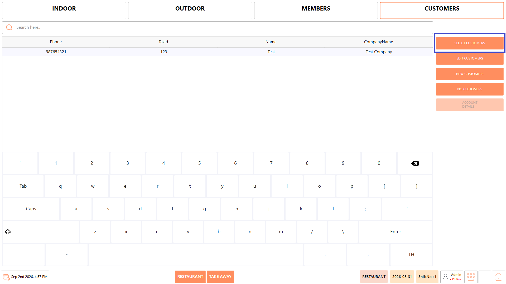<figcaption></figcaption></figure>

5. The selected customer is associated with the transaction.

#### **Create a New Customer** 

If the required customer does not exist:

1. Open "Customers".
2. Select "New Customers".

<figure>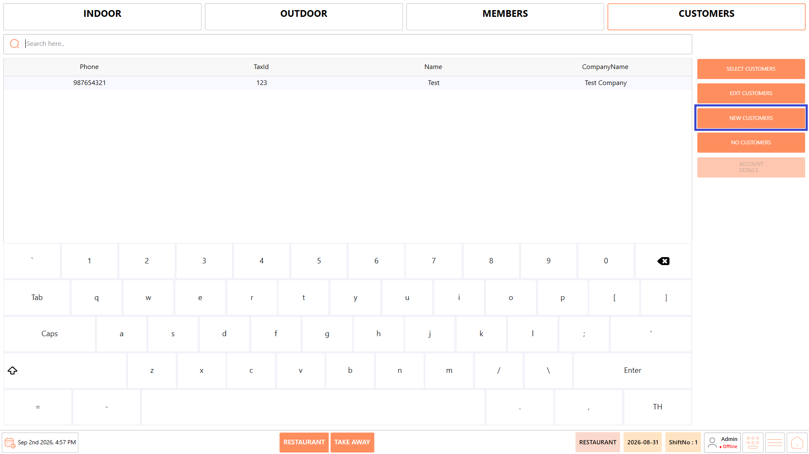<figcaption></figcaption></figure>

3. The New Customers screen is displayed.
4. Enter the customer's "Phone" number.
5. Enter the "TaxId", where applicable.
6. Enter the customer's "Name".
7. Enter the "CompanyName", where applicable.
8. Enter the customer's "Address".
9. Enter the customer's "Email" address, where applicable.

<figure>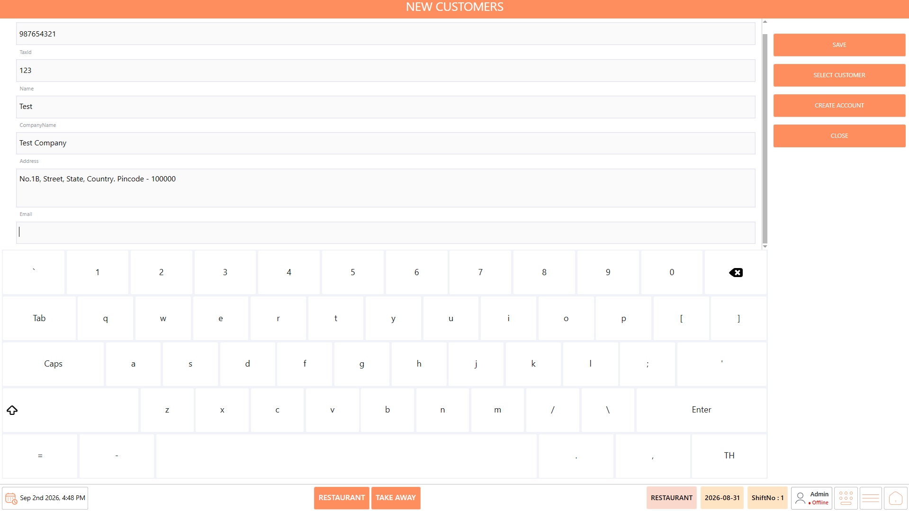<figcaption></figcaption></figure>

10. Review the entered information.
11. Select "Save".
12. The new customer record is created.

The New Customer screen also provides the following options:

* **Select Customer** – Directly selects the newly created customer and links the customer to the current transaction.
* **Create Account** – Creates an account for the customer. Once created, the customer is available in the Customers list.
* **Close** – Closes the New Customer screen.

**Note:** Use Select Customer when the newly created customer needs to be associated with the current transaction. Use Create Account when an account needs to be created for the customer.

### **Notes** 

* The table arrangement can be configured according to the restaurant's requirements.
* Always verify the table status before starting or continuing an order.
* Selecting a table opens the Ordering Screen.
* Use "Members" when a transaction needs to be associated with a member.
* Use "Customers" when a transaction needs to be associated with a customer.
* New member or customer records can be created using "New Members" or "New Customers".
* Verify all member and customer information before selecting "Save".
* Ensure the correct table is selected before entering an order.
