# Tickets

## **Overview** 

The Tickets screen is an operational screen available from the DinePlan Dashboard that provides a centralized view of ticket records generated during restaurant operations.

Users can use the screen to view, filter, search, and manage ticket records based on a specific date range and ticket type. The ticket list displays key details such as the invoice number, ticket number, member, table, customer, reference number, department, terminal, payment, total amount, and user name. The screen also provides actions such as Refresh, Push, Pull, Excel, Call, and Close for managing and working with the displayed tickets.

## **Open the Tickets** 

1. Log in to “DinePlan”.
2. From the “Dashboard”, select “Tickets”.

<figure>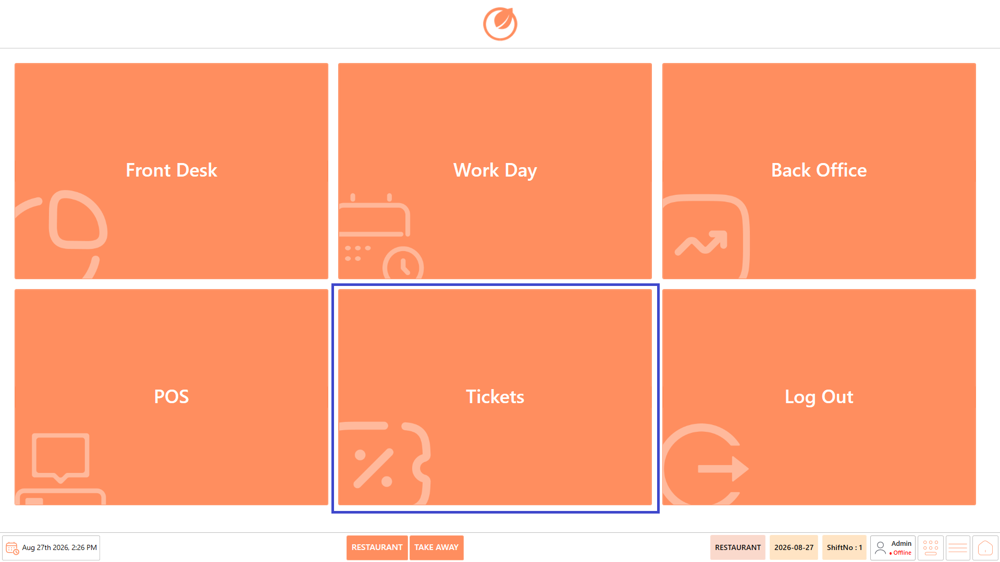<figcaption></figcaption></figure>

3. The “Tickets” screen opens.

<figure>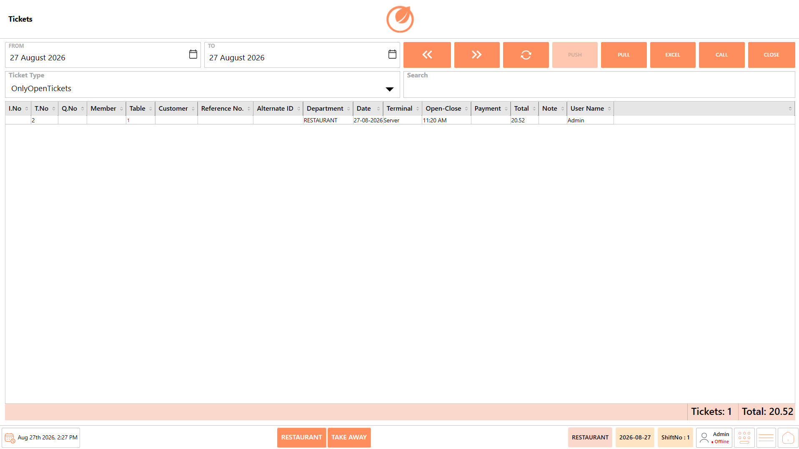<figcaption></figcaption></figure>

## **Ticket Types** 

The Ticket Type filter provides different categories that allow users to narrow down the ticket list and locate the required records more efficiently. Each option represents a specific type, status, or classification of ticket available in the system.

<figure>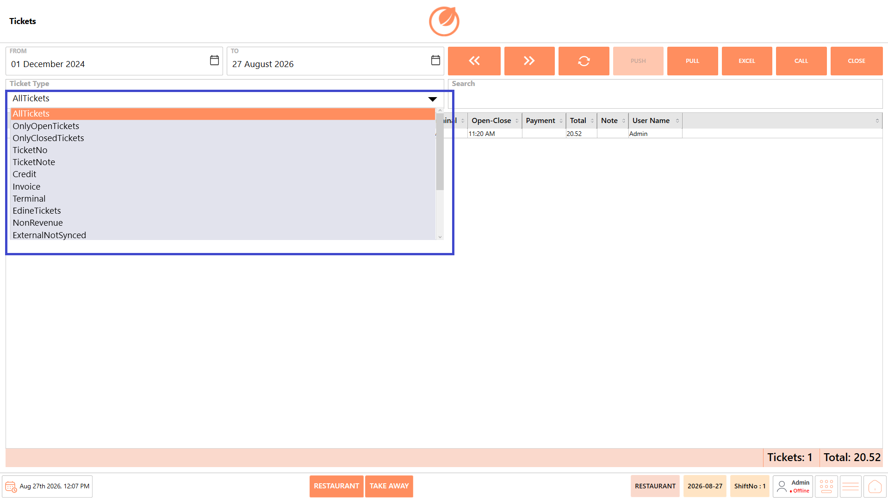<figcaption></figcaption></figure>

**Available options include:**

* **All Tickets** – Displays all available tickets within the selected date range. This option provides a complete view of the ticket records without applying a specific ticket type filter.
* **Only Open Tickets** – Displays tickets that are currently open and have not yet been closed. This can be used to identify tickets that are still active and may require further processing.
* **Only Closed Tickets** – Displays tickets that have already been closed. This option can be used to review completed ticket transactions.
* **Ticket No** – Allows users to locate tickets based on their ticket number. This is useful when the specific ticket number is known and the user needs to retrieve that particular ticket.
* **Ticket Note** – Displays or filters tickets based on ticket notes. This can help users locate tickets containing relevant notes or additional information.
* **Credit** – Displays credit-related tickets. This option can be used when users need to review tickets associated with credit transactions.
* **Invoice** – Displays invoice-related tickets. This allows users to locate tickets that are associated with invoice transactions.

<figure>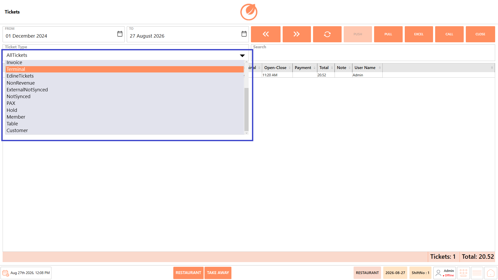<figcaption></figcaption></figure>

* **Terminal** – Displays tickets related to a terminal. This can be used to review tickets based on the terminal from which they were generated or processed.
* **Edine Tickets** – Displays tickets associated with Edine transactions.
* **NonRevenue** – Displays tickets classified as non-revenue. These tickets are handled separately from regular revenue-generating transactions.
* **ExternalNotSynced** – Displays tickets that have not been synchronized with an external system. This can help users identify tickets that may require synchronization or further attention.
* **NotSynced** – Displays tickets that have not yet been synchronized. This allows users to identify tickets that are pending synchronization, and PUSH them for syncing.
* **PAX** – Displays tickets associated with PAX-related transactions.
* **Hold** – Displays tickets that are currently on hold. This allows users to identify tickets that have been temporarily held and may require further action.
* **Member** – Displays tickets associated with members. This option can be used to locate transactions linked to member records.
* **Table** – Displays tickets associated with tables. This can help users locate tickets based on the table involved in the transaction.
* **Customer** – Displays tickets associated with customers. This allows users to locate tickets linked to a particular customer record.

## **Ticket Fields** 

The ticket list displays the following information for each ticket:

<figure>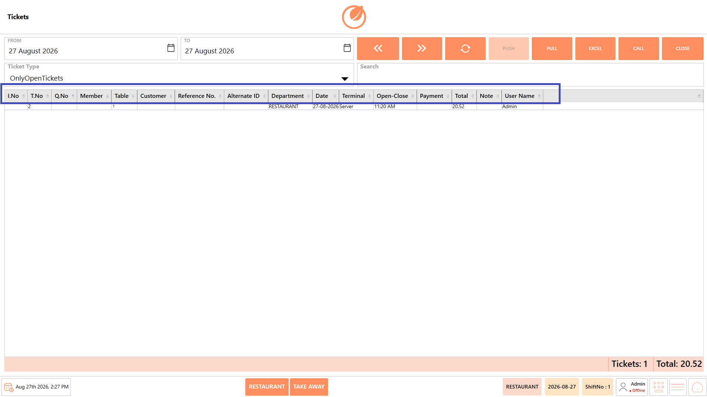<figcaption></figcaption></figure>

| **Ticket Field**  | **Description**                                                         |
| ----------------- | ----------------------------------------------------------------------- |
| **I.No**          | Displays the invoice number associated with the ticket.                 |
| **T.No**          | Displays the ticket number.                                             |
| **Q.No**          | Displays the queue number associated with the ticket, where applicable. |
| **Member**        | Displays the member associated with the ticket, where applicable.       |
| **Table**         | Displays the table associated with the ticket.                          |
| **Customer**      | Displays the customer associated with the ticket, where applicable.     |
| **Reference No.** | Displays the reference number associated with the ticket.               |
| **Alternate ID**  | Displays the alternate ID associated with the ticket, where applicable. |
| **Department**    | Displays the department associated with the ticket.                     |
| **Date**          | Displays the date associated with the ticket.                           |
| **Terminal**      | Displays the terminal from which the ticket was generated.              |
| **Open-Close**    | Displays the opening and closing time of the ticket.                    |
| **Payment**       | Displays the payment information associated with the ticket.            |
| **Total**         | Displays the total amount of the ticket.                                |
| **Note**          | Displays any note associated with the ticket.                           |
| **User Name**     | Displays the name of the user associated with the ticket.               |

## **Screen Elements** 

The Tickets screen consists of the following screen elements:

<figure><figcaption></figcaption></figure>

| **Screen Element** | **Description**                                                                          |
| ------------------ | ---------------------------------------------------------------------------------------- |
| **From**           | Select the starting date for the ticket search.                                          |
| **To**             | Select the ending date for the ticket search.                                            |
| **Calendar Icon**  | Opens the date picker to select the required date.                                       |
| **Ticket Type**    | Allows users to select the required ticket type for filtering the ticket list.           |
| **Previous**       | Moves to the previous set of ticket records.                                             |
| **Next**           | Moves to the next set of ticket records.                                                 |
| **Refresh**        | Reloads the ticket list using the selected filters.                                      |
| **Push**           | Pushes the selected ticket information where applicable.                                 |
| **Pull**           | Retrieves ticket information where applicable.                                           |
| **Excel**          | Exports the ticket information to an Excel file.                                         |
| **Call**           | Performs the call action for the selected ticket where applicable.                       |
| **Close**          | Closes the Tickets screen.                                                               |
| **Search**         | Allows users to search for a specific ticket or ticket-related information.              |
| **Ticket List**    | Displays the tickets matching the selected date range, ticket type, and search criteria. |
| **Tickets Count**  | Displays the total number of tickets in the current result.                              |
| **Total**          | Displays the combined total amount of the tickets shown in the current result.           |

## **Working with Tickets** 

Use the options available on the Tickets screen to view, search, navigate, export, and perform applicable actions on ticket records.

### **View and Filter Tickets** 

To view tickets based on a specific date range or ticket type:

1. Open the “Tickets” screen from the Dashboard.

<figure><figcaption></figcaption></figure>

2. In the “From” and “To” fields, select the required date range.

<figure>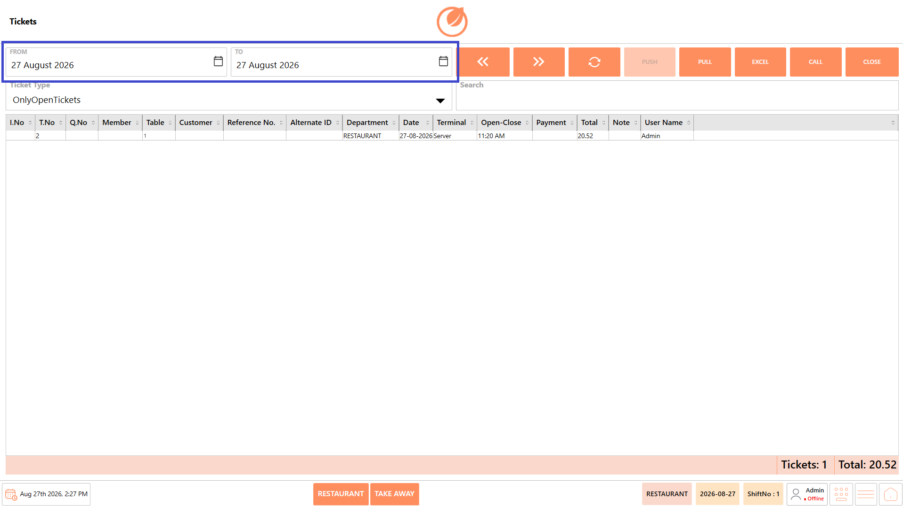<figcaption></figcaption></figure>

3. Select the required “Ticket Type”.

<figure>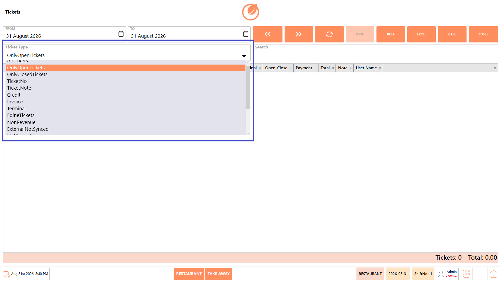<figcaption></figcaption></figure>

4. Click “Refresh”.

<figure>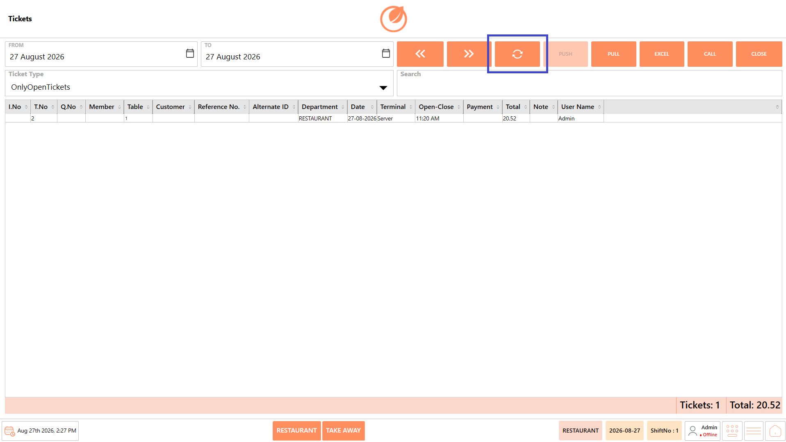<figcaption></figcaption></figure>

5. Review the tickets displayed in the ticket list.

**Note:** The ticket list is updated based on the selected criteria.

The Ticket Type filter can be used to display specific ticket statuses. For example:

* **Only Open Tickets** – Displays tickets that are currently open.
* **Only Closed Tickets** – Displays tickets that have been closed.

**Note:** Use **Refresh** whenever you change the date range or **Ticket Type** to reload the ticket list based on the selected criteria.

<figure>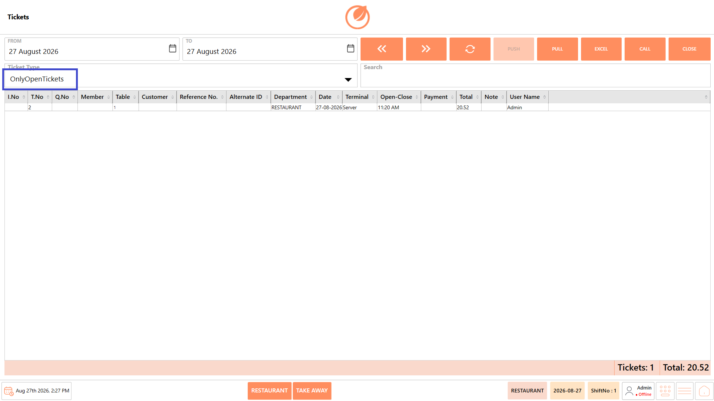<figcaption></figcaption></figure>

### **Search for a Ticket** 

Use the Search field to quickly locate a specific ticket using any relevant information available in the ticket list.

1. Enter the relevant ticket information in the Search field, such as I.No, T.No, Q.No, Member, Table, Customer, Reference No., Alternate ID, Department, Date, Terminal, Payment, or User Name.
2. Review the matching ticket records displayed in the ticket list.
3. Select the required ticket to perform an applicable action.

<figure>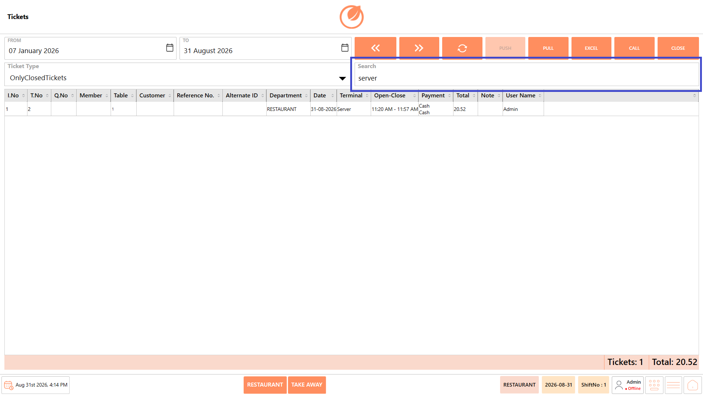<figcaption></figcaption></figure>

### **Navigate Through Ticket Records** 

When multiple ticket records are available, use the **Previous** and **Next** buttons to navigate through the results.

* **Previous** – Moves to the previous set of ticket records.

<figure>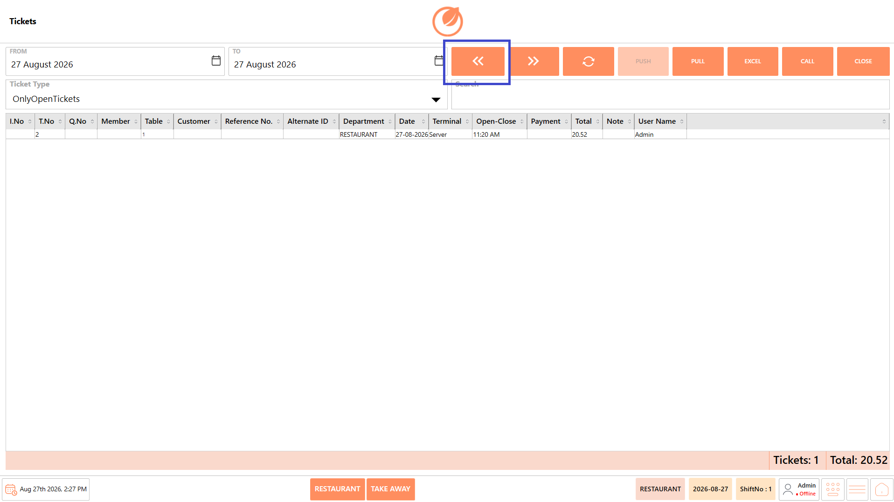<figcaption></figcaption></figure>

* **Next** – Moves to the next set of ticket records.

<figure>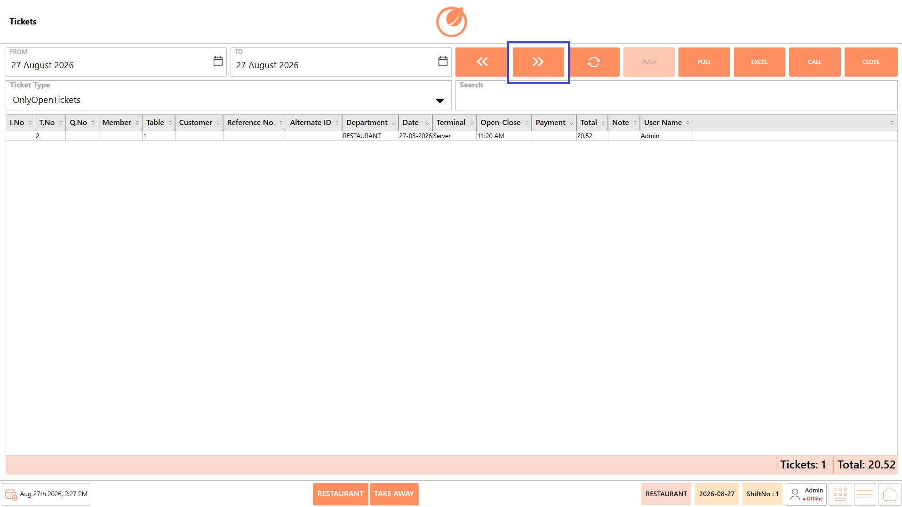<figcaption></figcaption></figure>

### **Export Ticket Information to Excel** 

After displaying the required tickets, click **Excel** to export the ticket information displayed on the screen to an Excel file.

<figure>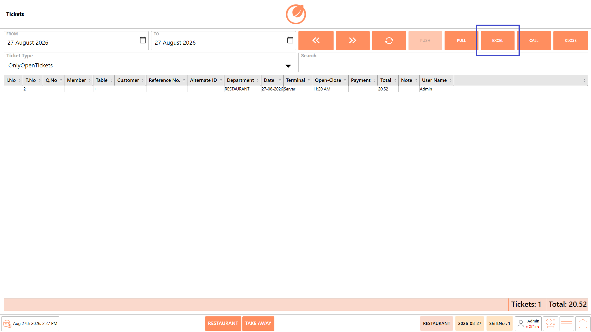<figcaption></figcaption></figure>

### **Push and Pull Ticket Information** 

The Push and Pull options are available for applicable ticket operations.

* **Push** – Pushes the selected tickets for syncing.

<figure>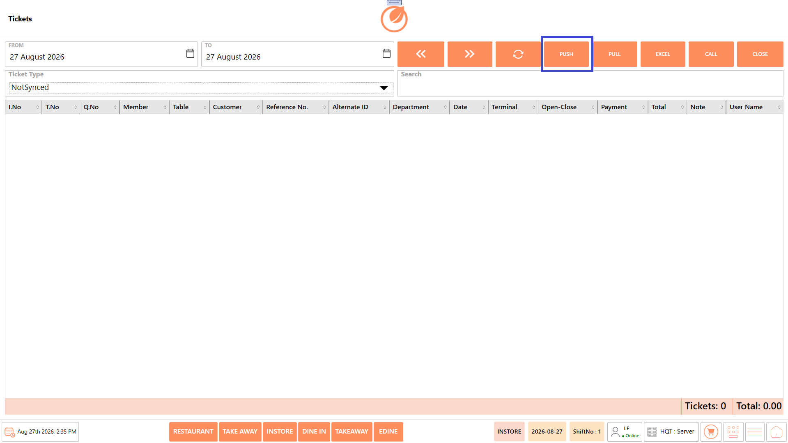<figcaption></figcaption></figure>

* **Pull** – Retrieves ticket information where applicable.

<figure>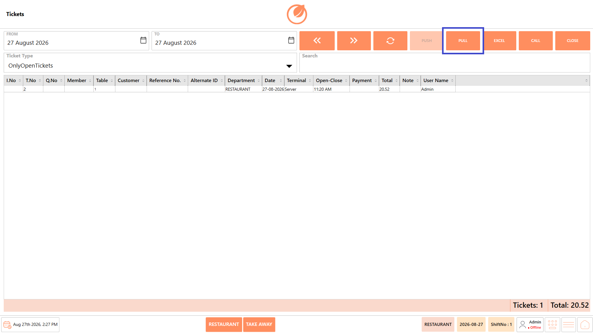<figcaption></figcaption></figure>

**Note:** The Push option is enabled only when NonSynced tickets are selected. This allows users to push non-synchronized tickets for synchronization. The availability or behavior of these actions may depend on the ticket and system configuration.

### **Call a Ticket** 

Use the Call option to retrieve an order received through a connected online ordering gateway and bring it into the Tickets screen for processing.

1. Click “Call”.

<figure>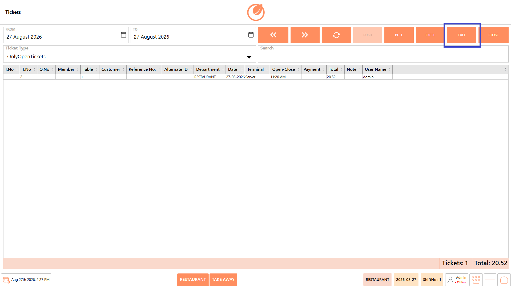<figcaption></figcaption></figure>

2. The available order is retrieved from the connected gateway and added to the ticket list.

For example, an online order received through Foodpanda can be called into the Tickets screen immediately for further processing.

### **Close the Tickets Screen** 

* Click "Close" to exit the Tickets screen and return to the previous screen.

<figure>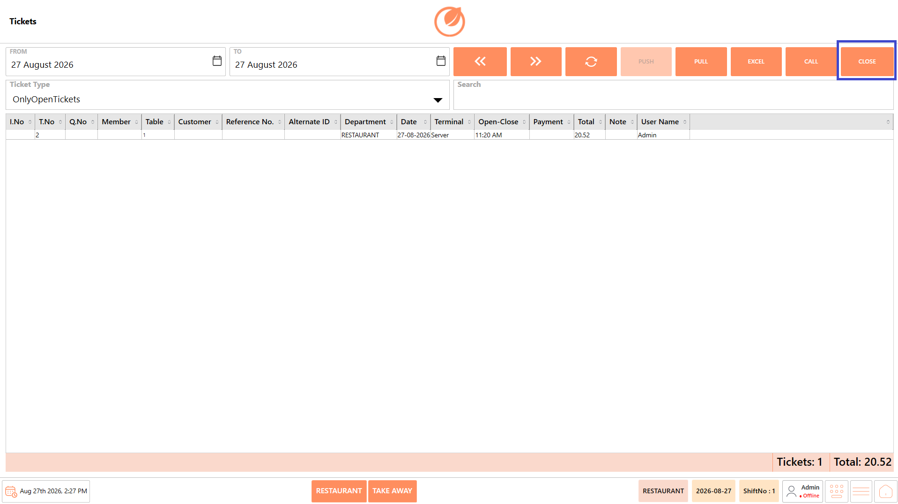<figcaption></figcaption></figure>

## **Use Cases** 

* View tickets generated within a specific date range.
* Filter tickets by Ticket Type, such as open or closed tickets.
* Search for specific tickets using available ticket information.
* Review ticket and transaction details for operational reference.
* Navigate through multiple ticket records using Previous and Next.
* Export ticket information to Excel for reporting or record keeping.
* Push Non Synced ticket information or Pull ticket information where applicable.
* Call online orders from connected gateways, such as Food panda, into the Tickets screen for immediate processing.
