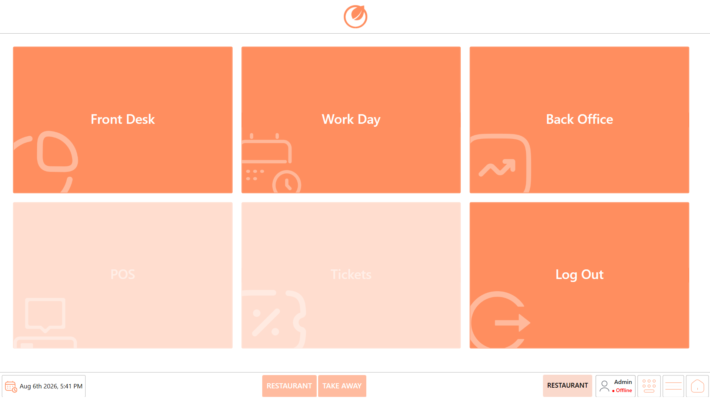

# About Work Day

## **Overview** 

The Workday module is used to manage the restaurant's daily operational cycle in DinePlan. It enables authorized users to start and end the business day while controlling access to key operational modules such as POS and Tickets.

A Workday must be started before the restaurant can begin accepting customer orders or processing transactions. Once the Workday is active, a Work Shift must be started on every terminal that accepts payments before transactions can be processed.

In addition to managing the business day, the Workday module allows users to:

* Start and end Work Shifts.
* Record opening and closing cash amounts.
* Synchronize data with Dine Connect.
* Enable or disable Training Mode.
* Print Workday and Work Shift information.
* Complete the end-of-day process after validating open tickets.

**Important**

Before the Workday and Work Shift are started, the POS and Tickets modules remain unavailable. Start the Workday first, followed by a Work Shift on each payment terminal to enable restaurant operations.

<figure><figcaption></figcaption></figure>

**Note**

* A restaurant can have multiple POS terminals.
* A Workday can be started from any terminal.
* Every payment terminal must have its own active Work Shift before transactions can be processed.

## **Workflow** 

The following workflow illustrates the key steps involved in starting, operating, and closing the Workday and Work Shift.

<figure><figcaption></figcaption></figure>

## **Workday** 

The Workday module can be accessed from the DinePlan Home screen. Users with the required permissions can open the module to start or end the business day, manage Work Shifts, and perform Workday-related administrative functions.

### **Access Workday** 

1. Log in to “DinePlan” using your credentials.
2. Navigate to the “Home” screen.

<figure><figcaption></figcaption></figure>

2. Click “Workday”.

<figure><figcaption></figcaption></figure>

3. The “Workday” screen opens.

<figure><figcaption></figcaption></figure>

The **Workday** screen provides the options required to manage the business day and its associated Work Shifts. Once the Workday screen is opened, users can start the business day and proceed with the required Work Shift operations.

The following sections explain how to start the Workday and manage the Work Shift.
