# End Work Shift

## **Overview** 

The Shift Closing screen is displayed when an active Work Shift is being ended. It allows users to record the closing amounts for each payment method used during the shift before completing the shift closure.

Recording the closing amounts helps ensure that the payment totals recorded in the system match the actual amounts collected during the shift. This process supports accurate cash reconciliation and daily financial reporting. The screen also provides an option to open the cash drawer before completing the shift, allowing users to count or verify the cash collected.

## **Prerequisites** 

Before closing a Work Shift, ensure that:

* The Workday is active.
* You are logged in to the appropriate POS terminal with an active Work Shift.
* All transactions for the shift have been completed.
* The closing amount for each applicable payment method is available for verification.
* The closing amounts can be verified against the actual amounts collected during the shift.
* You have the required permissions to end the Work Shift.

## **Procedure** 

1. Open the "Work Shift" screen.

<figure><figcaption></figcaption></figure>

2. Click "End Work Shift".

<figure>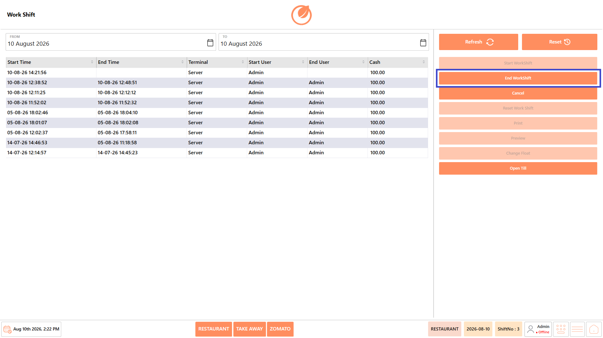<figcaption></figcaption></figure>

3. A confirmation message asking "Do you want to end Work Shift?" is displayed.

<figure>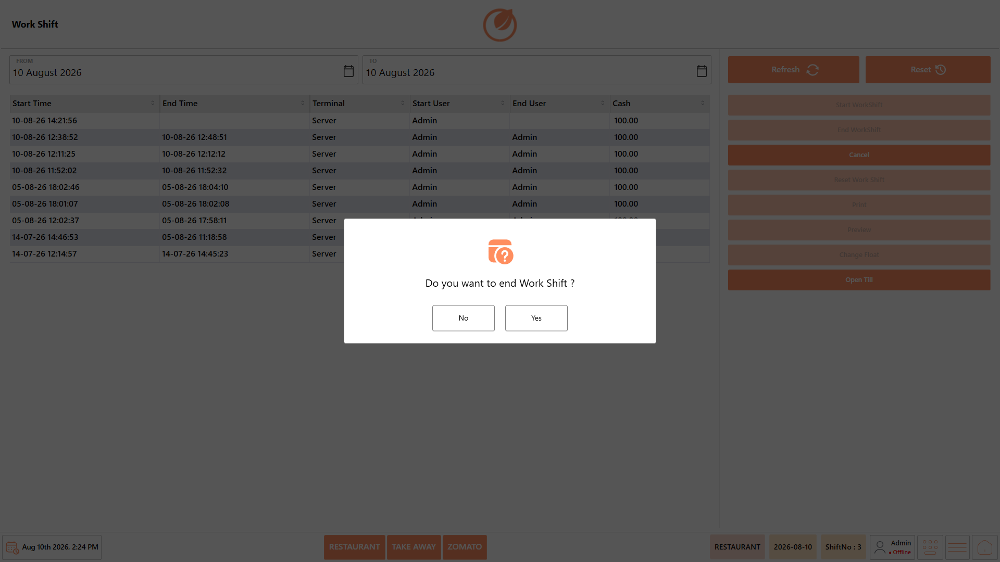<figcaption></figcaption></figure>

4. Click "Yes" to continue.

<figure>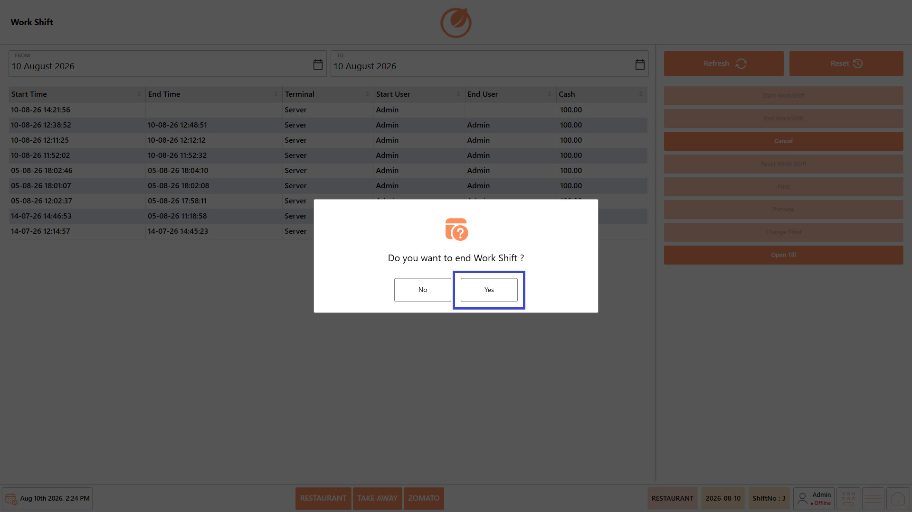<figcaption></figcaption></figure>

5. The "Cash Denomination" screen is displayed.

<figure>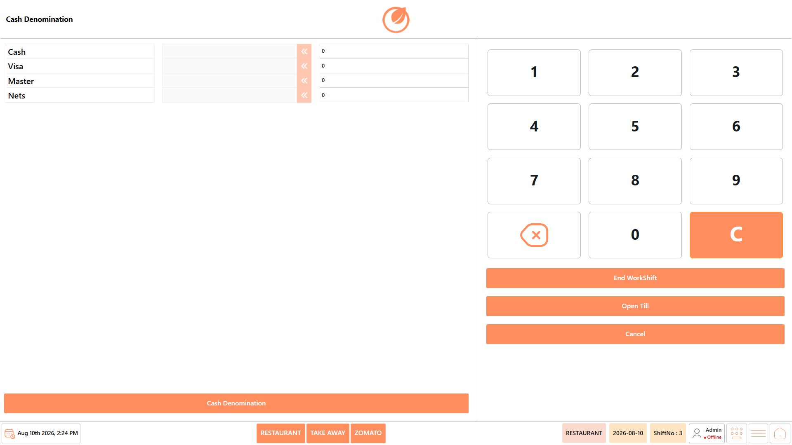<figcaption></figcaption></figure>

6. Enter the closing amount for each available payment method, such as "Cash", "Visa", "Master", and "Nets".
7. Verify that the entered amounts match the actual amounts collected during the shift.

<figure>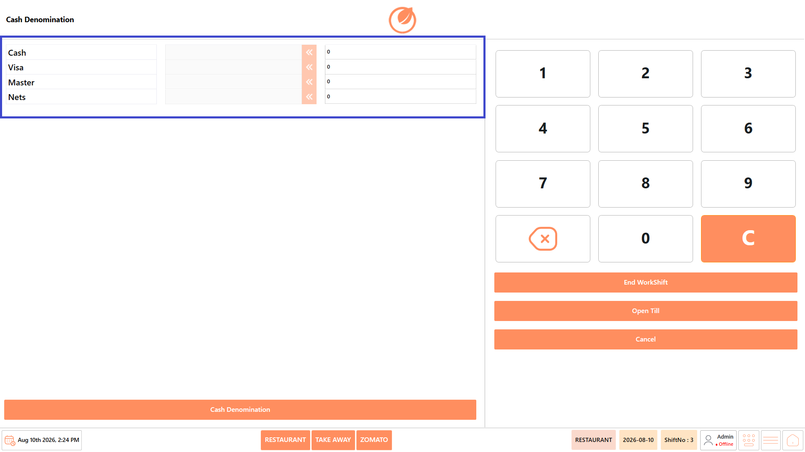<figcaption></figcaption></figure>

8. If required, click "Open Till" to open the cash drawer and verify the cash amount.

<figure>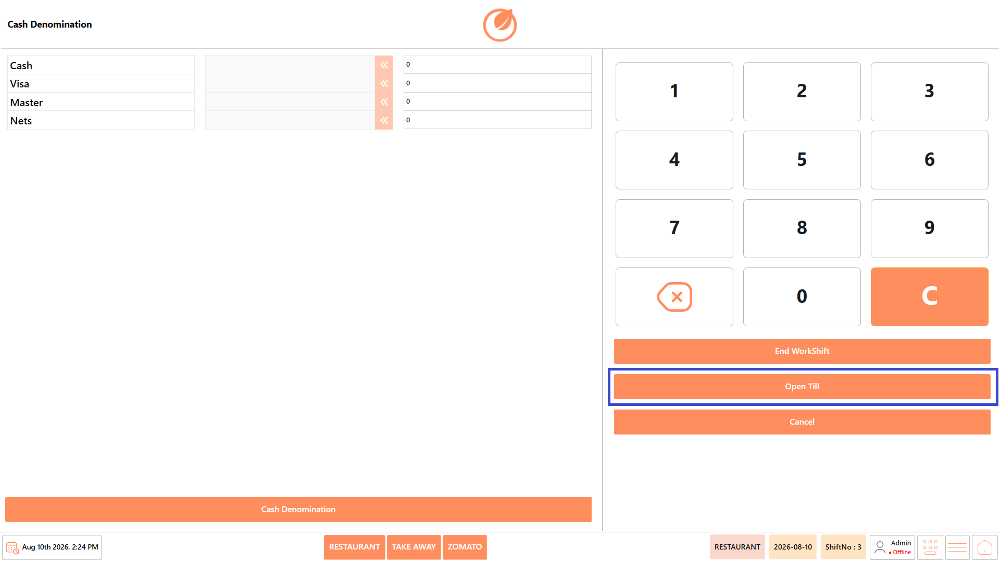<figcaption></figcaption></figure>

9. Click "End WorkShift" to proceed with closing the shift.

<figure>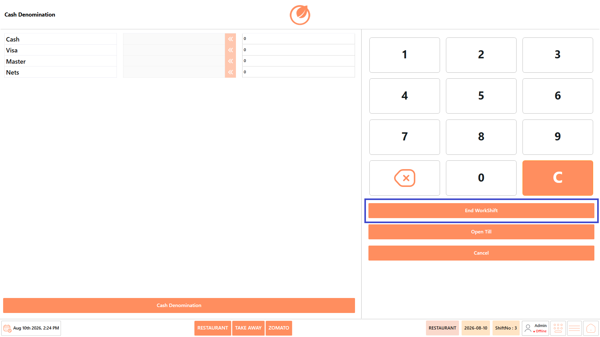<figcaption></figcaption></figure>

10. A confirmation message asking "Do you want End WorkShift operation?" is displayed.

<figure>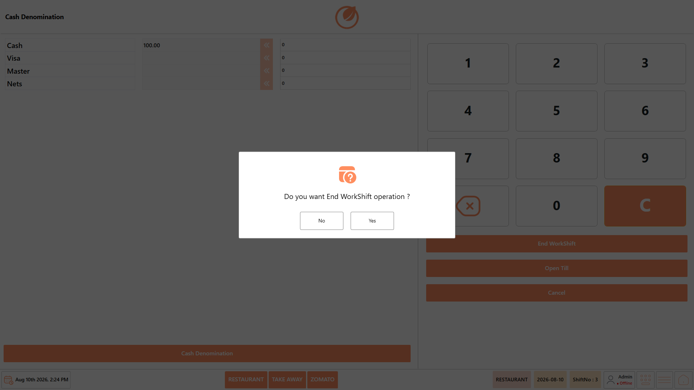<figcaption></figcaption></figure>

11. Click "Yes" to confirm the operation.

<figure>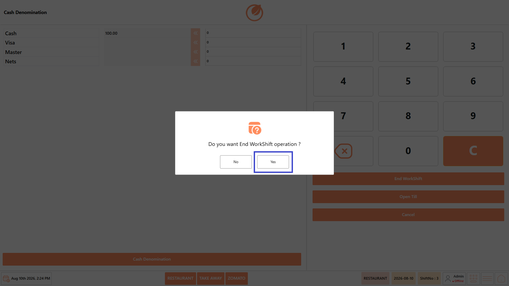<figcaption></figcaption></figure>

12. A confirmation message indicating that the Work Shift has ended is displayed.

<figure>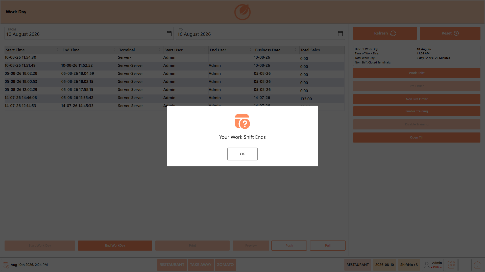<figcaption></figcaption></figure>

13. Click "OK" to close the confirmation message.

<figure>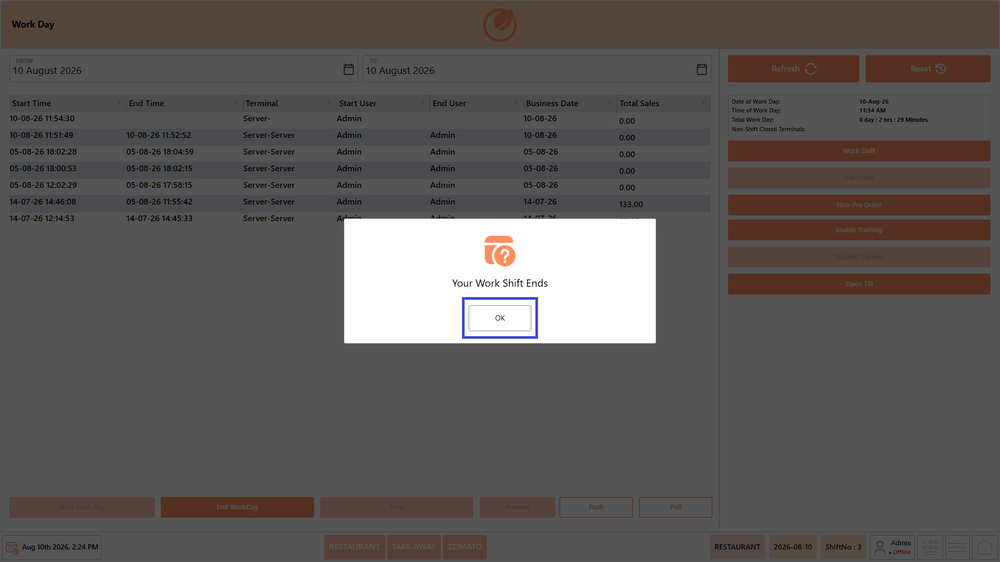<figcaption></figcaption></figure>

**Note -** Make sure the closing amounts entered for each payment method match the actual amounts collected before confirming the Work Shift closure.

## **Result** 

The Work Shift is successfully closed, and the entered closing amounts are recorded for the shift. The terminal is no longer available for billing until a new Work Shift is started.
