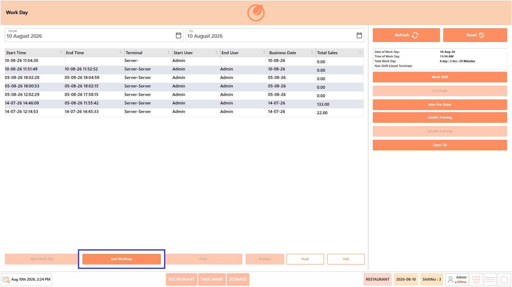
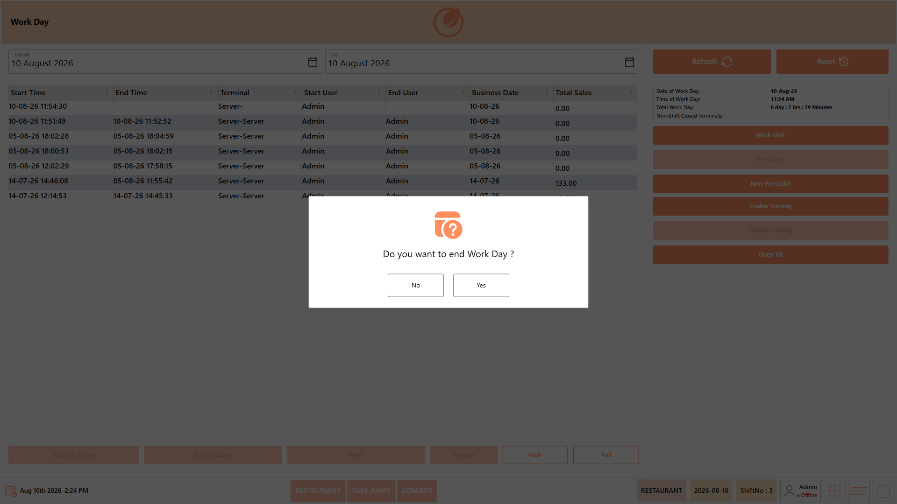
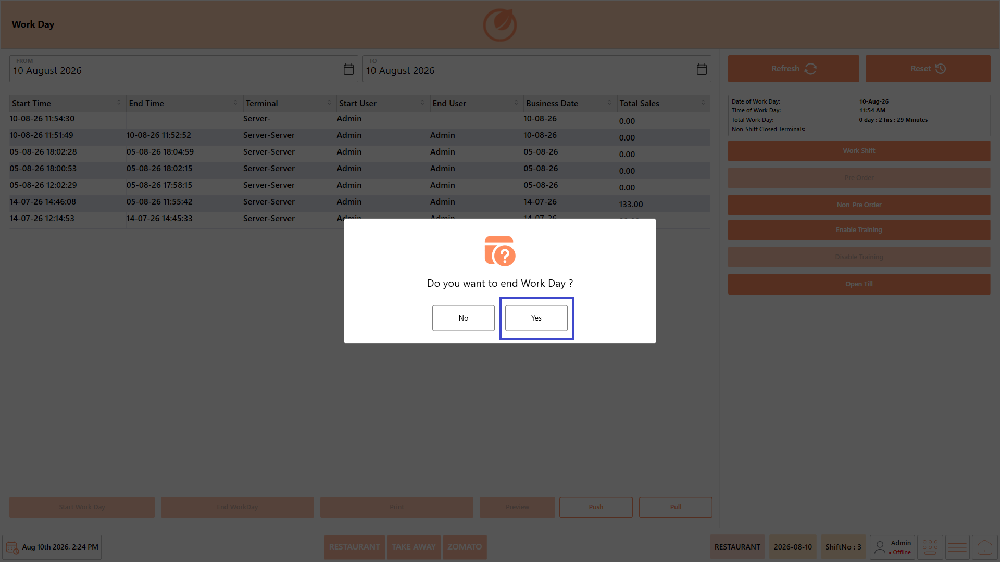
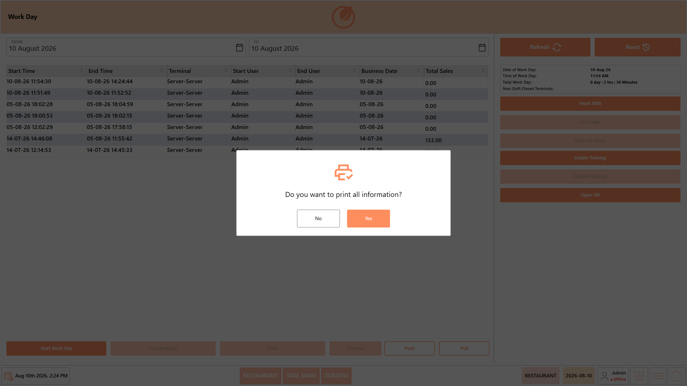
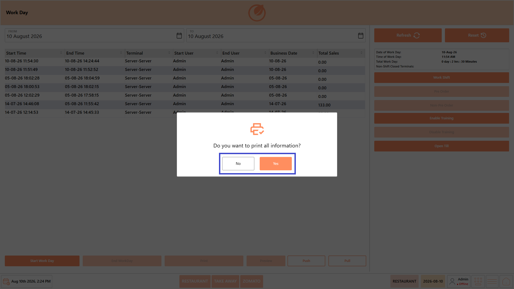
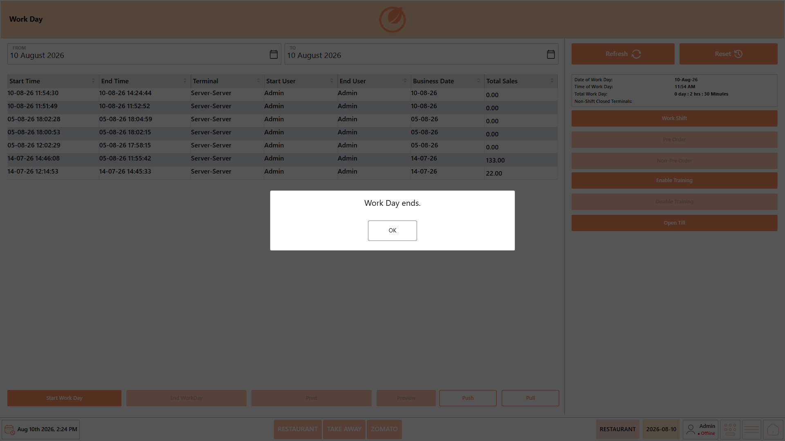
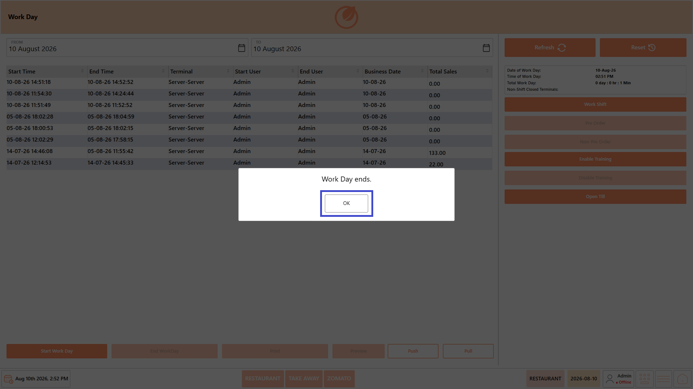

# End Workday

## **Overview** 

The End Workday function is used to close the restaurant's business day after all operational activities have been completed. Before ending the Workday, all active Work Shifts must be closed, and the system validates whether any customer tickets remain open.

If open tickets are found, the Workday cannot be closed until they are resolved, unless **Pre Order** mode has been enabled. Completing the End Workday process records the day's operational information and prepares the system for the next business day.

## **Prerequisites** 

Before ending the Workday, ensure that:

* All active **Work Shifts** have been ended.
* All customer transactions for the business day have been completed.
* There are no open customer tickets, unless **Pre Order** mode is enabled.
* You have the required permissions to end the Workday.

## **Procedure** 

1. Open the "Workday" module.

<figure><figcaption></figcaption></figure>

2. Verify that the active Work Shift has been ended.
3. The "End Workday" option becomes available only after the active Work Shift is ended.
4. Click "End Workday".

<figure><figcaption></figcaption></figure>

5. A confirmation message asking "Do you want to end Work Day?" is displayed.

<figure><figcaption></figcaption></figure>

6. Click "Yes" to confirm that you want to end the Workday.

<figure><figcaption></figcaption></figure>

7. A confirmation message asking "Do you want to print all information?" is displayed.

<figure><figcaption></figcaption></figure>

8. Click "Yes" to print the Workday information, or click "No" to continue without printing.

<figure><figcaption></figcaption></figure>

9. The "Work Day ends." confirmation message is displayed.

<figure><figcaption></figcaption></figure>

10. Click "OK" to close the confirmation message.

<figure><figcaption></figcaption></figure>

### If the End Workday Button Is Disabled

The **"End Workday"** button remains disabled if there are any open customer tickets. The number of open tickets is displayed in the right corner of the screen. All open tickets must be resolved before the Workday can be ended.

<figure><figcaption></figcaption></figure>

#### Procedure to Resolve Open Tickets

1. Open **"Tickets"** from the dashboard.

<figure><figcaption></figcaption></figure>

2. Select the required date.
3. Select **"Open Tickets"** from the filter.

<figure><figcaption></figcaption></figure>

4. Select the ticket you want to resolve.
5. Click **"Display"** to view the selected ticket.
6. Close the ticket according to the applicable procedure.
7. Repeat the process until all open tickets are closed.
8. Return to the **"Workday"** module. Once all open tickets are closed, the **"End Workday"** button becomes enabled.
9. Click **"End Workday"** to close the business day.

**Note:** Ensure that all active Work Shifts have also been ended before proceeding with the End Workday operation.

## **Open Ticket Validation** 

Before ending the Workday, DinePlan checks for any open customer tickets. If open tickets are found, the system displays a validation message and prevents the Workday from being closed until the tickets are resolved.

If "Pre Order" mode is enabled, the Workday can be ended while eligible open tickets remain available for processing in the next business period.

**Note -**&#x4D;ake sure all tickets that should be completed for the current business day are closed before ending the Workday.

## **Result** 

The Workday is successfully ended, and the business day is closed. The Workday information is retained in the Workday history for future reference.
