# Screen Commands

## **Order Processing** 

### **Pre Order** 

The Pre Order command allows the current Workday to be closed even when one or more customer tickets remain open. This option is useful when orders need to remain active beyond the current business day, such as advance orders or orders that will be completed during the next operational period.

When Pre Order is enabled, the system allows the Workday to be closed without requiring all open tickets to be settled. This provides operational flexibility while ensuring that pending tickets remain available for future processing.

<figure>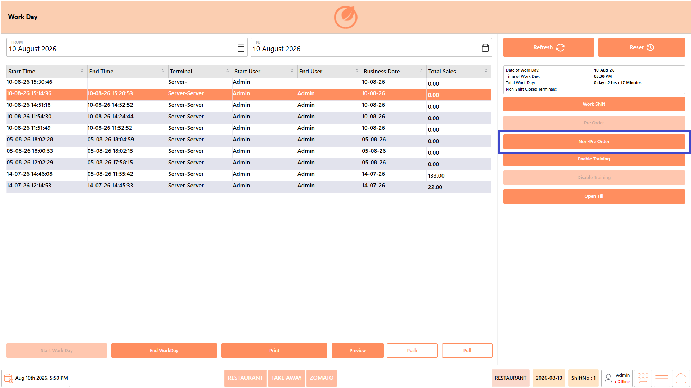<figcaption></figcaption></figure>

### **Non-Pre Order** 

The Non-Pre Order command returns the system to its default order processing behavior. In this mode, all customer tickets must be completed, settled, or closed before the Workday can be ended.

This option ensures that all transactions for the current business day are finalized before daily operations are closed, reducing the possibility of leaving unfinished orders in the system.

<figure><figcaption></figcaption></figure>

## **Training** 

### **Enable Training** 

The "Enable Training" command places the POS terminal in Training Mode, allowing users to practice restaurant operations without affecting live business data.

While Training Mode is enabled, transactions performed on the terminal are treated as practice transactions and are not synchronized with the server. Training Mode can be used for employee training, demonstrations, and practice before handling live customer transactions.

When Training Mode is enabled, the "Training" status is displayed on the DinePlan dashboard. The system also automatically redirects the user to the login page.

#### **Procedure** 

1. Open the "Workday" module.

<figure><figcaption></figcaption></figure>

2. Click "Enable Training".

<figure>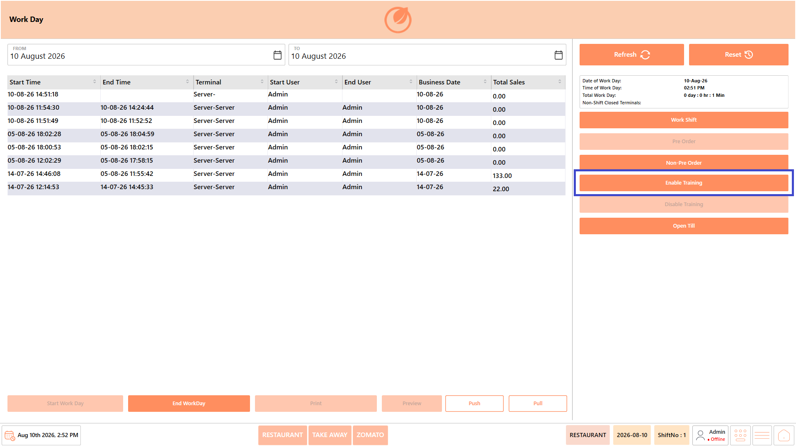<figcaption></figcaption></figure>

3. A confirmation message asking "Do you want Training Mode operation?" is displayed.

<figure>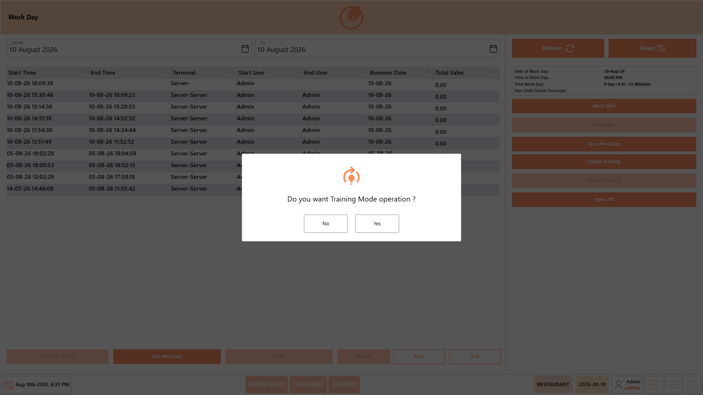<figcaption></figcaption></figure>

4. Click "Yes" to enable Training Mode.

<figure>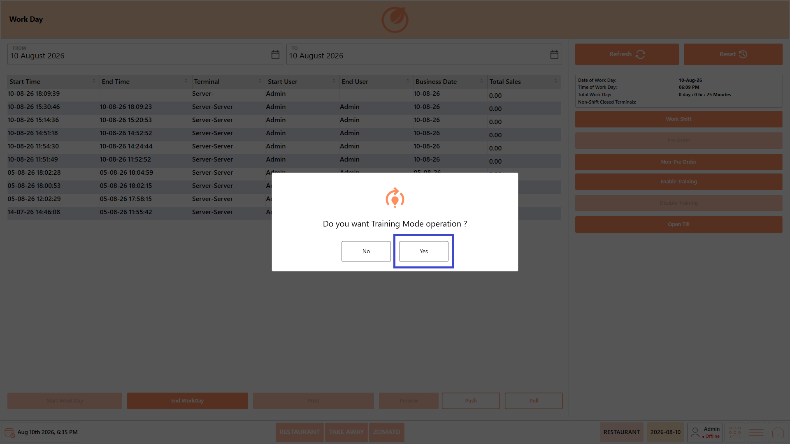<figcaption></figcaption></figure>

5. The system enables Training Mode and automatically redirects you to the login page.
6. Log in to continue using DinePlan in Training Mode.
7. Verify that "Training" is displayed on the dashboard to confirm that Training Mode is active.

<figure>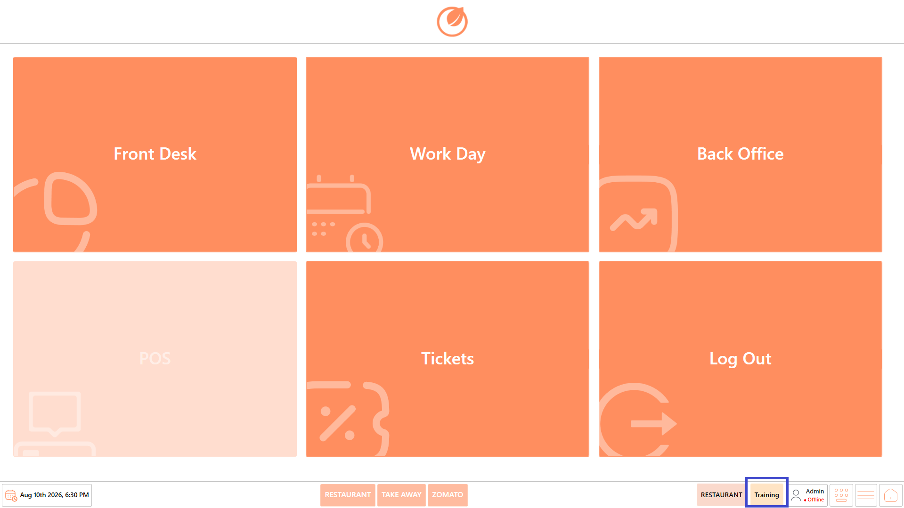<figcaption></figcaption></figure>

#### **Result**

The POS terminal operates in Training Mode. Transactions performed while Training Mode is active are treated as practice transactions and are not synchronized with the server.

### **Disable Training** 

The "Disable Training" command exits Training Mode and returns the POS terminal to normal operating mode.

After Training Mode is disabled, new transactions are processed as live business transactions and synchronized with the server. Disable Training Mode before resuming regular restaurant operations.

#### **Procedure** 

1. Open the "Workday" module.

<figure>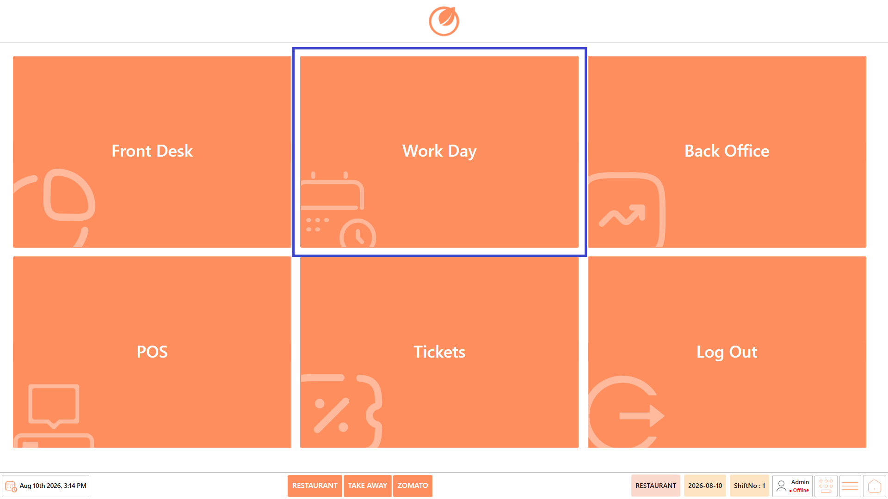<figcaption></figcaption></figure>

2. Click "Disable Training".

<figure>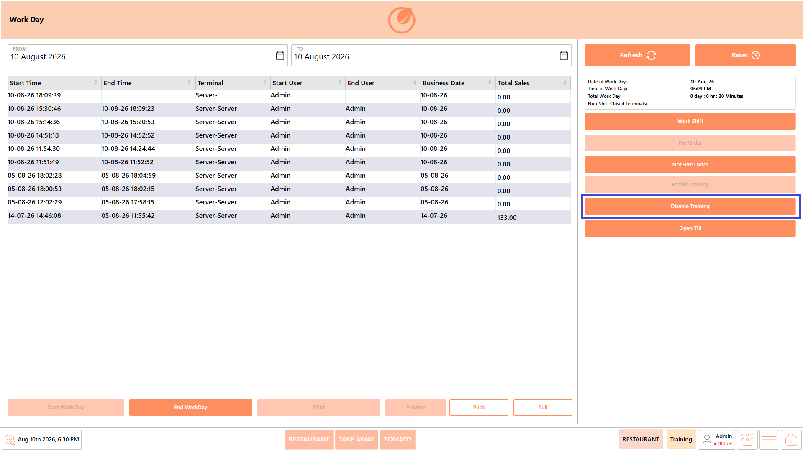<figcaption></figcaption></figure>

3. The system disables Training Mode and automatically redirects you to the login page.
4. Log in to continue using DinePlan in normal operating mode.

#### **Result**

Training Mode is disabled, and the POS terminal resumes normal operations. New transactions are recorded as live business transactions and synchronized with the server.

## **Data Synchronization** 

### **Push** 

The Push command manually synchronizes pending transaction data from the POS terminal to Dine Connect.

<figure>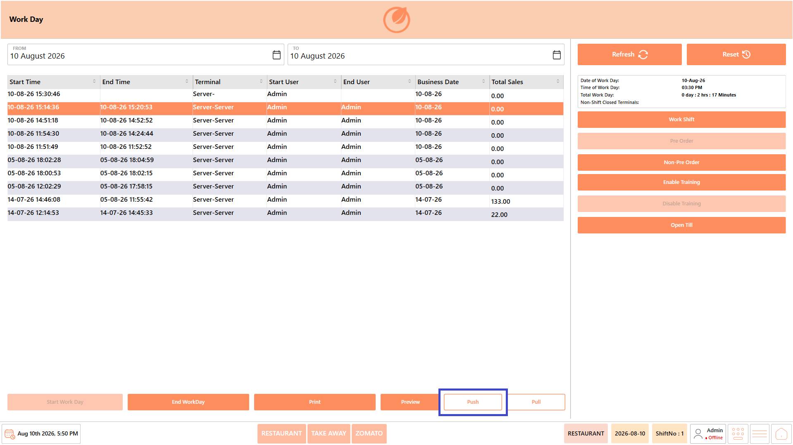<figcaption></figcaption></figure>

Normally, transaction data is synchronized automatically after each completed order or payment. If network connectivity is interrupted, some transactions may remain pending. Use **Push** after connectivity is restored to manually synchronize any unsent data with Dine Connect.

### **Pull** 

The Pull command retrieves the latest operational data and configuration updates from Dine Connect.

Use this command after changes have been made in Dine Connect, such as menu updates, pricing changes, promotional offers, or configuration changes. Pulling the latest data ensures that the POS terminal is working with the most recent information.

<figure>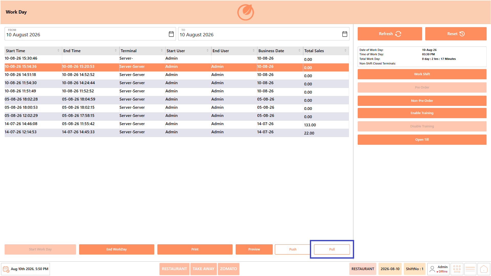<figcaption></figcaption></figure>

## **Screen Actions** 

### **Refresh** 

The Refresh command reloads the current Workday screen and updates the displayed information without changing the selected business date or applied filters.

Use this command to display the latest Workday or Work Shift information after completing an operation, such as starting or ending a Workday or Work Shift.

<figure>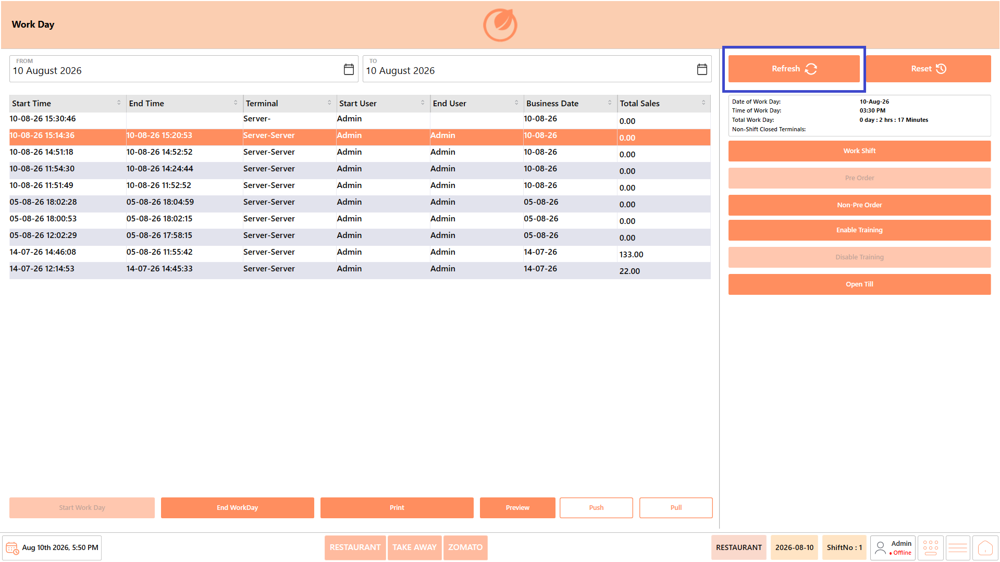<figcaption></figcaption></figure>

### **Reset** 

The Reset command restores the selected business date to the current business date and refreshes the Workday information displayed on the screen.

If historical Workday records have been viewed using different date filters, selecting Reset quickly returns the screen to the current business day's information.

<figure>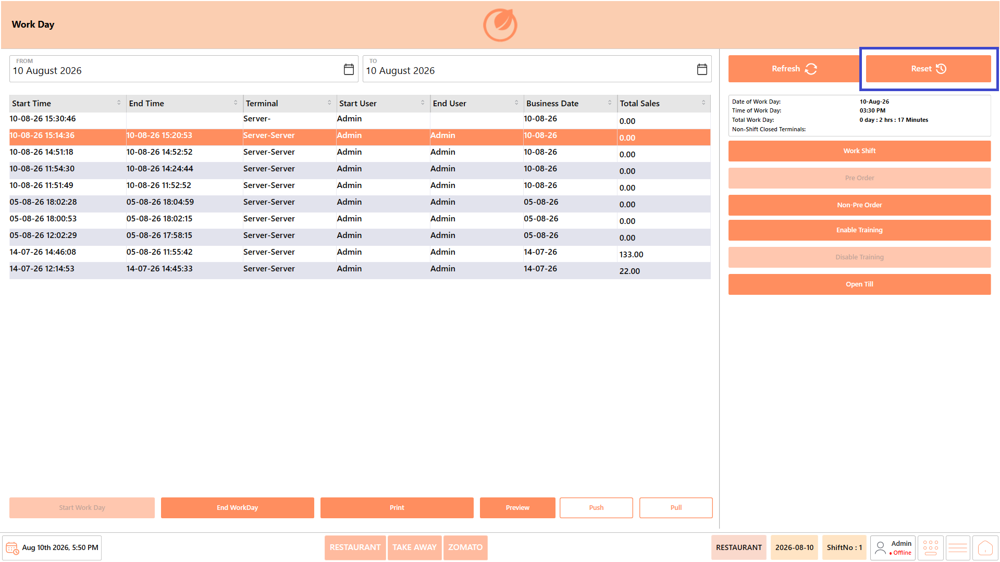<figcaption></figcaption></figure>

### **Reports** 

#### **Print**

The "Print" command allows you to print the available Workday or Work Shift information. This can be used when a physical copy of the displayed operational information is required for review or record-keeping.

<figure>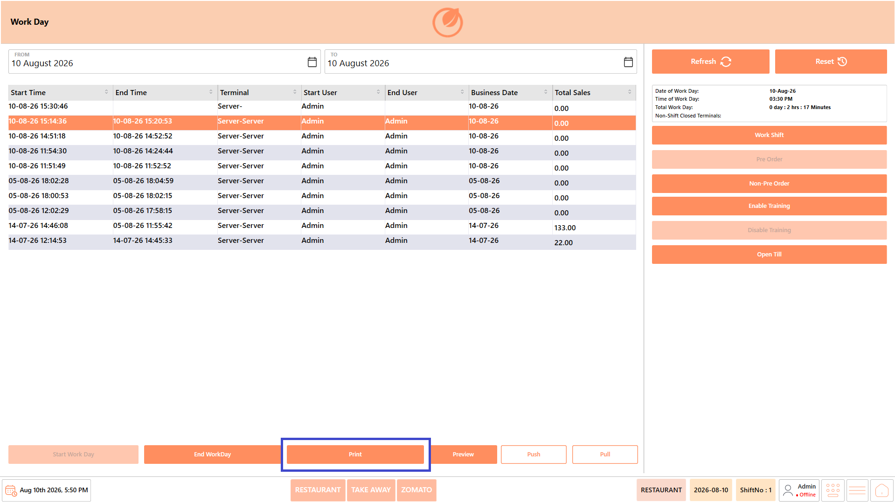<figcaption></figcaption></figure>

#### **Preview**

The "Preview" command allows you to preview the selected Workday or Work Shift information before printing it. This helps you review the information on screen and confirm that the required details are available before generating a printed copy.

#### **Procedure** 

1. Select the required Workday or Work Shift record.

<figure>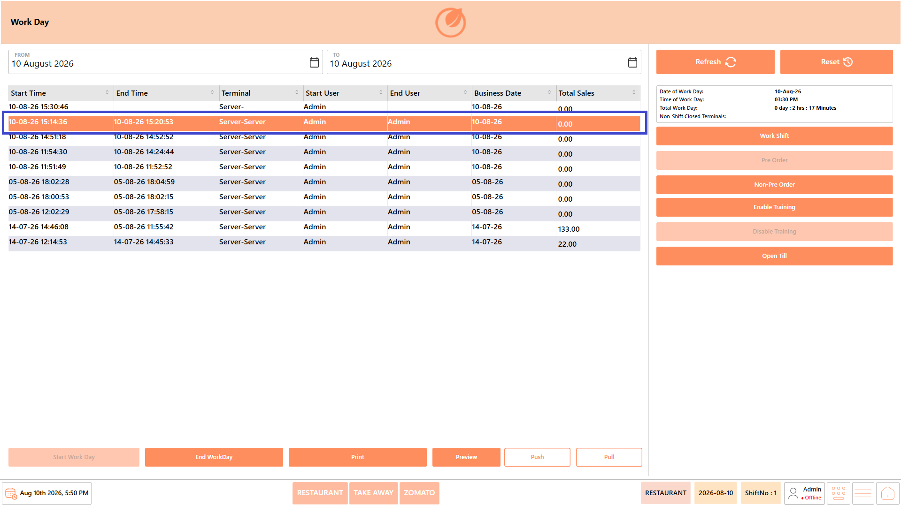<figcaption></figcaption></figure>

2. Click "Preview".

<figure>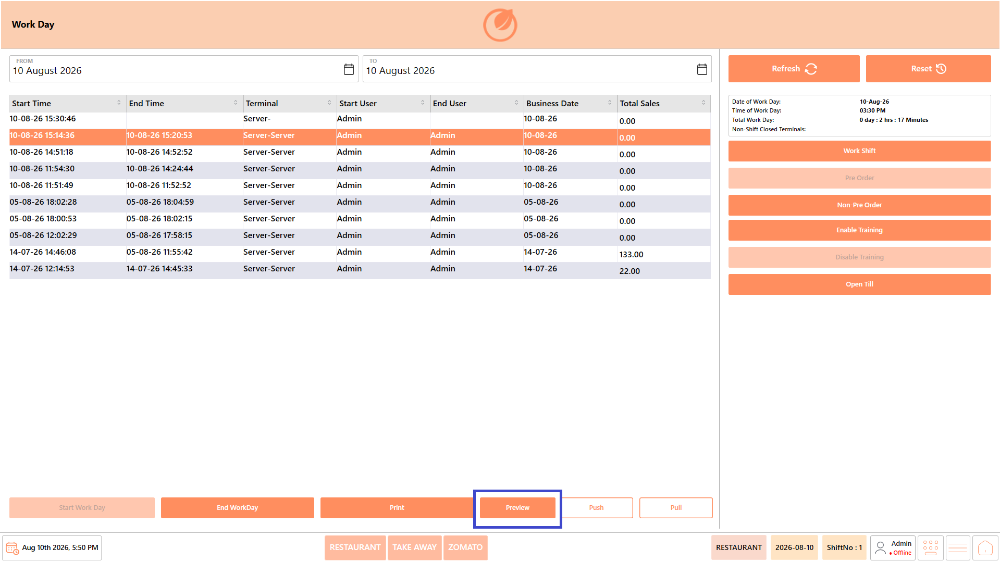<figcaption></figcaption></figure>

3. The system displays a preview of the selected information.

<figure>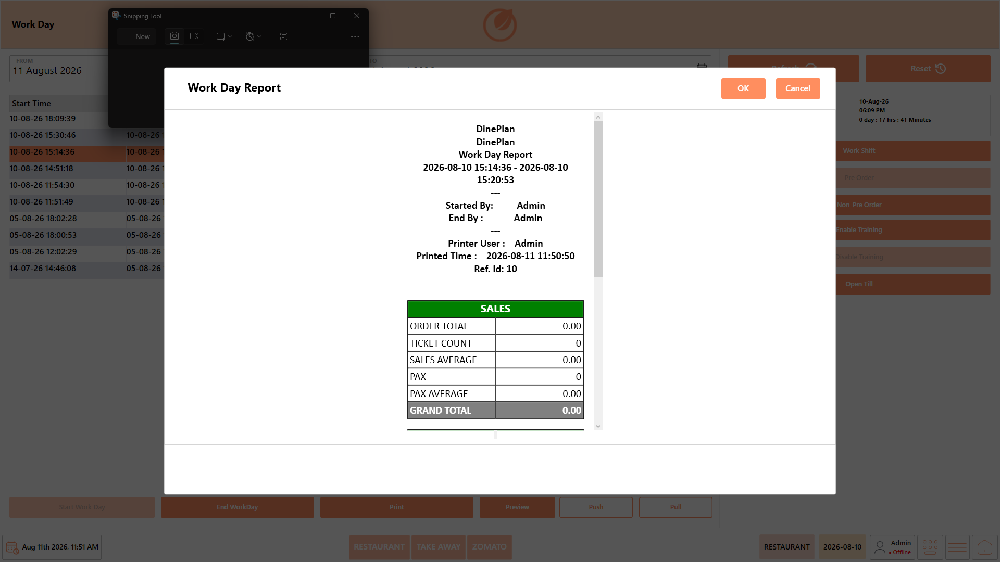<figcaption></figcaption></figure>

4. Review the displayed details.
