# Start Work Shift

## **Overview** 

The Work Shift screen is used to manage the work shifts for individual POS terminals. While a Workday enables restaurant operations for the entire business day, a Work Shift enables transactions on a specific payment terminal. Every terminal that accepts customer payments must have an active Work Shift before orders and payments can be processed.

The screen displays the history of previously recorded work shifts and provides options to start a new Work Shift, end an active Work Shift, reopen a previously closed Work Shift, print work shift details, and generate work shift reports. It also displays information such as the terminal, users who started and ended the shift, opening cash amount, and shift timings.

<figure>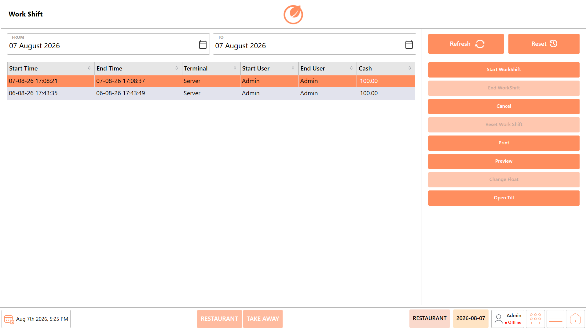<figcaption></figcaption></figure>

## **Screen Elements** 

| Screen Element       | Description                                                                            |
| -------------------- | -------------------------------------------------------------------------------------- |
| **From**             | Allows users to select the start date for the period to display Work Shift records.    |
| **To**               | Allows users to select the end date for the period to display Work Shift records.      |
| **Refresh**          | Refreshes the Work Shift information based on the selected date range.                 |
| **Reset**            | Resets the selected date range or applied filters.                                     |
| **Work Shift List**  | Displays the available Work Shift records for the selected date range.                 |
| **Start Time**       | Displays the date and time when the Work Shift was started.                            |
| **End Time**         | Displays the date and time when the Work Shift was ended.                              |
| **Terminal**         | Displays the terminal associated with the Work Shift.                                  |
| **Start User**       | Displays the user who started the Work Shift.                                          |
| **End User**         | Displays the user who ended the Work Shift.                                            |
| **Cash**             | Displays the cash amount associated with the Work Shift.                               |
| **Start WorkShift**  | Starts a new Work Shift for the selected terminal or user.                             |
| **End WorkShift**    | Ends the currently active Work Shift.                                                  |
| **Cancel**           | Cancels the current Work Shift-related operation.                                      |
| **Reset Work Shift** | Resets the selected Work Shift when the option is available.                           |
| **Print**            | Prints the Work Shift information.                                                     |
| **Preview**          | Displays a preview of the Work Shift information before printing.                      |
| **Change Float**     | Allows users to change the float amount associated with the Work Shift when available. |
| **Open Till**        | Opens the till associated with the Work Shift.                                         |

## **Start Work Shift** 

A Work Shift represents an active operating session for a specific POS terminal. Starting a Work Shift enables the terminal to process customer orders and payment transactions during the current business day.

When a Work Shift is started, the system prompts the user to enter the opening cash amount for the cash drawer. This amount is used later during shift reconciliation when the Work Shift is closed.

**Important**

Every payment terminal that accepts customer payments must have its own active Work Shift. Starting a Work Shift on one terminal does not automatically start Work Shifts on other terminals.

### **Prerequisites** 

Before starting a Work Shift, ensure that:

* The Workday has already been started.
* You are logged in to the appropriate POS terminal.
* The terminal is ready to accept customer payments.
* You have the required permissions to start a Work Shift.
* The opening cash amount is available for verification before beginning the shift.

### **Procedure** 

1. Open the "Workday" module.

<figure>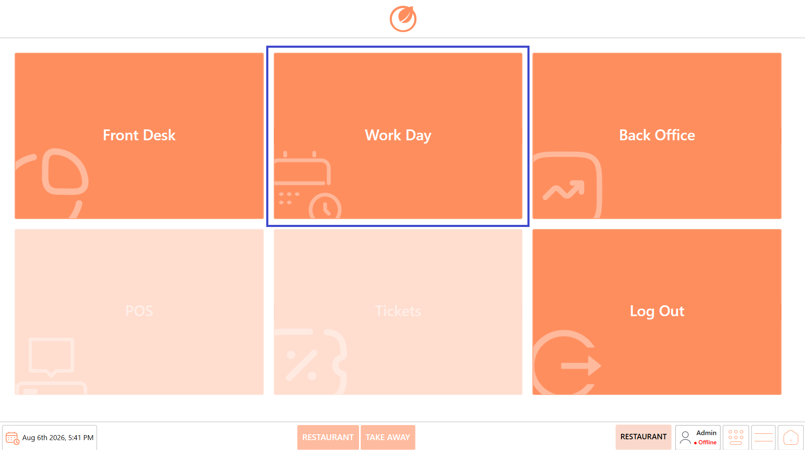<figcaption></figcaption></figure>

2. Click "Work Shift".

<figure>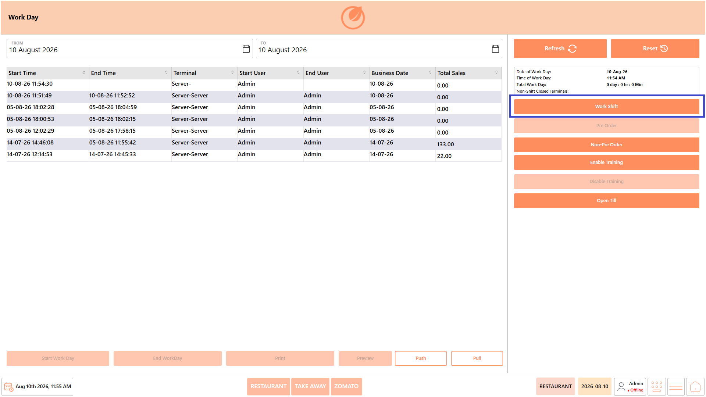<figcaption></figcaption></figure>

3. The "Work Shift" screen opens.
4. Review the existing work shift information, if required.

<figure>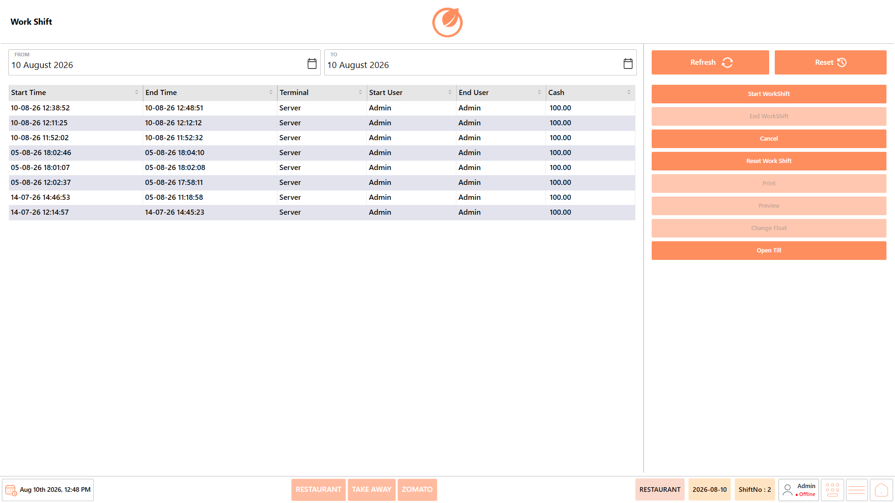<figcaption></figcaption></figure>

5. Click "Start Work Shift".

<figure>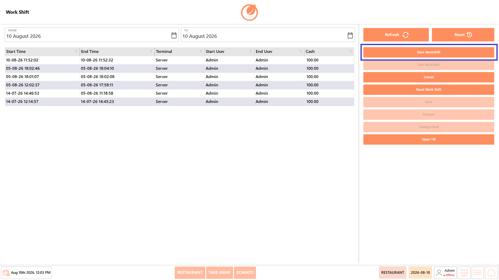<figcaption></figcaption></figure>

6. The "Opening Cash" screen is displayed.
7. Enter the opening cash amount.

<figure>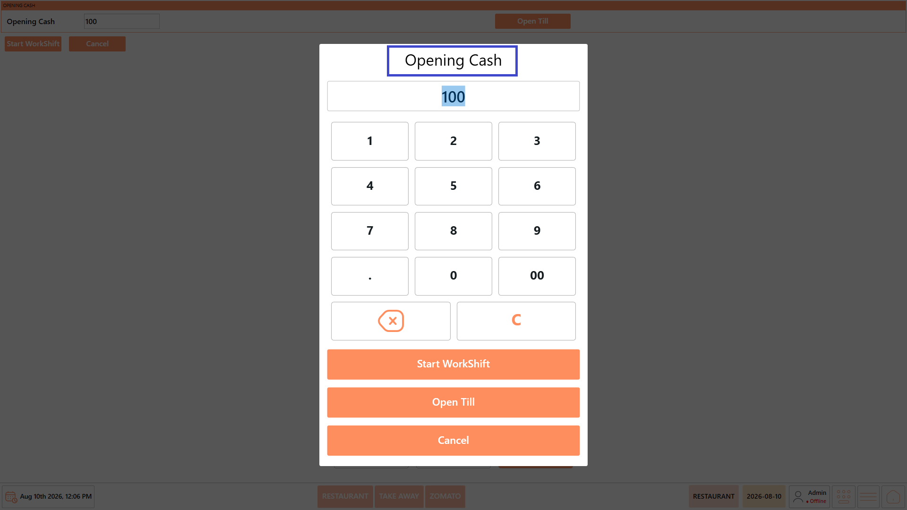<figcaption></figcaption></figure>

8. Verify that the amount entered matches the cash placed in the cash drawer.
9. If required, click “Open Til&#x6C;**”** to open the cash drawer and place or verify the opening cash.

<figure>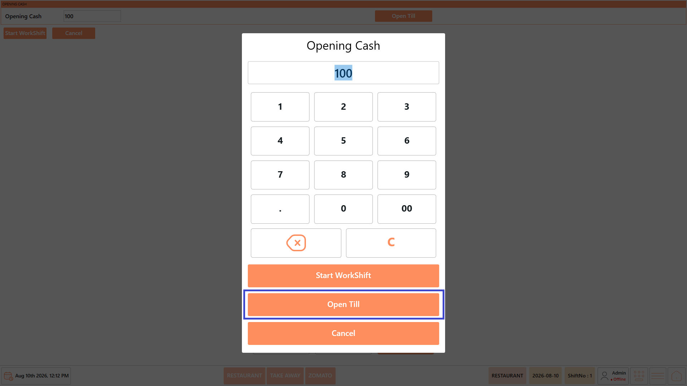<figcaption></figcaption></figure>

10. Click "Start Work Shift" to activate the work shift.

<figure>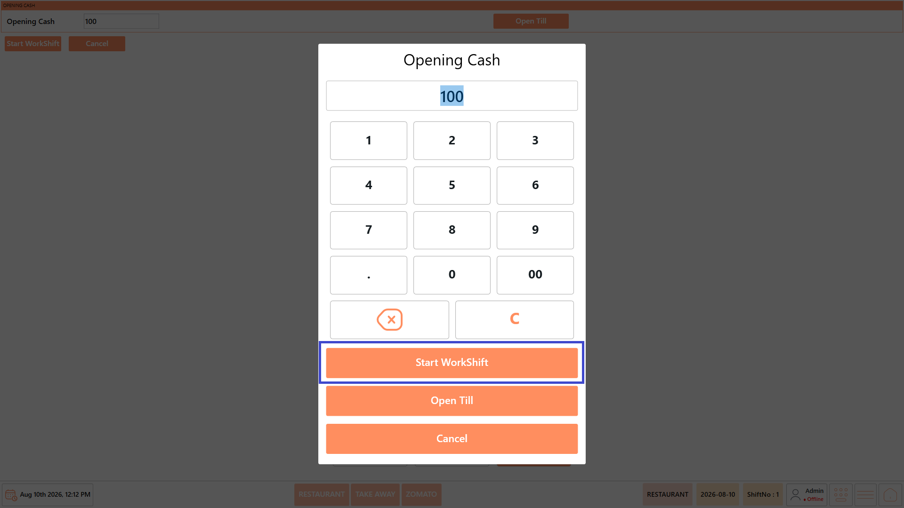<figcaption></figcaption></figure>

11. The "Work Shift Started" confirmation message appears. Review the displayed details.

<figure>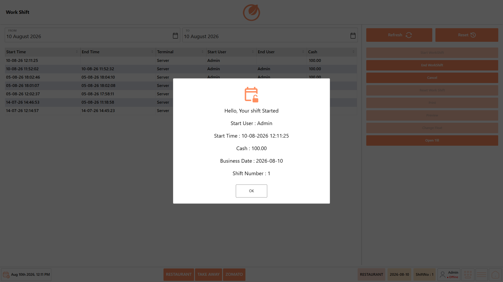<figcaption></figcaption></figure>

12. Click "OK" to close the confirmation message.

<figure>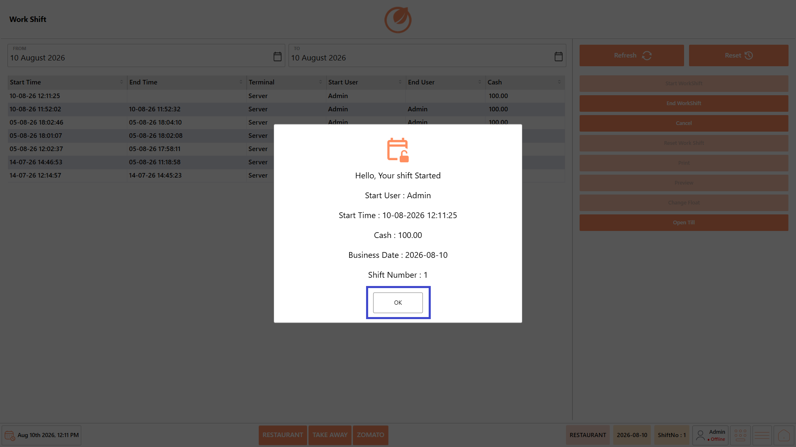<figcaption></figcaption></figure>

**Note -** The confirmation message displays the Start User, Start Time, Cash, Business Date, and Shift Number for the newly started Work Shift.

<figure>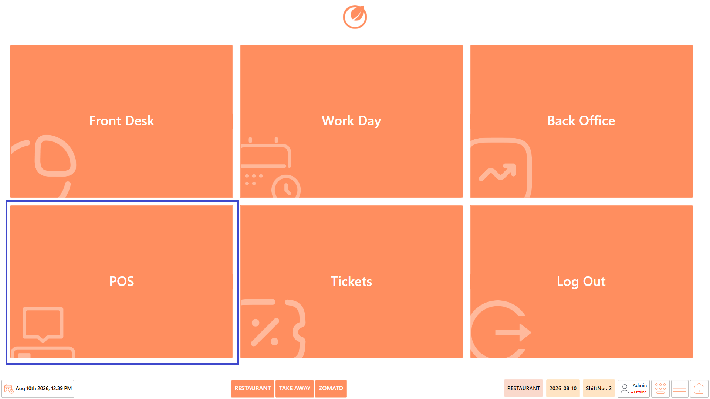<figcaption></figcaption></figure>

### **Result** 

The Work Shift is started successfully for the selected terminal. The opening cash amount is recorded, and the terminal becomes available for processing customer orders and payments through the POS system.
