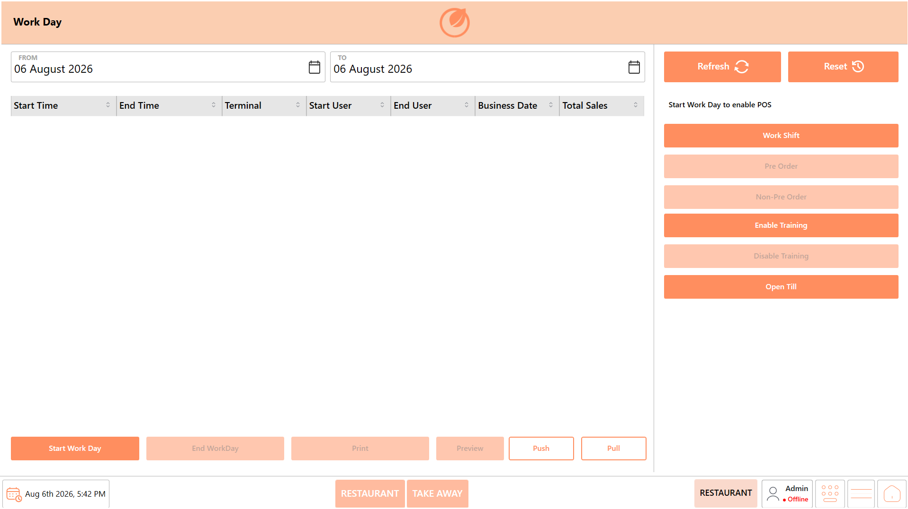
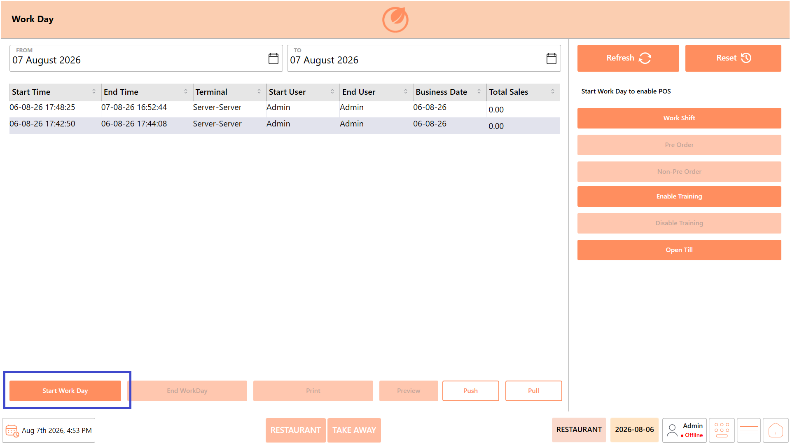
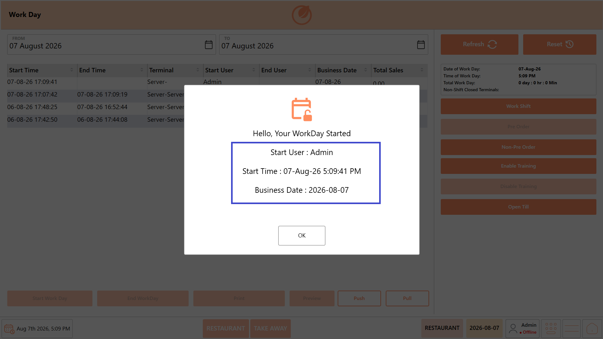
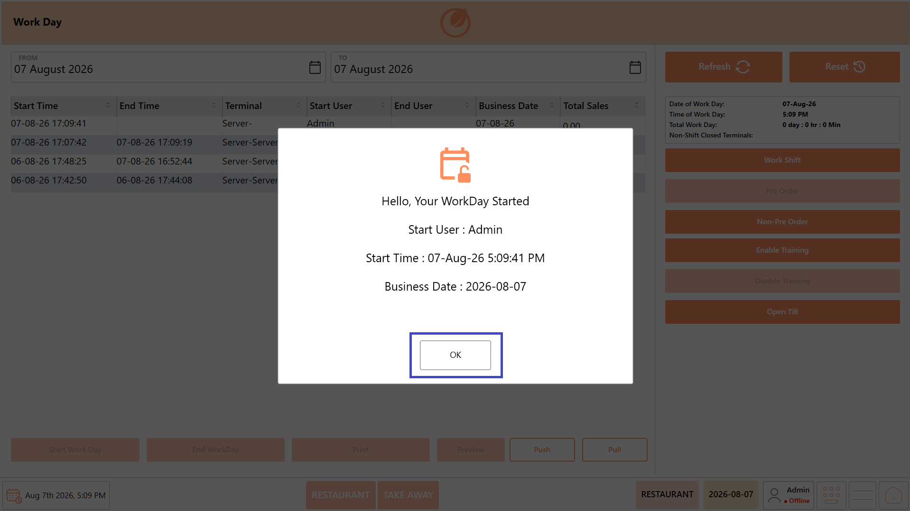

# Start Workday

## **Overview** 

The Workday screen serves as the central location for managing the restaurant's business day. It displays the current Workday status, historical Workday records, and provides access to all Workday functions, including starting and ending the Workday, managing Work Shifts, synchronizing data, enabling Training Mode, and printing Workday information.

Users can also review the current business date and perform administrative actions required during daily restaurant operations.

<figure><figcaption></figcaption></figure>

## **Screen Elements**

| **Screen Element**        | **Description**                                                          |
| ------------------------- | ------------------------------------------------------------------------ |
| Business Date (From)      | Displays or selects the starting business date.                          |
| Business Date (To)        | Displays or selects the ending business date.                            |
| Workday History           | Displays previously completed Workdays for the selected date range.      |
| Start Workday             | Starts the business day for the selected terminal.                       |
| End Workday               | Ends the current business day after all Work Shifts have been completed. |
| Work Shift                | Opens the Work Shift screen to manage Work Shifts.                       |
| Pre Order                 | Enables Pre Order mode.                                                  |
| Non-Pre Order             | Disables Pre Order mode.                                                 |
| Enable Training           | Enables Training Mode.                                                   |
| Disable Training          | Disables Training Mode.                                                  |
| Push                      | Manually synchronizes pending transaction data with Dine Connect.        |
| Pull                      | Retrieves the latest configuration and master data from Dine Connect.    |
| Refresh                   | Reloads the displayed Workday information.                               |
| Reset                     | Resets the selected business date to the current business date.          |
| Print                     | Prints the current Workday information.                                  |
| Workday Information Panel | Displays the current Workday date, start time, and total duration.       |
| Status Message            | Displays system notifications such as open ticket validation messages.   |

## **Start Workday** 

The Start Workday function initializes the restaurant's business day and enables operational modules such as POS and Tickets. Until a Workday is started, these modules remain unavailable for use.

After the Workday has been started successfully, users can proceed to start a Work Shift on each payment terminal before processing customer transactions.

### **Prerequisites** 

Before starting a Workday, ensure that:

* You are logged in with the required permissions.
* No active Workday already exists for the selected business date.
* The restaurant is ready to begin daily operations.
* Payment terminals are available for starting Work Shifts.

### **Procedure** 

1. Open the “Workday” module.

<figure><figcaption></figcaption></figure>

2. Review the current Workday status.
3. Click “Start Workday”.

<figure><figcaption></figcaption></figure>

4. When the confirmation message appears, review the Workday details displayed by the system, including:
   1.
      1. Start User – Displays the name of the user who started the Workday.
      2. Start Time – Displays the date and time when the Workday was started.
      3. Business Date – Displays the business date associated with the Workday.

<figure><figcaption></figcaption></figure>

5. Click “OK” to continue.

<figure><figcaption></figcaption></figure>

6. Verify that the Workday status has been updated successfully.
7. Proceed to start a “Work Shift” on each payment terminal.

### **Result** 

The Workday becomes active for the selected business date. Operational modules such as POS and Tickets are enabled, allowing restaurant operations to begin.

You can now proceed to start a Work Shift on each payment terminal before accepting customer orders or payments.
