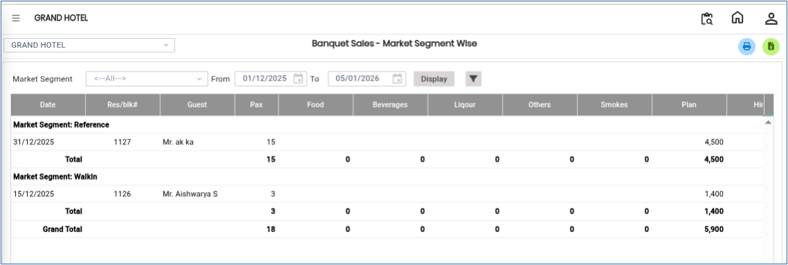

# Banquet Sales Performance

The **Banquet Sales Performance** is used to evaluate banquet sales performance based on different market segments within a selected date range. This analysis helps management review sales trends, compare segment-wise performance, and generate business insights for better decision-making.

## **Steps to View Banquet Sales Performance Analysis**

Step 1: Log in to the system and navigate to the **Banquet Module**.

1. Click on the **Analysis** menu.
2. Select **Banquet Sales Performance** from the available options.

Step 2: After selecting **Banquet Sales Performance**, the system will open the analysis screen.

* By default, the system displays banquet sales performance details based on a **predefined day/date range**.
* This initial view provides an overview of banquet sales performance during the selected period.

<figure><figcaption></figcaption></figure>

Step 3: Click on the **Market Segment** option.

* Select the required segment(s) for analysis.
* The report can be generated segment-wise to compare performance across different business categories.

<figure><figcaption></figcaption></figure>

Step 4: Click on the **Advanced Filter** option.

* The advanced filter section will open with additional filtering options.
* Apply the required criteria to refine the analysis report.

<figure><figcaption></figcaption></figure>

Step 5: After selecting the required filters and market segments, click on the **Display** button.

* The system will generate and display the **Banquet Sales – Market Segment Wise Analysis Report**.

<figure><figcaption></figcaption></figure>
