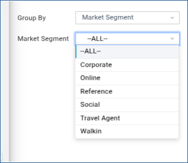
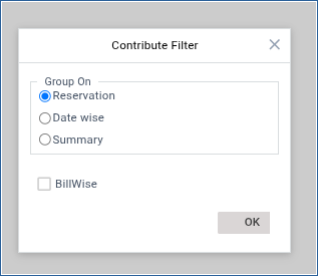
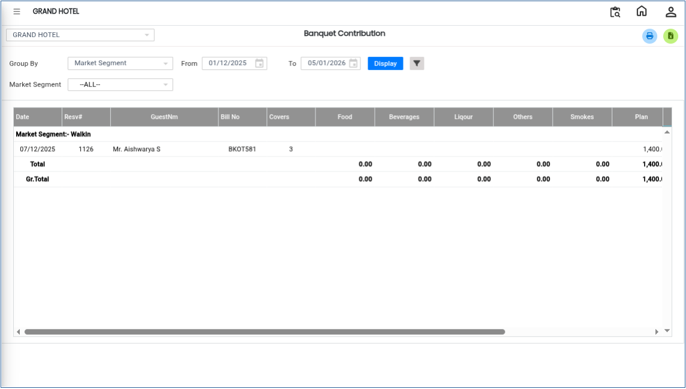

# Banquet Sales

The **Banquet Sales** used to analyse banquet sales data within a selected date range. This analysis helps users review sales performance based on different grouping options, market segments, and contribution filters for better business insights and reporting.

## **Steps to View Banquet Sales Analysis**

Step 1: Log in to the system and navigate to the **Banquet Module**.

* Click on the **Analysis** menu.
* Select **Banquet Sales** from the available options.

Step 2: After selecting **Banquet Sales**, the system will open the analysis screen.

* By default, the system displays banquet sales details based on a **predefined day/date range**.
* This view provides an overview of banquet sales transactions for the selected period.

<figure><figcaption></figcaption></figure>

Step 3: Click on the **Group By** option.

* Select the required grouping method to organise the sales data accordingly.

<figure><figcaption></figcaption></figure>

Step 4: Click on the **Market Segment** option.

* Choose the required market segment(s) for analysis.

<figure><figcaption></figcaption></figure>

Step 5: Click on the **Contribution Filter** option.

* Select the required filter criteria to refine the analysis results.
* This filter helps users focus on specific sales contributions or categories.

<figure><figcaption></figcaption></figure>

Step 6: After applying all required filters and selections, click on the **Display** button.

* The system will generate and display the **Banquet Sales Analysis Report** based on the selected criteria.

<figure><figcaption></figcaption></figure>
