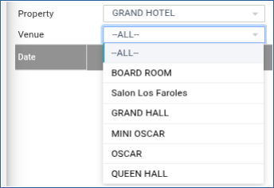
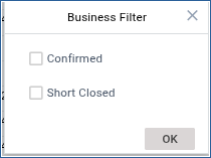
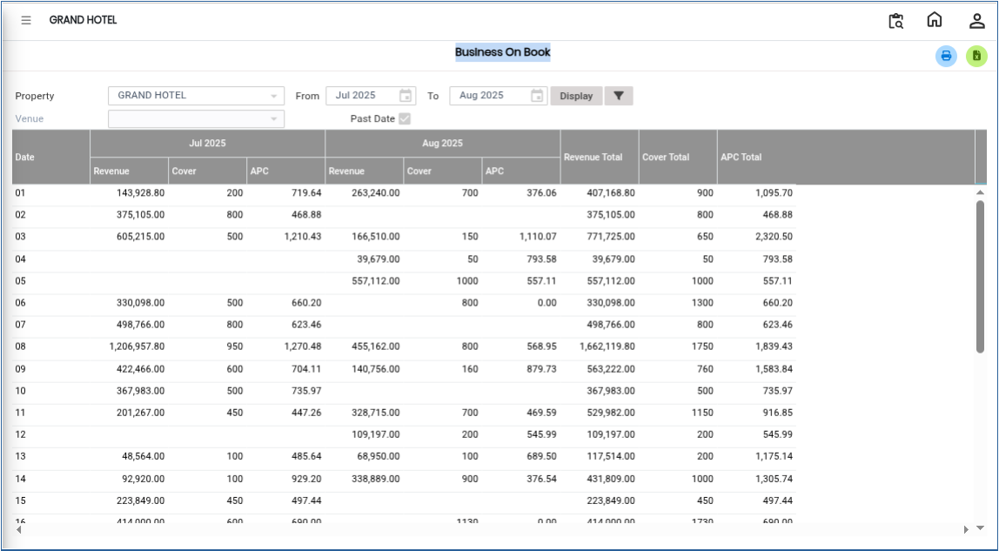

# Business On Book

The **Business On Book** is used to view and analyse upcoming banquet business bookings within a selected date range. This analysis helps users monitor booked business revenue, venue utilisation, and property-wise performance for future planning and management review.

## **Steps to View Business On Book Analysis**

Step 1: Log in to the system and navigate to the **Banquet Module**.

1. Click on the **Analysis** menu.
2. Select **Business On Book** from the available options.

Step 2: After selecting **Business On Book**, the system will open the analysis screen.

* By default, the system displays business booking details based on a **predefined day/date range**.
* This view provides an overview of banquet business bookings for the selected period.

<figure><figcaption></figcaption></figure>

Step 3: Click on the **Property** option.

* Select the required property for analysis.

<figure><figcaption></figcaption></figure>

Step 4: Click on the **Venue** option.

* Select the required venue(s) for the report.
* This helps filter the analysis based on specific banquet halls or event locations.

<figure><figcaption></figcaption></figure>

Step 5: Click on the **Business Filter** option.

* Select the required filter criteria to refine the report results.

<figure><figcaption></figcaption></figure>

Step 6: After selecting the required property, venue, and filters, click on the **Display** button.

* The system will generate and display the **Business On Book Analysis Report**.

<figure><figcaption></figcaption></figure>
