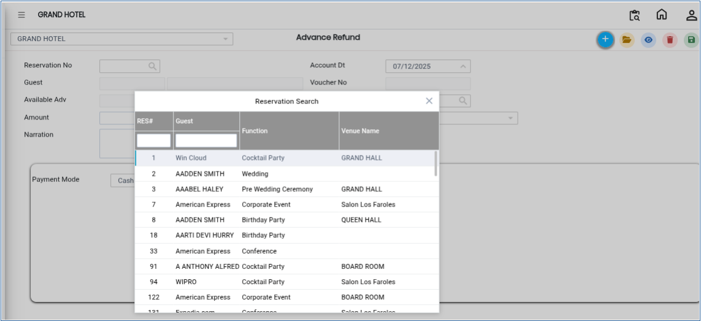
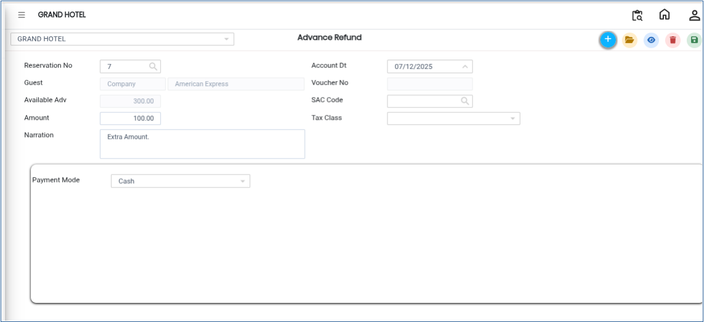
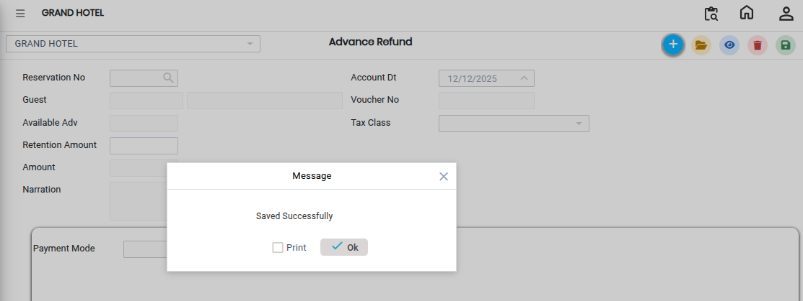

# Advance Refund

**Advance Refund** is used to return the advance amount previously collected from a customer against a reservation. This process is required when a reservation is cancelled, modified, or when the customer is eligible for a refund.

## Steps to Refund a Reservation Advance

Step 1: Navigate to the **Banquet** module and select the **Cashier** menu.

* From the available options, select **Advance Refund**.

Step 2: Click on the **Reservation No.** field.

* A list of reservations will be displayed.
* Select the reservation for which the advance amount needs to be refunded.
* Verify that the correct reservation and guest details are selected before proceeding.

<figure><figcaption></figcaption></figure>

Step 3: After selecting the reservation, enter the refund information:

1. **Amount**

* Enter the amount to be refunded to the customer.
* Ensure the refund amount does not exceed the available advance balance.

2. **Payment Mode**

* Select the payment method through which the refund is being made.Make sure all details are entered correctly.

<figure><figcaption></figcaption></figure>

Step 4: Save the Refund Transaction

Click on the **Save** button to complete the refund process.

* The system will record the refund transaction successfully.
* The refunded amount will be adjusted against the reservation advance balance.
* A confirmation message may appear after saving.

<figure><figcaption></figcaption></figure>
