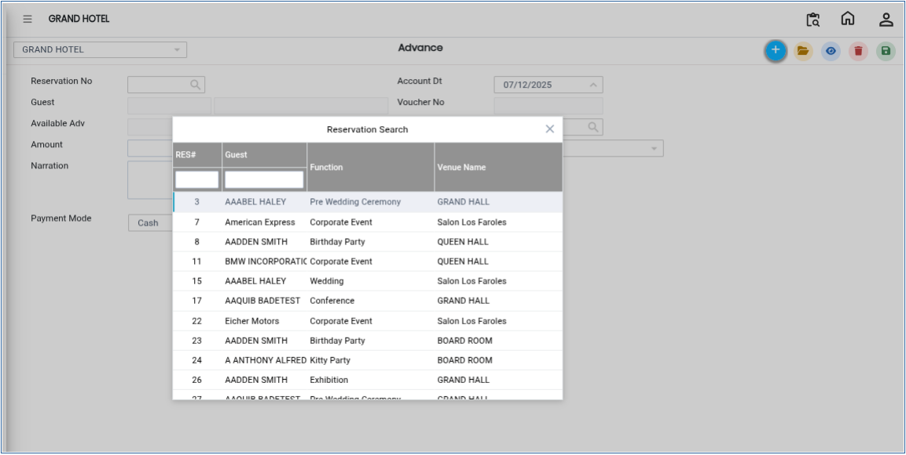
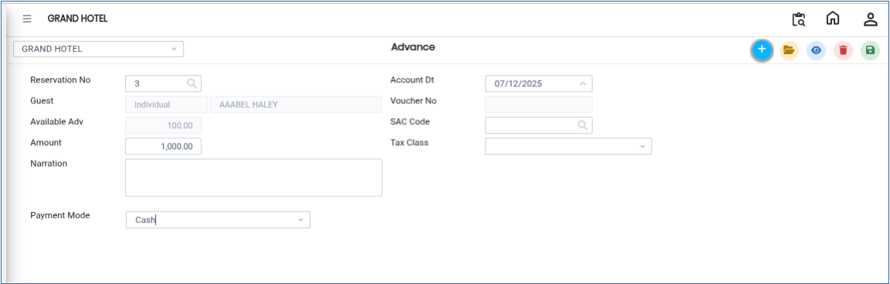

# Advance

**Advance** in the Cashier Menu refers to an upfront payment collected against a reservation before the actual service is provided. This amount is recorded in the system to confirm the booking and secure the customer’s commitment. It is usually adjusted against the final bill at the time of checkout.

### Steps to Create a Reservation Advance

Step 1: Navigate to the **Banquet** module and select the **Cashier** menu.

1. From the available options, select **Advance**.

Step 2: Click on the **New** button to create a fresh advance entry.

* A reservation selection window will appear.
* Choose the appropriate **reservation** from the list displayed.
* Ensure you select the correct guest or booking details.

<figure><figcaption></figcaption></figure>

Step 3: After selecting the reservation, enter the required payment details:

* **Amount:** Enter the advance amount received from the customer.
* **Payment Mode:** Select how the payment was made (e.g., Cash, Card, UPI, Bank Transfer, etc.).

Make sure the entered details are accurate before proceeding.

<figure><figcaption></figcaption></figure>

Step 4: Click on the **Save** button.png>)to confirm and record the advance payment.

* The system will store the advance against the selected reservation.
* A confirmation message may appear indicating successful saving of the transaction.

<figure><figcaption></figcaption></figure>
