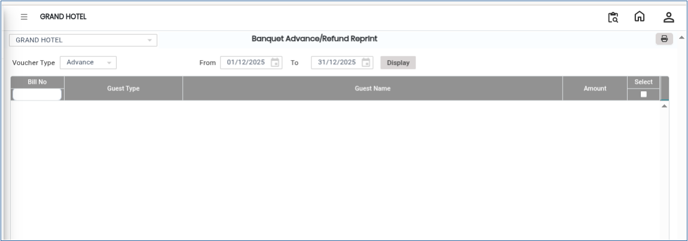
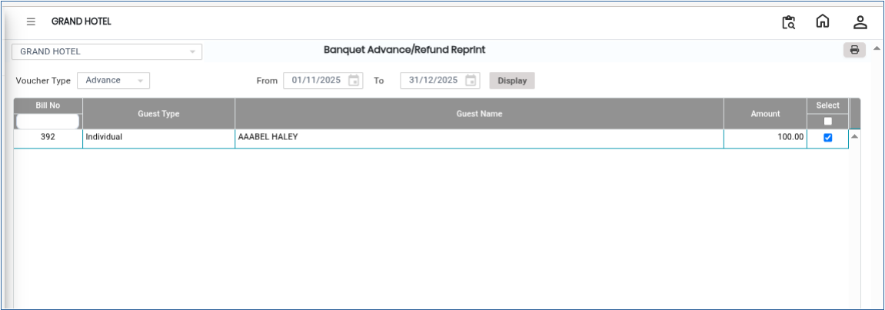

# Banquet Advance/Refund Reprint

The **Banquet Advance Reprint** feature is used to generate and print a duplicate copy of an already issued banquet advance receipt. This option is useful when the original receipt is lost, damaged, or requested again by the customer.

## Steps to Reprint Banquet Advance

Step 1: Navigate to the **Banquet** module and select the **Cashier** menu.

1. Click on **Banquet Advance Reprint**.

* This will open the Banquet Advance Reprint window.

<figure><figcaption></figcaption></figure>

Step 2: Click on the **Display** button.

1. The system will display the list of banquet advance receipts.
2. Select the required advance receipt that needs to be reprinted.

* Ensure the correct advance receipt is selected before proceeding.

<figure><figcaption></figcaption></figure>

Step 3: Click on the **Print** button.

1. The system will generate the print preview of the selected banquet advance receipt.
2. Proceed with printing the receipt.

The banquet advance receipt will be reprinted successfully.
