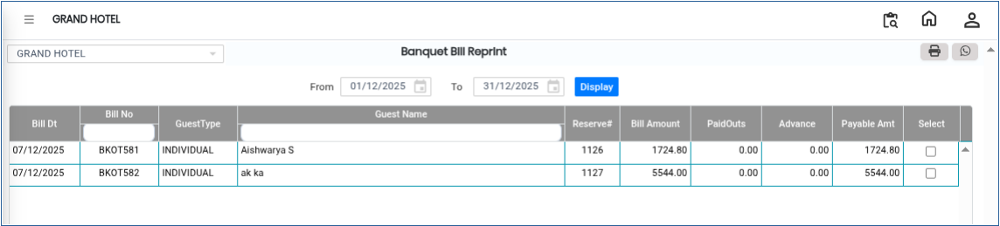
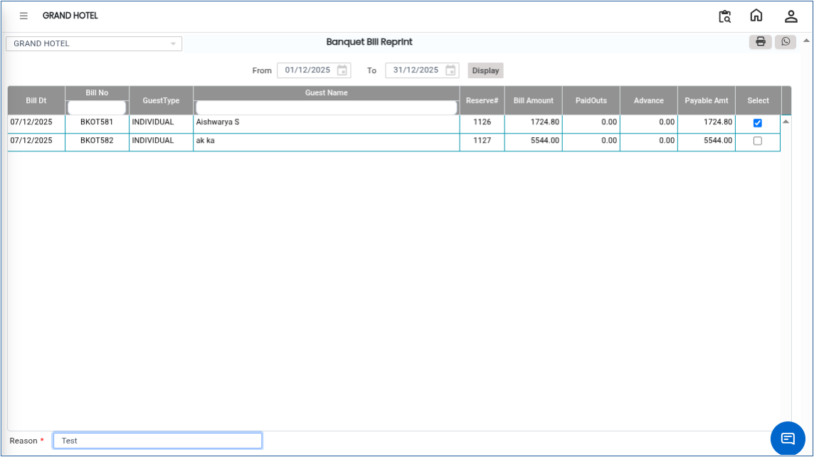
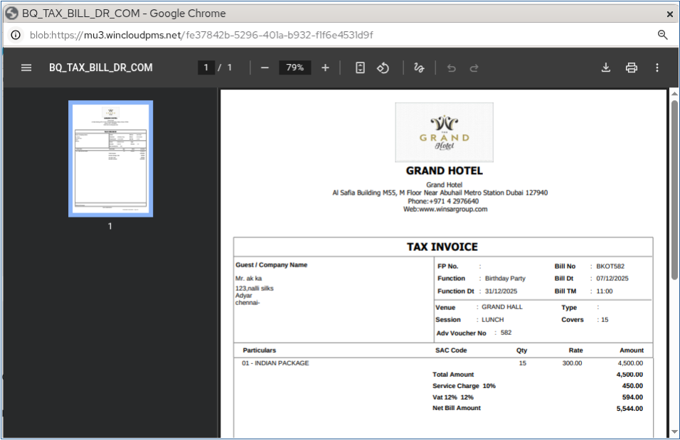

# Bill Reprint

The **Bill Reprint** feature is used to generate and print a copy of an existing bill. This option is helpful when a guest requests a duplicate bill or when the original bill print is lost or damaged.

## Steps to Reprint a Bill

Step 1: Navigate to the **Banquet** module and select the **Cashier** menu.

1. Click on **Bill Reprint**.

* This will open the Bill Reprint window.

Step 2: Click on the **Display** button.

1. The system will show the list of available bills.

* This allows you to search and select the required bill for reprinting.

<figure><figcaption></figcaption></figure>

Step 3: Select the required bill from the displayed list.

1. Enter the **Reason** for reprinting the bill in the provided field.

* Providing a reason helps maintain proper audit records.

<figure><figcaption></figcaption></figure>

Step 4: Click on the **Bill** button.

1. The print preview of the selected bill will be displayed.
2. Proceed with printing the bill as required.

The bill will be reprinted successfully.

<figure><figcaption></figcaption></figure>
