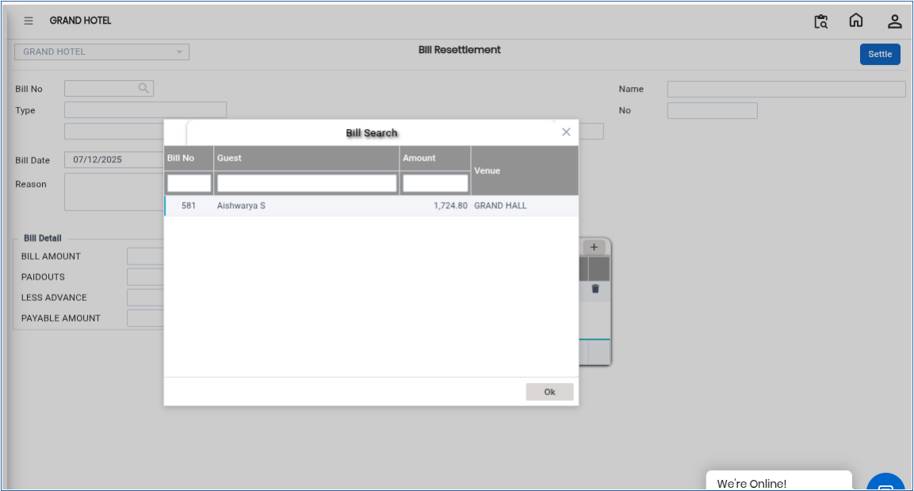
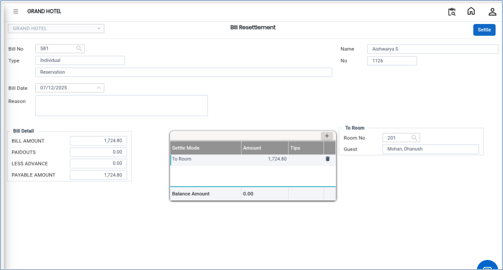

# Bill Resettlement

The **Bill Resettlement** feature is used to modify or update the payment settlement mode of an already settled bill. This process is useful when the original payment method needs to be corrected or changed, such as changing the payment from cash to card or updating incorrect settlement details.

## Steps to Create a Bill Resettlement

Step 1: Navigate to the **Banquet** module and select the **Cashier** menu.

1. Click on **Bill Resettlement**.

* This will open the Bill Resettlement window.

Step 2: Click on the **Bill No** field.

1. Search for and select the required bill number that needs to be resettled.
2. Confirm the selection.

* The selected bill details will be displayed on the screen.

<figure><figcaption></figcaption></figure>

Step 3: Review the existing settlement details carefully.

1. Select or change the **Settlement Mode** as required\
   (for example: Cash, Card, UPI, Bank Transfer, etc.).
2. Ensure the updated payment method is correct before proceeding.

* This step allows the payment details to be corrected or updated.

Step 4: In the **Reason** field, type the reason for bill resettlement.

1. Provide a clear and valid explanation for the change.

Step 5: Click on the **Settle** button.

1. The system will process and complete the bill resettlement successfully.

* The updated settlement details will now be saved in the system.

<figure><figcaption></figcaption></figure>
