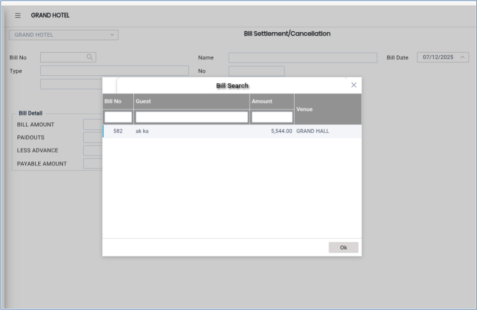
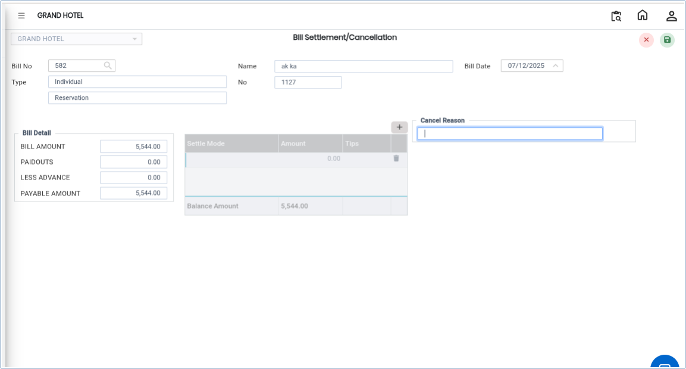

# Bill Settlement/Cancellation

The **Bill Settlement/Cancellation** option is used to either settle a guest bill after payment or cancel an existing bill when required. This process helps maintain accurate billing records and properly close guest reservations.

## Steps to Settle or Cancel a Bill

Step 1: Navigate to the **Banquet** module and select the **Cashier** menu.

1. Click on **Bill Settlement/Cancellation**.

* This will open the Bill Settlement/Cancellation window.

Step 2: Click on the **Bill No Search** option.

1. Select the required bill number from the list.
2. Click **OK** to confirm the selection.

* This step retrieves the bill details for settlement or cancellation.

<figure><figcaption></figcaption></figure>

Step 3: Verify the bill details displayed on the screen.

1. Click **OK** to proceed with bill settlement.
2. The system will close the reservation after successful settlement, as shown on the screen.

* This confirms that the guest payment process has been completed successfully.

If the bill needs to be cancelled, follow the steps below:

Step 4: Click on the **Cancel** button.

1. Enter the **Cancel Reason** in the provided field.
2. Confirm the cancellation process.

The bill will be cancelled successfully, and the reason for cancellation will be recorded for future reference.

<figure><figcaption></figcaption></figure>
