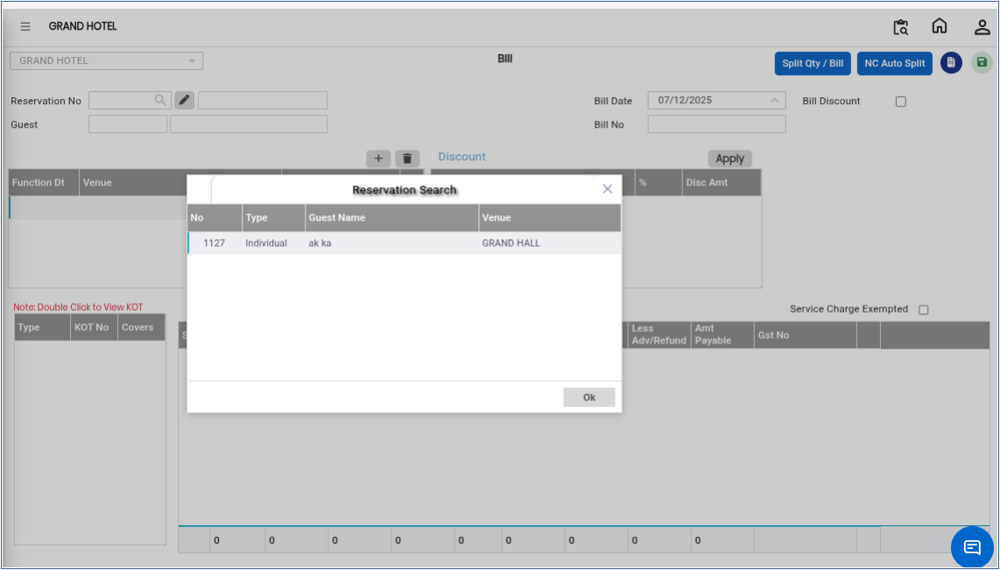
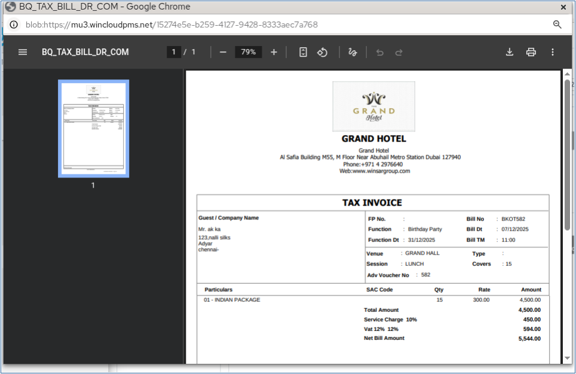

# Bill

A **Bill** is a document generated for a guest or customer that contains the details of the services used, charges applied, taxes, and the total amount to be paid. It helps the cashier maintain accurate payment records and complete the guest checkout process smoothly.

## Steps to Create a Bill

Step 1: Navigate to the **Banquet** module and select the **Cashier** menu.

1. Click on **Bill**.

* This will open the Bill creation screen.

Step 2: Click on the **Reservation No Search** option.

1. Select the required reservation number from the list.
2. Click **OK** to confirm the reservation selection.

* This step links the bill to the correct guest reservation.

<figure><figcaption></figcaption></figure>

Step 3: After selecting the reservation number, verify the guest details displayed on the screen.

1. Ensure that all charges and booking information are correct before proceeding.

* This helps avoid billing errors.

Step 4: Click the **Save** button.

1. The system will generate and create the bill successfully.

* Once saved, the bill will be available for payment processing and printing.

<figure><figcaption></figcaption></figure>
