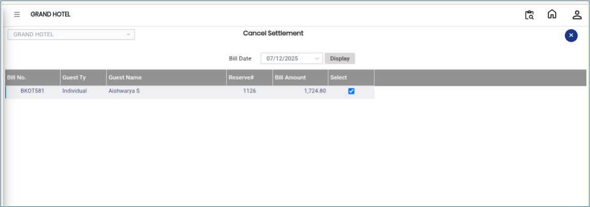

# Cancel Bill Settlement

The **Cancel Bill Settlement** feature is used to reverse or cancel an already completed bill settlement. This option is helpful when a settlement has been made incorrectly or when payment details need to be corrected.

## Steps to Cancel Bill Settlement

Step 1: Navigate to the **Banquet** module and select the **Cashier** menu.

1. Click on **Cancel Bill Settlement**.

* This will open the Cancel Bill Settlement window.

<figure><figcaption></figcaption></figure>

Step 2: Click on the **Display** button.

1. The system will display the list of settled bills.
2. Select the required settlement record that needs to be cancelled.

* Ensure the correct bill settlement is selected before proceeding.

<figure><figcaption></figcaption></figure>

Step 3: Click on the **Cancel** button located at the right-side corner of the screen.

1. Confirm the cancellation process if prompted by the system.

* The selected bill settlement will be cancelled successfully.
