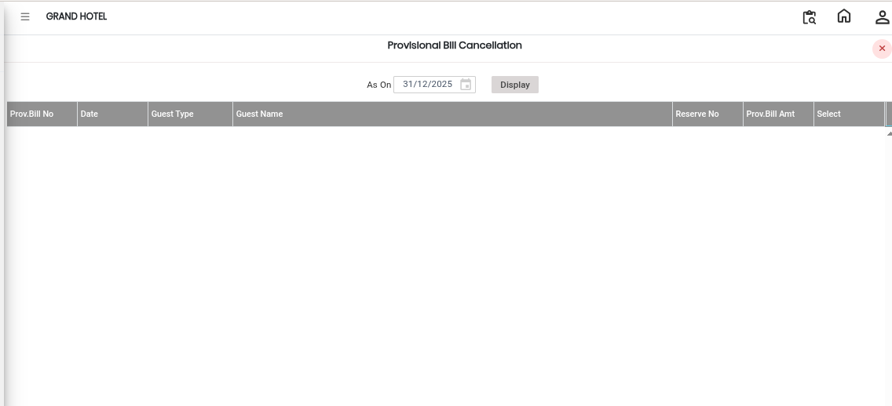

# Provisional Bill Cancellation

**Provisional Bill Cancellation** is used to cancel a provisional bill that was generated for a guest or reservation. A provisional bill is usually a temporary or interim bill created before the final billing process. If the bill was created incorrectly or is no longer required, it can be cancelled using this option.

## Steps to Cancel a Provisional Bill

Step 1: Navigate to the **Banquet** module and select the **Cashier** menu.

1. From the available options, select **Provisional Bill Cancellation**.

* The Provisional Bill Cancellation screen will appear.

<figure><figcaption></figcaption></figure>

Step 2: Choose the provisional bill that needs to be cancelled.

* Identify the correct bill using the bill number, guest name, reservation number, or other available details.
* Click on the **Select** button to confirm the chosen provisional bill.

Make sure the correct bill is selected before proceeding with the cancellation.

Step 3: After selecting the provisional bill, click on the **Cancel** button.

* The selected provisional bill will be cancelled successfully.
