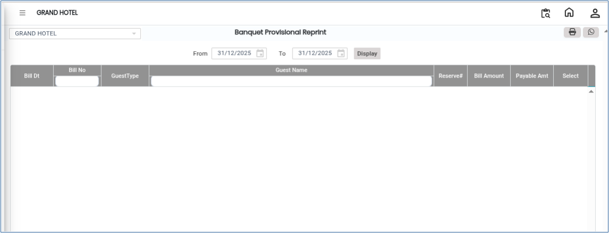

# Provisional Bill Reprint

**Provisional Bill Reprint** is used to print a copy of an already generated provisional bill. This feature is helpful when the original print is lost, damaged, or when an additional copy is required for reference or customer purposes.

## Steps to Reprint a Provisional Bill

Step 1: Navigate to the **Banquet** module and select the **Cashier** menu.

1. From the available options, select **Provisional Bill Reprint**.

* The Provisional Bill Reprint screen will appear.

<figure><figcaption></figcaption></figure>

Step 2: Choose the provisional bill that needs to be reprinted.

1. Identify the correct bill using the bill number, reservation number, guest name, or other available details.
2. Click on the **Select** button to confirm the selected provisional bill.
3. After selecting the bill enter the **Reason** for reprinting the provisional bill.

* Ensure the entered reason is accurate and meaningful for future reference.

<figure><figcaption></figcaption></figure>

Step 3: Click on the **Print** button.

* The system will generate the provisional bill print preview or directly send it to the printer.
* You will be able to view and print the provisional bill successfully.
