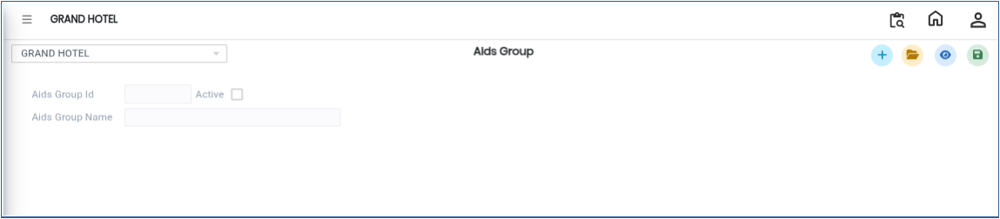
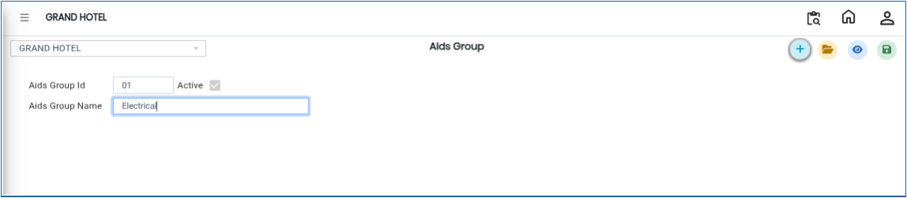

# Aids Group

The **Aids Group** option in the Masters module is used to create and manage different Aid Groups. This screen allows users to maintain Aid Group IDs and Aid Group Names for proper classification and management.

## Steps to Create a Aids Group

Step 1: Login to the application and navigate to the **Banquet Module**.

1. Click on **Masters**.
2. Select **Aids Group**.

* After selecting the Aids Group option, the **Aids Group Details** screen will be displayed.

<figure><figcaption></figcaption></figure>

Step 2: Click on the **Open** button.

1. The screen displays the list of existing Aids Groups.
2. Users can review previously created Aids Group records and their details.

Step 3: Click on the **New** button.

1. Enter the required details in the respective fields:
   * **Aids Group ID** – Enter a unique ID for the Aids Group.
   * **Aids Group Name** – Enter the name of the Aids Group.
2. Ensure that all entered details are accurate before saving.

<figure><figcaption></figcaption></figure>

Step 4: After entering all the required information, click on the **Save** button.

1. The Aids Group details will be saved successfully.

<figure><figcaption></figcaption></figure>
