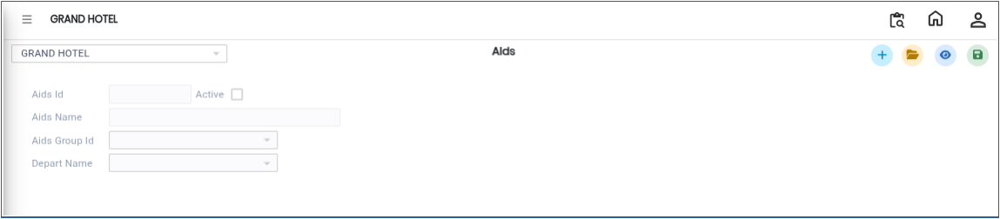
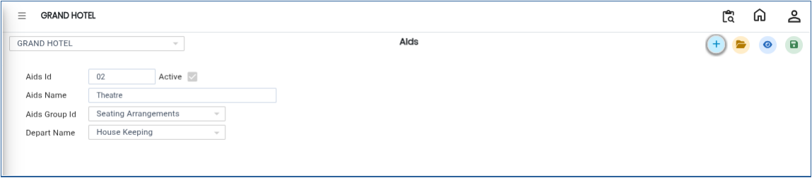

# Aids

The **Aids** master in the Banquet Module is used to create and manage Aids details. This section allows users to add new Aids records by entering important information such as Aids ID, Aids Name, Aids Group, and Department Name.

## Steps to Create a Aids Master

Step 1: Login to the application and navigate to the **Banquet Module**.

1. Click on **Masters**.
2. Select **Aids** from the Masters menu.

* After selecting the Aids option, the **Aids Details** screen will be displayed.

<figure><figcaption></figcaption></figure>

Step 2: Click on the **Open** button

1. The screen displays the list of already created Aids.
2. You can review the existing records and their details.

Step 3: Click on the **New** button.

1. Enter the required details in the respective fields:
   * **Aids ID** – Enter the unique ID for the Aid.
   * **Aids Name** – Enter the name of the Aid.
   * **Aids Group List** – Select the appropriate Aid Group from the list.
   * **Department Name** – Select the related department name.
2. Verify that all the entered details are correct.

<figure><figcaption></figcaption></figure>

Step 4: After entering all the required information, click on the **Save** button.

1. The Aid details will be saved successfully.

<figure><figcaption></figcaption></figure>
