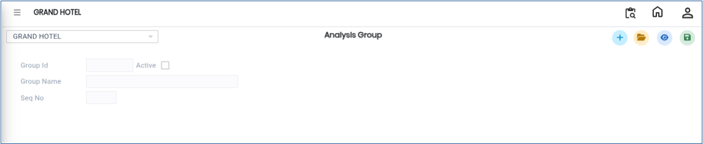
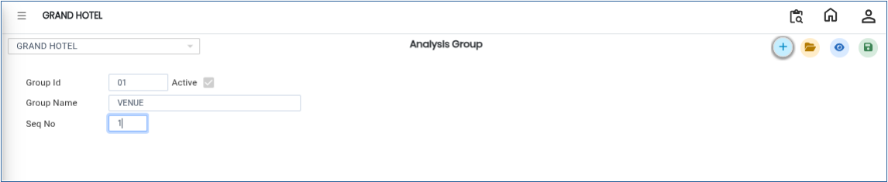

# Analysis Group

The **Analysis Group** option in the **Banquet Module** is used to create and manage different analysis groups within the system. This screen helps users organise analysis categories by maintaining Group IDs, Group Names, and Sequence Numbers.

## Steps to Create a Analysis Group&#x20;

Step 1: Login to the application and navigate to the **Banquet Module**.

1. Click on **Masters**.
2. Select **Analysis Group**.

* After selecting the Analysis Group option, the **Analysis Group Details** screen will be displayed.

<figure><figcaption></figcaption></figure>

Step 2: Click on the **Open** button.

1. The screen displays the list of existing Analysis Groups.
2. Users can review previously created Analysis Group records and their details.

Step 3: Click on the **New** button.

1. Enter the required details in the respective fields:
   * **Group ID** – Enter a unique ID for the Analysis Group.
   * **Group Name** – Enter the name of the Analysis Group.
   * **Seq No** – Enter the sequence number for the group.
2. Verify that all entered details are correct before saving.

<figure><figcaption></figcaption></figure>

Step 4: After entering all the required information, click on the **Save** button.

1. The Analysis Group details will be saved successfully.

<figure><figcaption></figcaption></figure>
