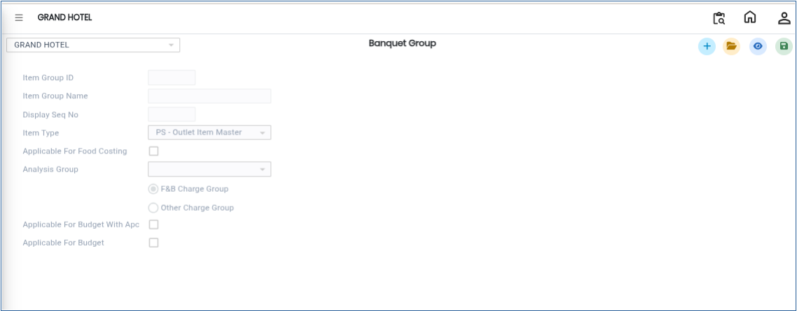
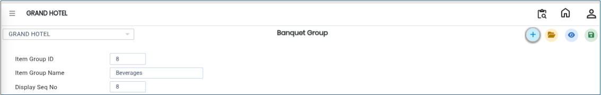
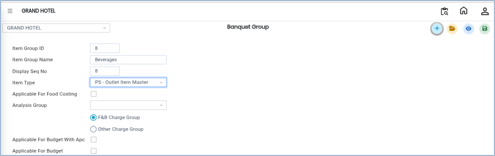

# Banquet Group

The **Banquet Group** master is used to create and manage item groups. Grouping banquet items helps organise items based on type and analysis category, making reporting and operational management easier.

## **Steps to Create a Banquet Group**

Step 1: Log in to the system and navigate to the **Banquet Module**.

1. Click on the **Masters** menu.
2. Select **Banquet Group** from the available options.

Step 2: After selecting **Banquet Group**, the system will open the Banquet Group master screen.

<figure><figcaption></figcaption></figure>

Step 3: Click on the **New** button.

1. A new entry screen will appear.
2. Enter the required details such as:
   * **Item Group ID**
   * **Group Name**

Ensure that the entered details are accurate before proceeding.

<figure><figcaption></figcaption></figure>

Step 4: Click on the **Item Type** option.

1. Select the appropriate item type for the banquet group.

* The item type helps classify banquet items based on operational requirements.

Step 5: Choose the required **Analysis Group** from the available options.

* The analysis group is used for reporting and business analysis purposes.

<figure><figcaption></figcaption></figure>

Step 6: After entering all required details and selections, click on the **Save** button.

* The system will save the Banquet Group successfully.

<figure><figcaption></figcaption></figure>
