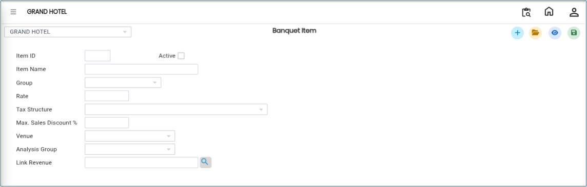

# Banquet Item

The **Banquet Item** master is used to create and manage banquet items used in banquet operations and billing. This setup allows users to define item details, assign tax structures, map venues, link revenue accounts, and configure analysis groups for reporting purposes.

## **Steps to Create a Banquet Item**

Step 1: Log in to the system and navigate to the **Banquet Module**.

1. Click on the **Masters** menu.
2. Select **Banquet Item** from the available options.

Step 2: After selecting **Banquet Item**, the system will open the Banquet Item master screen.

<figure><figcaption></figcaption></figure>

Step 3: Click on the **New** button.

1. A new entry screen will appear.
2. Enter the required item details such as:
   * **Item ID**
   * **Item Name**
3. Ensure that the entered information is accurate before proceeding.

<figure><figcaption></figcaption></figure>

Step 4: Click on the **Group** button.

1. Select the appropriate group for the banquet item.

* The group helps categorise banquet items for operational and reporting purposes.

<figure><figcaption></figcaption></figure>

Step 5: Click on the **Tax Structure** option.

1. Select the required tax structure applicable to the banquet item.

* This configuration ensures correct tax calculation during billing.

<figure><figcaption></figcaption></figure>

Step 6: Click on the **Venue** option.

1. Select the venue(s) where the banquet item will be available.

* This helps map items to specific banquet locations or halls.

<figure><figcaption></figcaption></figure>

Step 7: Click on the **Analysis Group** option.

1. Choose the required analysis group from the list.

* The analysis group is used for reporting, tracking, and business analysis purposes.

<figure><figcaption></figcaption></figure>

Step 8: Click on the **Link Revenue** option.

1. Search and select the appropriate revenue account for the banquet item.

* This mapping helps maintain accurate financial and accounting records.

<figure><figcaption></figcaption></figure>

Step 9: After entering all required details and configurations, click on the **Save** button.

* The system will save the newly created banquet item successfully.

<figure><figcaption></figcaption></figure>
