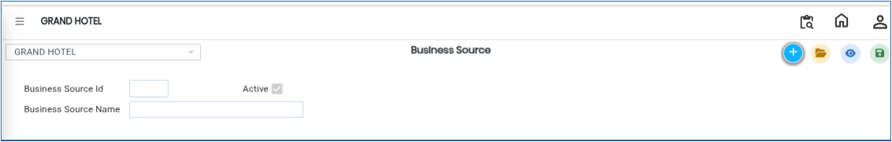
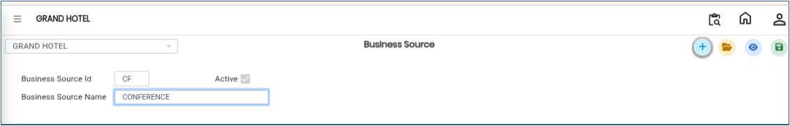

# Business Source

The **Business Source** master is used to define and manage the sources through which banquet business is generated. These sources help track how bookings are received, such as direct walk-ins, travel agents, corporate clients, or other business channels. This information is useful for reporting, analysis, and business performance tracking.

## **Steps to Create a Business Source**

Step 1: Log in to the system and navigate to the **Banquet Module**.

1. Click on the **Masters** menu.
2. Select **Business Source** from the available options.

Step 2: After selecting **Business Source**, the system will open the Business Source master screen.

<figure><figcaption></figcaption></figure>

Step 3: Click on the **New** button.

1. A new entry form will appear on the screen.
2. Enter the required details **Business Source ID** and **Business Source Name.**

* Ensure that the entered information is accurate and properly defined for reporting purposes.

<figure><figcaption></figcaption></figure>

Step 4: After entering the required details, click on the **Save** button.

* The system will save the Business Source successfully.

<figure><figcaption></figcaption></figure>
